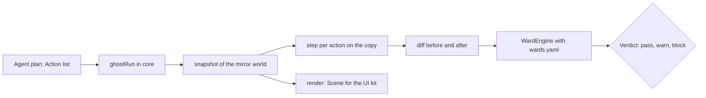

# Design Document: <world-name>

> **Template notice.** This file is a fill-in skeleton from `.kiro/specs/_new-world/`. Replace every `<placeholder>`, every `Fill in:` line, and every `TBD`. Delete this block when done. Sections marked "fixed" are repository rules and must not change.

## Overview

Fill in: what `<world-name>` mirrors, the state model in one paragraph, and the one design decision that matters most (for example "files are kept as a map from path to bytes" or "buckets are kept as a map from name to object list").

The world lives in `worlds/<world-name>/`. It depends on `core/` and the runtime libraries of Requirement 4 only.

## Architecture



Fill in: the real system on the left of `snapshot` (what `create()` reads or builds), and where the Docker box is used (in real mode only; the playground world is in memory).

## Components and Interfaces

### File layout (fixed)

```
worlds/<world-name>/
  world.config.ts          registration (Component 3)
  wards.yaml               wards of this world (Component 5)
  README.md                claims and non-claims (Component 7)
  src/
    types.ts               <State>, <Action>, <ChangeKind>
    world.ts               the six functions and create()
    actions.ts             actionArb for tests, plan examples for the demo
  tests/
    contract.test.ts       verifyWorld call (Component 4)
    <extra>.test.ts        Fill in: world-specific unit and property tests
```

### Component 1: State and actions

```ts
// Fill in: replace the shapes below.
export interface <State> { /* plain serializable data, no handle to reality */ }
export type <Action> =
  | { kind: '<action-kind-1>'; /* fields */ }
  | { kind: '<action-kind-2>'; /* fields */ };
```

### Component 2: The six functions (fixed signatures)

```ts
interface World<S, A> {
  snapshot(): Promise<Snapshot<S>>;                        // deep copy; reality unchanged
  step(s: Snapshot<S>, a: A): Promise<Snapshot<S>>;        // apply one action to the copy
  diff(before: Snapshot<S>, after: Snapshot<S>): Change[]; // minimal change set
  render(s: Snapshot<S>): Scene;                           // pure
  fingerprint(): Promise<string>;                          // hash of real state (P1 check)
  effectsOutside(a: A): Effect[];                          // out-of-copy effects (warn)
}
```

| Function | Contract (fixed) | How this world meets it (fill in) |
|---|---|---|
| `snapshot()` | Returns a deep copy of the current state. Must not modify reality. | TBD |
| `step(s, a)` | Applies one action to a snapshot. Must not modify reality or the input snapshot. | TBD |
| `diff(before, after)` | Returns the minimal set of `Change` objects between two snapshots. | TBD |
| `render(s)` | Returns a `Scene` for the UI kit. Pure, no side effects. | TBD |
| `fingerprint()` | Returns a hash of real-world state. Used to verify P1. | TBD |
| `effectsOutside(a)` | Returns `Effect[]` for every action that reaches outside the copy. | TBD |

Fill in: the change kinds (`<ChangeKind>`) with their fields, and which ward kind reads each one.

| Change kind | Fields | Read by ward kind |
|---|---|---|
| `<ChangeKind>` | TBD | TBD |

### Component 3: Registration (`world.config.ts`, fixed shape)

```ts
import { create<WorldName>World } from './src/world.js';

export default {
  id: '<world-name>',
  deterministic: false, // true only after the world is shown to be deterministic (P2)
  wardsFile: './wards.yaml', // a path string only; never imported
  create: create<WorldName>World,
} as const;
```

The `world-scaffold` hook writes a first version of this file with a `create` that throws a placeholder error. Replace it with the real factory.

### Component 4: Registration gate (`tests/contract.test.ts`)

`verifyWorld` of `@ghost-run/core/verify` runs the properties and throws a `VerificationError` with the property id, the criterion id, and a counterexample.

```ts
await verifyWorld(world, {
  id: config.id,
  deterministic: config.deterministic,
  wardSet: parsed.wardSet,        // from parseWards(wards.yaml)
  actionArb,                      // generates valid actions of every kind
  numRuns: NUM_RUNS,              // 100 in a Short_Run, 10000 when GHOST_PBT_MODE=nightly
  // testAdapter: required when deterministic is true (P2)
  // stateEquals: only when the state holds per-step noise (copy paths, timestamps)
});
```

| Property | Required for registration | Note |
|---|---|---|
| P1 | Always | Fingerprint before equals fingerprint after, for any action list |
| P3 | Always | Restore returns the exact pre-snapshot state |
| P2 | Only if `deterministic: true` | Needs a `testAdapter` that applies the actions for real in a test copy |
| P4, P5, P6 | For the ward kinds in `wards.yaml` | Same engine as every other world |

### Component 5: Wards and default wards file

Fill in: the wards of this world. Each ward has an `id`, a `kind` (`path`, `sql`, `egress`, `physics`), and kind-specific rules.

```yaml
# worlds/<world-name>/wards.yaml
wards:
  - id: <ward-id-1>
    kind: TBD
    # Fill in: kind-specific rules
  - id: <ward-id-2>
    kind: TBD
```

| Ward id | Kind | Violated when | Message must show |
|---|---|---|---|
| `<ward-id-1>` | TBD | TBD | the ward id and the numbers |
| `<ward-id-2>` | TBD | TBD | the ward id and the numbers |

### Component 6: Hooks that act on this world (fixed behavior)

| Hook | Trigger | Effect on this world |
|---|---|---|
| `world-scaffold` | Agent creates a file under `worlds/<world-name>/` | Creates `world.config.ts`, `tests/contract.test.ts`, `wards.yaml`, and `README.md` when missing. Existing files stay unchanged. Fires only for files that the agent created. |
| `contract-pbt` | Agent saves a file under `core/` or `worlds/` | Runs the world suite in a Short_Run (100 examples; 20 for a Docker-bound property). Hook limit 60 s, internal stop at 55 s. Writes `.ghost-run/pbt/last.json`. |
| `blacklight-steering` | Agent saves a file under `.kiro/` | Scans this spec for hidden Unicode. |

Fill in: the measured time of the world suite and the example count that fits in 55 s (record it in `docs/measurements.md`).

### Component 7: Claims table (fixed rule: assert a property only inside its scope)

| Property | Claimed for this world | Where | Not claimed |
|---|---|---|---|
| P1 | TBD | Playground; real mode with the Docker box | Docker unavailable (Plan B fallback) |
| P2 | TBD (claim only if `deterministic: true`) | The tested environments only | Worlds where time, process ids, or network responses vary |
| P3 | TBD | All worlds | n/a |
| P4 | TBD | Wards engine | n/a |
| P5 | TBD | Where P1 holds | Where P1 does not hold |
| P6 | TBD | Playground; real mode with the Docker box | Plan B; compression, encryption, and DNS exfiltration under content inspection |
| P7 | TBD | Everywhere (pure function) | n/a |
| P8 | not applicable | Ghost Hand only | n/a |

If the execution environment changes, the UI and the README lower the claim explicitly.

### Component 8: Hygiene rules (fixed)

- No literal hidden Unicode character and no literal HTML comment opener in any file. Tests build them with `\u` escapes or `String.fromCodePoint`.
- Secrets in fixtures are canary values only (for example `sk-CANARY-abc123`).
- Hosts in fixtures are reserved domains only (`.example`, `.test`, `.localhost`, `.invalid`) or `192.0.2.0/24`.
- No real user name, home path, or e-mail address. All text is English.

## Data Models

Fill in: the `<State>` fields with types and limits (largest number of entries, largest name length), the `Scene` entity kinds, and the `Effect` kinds.

| Model | Fields | Limits |
|---|---|---|
| `<State>` | TBD | TBD |
| `Scene` entity | TBD | TBD |
| `Effect` | TBD | TBD |

## Correctness Properties

Each property below is tested with `fast-check` at 100 examples in a Short_Run and 10,000 in a Nightly_Run. The numbers P1 to P8 are the safety-contract properties. World-specific properties use the prefix `W-P`.

### Property 1: Ghost run never changes reality (P1)

For any action list generated by `actionArb`, `fingerprint()` before a ghost run equals `fingerprint()` after it.

**Validates: Requirements 2.6, 3.2**

### Property 2: Snapshot restore (P3)

For any state and any action list, restoring a snapshot returns the world to exactly its pre-snapshot state, and `step` leaves its input snapshot unchanged.

**Validates: Requirements 2.2, 2.3, 3.2**

### Property 3: Same diff when executed for real (P2, only if deterministic)

Fill in or delete. For any plan that passes, the diff of the ghost run equals the diff of the real execution through the `testAdapter`.

**Validates: Requirements 3.3**

### Property 4: Out-of-copy effects (W-P1)

For any action, `effectsOutside(a)` is non-empty exactly when the action leaves the copy. Fill in: the list of such actions.

**Validates: Requirements 2.7**

### Property 5: Diff completeness (W-P2)

For any two snapshots reached by an action list, applying the changes of `diff` to the first gives the second. Fill in: the exact statement for this world.

**Validates: Requirements 2.4**

### Property 6: Ward properties (P4, P5, P6 where they apply)

Fill in: one statement per ward of Requirement 5, for example "any plan that deletes a protected item produces `block`".

**Validates: Requirements 3.6, 5.2, 5.3**

### Property 7: Render purity (W-P3)

For any snapshot, `render(s)` called twice returns equal scenes, and the snapshot is unchanged.

**Validates: Requirements 2.5**

## Error Handling

| Situation | Behavior |
|---|---|
| Invalid action | `step` returns the snapshot unchanged and records an error. It does not throw. |
| `create()` cannot build the world | Throws an error that names the missing part. `verifyWorld` reports it. |
| `wards.yaml` does not parse | The registration test fails with the `Config_Error` text. |
| Docker unavailable | Real mode falls back to Plan B. P1, P5, and P6 are not claimed. The UI says so. |
| Save-time run exceeds 55 s | `contract-pbt` stops and reports `unfinished`. Lower `numRuns` with a written reason. |

## Testing Strategy

- **Property tests** (`fast-check`, `vitest`): Properties 1 to 7 above. Print the seed on failure.
- **Example tests**: one test per demo plan (pass, warn, block) and one per ward message.
- **Registration test**: `tests/contract.test.ts` through `verifyWorld`.
- **Scan tests**: the possession scan of `worlds/<world-name>/` and this spec returns `clean`.
- Tests labeled `[docker]` use `describe.skipIf(!dockerAvailable)` and report `skipped (docker unavailable)`, never `passed`.

Verification commands: `corepack pnpm --filter @ghost-run/<world-name> test`, `typecheck`, `lint`, and the root `vitest.worlds.config.ts` run for the contract test.

## Requirement Traceability

| Requirement | Design section |
|---|---|
| 1 State and actions | Component 1, Data Models |
| 2 Six functions | Component 2, Properties 2, 4, 5, 7 |
| 3 Registration gate | Component 4, Properties 1, 2, 3 |
| 4 Registration file | Component 3 |
| 5 Wards | Component 5, Property 6 |
| 6 Save-time run | Component 6 |
| 7 Scene and demo | Component 2 (`render`), Testing Strategy |
| 8 Claim scope | Component 7 |
| 9 Scaffold files | Component 6 |
| 10 Hygiene | Component 8 |
| 11 Dependencies | Architecture, README table |

## Open Items

| # | Item | Resolved by |
|---|---|---|
| O1 | Is the world deterministic (P2)? | TBD: the determinism check in the world tests |
| O2 | Example count that fits the 55 s save-time budget | TBD: measurement in `docs/measurements.md` |
| O3 | Fill in: any other unknown | TBD |
