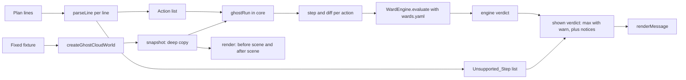

# Design Document: ghost-cloud

## Overview

`ghost-cloud` mirrors an S3-compatible object store in memory. An agent plan is a list of AWS CLI lines. The world parses each line into an `Action`, applies it to a copy of the store, and reports the changes as `FileChange` objects on virtual paths. Two path wards judge the changes: `no-bucket-delete` and `no-public-bucket`.

The decision that matters most is the virtual path model. A bucket and its objects live under `BUCKET/...`. The two bucket attributes (ACL and public access block) live outside that tree, at `_acl/BUCKET` and `_public-access-block/BUCKET`. A bucket name cannot contain `_`, so these prefixes can never collide with a bucket. With this layout the ward patterns `prod-*` (bucket and objects) and `_acl/prod-*`, `_public-access-block/prod-*` (attributes) do not overlap, and each demo plan violates exactly one ward or none.

The second decision is that `diff` treats attributes as properties of a bucket that exists in both snapshots. When a bucket appears or disappears, `diff` emits changes for the bucket path and its object paths only.

The world lives in `worlds/ghost-cloud/` as the package `@ghost-run/ghost-cloud`. It depends on `@ghost-run/core` only. It has no runtime library of its own, so it adds no dependency and no license row.

## Architecture



`Reality` is a plain state object held in the closure of the world, as the in-memory file system is in `worlds/playground-shell`. `snapshot()` deep-copies it. `step` works on a copy of the snapshot state and never touches Reality. No Docker, network, or AWS service is involved.

## Components and Interfaces

### File layout

```
worlds/ghost-cloud/
  package.json             @ghost-run/ghost-cloud (Component 1)
  tsconfig.json
  eslint.config.mjs
  vitest.config.ts
  world.config.ts          registration (Component 8)
  wards.yaml               the two wards (Component 6)
  README.md                six functions, wards, limits, claims (Component 12)
  demo/
    01-delete-protected-bucket.txt
    02-make-bucket-public.txt
    03-delete-temporary-bucket.txt
    04-non-copy-endpoint.txt
  src/
    index.ts               public entry (browser-safe)
    types.ts               State, Action, constants
    fixture.ts             fixed initial state
    parse.ts               parseLine
    apply.ts               applyAction (pure)
    diff.ts                diffStates (pure)
    scene.ts               renderScene (pure)
    fingerprint.ts         fingerprintState (Web Crypto)
    effects.ts             effectsOutsideAction
    world.ts               createGhostCloudWorld
    demo.ts                DEMO_PLANS constants
    pipeline/
      run-plan.ts          Pipeline_Entry
      verdict.ts           buildShownVerdict (own code)
      texts.ts             fixed reason texts
  tests/
    pbt-config.ts
    contract.test.ts       verifyWorld (Component 9)
    support/
      arbitraries.ts       actionArb, line arbitraries
      reference-model.ts   Reference_Model and testAdapter
      format-action.ts     formatAction (test-only inverse of the parser)
    prop-*.test.ts, demo.test.ts, scan-*.test.ts
```

### Component 1: Package setup

The package is laid out like `worlds/playground-shell`.

| File | Content |
|---|---|
| `package.json` | `name` `@ghost-run/ghost-cloud`, `private`, `type` `module`, `main` and `types` `src/index.ts`, `sideEffects` false, `engines.node` `>=20`, license MIT. Scripts: `test` (`vitest run`), `test:nightly` (`GHOST_PBT_MODE=nightly vitest run`), `typecheck` (`tsc --noEmit`), `lint` (`eslint .`). |
| dependencies | `@ghost-run/core` `workspace:*` only. |
| devDependencies | `@ghost-run/wards-config` `workspace:*`, `@types/node` `^20.19.0`, `eslint` `^10.15.0`, `fast-check` `^4.10.2`, `typescript` `^5.9.0`, `typescript-eslint` `^8.73.0`, `vitest` `^3.2.7`. These are the versions of `worlds/playground-shell`. `typescript-eslint` is needed by `eslint.config.mjs` and is not in the owner's list; see decision D9. `sql.js` and `jsdom` are not used. |
| `tsconfig.json` | Same as `playground-shell`: ES2022, Bundler resolution, `strict`, `noEmit`, `verbatimModuleSyntax`, `types: ["node"]`, `paths` for `@ghost-run/core` and `@ghost-run/core/verify`; include `src`, `tests`, `vitest.config.ts`, `world.config.ts`. |
| `vitest.config.ts` | Same aliases as `playground-shell` for `@ghost-run/core` and `@ghost-run/core/verify`; `environment: node`; `include: ['tests/**/*.test.ts']`. No `setupFiles` and no `globals`: tests import `describe`, `it`, and `expect` from `vitest`, so a test runs under this config and under the root `vitest.worlds.config.ts` (which sets `globals: true`). Node 20 has `globalThis.crypto.subtle`, so no polyfill is needed. |
| `eslint.config.mjs` | The configuration of `playground-shell` with the message text renamed: the same `bannedPatterns` (wards-config in `src` only, `ui`, `ghost-runner`, `apps`, `integrations` and the `@ghost-run/kiro-hook` and `@ghost-run/mcp` packages, `react`, `three`, `@mujoco/mujoco`, `@ghost-run/core/*` except `verify`), the same `bannedSyntax` and `bannedProperties` for `src` (`eval`, `Function`, `new Date`, `Date.now`, `Math.random`), and the test override that allows the `@ghost-run/wards-config` package name but not relative wards-config paths. One addition for `src/**/*.ts`: a ban on `node:*` and on bare Node built-in names (as `wards-config/eslint.config.mjs` and `core/eslint.config.mjs` do), because `src` is the browser entry. Tests may import `node:` modules. |

`pnpm-workspace.yaml` already lists `worlds/*`. Creating the package changes the importer list of `pnpm-lock.yaml`; see open question Q1.

### Component 2: State and actions (`src/types.ts`)

State is plain data. It uses sorted arrays and no `Map` and no object keyed by user text. A `Map` would compare equal in `verifyWorld` (its deep comparison reads `Object.keys`), which would make P3 pass vacuously. An object keyed by object key would break on a key such as `__proto__`.

```ts
export type Acl = 'private' | 'public-read';

export interface StoredObject { readonly key: string; readonly content: string }

export interface BucketState {
  readonly name: string;
  readonly acl: Acl;
  readonly publicAccessBlocked: boolean;
  readonly objects: readonly StoredObject[];   // sorted by key, code-point order
}

export interface LocalFile { readonly path: string; readonly content: string }

export interface CloudState {
  readonly buckets: readonly BucketState[];    // sorted by name
  readonly localFiles: readonly LocalFile[];   // read-only, sorted by path
}

interface WithEndpoint { readonly endpointUrl?: string }   // omitted, never undefined

export type Action =
  | ({ kind: 'ls'; bucket?: string; prefix?: string } & WithEndpoint)
  | ({ kind: 'mb'; bucket: string } & WithEndpoint)
  | ({ kind: 'rb'; bucket: string; force: boolean } & WithEndpoint)
  | ({ kind: 'cp'; bucket: string; key: string; source?: string; fromBucket?: string; fromKey?: string } & WithEndpoint)
  | ({ kind: 'rm'; bucket: string; key: string; recursive: boolean } & WithEndpoint)
  | ({ kind: 'put-bucket-acl'; bucket: string; acl: Acl } & WithEndpoint)
  | ({ kind: 'put-public-access-block'; bucket: string; blocked: boolean } & WithEndpoint)
  | ({ kind: 'delete-public-access-block'; bucket: string } & WithEndpoint)
  | { kind: 'unsupported'; line: string; reason: string };
```

Rules of the types:

- `cp` has exactly one source: `source` (a virtual local file) or the pair `fromBucket`, `fromKey`.
- For `rm`, `key` is the prefix when `recursive` is true (it may be empty), and the object key otherwise.
- `unsupported.line` is the sanitized line (`sanitizeJudgeText`, 1,024 code points) and `reason` is one of the fixed texts of `parse.ts`.
- The state holds no timestamp, ETag, request id, or random value. Snapshot ids come from a counter inside one world instance, outside the state.

Fixed fixture (`src/fixture.ts`), identical on every call:

| Bucket | Objects | ACL | Public access block |
|---|---|---|---|
| `prod-assets` | `css/site.css`, `img/logo.txt`, `index.html` | `private` | blocked |
| `prod-logs` | `2026/01/app.log`, `2026/02/app.log` | `private` | blocked |
| `tmp-build-cache` | `cache/a.txt`, `cache/b.txt` | `private` | blocked |

Local files: `local/notes.txt`, `local/report.txt`, `local/data.csv`. All content is plain filler text with no secret, host, or user name.

### Component 3: Parser (`src/parse.ts`)

`parseLine(line: string): Action` is total. It never throws and returns `unsupported` with a fixed reason for every failure. Reasons are fixed strings and never echo the input.

Checks, in this order:

1. The line is longer than 1,024 code units: `line is too long`.
2. The line holds a character outside printable ASCII (U+0020 to U+007E). This covers tab, newline, hidden Unicode, and every non-ASCII character: `line has a character outside printable ASCII`.
3. The line holds a shell operator (`;`, `|`, `&`, a backtick, `$(`, `<`, `>`): `shell operator`.
4. The line, split on runs of spaces, is empty: `empty line`.
5. The tokens start with `aws s3` or `aws s3api`, then a command from the table of Requirement 1. Any other form: `unsupported command`.
6. Each command accepts only its own options. An unknown option, a duplicate option, or a missing argument: `malformed command`.
7. Closed character sets: a bucket name is 3 to 63 characters of `a-z`, `0-9`, `.`, `-`; a key or prefix uses `A-Za-z0-9._/-` only; a local file path uses the same set and has no leading `/` and no `..` segment; an endpoint URL uses `A-Za-z0-9:/._-` and starts with `http://` or `https://`. Anything else: `malformed argument`.

Notes on the table of Requirement 1:

- `--endpoint-url URL`, `--force`, and `--recursive` may appear in any position after the command. Each may appear once, and only on the commands that take it (`--endpoint-url` on all; `--force` on `rb`; `--recursive` on `rm`).
- `cp` with a destination that is not `s3://BUCKET/KEY` (a local destination, or no key) is `unsupported command`.
- `put-public-access-block` needs all four flags, each `true` or `false`, in any order. `blocked` is true only when all four are `true`.
- A blank line is an Unsupported_Step, not skipped. The demo loader drops one trailing empty row of a plan file and nothing else.
- Quote characters, `\`, `*`, `?`, `~`, and `!` are outside every closed set, so a line that a real shell would expand or unquote is `unsupported`, never run with a different meaning.

### Component 4: World functions

`createGhostCloudWorld(options?: { reality?: CloudState }): World<CloudState, Action>`. Without `options`, Reality starts from the fixture. The `reality` option exists so that a test can supply a store it can inspect (Property 17).

| Function | How this world meets the contract |
|---|---|
| `snapshot()` | Returns `{ id, state: structuredClone(reality), result: { success: true } }`. The id is `gc-` plus a counter of this instance. Reality is not modified. |
| `step(s, a)` | Calls the pure `applyAction(structuredClone(s.state), a)`. On success returns a new snapshot with the new state and `{ success: true }`. On an invalid action or an `unsupported` action returns a new snapshot with a copy of the same state and `{ success: false, error }`. Never reads or writes Reality and never mutates `s`. Never throws. |
| `diff(before, after)` | `diffStates(before.state, after.state)`: the minimal `FileChange` list of Requirement 2, criterion 4. Pure. |
| `render(s)` | `renderScene(s.state)`: the Scene of Component 5. Pure. |
| `fingerprint()` | `fingerprintState(reality)`. SHA-256 through `globalThis.crypto.subtle`. The manifest maps each virtual path (bucket, object, and both Attribute_Paths, plus `_local/PATH` for each local file) to the SHA-256 hex of its content. `hash` is the SHA-256 hex of the JSON text of the manifest entries sorted by path. |
| `effectsOutside(a)` | `effectsOutsideAction(a)`: for an action with `endpointUrl`, one `{ kind: 'network', destination: host }`. The host is read with the pattern `^https?://([A-Za-z0-9.-]+)(:[0-9]+)?(/.*)?$`; when it does not match, the destination is `sanitizeJudgeText(raw, 120)`. Every other action, including `unsupported`, gets `[]`. No I/O. |

`applyAction` rules (state before the action; "valid" means it passes the checks of Requirement 1, criterion 4):

| Action | Effect on the state |
|---|---|
| `ls` | none. Fails when `bucket` is set and does not exist. |
| `mb` | adds an empty bucket with ACL `private` and `publicAccessBlocked: true` (the S3 default for a new bucket). Fails when the bucket exists. |
| `rb` | removes the bucket and its attributes. Fails when the bucket is missing, or when it holds objects and `force` is false. With `force`, its objects go too. |
| `cp` | sets the object `bucket/key` to the content of the source (a local file, or the object `fromBucket/fromKey`). Fails when the destination bucket, the source bucket, the source object, or the local file is missing. |
| `rm` | non-recursive: removes the object when it exists; a missing object is a success with no change (S3 delete is idempotent). Recursive: removes every object whose key starts with the prefix as a string. Fails when the bucket is missing. |
| `put-bucket-acl` | sets the ACL. Fails when the bucket is missing. |
| `put-public-access-block` | sets `publicAccessBlocked` to `blocked`. Fails when the bucket is missing. |
| `delete-public-access-block` | sets `publicAccessBlocked` to false. Fails when the bucket is missing. |
| `unsupported` | fails with `unsupported step: REASON`. |

Error texts are built from fixed text and validated tokens only (bucket names and keys of the closed character sets), so they hold no hidden character.

### Component 5: Diff and scene

`diffStates` flattens each state into entries `(path, content)` for the buckets and objects, and handles Attribute_Paths in a separate pass over the buckets present in both states. This is the definition of "minimal" in Requirement 2, criterion 4:

1. Buckets only in `before`: `file-deleted` for the bucket path and each object path.
2. Buckets only in `after`: `file-created` for the bucket path and each object path.
3. Buckets in both: compare objects by key (created, deleted, overwritten when content differs), the ACL (overwritten when the value differs), and the block (created or deleted).
4. Sort by path in code-point order (`compareCodePoints` from core). Each change is exactly `{ kind, path }`.

`diffStates(s, s)` is `[]`.

Scene (`renderScene`), a plain JSON value, sorted, with no timestamp:

```ts
{
  world: 'ghost-cloud',
  buckets: [
    { name, protected, acl, publicAccessBlocked, objectCount,
      objects: [{ key, size }] }   // size = code points of the content
  ]
}
```

`protected` is true for a name that starts with `prod-` (the salt line of the UI). The scene holds no object content and has depth 4, inside the UI limit of 8. The mirror-world component of the UI kit takes `changes` per step, `realScene`, `mirrorScene`, and `stepLabels` (the plan lines).

### Component 6: Wards and the matching semantics

```yaml
# worlds/ghost-cloud/wards.yaml
wards:
  - id: no-bucket-delete
    kind: path
    deny: [delete]
    paths: ["prod-*"]
  - id: no-public-bucket
    kind: path
    deny: [delete, overwrite]
    paths: ["_acl/prod-*", "_public-access-block/prod-*"]
```

**Ward matching semantics.** I read `core/src/judge/glob.ts`, `pathset.ts`, and `normalize.ts`, and ran `compilePathSet` from the built `core/dist` on sample paths, case-insensitive as the engine does by default.

- The pattern is anchored at the root and has an implicit trailing `**`. So `prod-*` matches the path it names and everything below it.
- `*` matches any run of code points inside one segment. It has no special rule for `.`, `-`, or `_`.
- The pattern is matched segment by segment, so `prod-*` needs the first segment to start with `prod-`.
- `normalizePath` drops empty and `.` segments and resolves `..`. A path that leaves the root never matches.

Results of the run (a path is listed when it matches):

| Pattern | Matches | Does not match |
|---|---|---|
| `prod-*` | `prod-assets`, `prod-assets/a/b.txt`, `prod-assets/.acl`, `prod-a.b_c` | `_acl/prod-assets`, `_public-access-block/prod-logs`, `tmp-build-cache`, `tmp-build-cache/x`, `prod.assets` |
| `_acl/prod-*` | `_acl/prod-assets`, `_acl/prod-assets/x` | `_acl/tmp-build-cache`, `_acl`, `prod-assets` |
| `_public-access-block/prod-*` | `_public-access-block/prod-logs` | `prod-assets`, `_acl/prod-assets` |

The old pattern `prod-*/.acl` matched `prod-assets/.acl`, and `prod-*` also matched it. That overlap is why the old layout made demo plans (a) and (b) violate two wards. With the new layout the three patterns above match disjoint path sets. A bucket name has no `_`, so `_acl` and `_public-access-block` are never bucket names. The ward engine reports one violation per matching path. One ward can therefore appear several times in `violations`. The "set of violated ward ids" in Requirement 7, criterion 5 is the set of distinct `wardId` values.

Ward sufficiency is a test (Property 12), not an assumption.

### Component 7: Pipeline entry (`src/pipeline/run-plan.ts`)

```ts
export interface PlanLine {
  readonly index: number;                       // 0-based, same as stepIndex
  readonly line: string;                        // sanitizeJudgeText(line, 1024)
  readonly kind: Action['kind'];
  readonly unsupported: boolean;
  readonly result: { readonly ok: true } | { readonly ok: false; readonly error: string };
}

export interface GhostCloudRun {
  readonly report: GhostReport<Scene>;          // snapshots hold scenes, not states
  readonly engineVerdict: WardVerdict;
  readonly wardVerdict: WardVerdict;            // shown: engine plus unsupported notices, floored at warn; block when P1 failed
  readonly p1: { readonly equal: boolean; readonly before: string; readonly after: string }; // hashes only
  readonly verdict: Verdict;                    // wardVerdict.verdict
  readonly message: string;
  readonly lines: readonly PlanLine[];
  readonly scenes: { readonly before: Scene; readonly after: Scene };
  readonly unsupportedSteps: readonly number[];
  readonly truncatedLines: number;              // lines cut off beyond 50, else 0
}

export function runGhostCloudPlan(plan: readonly string[], wardSet: WardSet): Promise<GhostCloudRun>;
```

Flow:

1. Cut the plan at 50 lines. `truncatedLines` is the number cut. Each kept line goes through `parseLine`.
2. Create a fresh world from the fixture, take `fpBefore = await world.fingerprint()` and `start = await world.snapshot()`, call `ghostRun(world, start, actions)`, then `fpAfter = await world.fingerprint()`. `p1 = { equal: fpBefore.hash === fpAfter.hash, before: fpBefore.hash, after: fpAfter.hash }` (hashes only, no manifest).
3. `engineVerdict = WardEngine.evaluate(report, wardSet)`.
4. `unsupportedSteps` are the indexes whose action kind is `unsupported`. The entry derives this from the parsed action, not from the state.
5. `wardVerdict = buildShownVerdict(engineVerdict, p1Failed, unsupportedSteps, truncatedLines)` in `src/pipeline/verdict.ts`, own code with the same rule as `apps/ghost-shell/src/pipeline/verdict.ts` (read, not imported): the notices of the engine, then one notice `{ kind: 'unsupported-step', stepIndex, reason: 'unsupported command, not rehearsed.' }` per unsupported step in `stepIndex` order; `verdict = max(engine verdict, floor)` with `VERDICT_ORDER` from core, where the floor is `block` when P1 failed (`p1.equal` is false), else `warn` if any unsupported step, else `pass`. When P1 failed, one more notice `{ kind: 'observed-event', stepIndex: 0, reason: P1_FAILED_TEXT }` is added, because core has no notice kind for P1 (`P1_FAILED_TEXT` is a constant of `texts.ts`: `Ghost run changed reality: this is a bug in the ghost-cloud world.`). The reason text is a constant of `texts.ts`.
6. `message = renderMessage(wardVerdict, { wardCount, claims })`. `claims` is `{ p5: false, p6: false, reason: 'unsupported-step' }` when there is an unsupported step, `{ p5: false, p6: false }` when only P1 failed (the P1-dependent claims are lowered), and absent otherwise (Requirement 12, criteria 4 and 10). When P1 failed, the message also ends with the line `P1_FAILED_TEXT`.
7. `lines[i]` pairs `plan[i]` with the kind of `actions[i]` and `report.snapshots[i + 1].result`. `scenes.before` is the scene of `snapshots[0]`, `scenes.after` is the scene of the last snapshot. `report.snapshots` is mapped to scenes with the same ids and results.
8. The body runs inside one `try`. If the world or the engine throws (a bug), the entry does not rethrow, because Requirement 12, criterion 5 says it never throws. It returns a run with verdict `block`, an empty report, no lines, and the message `internal error: the ghost run could not finish`. Property 14 never expects this path. One example test with a broken world factory covers it.

Truncation: when more than 50 lines are given, the dropped lines are not rehearsed. The entry then adds one notice `{ kind: 'unsupported-step', stepIndex: 50, reason: 'plan cut off at 50 lines, remaining lines not rehearsed.' }`, floors the verdict at `warn`, and lowers the claims as for an unsupported step. This is decision D5.

Imports of `src/` are `@ghost-run/core` and relative files only. Returned values are plain data and survive `JSON.parse(JSON.stringify(x))` unchanged.

### Component 8: Registration (`world.config.ts`)

```ts
import { createGhostCloudWorld } from './src/world.js';

export default {
  id: 'ghost-cloud',
  deterministic: true,
  wardsFile: './wards.yaml',
  create: createGhostCloudWorld,
} as const;
```

The scaffold writes `deterministic: false` and a throwing `create`. The implementation sets `deterministic: true` only after Property 3 passes (task 6).

### Component 9: Registration gate (`tests/contract.test.ts`)

```ts
await verifyWorld(world, {
  id: config.id,
  deterministic: config.deterministic,
  wardSet: parsed.wardSet,         // parseWards(readFileSync('../wards.yaml'))
  testAdapter: createReferenceAdapter(),
  actionArb,
  numRuns: NUM_RUNS,               // 100, or 10000 when GHOST_PBT_MODE=nightly
});
```

`verifyWorld` runs six checks per call, each over `numRuns` plans of 1 to 50 actions: P3 immutability (10.1), P3 replay (10.2), P1 (8.1), P2 (9.1), and one ward check for each of the two wards (11.1). It compares the ghost changes (all steps, flattened) with `adapter.apply(structuredClone(state), actions)` using a deep equality that is order-sensitive. The Reference_Model therefore returns the changes of each action in path order, concatenated in action order.

`actionArb` draws well-formed actions of every kind except `unsupported`:

- Buckets from a pool of five: the three fixture buckets and two fresh names (`prod-new-b`, `tmp-new-a`).
- Keys from a pool: `index.html`, `img/logo.txt`, `a.txt`, `b/c.txt`, `2026/01/app.log`.
- Prefixes: empty, `img/`, `b`, `2026/`.
- Local sources from the fixture's three local files.
- Weights favor `rb`, `rm`, `cp`, `put-bucket-acl`, and the two block actions, so that plans hit protected buckets.
- About one action in eight carries `endpointUrl` from `http://s3.example`, `http://s3.example:4566`, `https://store.test`.

Many generated actions fail on state (missing bucket, non-empty bucket without `--force`). That is intended: the gate then also exercises the failure path.

### Component 10: Reference_Model (`tests/support/reference-model.ts`)

The `testAdapter` is a separate model written apart from `apply.ts` and `diff.ts`.

- `apply(state, actions)` flattens the state into one `Map<string, string>` from virtual path to content (bucket `''`, object content, `_acl/B` the ACL text, `_public-access-block/B` the text `blocked`) and a second map of local files.
- A small interpreter handles each action imperatively with its own validity checks. It records events as it writes: `put(path, content)` records `file-created` or `file-overwritten` (nothing when the content is equal), `del(path)` records `file-deleted`.
- `rb` and `mb` change the attribute entries with raw map operations that record no event, and `put-bucket-acl` and the two block actions change them with `put` and `del`. This is how the model gets the rule "attributes are judged only for a bucket that exists in both snapshots" without computing a diff.
- After each action it sorts that action's events by path and appends them to the result.
- The file imports only types (`import type`) from `src/types.ts` and from `@ghost-run/core`. It imports no fixture, parser, `apply`, `diff`, or `world` code. Property 15 scans for this.

P2 then reads: the diff of the ghost run equals the change set of the independent Reference_Model for the same actions. It tests the `diff` and the copy separation of this world against a second implementation. It is not a test of fidelity to a real S3 service.

### Component 11: Hooks (all disabled in this repository)

| Hook | Status | What to do instead |
|---|---|---|
| `world-scaffold` | disabled | Create the four scaffold files by command from `integrations/kiro-hook/lib/scaffold/templates.mjs` (task 1). |
| `contract-pbt` | disabled | Run `corepack pnpm --filter @ghost-run/ghost-cloud test` and, from the root, `corepack pnpm --filter @ghost-run/kiro-hook exec vitest --run --config ../../vitest.worlds.config.ts`. |
| `blacklight-steering` | disabled | Run the possession scan of the checkpoint (task 13). |

### Component 12: README and claims

`worlds/ghost-cloud/README.md` holds: the six functions; the path model; the two wards and the limits of Requirement 5, criterion 3; the claims table below; the Tested_Environments for P2 (Node version and the browser engine on which the P2 test ran; the browser engine is "not run" until a browser run exists); the statement that real mode and the moto server are not implemented; and the measured suite time.

| Property | Claim for this world | Not claimed |
|---|---|---|
| P1 | Playground, in-memory store, fingerprint before equals after | Any real store; Docker (not used); Plan B |
| P2 | Ghost diff equals the change set of the independent Reference_Model. Not a fidelity test of a real S3 service | Real S3, moto, AWS CLI; a run with an Unsupported_Step |
| P3 | Claimed | n/a |
| P4 | Claimed through `core` and the ward checks of `verifyWorld` | n/a |
| P5 | Supported steps, within the limits of Requirement 5, criterion 3 | A run with an Unsupported_Step; overwrite of an object; a temporary bucket |
| P6 | Not claimed (no secret file, no egress ward) | All |
| P7 | Inherited from `core` | n/a |
| P8 | Not applicable | Ghost Hand only |

### Component 13: Hygiene rules

- No literal hidden Unicode character and no literal HTML comment opener in any file of `worlds/ghost-cloud/` or `.kiro/specs/ghost-cloud/`. Tests build such strings with `\u` escapes or `String.fromCodePoint`.
- Hosts are `s3.example`, `store.test`, or other reserved names. Secrets, if any, are canary values (`sk-CANARY-abc123`). The fixture has none.
- No `Date`, `Math.random`, `fetch`, `XMLHttpRequest`, `WebSocket`, storage API, `eval`, or `Function` in `src/` (ESLint plus a scan test).
- The world, its tests, and its scripts make no network call and no LLM call.

## Data Models

| Model | Fields | Limits |
|---|---|---|
| `CloudState` | `buckets`, `localFiles` | fixture: 3 buckets, 7 objects, 3 local files. A plan of 50 lines adds at most 50 objects and 2 buckets. |
| `Action` | see Component 2 | line length 1,024; bucket name 3 to 63 characters |
| `Scene` | `world`, `buckets[{ name, protected, acl, publicAccessBlocked, objectCount, objects[{ key, size }] }]` | depth 4 |
| `Effect` | `{ kind: 'network', destination }` | one per action with `endpointUrl` |
| `PlanLine`, `GhostCloudRun` | Component 7 | at most 50 lines |

## Correctness Properties

Each property is a `fast-check` test (`fc.assert`) or an example test. "Short" is the save-time run and "Nightly" is `GHOST_PBT_MODE=nightly` with 10,000 examples. The tag comments follow `// Feature: ghost-cloud, Property n: title` and `// **Validates: Requirements ...**`. P1 to P8 are the safety-contract properties. Numbers 1 to 17 below are the properties of this design.

| # | Property | Validates | Short | Nightly |
|---|---|---|---|---|
| 1 | **P1.** For any plan from `actionArb`, `fingerprint()` before a ghost run equals `fingerprint()` after it (`verifyWorld`, check 8.1). | 2.2, 2.6, 3.2, 8.1 | 100 | 10,000 |
| 2 | **P3.** `step` leaves its input snapshot unchanged (10.1), and replaying a plan from one snapshot gives the same final state (10.2) (`verifyWorld`). | 2.2, 2.3, 3.2 | 100 each | 10,000 each |
| 3 | **P2.** The diff of the ghost run equals the change set of the independent Reference_Model for the same plan (`verifyWorld`, check 9.1). | 3.3, 8.1 | 100 | 10,000 |
| 4 | **Ward checks (P4).** For each ward, evaluation is deterministic, only that ward's id is reported, and the full ward set never gives a lower verdict than one ward (`verifyWorld`, check 11.1). | 3.5, 5.1, 5.6 | 100 each ward | 10,000 each |
| 5 | **Parser totality.** For any string (random Unicode, mutations of valid lines with inserted tokens, unknown options, shell operators, long lines, hidden characters built with `\u` escapes), `parseLine` does not throw and returns a supported kind only when the line is exactly one form of the table. Every other string is `unsupported` with a reason from the fixed list. | 1.2, 1.3, 12.5 | 100 per generator (3) | 10,000 |
| 6 | **Parser round trip.** For any action of `actionArb`, `parseLine(formatAction(a))` equals `a`, and for any string `x`, `parseLine(formatAction(parseLine(x)))` equals `parseLine(x)` when `parseLine(x)` is supported. | 1.2 | 100 | 10,000 |
| 7 | **Step purity.** For any snapshot reached by a plan and any action (including actions on missing buckets, invalid keys, and `unsupported`), `step` does not throw, leaves its input unchanged, returns `{ success: false, error }` with an unchanged state when the action is invalid or unsupported, and an `unsupported` action's error starts with `unsupported step`. | 1.4, 1.5, 1.6, 2.3 | 100 | 10,000 |
| 8 | **Diff minimality and order.** For any two snapshots on a plan, the changes are sorted by code-point order with no duplicate path, have exactly the fields `kind` and `path`, contain a change for a path exactly when its presence or content differs, never touch an Attribute_Path of a bucket that appears or disappears, and `diff(s, s)` is empty. Applying the changes to the flat path map of `before` gives that of `after` for bucket paths, object paths, and the Attribute_Paths of buckets in both snapshots. | 2.4 | 100 | 10,000 |
| 9 | **Render purity and fingerprint stability.** `render` called twice returns equal scenes, leaves the snapshot unchanged, is sorted, and survives a JSON round trip. Two equal states give equal fingerprints. States that differ in one object, ACL value, or block flag give different fingerprints. | 2.5, 2.6 | 100 | 10,000 |
| 10 | **Effects.** `effectsOutside(a)` is a single `network` effect with the host of `endpointUrl` exactly when the action has `endpointUrl`, and `[]` for every other action, including `unsupported`. It does not throw for any string in `endpointUrl`. | 2.7 | 100 | 10,000 |
| 11 | **Demo verdicts and exact ward sets.** Each demo plan run through the Pipeline_Entry gives its verdict and the exact set of violated ward ids: (a) `block`, `{no-bucket-delete}`; (b) `block`, `{no-public-bucket}`; (c) `pass`, `{}`; (d) `warn`, `{}`. The files in `demo/` equal `DEMO_PLANS`. | 7.2, 7.3, 7.5, 5.4, 5.5 | 4 examples | same |
| 12 | **Ward soundness (P5 for supported plans).** For any plan without an unsupported line, the set of violated ward ids equals the set computed from the Reference_Model events: `no-bucket-delete` when an event is a delete on a path whose first segment starts with `prod-`, `no-public-bucket` when an event is a delete or overwrite on a path that starts with `_acl/prod-` or `_public-access-block/prod-`. The verdict is `block` exactly when the set is not empty, else `warn` exactly when an action has `endpointUrl`, else `pass`. | 5.2, 5.3, 5.4, 5.5, 8.1 | 100 | 10,000 |
| 13 | **Pipeline floor and notices.** For any plan of 0 to 50 lines mixing supported and unsupported lines, `wardVerdict.verdict` is the maximum of the engine verdict and `warn` when an unsupported step exists, and the engine verdict otherwise; the notices are the engine notices followed by exactly one `unsupported-step` notice per unsupported step, in `stepIndex` order, with the reason `unsupported command, not rehearsed.`; the message holds the lowered-claim line exactly when an unsupported step exists. | 12.2, 12.4, 12.6 | 100 | 10,000 |
| 14 | **Pipeline totality and shape.** For any array of strings (0 to 80 lines, random Unicode and hidden characters), `runGhostCloudPlan` does not throw, returns one `PlanLine` per kept line (at most 50) with the parsed kind, the unsupported flag, and the step result, returns `truncatedLines` equal to the number cut, returns before and after scenes, and returns a value equal to its JSON round trip. A plan over 50 lines gets the cut-off notice and the `warn` floor. | 12.5, 12.7, 12.8, 12.9 | 100 | 10,000 |
| 15 | **Import scans.** The import graph of `src/index.ts` and `src/pipeline/run-plan.ts` has no `node:` import and only `@ghost-run/core` and relative files. `tests/support/reference-model.ts` has only `import type` from `src/` and `@ghost-run/core`. `src/` holds no import from `apps/`, `integrations/`, `ui/`, or `ghost-runner/`. | 12.3, 3.3, 4.3 | 1 example | same |
| 16 | **Hygiene scans.** No literal hidden Unicode character and no HTML comment opener in the files of `worlds/ghost-cloud/` and `.kiro/specs/ghost-cloud/`; no forbidden API in `src/`; hosts are reserved names; no user name or home path; text is ASCII English. The possession scan (`scanFiles`) is `clean` (run by command at the checkpoint). | 10.1 to 10.6 | 1 example | same |
| 17 | **Gate catches a broken world.** Negative control: a wrapper whose `step` writes into the injected `reality` store makes `verifyWorld` throw a `VerificationError` for P1; a wrapper whose `diff` drops one change makes it throw for P2; a wrapper whose `step` mutates its input makes it throw for P3. | 3.2, 3.3, 8.1 | 100 per case | same |

Properties 1 to 4 run inside one `verifyWorld` call. Their example counts are the `numRuns` of that call. The suite time is measured in task 6 (Requirement 6, criterion 3). If six checks of 100 plans of up to 50 actions exceed the 55 s save-time budget, `numRuns` of the Short_Run is lowered only with a written reason (see Q2).

## Error Handling

| Situation | Behavior |
|---|---|
| Unparseable or unsupported line | `parseLine` returns `unsupported` with a fixed reason. No throw. |
| Invalid action for the state | `step` returns the state unchanged with `{ success: false, error }`. `ghostRun` goes on with the next action. |
| `unsupported` action in `step` | `{ success: false, error: 'unsupported step: REASON' }`. The entry also adds the notice and floors the verdict at `warn`. |
| Plan longer than 50 lines | The first 50 lines run; `truncatedLines` is set; one cut-off notice and the `warn` floor apply. |
| `--endpoint-url` | Rehearsed on the copy as if absent. `effectsOutside` returns a `network` effect, so the engine gives `warn`. |
| World or engine throws (a bug) | `runGhostCloudPlan` returns a `block` run with the text `internal error: the ghost run could not finish`. It does not throw. |
| `wards.yaml` does not parse | The contract test fails with the `Config_Error` text. |
| `create()` | Needs no network, Docker, or credential, so it does not fail. |
| Save-time run exceeds 55 s | Lower `numRuns` with a written reason (Q2). |

## Testing Strategy

- **Property tests** (`fast-check`, `vitest`): Properties 1 to 10, 12 to 14, 17. The seed prints on failure. Short is 100 examples, Nightly is 10,000.
- **Example tests**: Property 11 (four demo plans), 15, 16, and example tests per action kind and per invalid case.
- **Registration test**: `tests/contract.test.ts` through `verifyWorld`. It also runs from the root with `vitest.worlds.config.ts`.
- **Possession scan**: a command at the checkpoint (task 13) runs `scanFiles` of `@ghost-run/core/possession-node` from the `integrations/kiro-hook` package over `worlds/ghost-cloud/` and `.kiro/specs/ghost-cloud/`. The world's own ESLint config does not allow the `@ghost-run/core/possession-node` import, so the world tests do not call `scanFiles` (decision D8). The in-package scan test (Property 16) uses regular expressions built from fragments, like `worlds/playground-shell/tests/scan/world-scan.test.ts`.
- No test is labeled `[docker]`. Every test runs without Docker and without a network.

Verification commands: `corepack pnpm --filter @ghost-run/ghost-cloud test`, `typecheck`, `lint`; the root contract run (`corepack pnpm --filter @ghost-run/kiro-hook exec vitest --run --config ../../vitest.worlds.config.ts`).

## Requirement Traceability

| Requirement | Design section |
|---|---|
| 1 State and actions | Components 2, 3, 4; Properties 5, 6, 7 |
| 2 Six functions | Components 4, 5; Properties 1, 2, 7, 8, 9, 10 |
| 3 Registration gate | Components 9, 10; Properties 1 to 4, 17 |
| 4 Registration file | Components 1, 8; Property 15 |
| 5 Wards | Component 6; Properties 4, 11, 12 |
| 6 Save-time run | Components 9, 11; Correctness Properties note |
| 7 Scene and demo | Components 5, 7; Property 11 |
| 8 Claim scope | Component 12 |
| 9 Scaffold files | Component 11 |
| 10 Hygiene | Component 13; Property 16 |
| 11 Dependencies | Component 1 |
| 12 Pipeline entry | Component 7; Properties 13, 14, 15 |
| 13 Out of scope | Overview; Component 1 |

## Design Decisions to Confirm

| # | Decision | Why |
|---|---|---|
| D1 | State is sorted arrays, not `Map` or keyed objects. | A `Map` makes the deep comparison of `verifyWorld` pass without comparing anything. A keyed object breaks on `__proto__`. |
| D2 | A new bucket starts with ACL `private` and `publicAccessBlocked: true`. | It matches the S3 default and the fixture. A bucket created by `mb` then has no attribute change in its first diff (Requirement 2, criterion 4). |
| D3 | The parser accepts only closed character sets (printable ASCII, then per-argument sets) and rejects quotes, `\`, `*`, `?`, `~`, `!` as malformed. This is stricter than the shell-operator list of Requirement 1, criterion 3. | A line a real shell would expand or unquote must not be rehearsed with a different meaning. |
| D4 | A blank plan line is an Unsupported_Step. | Skipping it would shift step indexes. |
| D5 | A plan over 50 lines gets a cut-off notice, the `warn` floor, and lowered claims. Requirement 12, criterion 5 only says "cut off and reported". | The dropped lines are not rehearsed, so a `pass` would hide them. |
| D6 | `report.snapshots` in the run holds scenes, as Ghost Shell does, and `scenes.before` and `scenes.after` repeat the first and last. | A page needs no world internals, and no object content leaves the world. |
| D7 | `DEMO_PLANS` in `src/demo.ts` repeats the four files of `demo/`, and a test checks they are equal. | The browser entry cannot read files. Requirement 7, criterion 2 asks for plan files. |
| D8 | The world tests do not import `@ghost-run/core/possession-node`. The possession scan runs by command at the checkpoint. | The ESLint bans are the same as `playground-shell`, which allows only `@ghost-run/core/verify`. |
| D9 | `typescript-eslint` is a dev dependency in addition to the owner's list. | `eslint.config.mjs` imports it, as in `playground-shell`. |
| D10 | `put-public-access-block` with all four flags `true` creates the block; any `false` flag removes it (Requirement 5, criterion 3). | One boolean models the block. |
| D11 | (Changed by the owner.) The pipeline checks P1 for every run: it fingerprints Reality before and after the ghost run and returns `p1: { equal, before, after }` (hashes only). When they differ the verdict is `block`, a notice says the ghost run changed reality and that this is a bug, and the claims passed to `renderMessage` are lowered. | Same rule as `apps/ghost-shell`. A broken world then cannot show a `pass`. |
| D12 | Attribute key names `.acl` and `.public-access-block` are no longer reserved object keys. | The attributes moved to `_acl/` and `_public-access-block/`. Requirement 1, criterion 4 was changed to match. |

## Open Items

| # | Item | Resolved by |
|---|---|---|
| Q1 | Creating the package changes `pnpm-lock.yaml` (importer entry). It is outside `worlds/ghost-cloud/` and `.kiro/specs/ghost-cloud/`. | The owner allows the lockfile change in the implementation run, or runs `corepack pnpm install` once. |
| Q2 | Suite time and `numRuns` of the Short_Run. | Measured in task 6 and task 12. Written in the world README. |
| Q3 | Requirement 6, criterion 3 says to record the measurement in `docs/measurements.md`, which is outside the two folders this agent may change. | The owner allows an appended entry, or the record stays in the world README. |
| Q4 | The browser engine for the Tested_Environments of P2. | No browser run exists. The README says "not run" until one does. |
