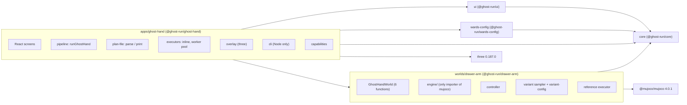
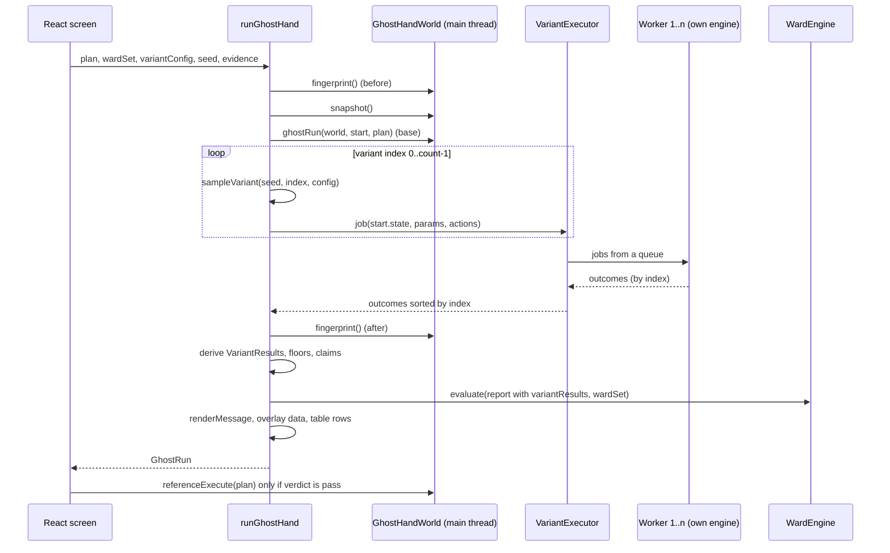
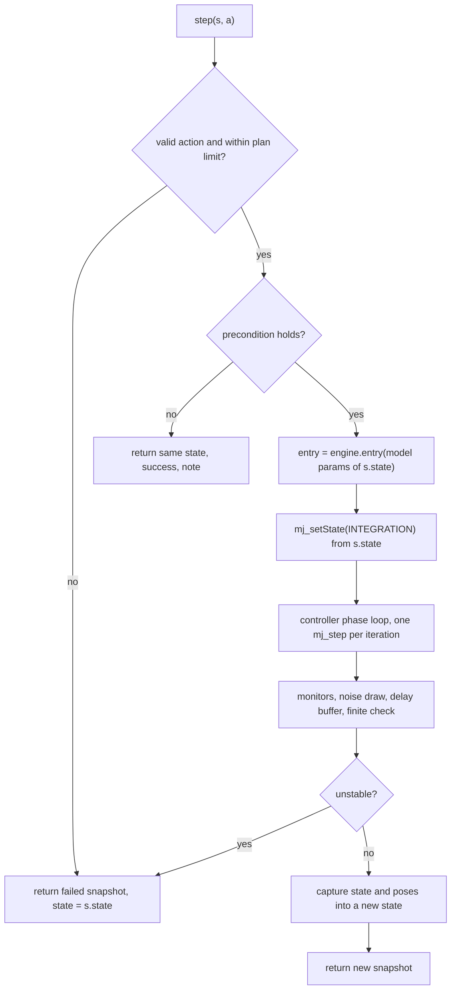

# Design Document

## Overview

Ghost Hand is App 2 of Ghost Run+. It has two halves.

1. **The world** (`worlds/drawer-arm/`, package `@ghost-run/drawer-arm`). A MuJoCo (WebAssembly) scene with a primitive-shape arm, a cabinet with one drawer, and a vase. It implements the six `World<GhostHandState, GhostHandAction>` functions of `core`, the variant sampler, the variant-config and wards files, the deterministic controller, and the reference executor. It depends on `@ghost-run/core` and `@mujoco/mujoco` only.
2. **The app** (`apps/ghost-hand/`, package `@ghost-run/ghost-hand`). A pure pipeline `runGhostHand` (plan to `GhostRun`), the Plan_File parser and printer, a worker-pool executor for variant runs, the Three.js ghost overlay, thin React screens built from `@ghost-run/ui` components, and a Node entry point for agents.

The design reuses the existing contracts and adds no second shape for any of them. The signatures used below were read from the repository on the day of writing: `World`, `Snapshot`, `Change`, `Scene`, `Effect`, `FingerprintResult`, `GhostReport`, `VariantResult`, `Ward`, `WardSet`, `WardVerdict`, `WardViolation`, `WardNotice`, `Verdict` and `VERDICT_ORDER` (`core/src/types.ts`); `ghostRun` (`core/src/runner.ts`); `WardEngine.evaluate` and `isMoreRestrictive` (`core/src/wards.ts`); `renderMessage`, `Claims`, `RenderContext`, `CLAIM_LOWERED_LINE` (`core/src/judge/message.ts`); `verifyWorld`, `DeterministicTestAdapter`, `VerificationError` (`core/verify.ts`, exported as `@ghost-run/core/verify`); `collectNeedles`, `traceRedThread`, `Needle`, `NeedleOrigin`, `ThreadLink`, `ProvenanceRecord`, `ProvenanceLog` (`core/src/possession/`); `parseWards`, `formatConfigError` (`wards-config`, as the `wards` design specifies); and the `ui-kit` components and types `IsolationClaims`, `GraveEntry`, `GraveDetail`.

Three facts about the current code shape the design.

- `VariantResult` in `core` has no `jointLimitExceeded` or `selfCollisionOccurred` field yet, `checkPhysics` reads only `success`, `contactForceN`, and `forbiddenContactOccurred`, and `RenderContext.claims` is required. These are the prerequisites PR-1 and PR-2. The design detects their landing by behavior probes and falls back as Requirements 8, 9, 10, and 21 require (see "Prerequisites and fallback").
- `ghostRun` leaves `variantResults` empty and calls `world.effectsOutside(action)` before `world.step`. The pipeline fills `variantResults` and validates the plan before it calls `ghostRun`.
- `verifyWorld` compares final states with its own `deepEqual` (it accepts typed arrays, compares `-0` and `0` as different through `Object.is`) and runs 3 + (number of wards) properties, each over plans of 1 to 50 actions. For `deterministic: true` it also calls the `testAdapter`. This sets the cost model of the time budget (D14).

**Scope of claims** (as in requirements.md, repeated because every property below is stated within it). P1 is claimed per run in the page, only from two equal fingerprints of the in-memory Reference_State. P2 is claimed per run, as a comparison of the base ghost diff with the diff of the reference execution by the same engine build in the same browser, and says nothing about hardware. P3 is claimed for the world (evidence in the Tested_Environments plus a runtime self-check). P4 is not asserted here. P5 and P6 are not claimed. P7 applies only in the optional possession scenario. P8 is claimed only in Node.js 20.20.2 and Chrome 157 on an Apple M1 Mac.

## Design Decisions

The first table resolves the open items of requirements.md ("Design Decisions and Open Items") and the decisions that the requirements delegate to the design.

| ID | Decision | Resolves |
|---|---|---|
| D1 | World folder `worlds/drawer-arm/`, package `@ghost-run/drawer-arm`, world id `drawer-arm`. The name describes the world (a drawer and an arm), not the app. | Open Item 1, Req 1.2 |
| D2 | `world.config.ts` follows the `kiro-integration` convention (design D7): default export `{ id, deterministic, wardsFile, create }`. `wardsFile` is the string `./wards.yaml` and is never imported. `create` is `createGhostHandWorld` (async, because the engine loads a WebAssembly module). `deterministic` is `true` only after the registration gate passes in the Tested_Environments (Req 3.13); the scaffold creates it as `false`. | Open Item 1, Req 3.13 |
| D3 | The World_Config is a typed constants module `worlds/drawer-arm/src/world-config.ts` (`as const`, no parsing). The Variant_Config is a JSON file `worlds/drawer-arm/variant-config.json` parsed by `parseVariantConfig`; the app bundles its text with Vite `?raw` and a test requires that the text equals the file bytes. | Open Item 1, Req 4.4, 6.2, 7 |
| D4 | The single canonical Wards_File is `worlds/drawer-arm/wards.yaml`. This is the location that the world-contract steering and the `world-scaffold` hook use, so no exception to the steering checklist is needed (Ghost Shell chose `apps/` and recorded an exception). The package exports it as the subpath `@ghost-run/drawer-arm/wards.yaml`; the app imports it as `?raw`; the Node entry point reads the path it is given. No copy exists in `apps/ghost-hand/`. | Open Item 1, Req 9.1, 9.4 |
| D5 | `reach` targets are points in the world frame in meters. Origin: on the floor, at the center of the cabinet's front face. +x to the right of the cabinet, +y out of the cabinet toward the arm (the drawer opens toward +y), +z up. The declared range is a per-coordinate box, not a reachability test. An unreachable target is not an error: the inverse kinematics ends at the best reachable pose and the plan then fails by its outcome (the drawer does not open). The plans use absolute handle coordinates of the closed drawer and never compensate the variant's handle offset, so that the offset can make a plan fail. | Open Item 3, Req 5.3 |
| D6 | Restore uses `mj_getState` and `mj_setState` with `mjSTATE_INTEGRATION`, stored as one `Float64Array` in the state. This signature includes the warm-start accelerations, so a reused snapshot reproduces the trajectory bit for bit. The Task 1.1 probe confirmed it (`qpos`, `qvel`, `qacc_warmstart`; 150 warm-up steps with contacts, 300 steps, restore, 300 steps; also when restored into a freshly constructed `MjData`: max abs diff 0). `mjSTATE_FULLPHYSICS` is not used: it omits the warm start and is not bit-exact (probe max abs diff 0.0113 in the probe scene). The vector layout is the single-bit signatures in bit order: time, qpos, qvel, act, history, warmstart, ctrl, qfrc_applied, xfrc_applied (then the empty or unused bits). Warning counters are not in the vector; they survive `mj_setState` and only `mj_resetData` clears them. Argument shapes (probe): `mj_stateSize(model, sig: number)`; `mj_getState(model, data, out, sig)` writes ONLY into a `DoubleBuffer` (a plain `Float64Array` is accepted and silently stays zero, a `number[]` throws), so the get path copies through a wrapped `DoubleBuffer` inside a `Scope` (`Float64Array.from(buffer.GetView())`, then delete); `mj_setState(model, data, state, sig)` accepts a `Float64Array` or `number[]` and throws for a `DoubleBuffer`. The `MjData` copy constructor is not used for restore because the snapshot must be plain data. The offsets inside the vector are computed from `mj_stateSize` of each single-bit signature, never hard-coded. The runtime self-check and the P3 property test are the gate. The probe showed the INTEGRATION restore is bit-identical, so no contingency is needed now; the one in "Error Handling" remains only as a guard against a different browser result. | Open Item 4, Req 3, 17.5 |
| D7 | Variant runs use the single-thread build. A pool of at most 4 Web Workers (`clamp(hardwareConcurrency - 1, 1, 4)`) takes jobs from a queue. A job is a pure function of `(start state, variant params, actions)`. Results are stored by variant index, so finishing order and pool size cannot change the run. The base ghost run and the reference world stay on the main thread. Without `Worker`, and in Node, an inline executor runs the same job function. No `SharedArrayBuffer`, no COOP or COEP header. | Open Item 2, Req 2.2, 8.7 |
| D8 | Model parameters (drawer friction loss, drawer mass, handle offset) are applied by compiling a model from the MJCF text with those numbers substituted. Compiled models are cached in the engine by the exact text of the parameters (at most 24 entries, deleted on eviction and on `dispose`). Setting `body_mass` on a live model would leave derived constants stale and would need `mj_setConst`; recompiling avoids both. Sensor noise, command delay, and the noise seed are state-level, not model-level. | Req 6.1, 6.6 |
| D9 | The MJCF text contains `<size memory="1M"/>`. A test builds the model and requires the arena size reported by the engine to be at most 2 MiB, and the tasks include a probe that reads the byte size of one `MjData`. Probe result: with `<size memory="1M"/>` `model.narena` and `data.narena` are 1,048,576 and one `MjData` (`narena + nbuffer`) is 1,056,959 bytes in the probe scene (under 2 MiB); without the element they are 13,631,488 and 13,639,871. The engine reads the arena size from `model.narena` and `data.narena`. | Open Item 5, Req 4.3 |
| D10 | Memory discipline. All access to the module lives in `worlds/drawer-arm/src/engine/`. An ESLint `no-restricted-imports` rule forbids `@mujoco/mujoco` outside that folder. Views over WebAssembly memory (`data.qpos`, `data.ctrl`, and similar) are fetched fresh at every use through `readArray(data, name, expectedLength)`, copied at once into a JavaScript-owned `Float64Array`, and never stored. `readArray` throws `EngineMemoryError('view-detached')` when the length is not the expected one (a grown heap leaves a stale view with length 0; confirmed by the probe, for `data.qpos` and for `DoubleBuffer` views). The module does not export `HEAP8`, `HEAPU8`, `HEAPF64`, or `wasmMemory`, so the heap size accessor (`Engine.heapBytes`) is `const b = mujoco.DoubleBuffer.FromArray([0]); const n = b.GetView().buffer.byteLength; b.delete();`. The package README differs from the API: `new DoubleBuffer([..])` throws (the constructor takes an element count; use `DoubleBuffer.FromArray`), and the method is `GetView()`, not `getView()`. | Open Item 5, Req 3.14 |
| D11 | Ownership and `.delete()`. The `Engine` owns the module handle (never deleted, one per realm), every cached `EngineEntry` (model, main data, scratch data for inverse kinematics), and a `Scope` object that collects any wrapped temporary created during one call and deletes it in `finally`. `Engine.dispose()` is idempotent and deletes all entries. A world instance owns one engine unless the caller passes one in (then the caller disposes). A source-scan test requires every `new mujoco.Mj*` in `engine/` to be inside a `Scope` or an `EngineEntry`. Probe facts: every constructed type has `.delete()`. `data.warning`, `data.solver`, and `data.timer` are non-owning references and are NEVER deleted or registered in a `Scope` (`free` aborts the module). `data.contact` (a new `MjContactVec` copy on every access), `model.opt`, `data.body(i)`, `data.geom(i)`, `contact.get(i)`, and `warning.get(i)` are owning copies and are deleted. The heap check (Req 3.14, 17.9) compares the byte length of the module heap after run 1 and after run 40. | Open Item 5, Req 3.14 |
| D12 | The 3D overlay is `apps/ghost-hand/src/overlay/` and imports `three`. `ui/` never imports it. The overlay's colors come from a token module inside the app (`overlay-tokens.ts`) with its own Contrast_Pairs and WCAG test, because the `ui-kit` token module is not a public export and the overlay must not widen the kit's API. | Req 1.14, 13.9 |
| D13 | The Node entry point is `ghost-hand-run`, built to `apps/ghost-hand/dist-node/cli.js`. Exit codes: `0` pass, `1` warn, `2` block, `64` usage error, `65` plan or wards file invalid, `70` internal error. `ghost-hand-run validate <plan>` checks a Plan_File alone (exit `0` or `65`) so an agent can check a revised plan before running it. Details in "Node entry point". | Open Item 6, Req 11.8 |
| D14 | Time budget of `verifyWorld`. Time step `0.002` s. Per-action limit `3.0` s (1500 steps). Per-plan limit `6.0` s (3000 steps). The short-run example count is not fixed in advance: an early task measures the worst-case cost of one example and sets `shortRuns` in `worlds/drawer-arm/tests/pbt-budget.json` by the rule in "Time budget", never above 100 and never below 20, and `docs/measurements.md` and the README record any value below 100 with its measured basis. | Req 17.11, Open Item "Time budget" |
| D15 | Possession red thread. The minimal change is proposed, not made: one new `NeedleOrigin` value `'contact'` (with rank 3 in `ORIGIN_RANK`, and one label in the `ui-kit` origin text map). The Ghost Hand scenario builds the `Needle` itself. This is the last, optional task. | Req 16.4 |
| D16 | Capability probes. Whether PR-1, PR-2, and PR-3 have landed is decided by the behavior of the installed packages (small pure probes at startup and in tests), not by a constant that someone must remember to flip. See "Prerequisites and fallback". | Req 21.4 |
| D17 | Browser evidence, decided by the user (2026-11-18). First choice, no new dependency: the Chrome 157 checks (hash equality in the main thread and in a Worker, the frame-time median, the page load time) run through a harness that uses only Node built-ins: a `node:http` static server serves a harness page, the installed Chrome runs headless through its command line, and the harness page posts its JSON result to the local server. Fallback, only if that harness fails on the Reference_Machine: Playwright (Apache-2.0) is added as a development dependency of `apps/ghost-hand/`, driving the installed Chrome through its `channel` option, with no browser download (`PLAYWRIGHT_SKIP_BROWSER_DOWNLOAD=1`); its exact version and license are then recorded in the README table. The Vitest browser mode is not used. The page under test is the harness page, not the app, so Requirement 2.4 is not affected. | Req 17.7, 13.10, 2.6, 1.3 |
| D18 | A Plan_File of `origin: recorded` is produced by a real Kiro session: the agent runs `ghost-hand-run`, reads the block message, writes the revised Plan_File with `revisionOf` and `recordedWith`, and runs again. The repository ships scripted versions first; the recorded file replaces the revised one in a late task, and the README states which one ships. | Req 11, 12.12 |
| D19 | Frames for the overlay are not part of the state. The world instance keeps a Trace store (as `ghost-shell` does, its D3) keyed by snapshot id, filled only when the instance is created with `recordFrames: true`. Frames are `Float32Array` body poses at a stride of 9 steps (55.6 frames per simulated second, below the limit of 60), used for drawing only. | Req 8.11 |
| D20 | A step that fails (invalid value, time limit, instability) returns a snapshot whose state equals the input state (Req 3.6, 3.7). The partial monitors of the failed step are kept in a second side store `failureMonitors` keyed by snapshot id. Variant derivation combines the final monitors with the partial monitors of every failed snapshot, so an incomplete variant reports what it did up to the failure (Req 8.5). A failed step anywhere in the plan sets `success: false` for that run. | Req 8.5 |
| D21 | An action whose precondition does not hold (`pull` without a hold, `release` without a grasp) is a no-op: the returned state equals the input state, the result is `{ success: true }`, and the side store `stepNotes` records `precondition-not-met` for display. | Req 5.4 |
| D22 | The gate for the claim flags is an object `ClaimEvidence` built by the app shell from the Determinism_Self_Check and the capability probes. The pipeline never reads a global. | Req 10 |
| D23 | Requirements wording note for GH-P8 (incomplete variants only tighten). The property flips `success` to `false` on one Variant_Result and keeps its other fields. Replacing a result by an object that also drops `contactForceN` can lower the verdict (a force violation disappears while the rate stays at or above the threshold), which no engine can prevent. Requirement 8.5 already requires the other fields to be kept. | Req 18 (GH-P8) |
| D24 | The page needs a secure context for Web Crypto (`crypto.subtle`): `https:` or `http://localhost`. On `file:` the page shows `This page needs a secure context (https or localhost).` in a `role="alert"` element and runs nothing. | Req 3.11 |

Provisional numbers in this document (time step, limits, ranges, scene dimensions) are starting values. Experiment C measured them with throwaway code; the shipped scene is new code, and the tasks measure it again (Requirement 12 criteria 5 and 6). No test contains a measured pass count.

## Prerequisites and fallback

PR-1, PR-2, and PR-3 are implemented outside this spec. The pipeline asks the installed packages what they do.

```ts
// apps/ghost-hand/src/capabilities.ts
export interface Capabilities {
  readonly jointSelfWard: boolean;      // PR-1: physics ward blocks on jointLimitExceeded / selfCollisionOccurred
  readonly claimsOptional: boolean;     // PR-2: renderMessage accepts a context without `claims`, no lowered-claim line appended
  readonly bannerNotApplicable: boolean;// PR-3: Claim_Banner renders P5 / P6 as "not applicable"
}
export function probeCapabilities(): Capabilities;
```

- `jointSelfWard`: evaluate a synthetic report (one variant `{ variantId: 'probe', success: true, jointLimitExceeded: true }`, a `physics` Ward with `min_success_rate: 0`, `max_contact_force_n: 1e9`, no forbidden contacts) with `WardEngine.evaluate`. The flag is `true` if and only if the verdict is `block`. A second probe with `selfCollisionOccurred` must agree; if only one agrees the flag is `false` (partial landing is not a claim).
- `claimsOptional`: call `renderMessage` with `{ wardCount: 1 }` and no `claims` inside `try`. The flag is `true` if and only if the call does not throw and the text does not contain the stable fragment `no ghost rehearsal took place`.
- `bannerNotApplicable`: statically render the `Candle` with a claims value that carries the PR-3 field and test for the text `not applicable`. The field name is the one PR-3 defines. Until PR-3 lands there is no such field, `buildIsolationClaims` (below) does not emit one, and the flag is `false`.

| Behavior | Before the prerequisite lands | After it lands |
|---|---|---|
| Joint-limit and self-collision ward (Req 8.6, 8.7) | The monitors record both facts and the variant table shows them. `VariantResult` objects are built as `GhostHandVariantResult = VariantResult & { jointLimitExceeded?: boolean; selfCollisionOccurred?: boolean }` (an extra optional field is structurally assignable, so the code compiles before and after PR-1). The engine ignores them. The page shows `Joint-limit and self-collision wards are not active in this build.` in a `role="status"` element. No text or README sentence claims this ward. The fields are not folded into `success` or `forbidden_contacts`. | The same objects block through `WardEngine.evaluate`. The status text is removed. The README may claim the ward. |
| Message wording (Req 9.9) | `renderMessage(v, { wardCount, claims: { p5: false, p6: false } })`, plus the note `Message wording of the wards module is provisional: its last line does not apply to this physics world.` | `renderMessage(v, { wardCount })`. The note is removed. |
| P5 and P6 in the banner (Req 10.1) | Claims `{ mode: 'playground', p1Claimed, p5Claimed: false, p6Claimed: false }`. The banner shows both as not claimed. | The same values plus the PR-3 field; the banner shows "not applicable". |

Two consequences are tested. A test per flag runs the probe against the installed packages and compares it with an expected value stored in `tests/capabilities.expected.json`; a mismatch fails with the message `capability changed: update the expected file and the dependent texts`. This is the check that Requirement 21.4 asks for. The tasks.md task that checks landed state reads the probe output.

## Architecture

### Packages and dependency direction



`core/`, `ui/`, and `wards-config/` do not import either new package. Their existing ESLint `no-restricted-imports` rules gain the two new paths in a task (Requirement 1.6; the files belong to those packages, so the task edits only the rule lists and is listed as the single cross-package edit of the implementation, apart from the steering updates).

### Run sequence



### One simulated step



## Source layout

```
worlds/drawer-arm/
├─ package.json                  # deps: @ghost-run/core, @mujoco/mujoco (exact 4.0.1)
├─ world.config.ts               # { id, deterministic, wardsFile: './wards.yaml', create }
├─ wards.yaml                    # the single canonical Wards_File
├─ variant-config.json           # Variant_Config
├─ src/
│  ├─ index.ts                   # public entry: createGhostHandWorld, types, sampler, parsers
│  ├─ types.ts                   # GhostHandAction, GhostHandState, VariantParams, RunMonitors, ...
│  ├─ world-config.ts            # World_Config constants
│  ├─ actions.ts                 # validateAction, describeAction
│  ├─ engine/
│  │  ├─ mujoco-subset.d.ts      # local structural types of the API subset that is used
│  │  ├─ load.ts                 # loadMujoco(): memoized module loader (Node and Vite)
│  │  ├─ mjcf.ts                 # buildMjcf(modelParams): string
│  │  ├─ engine.ts               # Engine, EngineEntry, Scope, readArray, layout
│  │  └─ monitors.ts             # per-step contact scan, joint limit, self collision
│  ├─ controller.ts              # phases of reach / grasp / pull / release (basic arithmetic only)
│  ├─ ik.ts                      # damped least squares, fixed iterations, 3x3 inverse by cofactors
│  ├─ prng.ts                    # mix32, xorshift32, u32ToUnit
│  ├─ variant.ts                 # sampleVariant, applyVariant, BASE_VARIANT_PARAMS
│  ├─ variant-config.ts          # parseVariantConfig, printVariantConfig, VariantConfig
│  ├─ world.ts                   # createGhostHandWorld, the six functions, trace stores
│  ├─ diff.ts  scene.ts  fingerprint.ts   # pure helpers of the six functions
│  ├─ reference.ts               # referenceExecute (continuous run, no restore)
│  ├─ run-variant.ts             # runVariantJob: pure job function shared by all executors
│  ├─ hash.ts                    # sha256Hex, trajectory hash over exact bytes
│  └─ reference-plan.ts          # REFERENCE_PLAN for the Determinism_Self_Check and the Golden_Hash
└─ tests/                        # model/, engine/, contract.test.ts, golden.json, pbt-budget.json

apps/ghost-hand/
├─ package.json  tsconfig.json  tsconfig.node.json  vite.config.ts  vitest.config.ts  eslint.config.mjs
├─ index.html
├─ notices/                      # upstream license texts + sources.json (MuJoCo, Qhull, others)
├─ scripts/gen-notices.mjs       # writes dist/THIRD_PARTY_NOTICES.txt
├─ plans/                        # first.plan.json, revised.plan.json, (optional) possession.plan.json
├─ src/
│  ├─ main.tsx  App.tsx  texts.ts  reducer.ts  clock.ts
│  ├─ capabilities.ts  evidence.ts  self-check.ts
│  ├─ plan/                      # plan-file.ts (parse, print), scenarios.ts
│  ├─ pipeline/                  # run.ts (runGhostHand), derive.ts, claims.ts, verdict.ts, rows.ts, graveyard.ts
│  ├─ exec/                      # executor.ts, inline.ts, pool.ts
│  ├─ worker/sim-worker.ts       # message loop around runVariantJob
│  ├─ overlay/                   # view-model.ts, renderer.ts, overlay-tokens.ts, wcag.ts, geometry.ts
│  ├─ components/                # PlanPanel, SeedInput, VariantTable, OverlayView, ClaimsPanel, PossessionPanel
│  └─ cli/main.ts                # Node entry point (not in the browser import graph)
└─ tests/                        # model/, dom/, static/, browser/ (harness), cli/
```

## Steering update items for tasks.md

This spec edits no steering file. The tasks include one task for the following edits, each to be approved by the user when the task runs.

| ID | File | Change | Reason |
|---|---|---|---|
| S1 | `.kiro/steering/structure.md`, "Dependency Direction" | Add: `apps/*` may depend on `worlds/*`; `worlds/*` may depend on `core/` and on the engine package of the world only (for example `@mujoco/mujoco`, `sql.js`). | Ghost Hand imports `worlds/drawer-arm`; the current text does not say so (Req 1.8). |
| S2 | `structure.md`, tree comment of `ui/` | Remove "3D ghost overlay" from the `ui/` list. | The overlay lives in `apps/ghost-hand/` and `ui/` has no `three` dependency (Req 1.14). |
| S3 | `structure.md`, tree of `apps/ghost-hand/` and "What Goes Where" | Add `apps/ghost-hand/` entries for the 3D overlay and the Node entry point, and the line "3D ghost overlay -> `apps/ghost-hand/`". | Same. |
| S4 | `structure.md`, tree of `worlds/` | Name `worlds/drawer-arm/` as the Ghost Hand world, with its `wards.yaml`. | D1, D4. |
| S5 | `.kiro/steering/world-contract.md`, P2 row (and the P8 row only if it needs the same environment note) | Allow Ghost Hand's narrow P2. Scope wording, exactly: "On the same build and in the tested environments, the ghost run's result equals the reference simulation run's result. Not claimed for physical hardware." The existing scope (in-memory FS and sql.js worlds) stays for those worlds. | Requirement 10.6 claims P2 for Ghost Hand; the steering scope must allow it first. Decided by the user (2026-11-18): done as a task together with S1 to S7. |
| S6 | `.kiro/steering/tech.md`, "Hosting" | State that Ghost Hand uses the single-thread MuJoCo build and needs no COOP or COEP header; the multi-thread build is not used. | Req 2.2. The current text says the headers are required. |
| S7 | `.kiro/steering/product.md` | Record that App 2 is confirmed as Ghost Hand and the third world is Ghost Cloud (the file still says "may switch"). | Decision of 2026-11-18. Optional; not required by the requirements. |

Until the steering update (S5) lands, the page and the README show no P2 text at all (no P2 claim sentence and no P2 check line); the reference execution still runs and its diff comparison is computed and tested, but not displayed. A build constant `P2_TEXT_ENABLED` in `apps/ghost-hand/src/texts.ts` is set to `true` by the task that lands S5 and by no other task.

## Components and Interfaces

### Types (`worlds/drawer-arm/src/types.ts`)

```ts
export type Vec3 = readonly [number, number, number];

export type GhostHandAction =
  | { readonly type: 'reach'; readonly target: Vec3; readonly speed: number }   // meters, meters per second
  | { readonly type: 'grasp'; readonly force: number }                          // newtons
  | { readonly type: 'pull'; readonly distance: number; readonly speed: number }// meters, meters per second
  | { readonly type: 'release' };

/** Perturbed values of one variant plus the derived noise seed. All finite. */
export interface VariantParams {
  readonly drawerFrictionN: number;      // slide joint frictionloss, newtons
  readonly drawerMassKg: number;
  readonly handleOffsetM: Vec3;          // added to the nominal handle position in the drawer frame
  readonly sensorNoiseM: number;         // amplitude of the drawer displacement reading error
  readonly commandDelaySteps: number;    // whole number of time steps
  readonly noiseSeed: number;            // uint32, derived from (Seed, index); not a range field
}

export interface RunMonitors {
  readonly maxContactForceN: number;                 // max over contacts involving an Arm geom
  readonly touched: readonly string[];               // sorted Contact_Names touched by an Arm geom
  readonly jointLimitExceeded: boolean;
  readonly jointLimitSteps: number;
  readonly selfCollisionOccurred: boolean;
  readonly selfCollisionSteps: number;
}

export interface ControllerState {
  readonly jointTarget: readonly number[];           // commanded arm joint targets (before delay)
  readonly fingerForceN: number;                     // commanded closing force, 0 when open
  readonly holding: boolean;                         // both fingers touched the handle at the end of the last grasp
}

/** The state type S. Finite numbers, booleans, strings, plain arrays and objects, Float64Array only. */
export interface GhostHandState {
  readonly schema: 1;
  readonly variant: VariantParams;
  readonly steps: number;                            // integer count of mj_step calls since the initial state
  readonly integration: Float64Array;                // mj_getState(mjSTATE_INTEGRATION)
  readonly poses: Float64Array;                      // derived: per body xpos (3) and xquat (4), for pure render
  readonly controller: ControllerState;
  readonly prng: number;                             // uint32 state of the noise generator
  readonly delayBuffer: readonly number[];           // flattened ring of commanded ctrl vectors
  readonly delayHead: number;                        // integer index into the ring
  readonly monitors: RunMonitors;
}
```

`poses` is derived data, kept in the state so that `render` can stay pure and synchronous without calling the engine. It is recomputed from `integration` by the engine after each action (`mj_kinematics`), so it is covered by the same bit-exactness checks.

### World_Config (`world-config.ts`)

```ts
export const WORLD_CONFIG = {
  timeStepS: 0.002,
  perActionLimitS: 3.0,            // 1500 steps
  perPlanLimitS: 6.0,              // 3000 steps
  targetOpeningM: 0.12,            // success threshold of the drawer displacement (provisional)
  ikIterations: 20,
  ikDamping: 1e-3,
  pullWaypoints: 5,
  pullOvershootM: 0.02,
  minMoveS: 0.2,
  graspSettleS: 0.5,
  releaseSettleS: 0.3,
  frameStrideSteps: 9,             // ceil(1 / (60 * timeStepS)) = 9 -> at most 55.6 frames per simulated second
  jointLimitToleranceRad: 1e-3,
  actionRanges: {
    target: { x: [-0.30, 0.30], y: [-0.30, 0.70], z: [0.05, 0.70] },   // meters, world frame
    speed: [0.05, 0.60],           // m/s, reach and pull
    force: [2, 40],                // N, grasp
    distance: [0.02, 0.25],        // m, pull
  },
  contactNames: ['vase', 'cabinet', 'drawer', 'handle', 'floor'],
  nominalHandle: [0, 0.02, 0.18],  // closed drawer, world frame (provisional)
} as const;
```

Every range is a closed interval of finite numbers. `validateAction(a): { ok: true } | { ok: false; error: string }` checks the shape, that every number is finite, and the ranges, and never clamps (Requirement 5.2). `describeAction(a)` returns the text form of Requirement 5.8 with numbers printed by `String(number)`.

### Scene geometry (`MJCF` and overlay share one table)

`world-config.ts` also exports `BODY_SHAPES`, a table of `{ body, geomName, kind: 'capsule' | 'box' | 'sphere', halfSize numbers, localPos, localQuat, group: 'arm' | 'cabinet' | 'drawer' | 'vase' }`. `buildMjcf` and the overlay both read it, so the drawn shapes are the simulated shapes. Provisional dimensions (meters): cabinet 0.50 wide, 0.40 deep, 0.40 high with its front face at y = 0; drawer front 0.44 by 0.12; handle bar 0.012 radius at the nominal handle point; vase a 0.04 radius cylinder, 0.14 high, standing at about (0.12, -0.15, 0.40); arm base at (0, 0.45, 0.30), links of 0.32 m, and two finger slides (range 0 to 0.02 m each). The tasks tune these until Requirement 12 criteria 2 and 3 hold; the reach of the arm must cover both the handle and the vase (the possession scenario needs the vase).

Actuators: position actuators on the four arm hinges (the commanded target after delay is `ctrl`), and motor actuators on the two finger slides (`ctrl` is a force in newtons). Adjacent link pairs and the finger pair are listed in `<contact><exclude>`. Every remaining contact between two `arm` group geoms is a self-collision.

### Engine (`engine/`)

```ts
/** The API subset that is used; typed locally so the design does not depend on the shipped declarations. */
export interface MuJoCoModule { /* Mj* constructors, mj_* functions, enums used below, heap accessor */ }

export function loadMujoco(opts?: { locateFile?: (path: string, scriptDirectory: string) => string }): Promise<MuJoCoModule>;

export interface StateLayout {            // offsets and lengths inside the INTEGRATION vector
  readonly total: number;
  readonly time: number;
  readonly qpos: { offset: number; length: number };
  readonly qvel: { offset: number; length: number };
  readonly ctrl: { offset: number; length: number };
  readonly drawerQposIndex: number;       // index of the slide joint inside qpos
  readonly vaseQposOffset: number;        // 7 values: position (3) and quaternion (4)
}

export interface ModelParams {            // the only values that change the compiled model
  readonly drawerFrictionN: number;
  readonly drawerMassKg: number;
  readonly handleOffsetM: Vec3;
}

export interface EngineEntry { readonly key: string; /* model, data, scratch data: private */ }

export interface Engine {
  readonly layout: StateLayout;
  entry(params: ModelParams): EngineEntry;                         // cached, compiles on a miss
  load(entry: EngineEntry, integration: Float64Array): void;       // mj_setState
  capture(entry: EngineEntry): { integration: Float64Array; poses: Float64Array };
  step(entry: EngineEntry, ctrl: Float64Array): StepProbe;         // one mj_step with ctrl applied
  heapBytes(): number;
  dispose(): void;                                                 // idempotent
}

export interface StepProbe {
  readonly finite: boolean;
  readonly warnings: number;              // sum of the engine's warning counters that mean instability
  readonly maxArmContactForceN: number;
  readonly touched: readonly string[];    // Contact_Names touched by an Arm geom in this step
  readonly jointLimitExceeded: boolean;
  readonly selfCollision: boolean;
  readonly qposQvel: Float64Array;        // copy, for the trajectory hash
}

export function createEngine(mujoco: MuJoCoModule): Engine;
```

Probe items. The following facts are not verified in the repository yet and are the FIRST task of tasks.md (a probe script in `worlds/drawer-arm/scripts/probe.mjs`, its result recorded in `docs/measurements.md`). If a probe result differs from this design, `design.md` is corrected first and only then do later tasks continue: the loader name and the way Node and Vite locate `mujoco.wasm`; the argument shapes of `mj_stateSize`, `mj_getState`, and `mj_setState`; how contacts are read (geom ids per contact) and the shape of `mj_contactForce`; the accessor for the module heap size; the warning counters; and the output arguments of `mj_jacSite`. Experiment C used these functions, so they exist; the design keeps every call behind `engine/`, so a different argument shape changes one file. Probe results (Task 1.1, `docs/measurements.md`) that this design now follows:

- Loader: the default export `MainModuleFactory(options)`; `locateFile(path, scriptDirectory)` is called with `path = 'mujoco.wasm'` (so `loadMujoco`'s `locateFile` ignores the second argument or accepts it); the heap is not a `SharedArrayBuffer`; the `mt` build exists and is not used. `./package.json` is not exported, so the package folder is found through `./mujoco.wasm`.
- State: see D6. `mj_getState` needs a `DoubleBuffer` out argument inside a `Scope`; `mj_setState` takes a `Float64Array`.
- Warning counters: `data.warning` has `mjNWARNING` = 7 entries: INERTIA 0, CONTACTFULL 1, CNSTRFULL 2, BADQPOS 3, BADQVEL 4, BADQACC 5, BADCTRL 6. `data.warning.get(i)` returns an `MjWarningStat` copy with `number` and `lastinfo`; the `mjtWarning` enum object also has the keys `values` and `argCount`, so it is never iterated blindly. `mj_step` resets the data itself on NaN or huge values and then sets the counter, so `qpos` and `qvel` are finite zeros afterward and a finiteness check alone cannot see the instability. `StepProbe.warnings` is the sum of the BADQPOS, BADQVEL, BADQACC, and BADCTRL counters after the step minus their sum before the step (`mj_step` never clears them); `finite` is false when the difference is above 0 or a value is not finite.
- Contacts: `data.contact` returns a new `MjContactVec` copy on every access, so the engine reads it once per step and only when `ncon > 0`. `get(i)` returns an `MjContact` copy with integer `geom1` and `geom2`. Names come from `mj_id2name(model, mjtObj.mjOBJ_GEOM.value, id)`. `mj_contactForce(model, data, i, result)` needs a `DoubleBuffer` of 6 elements; element 0 is the normal force (a `Float64Array` is silently unwritten).
- Jacobian: `mj_jacSite(model, data, jacp, jacr, siteId)` needs `DoubleBuffer` objects of `3 * nv` elements (row-major, `null` allowed for either); a `Float64Array` is silently unwritten. `mj_forward` must have run for the pose to be current.
- Package README differences are listed in D10.

Every wrapped output buffer is created and deleted inside a `Scope`.

**Step loop (one `EngineEntry` call).** Per `mj_step`:

1. Apply the delayed command: `applied = delayBuffer[head - delay]`, write the buffer slot with the current command, advance the head (all integers).
2. `mj_step`.
3. Read `qpos` and `qvel` through `readArray` and check that every element is finite; check the instability warning counters.
4. Scan contacts only when `ncon > 0`. For each contact with at least one `arm` group geom, read `mj_contactForce` and keep the maximum normal force; map the other geom to its Contact_Name through `BODY_SHAPES`; a pair of two `arm` geoms that is not excluded sets `selfCollision`.
5. Compare each arm hinge `qpos` with its model range plus `jointLimitToleranceRad`; set `jointLimitExceeded`.
6. Draw one noise value from the PRNG (every step, whatever the action, so the generator state depends only on the step count).

### Controller (`controller.ts`, `ik.ts`)

```ts
export interface ActionOutcome {
  readonly ok: boolean;
  readonly error?: string;
  readonly noop?: 'precondition-not-met';
  readonly next?: GhostHandState;        // built from the engine capture and the loop accumulators
  readonly partialMonitors: RunMonitors; // monitors up to the failure, for failureMonitors
  readonly frames?: Float32Array;        // only when recordFrames is on
  readonly trajectory?: Float64Array;    // qpos and qvel per step, only when asked (trajectory hash)
}

export function runAction(engine: Engine, entry: EngineEntry, s: GhostHandState, a: GhostHandAction,
                          opts: { recordFrames: boolean; recordTrajectory: boolean }): ActionOutcome;
```

The controller uses only `+ - * /`, comparisons, `Math.sqrt`, `Math.min`, `Math.max`, `Math.abs`, `Math.floor`, and `Math.ceil` (all exact or correctly rounded in ECMAScript). It calls none of `Math.sin`, `cos`, `tan`, `asin`, `acos`, `atan`, `atan2`, `exp`, `log`, `pow`, and uses `**` only with integer exponents. A source-scan test checks this on `controller.ts`, `ik.ts`, `prng.ts`, `variant.ts`, and the noise and delay code (Requirement 5.6). Angles come from the engine (it computes them in WebAssembly), not from JavaScript trigonometry.

- **Inverse kinematics.** Solve for the four arm joints so that the hand site reaches the target. Work on the scratch `MjData` of the entry (so the main data is untouched): copy `qpos`, loop `ikIterations` times: `mj_kinematics`, `mj_jacSite` for the position Jacobian J (3 by 4), error e = target minus site position, `dq = J^T (J J^T + damping I)^-1 e`, with the 3 by 3 inverse by cofactors (only `+ - * /`), add `dq`, clamp each joint to its range with `Math.min` and `Math.max`. The iteration count is fixed, so the work and the result do not depend on convergence. The residual is not an error.
- **reach(target, speed).** IK from the current `qpos`. Duration in steps `n = max(ceil(minMoveS / dt), ceil(distance / (speed * dt)))`, with `distance` the Euclidean distance from the current hand site to the target. Commanded joint targets move from the current command to the IK result by the smoothstep `3t^2 - 2t^3`, `t = k / n`.
- **grasp(force).** Command finger force from 0 to `force` over `0.1` s (linear ramp), hold for `graspSettleS`. At the end, `holding = true` if both fingers touched the handle geom in the last step.
- **pull(distance, speed).** Precondition `controller.holding`. Build `pullWaypoints` points on a straight line from the current hand position along +y up to `distance + pullOvershootM`, IK at each, and interpolate joint targets piecewise-linearly (duration `(distance + overshoot) / speed`). The sensed drawer displacement is the true displacement plus the noise draw times `sensorNoiseM`; when the sensed value reaches `distance`, the commanded joint targets are frozen at their current values and the action ends after `0.1` s. If the sensed value never reaches `distance`, the action ends when the planned path ends. The noise therefore moves the stopping point by up to its amplitude, and slipping fingers leave the drawer short.
- **release().** Precondition `controller.holding`. Command the finger force to a fixed opening force for `releaseSettleS`; set `holding = false`, `fingerForceN = 0`.
- **Limits.** Before any simulation the controller computes the action's step count. If it exceeds `perActionLimitS / dt`, or `s.steps + n` exceeds `perPlanLimitS / dt`, the action fails with `error: "action exceeds time limit"` or `"plan exceeds time limit"` and nothing is simulated. This bounds the cost of every call.

### Variant sampler and config (`variant.ts`, `variant-config.ts`, `prng.ts`)

```ts
export interface Range { readonly min: number; readonly max: number }

export interface VariantConfig {
  readonly format: 'ghost-hand-variants';
  readonly version: 1;
  readonly defaultCount: number;           // 8
  readonly maxCount: number;               // at most 20
  readonly largeCountEnabled: boolean;     // counts above defaultCount are accepted only when true
  readonly defaultSeed: number;            // uint32
  readonly ranges: {
    readonly drawerFrictionN: Range;
    readonly drawerMassKg: Range;
    readonly handleOffsetM: { readonly x: Range; readonly y: Range; readonly z: Range };
    readonly sensorNoiseM: Range;
    readonly commandDelaySteps: Range;     // integer bounds
  };
}

export type ConfigErrorCode = 'invalid-json' | 'wrong-type' | 'missing-field' | 'unknown-field' | 'out-of-range' | 'input-too-large';
export interface FileError { readonly code: string; readonly message: string; readonly field: string }

export type ParseVariantConfigResult =
  | { readonly ok: true; readonly config: VariantConfig }
  | { readonly ok: false; readonly errors: readonly FileError[] };

export function parseVariantConfig(text: string): ParseVariantConfigResult;   // never throws
export function printVariantConfig(config: VariantConfig): string;            // 2-space JSON, fixed key order, trailing newline

export function sampleVariant(seed: number, index: number, config: VariantConfig): VariantParams;
export const BASE_VARIANT_PARAMS: VariantParams;                              // from WORLD_CONFIG nominal values
export function applyVariant(base: GhostHandState, params: VariantParams): GhostHandState; // pure
```

- `mix32` is the murmur3 finalizer on `uint32` with `Math.imul` and `>>> 0`. The stream state is `mix32(seed XOR Math.imul(index + 1, 0x9E3779B1))`, replaced by `0x6D2B79F5` if zero; the generator is xorshift32. Field order of draws is fixed: friction, mass, offset x, y, z, noise, delay, noise seed.
- `u = draw / 4294967296` (a division by a power of two is exact), value `= clamp(min + u * (max - min), min, max)`. The clamp uses `Math.min` and `Math.max`, so rounding cannot leave the closed range. Delay `= min(max, floor(min + u * (max - min + 1)))`.
- `applyVariant` returns a new state with `variant = params`, `prng = params.noiseSeed` (mapped to a non-zero state), and a delay buffer of length `delay + 1` filled with the current applied control. It does not touch `integration`, so every variant starts from the same physical state.
- `parseVariantConfig` rejects text above 64 KiB with `input-too-large` before parsing, wraps `JSON.parse` in `try`, reports every error with its field path, rejects non-finite numbers and `min > max`, counts outside 1 to 20, and a seed outside `[0, 4294967295]`. It rebuilds the config from known keys only.

### The world (`world.ts`)

```ts
export interface GhostHandWorldOptions {
  readonly mujoco?: MuJoCoModule;          // default: loadMujoco()
  readonly engine?: Engine;                // caller-owned when given
  readonly recordFrames?: boolean;
  readonly initial?: GhostHandState;       // default: the initial state of the Base_World
}

export interface GhostHandWorld extends World<GhostHandState, GhostHandAction> {
  adopt(state: GhostHandState): Snapshot<GhostHandState>;                 // new snapshot id, no engine call
  frames(snapshotId: string): FrameTrace | undefined;
  failureMonitors(snapshotId: string): RunMonitors | undefined;
  stepNote(snapshotId: string): 'precondition-not-met' | undefined;
  releaseTraces(ids: readonly string[]): void;                              // frees the three trace stores
  referenceExecute(plan: readonly GhostHandAction[]): Promise<ReferenceResult>; // advances the live Reference_State
  resetReference(): Promise<void>;
  heapBytes(): number;
  dispose(): void;                                                          // idempotent
}

export interface FrameTrace { readonly strideSteps: number; readonly bodyCount: number; readonly poses: Float32Array }
export interface ReferenceResult { readonly changes: Change[]; readonly final: GhostHandState; readonly trajectoryHash: string }

export function createGhostHandWorld(opts?: GhostHandWorldOptions): Promise<GhostHandWorld>;
export default function create(): Promise<GhostHandWorld>;   // used by world.config.ts
```

| Function | Behavior |
|---|---|
| `snapshot()` | `structuredClone` of the live Reference_State inside a new `Snapshot` (`id` from an integer counter, `result: { success: true }`). Reads no engine. |
| `step(s, a)` | Validate the action; run `runAction` on an entry whose params come from `s.state.variant` (model params only); on success build the next state and snapshot; on a failed outcome return a snapshot with `state` equal to `s.state` (a structured clone, so the caller cannot alias it) and `result: { success: false, error }`, and store the partial monitors. Never throws for action content. Never writes the live state. |
| `diff(before, after)` | Pure. See "Diff". |
| `render(s)` | Pure. See "Scene". |
| `fingerprint()` | Async. See "Fingerprint". |
| `effectsOutside(a)` | Calls `validateAction`; throws `Error("invalid action: <field> ...")` for an invalid action, otherwise returns `[]`. No I/O. |
| `referenceExecute(plan)` | Runs `reference.ts` on the live state with a separate `Engine`-free continuous loop, replaces the live state, returns the per-action `Change[]` concatenated, the final state, and the trajectory hash. Never called by a ghost run. |

**Diff.** `diffStates(before, after): Change[]`. Walk the state fields in a fixed order and compare with exact bit semantics (`Object.is` per element, so `-0` differs from `0`). Emit, sorted by `kind` and then by `field`:

- `{ kind: 'drawer-displacement', before, after, delta }` when the slide `qpos` differs.
- `{ kind: 'vase-displacement', before: Vec3, after: Vec3, distanceM }` when the vase position differs.
- `{ kind: 'arm-pose', joints: number[] }` listing the indices of changed arm joints.
- `{ kind: 'state-field', field }` for every top-level state field that differs (`variant`, `steps`, `integration`, `poses`, `controller`, `prng`, `delayBuffer`, `delayHead`, `monitors`). This kind makes the diff complete: two states are equal in every field if and only if the result is empty (Requirement 3.8, 3.9).

**Scene.** `renderScene(s): Scene` returns only JSON values: `{ timeS, steps, drawerM, vase: [x, y, z], joints: number[], bodies: [{ name, pos: [x, y, z], quat: [w, x, y, z] }], holding, monitors }`. Every number goes through `finite(n)` (`Number.isFinite(n) ? (n === 0 ? 0 : n) : 0`), which also writes `-0` as `0`. No typed array appears in a Scene.

**Fingerprint.** The live state's tracked resources are `state/qpos`, `state/qvel`, `state/integration`, `state/steps`, `state/controller`, `state/prng`, `state/delay`, `state/variant`, and `state/monitors`. Each is serialized to bytes (numbers as little-endian IEEE-754 through `DataView`, strings as UTF-8, booleans as one byte), hashed with `crypto.subtle.digest('SHA-256')` into a lowercase hex string, and stored in `manifest`. `hash` is the SHA-256 of the lines `<key>\n<hex>\n` sorted by key. Any single-bit change of one resource changes its entry and the total hash. The fingerprint tracks the Reference_State only (the claim of P1 is limited to that).

**Reference execution.** `reference.ts` implements `referenceExecute(engine, state, plan)`: one `EngineEntry`, one `load` at the start, then every action through the same `runAction` with no restore between actions, and `diffStates` between the states at the action boundaries. The `DeterministicTestAdapter` wraps it with its own `Engine` (own model and data from the MJCF text), so P2 compares a run with a restore at every action boundary (the ghost) with a run without any (the reference). Both use `runAction`, `capture`, and `diffStates`, so P2 does not test those three; they have their own properties (diff completeness, determinism, bit-exact restore).

**Trajectory hash.** `trajectoryHash(chunks: Float64Array[]): Promise<string>`: concatenate the `qpos` and `qvel` copies of every step into one buffer through a `DataView` with explicit little-endian writes and take SHA-256 once at the end (Web Crypto has no incremental hash). `REFERENCE_PLAN` (in `reference-plan.ts`) is a fixed valid plan of the four action types whose simulated time is at most 5 s. `golden.json` holds `{ planId, hash, recordedWith: { node, chrome, machine } }`, written by a task on the Reference_Machine.

### Variant job (`run-variant.ts`)

```ts
export interface VariantJob {
  readonly index: number;
  readonly params: VariantParams;
  readonly startState: GhostHandState;            // the base snapshot state, before applyVariant
  readonly actions: readonly GhostHandAction[];
  readonly recordFrames: boolean;
}

export interface VariantOutcome {
  readonly index: number;
  readonly params: VariantParams;
  readonly finalDrawerM: number;
  readonly monitors: RunMonitors;                 // final monitors combined with partial monitors of failed steps
  readonly failedSteps: readonly number[];        // action indices whose snapshot result was a failure
  readonly firstTouch: Readonly<Record<string, number>>; // Contact_Name -> first action index that touched it
  readonly trajectoryHash: string;
  readonly frames?: Float32Array;                 // concatenated frames of the whole plan
  readonly engineError?: string;
}

export function runVariantJob(world: GhostHandWorld, job: VariantJob): Promise<VariantOutcome>;
```

`runVariantJob` adopts `applyVariant(startState, params)`, calls `ghostRun`, folds the monitors, and hashes the trajectory. It reads no clock and no random source. A fresh world and a long-lived world must give equal outcomes (Requirement 3.15).

### Executors (`apps/ghost-hand/src/exec/`)

```ts
export interface VariantExecutor {
  run(jobs: readonly VariantJob[]): Promise<readonly VariantOutcome[]>;   // result[i].index === i, always
  dispose(): void;
}
export function createInlineExecutor(factory: () => Promise<GhostHandWorld>): VariantExecutor;
export function createPoolExecutor(opts: { size: number; spawn: () => Worker }): VariantExecutor;
```

`createInlineExecutor` creates its own world (own engine), never the reference world. `createPoolExecutor` posts `{ type: 'job', id, job }` messages, receives `{ type: 'result', id, outcome }` or `{ type: 'error', id, message }`, sends frames as transferables, and writes each outcome into `results[job.index]`. A worker error or a `messageerror` makes the executor retry that job once on an inline engine; if that also fails, the outcome is `{ ..., engineError }` with default monitors and `success: false` is derived later. The pool never sorts by arrival, so a permutation of completion order cannot change the output.

### Pipeline (`apps/ghost-hand/src/pipeline/`)

```ts
export interface ClaimEvidence {
  readonly selfCheck: SelfCheckResult;            // from self-check.ts
  readonly capabilities: Capabilities;
}

export interface RunInput {
  readonly plan: readonly GhostHandAction[];
  readonly wardSet: WardSet;
  readonly variantConfig: VariantConfig;
  readonly seed: number;
  readonly variantCount: number;
  readonly world: GhostHandWorld;                 // reference world, recordFrames on
  readonly executor: VariantExecutor;
  readonly evidence: ClaimEvidence;
  readonly planOrigin?: 'recorded' | 'scripted';
}

export type GhostHandVariantResult = VariantResult & {
  readonly jointLimitExceeded?: boolean;
  readonly selfCollisionOccurred?: boolean;
};

export interface VariantRow {
  readonly id: string;                            // 'base' or 'variant-<index>'
  readonly params: VariantParams;
  readonly drawerDisplacementM: number;
  readonly maxContactForceN: number;
  readonly touched: readonly string[];
  readonly vaseTouched: boolean;
  readonly jointLimitExceeded: boolean;
  readonly selfCollisionOccurred: boolean;
  readonly failedSteps: readonly number[];
  readonly status: 'passed' | 'failed';
}

export interface GhostRun {
  readonly engineVerdict: WardVerdict;
  readonly wardVerdict: WardVerdict;              // engine verdict with the P1 floor applied
  readonly verdict: Verdict;                      // Run_Verdict
  readonly message: string;
  readonly claims: IsolationClaims;
  readonly p1: { readonly before: string; readonly after: string; readonly equal: boolean };
  readonly rows: readonly VariantRow[];           // base first, then variants in index order
  readonly variantResults: readonly GhostHandVariantResult[];
  readonly baseChanges: readonly Change[];        // flattened base ghost diff, for the P2 comparison
  readonly overlay: OverlayInput;                 // frames and flags; no verdict logic
  readonly notices: readonly string[];            // fixed texts that depend on capabilities and wards
  readonly unknownContactNames: readonly string[];
  readonly needles: readonly Needle[];            // only in the possession scenario
  readonly links: readonly ThreadLink[];
}

export function runGhostHand(input: RunInput): Promise<GhostRun>;
export function deriveVariantResult(o: VariantOutcome, forbidden: readonly string[],
                                    caps: Capabilities): GhostHandVariantResult;
export function buildIsolationClaims(p1Claimed: boolean, caps: Capabilities): IsolationClaims;
export function applyVerdictFloor(v: WardVerdict, p1Equal: boolean): WardVerdict;
```

**`runGhostHand` steps.**

1. Validate every action with `validateAction`; an invalid action rejects with `GhostHandRunError('invalid-plan')` before any engine call (so `effectsOutside` cannot throw inside `ghostRun`).
2. `fpBefore = await world.fingerprint()`; `start = await world.snapshot()`.
3. `baseReport = await ghostRun(world, start, plan)`.
4. `jobs[i] = { index: i, params: sampleVariant(seed, i, cfg), startState: start.state, actions: plan, recordFrames: true }` for `i` in `0..count-1`; `outcomes = await executor.run(jobs)`.
5. `fpAfter = await world.fingerprint()`; `p1.equal = fpBefore.hash === fpAfter.hash`.
6. `forbidden` = union of `forbidden_contacts` of every `physics` Ward of `wardSet`. `variantResults[i] = deriveVariantResult(outcomes[i], forbidden, caps)` in ascending `i`.
7. `report = { ...baseReport, variantResults }` and `engineVerdict = WardEngine.evaluate(report, wardSet)`.
8. `wardVerdict = applyVerdictFloor(engineVerdict, p1.equal)`, `verdict = wardVerdict.verdict`.
9. `message`: if `p1.equal`, `renderMessage(wardVerdict, ctx)` with `ctx = { wardCount: wardSet.wards.length }` after PR-2 and `{ wardCount, claims: { p5: false, p6: false } }` before; no `seance`. If `p1.equal` is false, the message is the fixed text `Ghost run changed reality: this is a bug in the playground.` (the composite verdict is not rendered by `renderMessage`, whose physics suggestion would not apply).
10. Rows, claims, overlay input, notices, unknown contact names.

**`deriveVariantResult(o, forbidden, caps)`** (pure; Requirement 8.4 to 8.6):

```
success                  = o.engineError === undefined
                           && o.failedSteps.length === 0
                           && o.finalDrawerM >= WORLD_CONFIG.targetOpeningM
contactForceN            = o.monitors.maxContactForceN
forbiddenContactOccurred = o.monitors.touched.some(n => forbidden.includes(n))
jointLimitExceeded       = o.monitors.jointLimitExceeded      // always set; the engine reads it only after PR-1
selfCollisionOccurred    = o.monitors.selfCollisionOccurred
variantId                = 'variant-' + o.index
```

`forbiddenContactOccurred` is monotone in `forbidden` (a superset can only add contacts). A failed step anywhere makes `success` false and keeps every other field, so an incomplete variant can only make the verdict stricter.

**Verdict floor.** `applyVerdictFloor(v, p1Equal)` returns `v` unchanged when `p1Equal`; otherwise `{ verdict: 'block', violations: [...v.violations, { wardId: 'isolation-check', wardKind: 'physics', reason: 'fingerprint changed during the ghost run' }], notices: v.notices }`. The Run_Verdict is the maximum of the engine verdict and `block` under `VERDICT_ORDER`.

**Claims.** `buildIsolationClaims(p1Claimed, caps)` returns `{ mode: 'playground', p1Claimed, p5Claimed: false, p6Claimed: false }` with no `reason`. With `caps.bannerNotApplicable` it adds the PR-3 field in the form PR-3 defines (one function to edit). The page derives three more booleans from `ClaimEvidence`: P2 text shown only if the self-check passed and `P2_TEXT_ENABLED` is true (S5 landed); P8 text shown only if the self-check passed. A failed or pending self-check shows its own text and none of the P2 or P8 claims (Requirement 10.9).

### Self-check (`self-check.ts`)

```ts
export type SelfCheckResult =
  | { readonly state: 'pending' }
  | { readonly state: 'ok'; readonly hash: string; readonly restoreOk: true }
  | { readonly state: 'failed'; readonly reason: 'not-reproduced' | 'restore-mismatch' | 'engine-error' | 'no-secure-context'; readonly hash?: string };

export function runSelfCheck(createWorld: () => Promise<GhostHandWorld>, golden: { hash: string }): Promise<SelfCheckResult>;
```

It runs `REFERENCE_PLAN` twice on two fresh Base_World instances and compares the two trajectory hashes with each other and with the Golden_Hash (Requirement 10.7). It also runs a restore check: run the plan prefix to a snapshot, run the remainder twice from that snapshot, compare the two final states with `deepEqual`; this is the runtime evidence for P3. Texts: `Determinism check: this browser reproduced the reference trajectory (hash <first 12 hex digits>).` for `ok`; the P8-withdrawn text of Requirement 10.7 for `failed`. A restore failure shows `Restore check failed: this browser did not reproduce a reused snapshot.`

### Plan_File (`apps/ghost-hand/src/plan/plan-file.ts`)

```ts
export type PlanOrigin = 'recorded' | 'scripted';
export interface PlanFile {
  readonly format: 'ghost-hand-plan';
  readonly version: 1;
  readonly name: string;                 // 1 to 80 code points
  readonly origin: PlanOrigin;
  readonly actions: readonly GhostHandAction[];   // 1 to 50
  readonly note?: string;                // at most 500
  readonly recordedWith?: string;        // at most 120
  readonly revisionOf?: string;          // a plan name
  readonly taskText?: string;            // at most 4096
}
export type ParsePlanResult =
  | { readonly ok: true; readonly plan: PlanFile }
  | { readonly ok: false; readonly errors: readonly FileError[] };
export function parsePlanFile(text: string): ParsePlanResult;     // never throws
export function printPlanFile(plan: PlanFile): string;
```

Parse rules: text above 1 MiB gives `input-too-large` first; invalid JSON gives `invalid-json`; the root must be a plain object with only the known keys (`unknown-field` with the key as `field`); `format` and `version` are checked (`unsupported-version`); each action is rebuilt from known keys of its `type` (`unknown-action`, `unknown-field`, `wrong-type`, `out-of-range` using `validateAction`); `-0` is normalized to `0`; strings are checked by code point count; `name`, `note`, `recordedWith`, and `revisionOf` containing a control code point (U+0000 to U+001F, U+007F to U+009F) or a Hidden_Display_Code_Point give `invalid-character`. `taskText` is exempt from the hidden-character check (it is data for the scanner); it is kept as given, a lone surrogate from a JSON escape is allowed, and its length is counted in code points. A `\u`-escaped hidden character in the file text is accepted, because the file text is ASCII (Requirement 7.9).

Print rules: build the object with keys in the fixed order `format, version, name, origin, actions, note, recordedWith, revisionOf, taskText` (absent keys skipped), `JSON.stringify(obj, null, 2)`, then replace every UTF-16 code unit above `0x7E` with `\u` plus four lowercase hex digits, and add a trailing newline. A code point above U+FFFF becomes a surrogate pair of two escapes. Number printing is `JSON.stringify`'s shortest round-trip form, so `parse(print(x))` is deep-equal to `x` and printing the parsed text is identical.

### Wards and the app shell contracts

- `parseWards(text)` from `@ghost-run/wards-config` (default entry only). On `ok: false` the page shows each error as `formatConfigError(e)` through the Display_Escaper and does not run.
- `findUnknownContacts(wardSet, WORLD_CONFIG.contactNames): string[]` lists `forbidden_contacts` entries that are not Contact_Names. The page shows `Ward entry "<name>" matches no body in this world.` for each (Requirement 4.7).
- The page offers no wards editor. The initial wards text is the bundled `wards.yaml` raw text; a test requires that it equals the file bytes.
- Fixed texts live in `texts.ts` as constants; tests import them. Texts that the requirements pin are written exactly as in the requirements.

### Overlay (`apps/ghost-hand/src/overlay/`)

```ts
export type FailureReason = 'unsuccessful' | 'forbidden-contact' | 'joint-limit' | 'self-collision';

export interface OverlayArm {
  readonly id: string;                         // 'base' or the variantId
  readonly role: 'base' | 'ghost';
  readonly failed: boolean;
  readonly reasons: readonly FailureReason[];
  readonly frames: Float32Array;               // frameCount * bodyCount * 7 (drawing only)
}

export interface OverlayInput {                // part of GhostRun; carries no verdict logic
  readonly variants: readonly { id: string; result: GhostHandVariantResult; frames: Float32Array }[];
  readonly base: { frames: Float32Array };
  readonly bodyCount: number; readonly framesPerSecond: number;
}

export interface OverlayViewModel {
  readonly arms: readonly OverlayArm[];        // base first, then one per Variant in index order
  readonly frameCount: number; readonly framesPerSecond: number; readonly bodyCount: number;
}

export function buildOverlayViewModel(input: OverlayInput): OverlayViewModel;   // pure
```

A ghost arm is `failed` if and only if its `VariantResult` has `success: false`, `forbiddenContactOccurred: true`, `jointLimitExceeded: true`, or `selfCollisionOccurred: true`. `reasons` lists which. The renderer computes nothing of this kind.

`OverlayRenderer` (`renderer.ts`) is the only module that imports `three`:

```ts
export interface OverlayRenderer {
  setModel(model: OverlayViewModel, opts: { reducedMotion: boolean }): void;
  setFrame(index: number): void;                 // slider control and the final static frame
  play(): void;                                  // no-op under reduced motion
  setCameraPreset(name: 'front' | 'side'): void; // two keyboard-reachable presets
  setTheme(theme: 'dark' | 'light'): void;
  dispose(): void;                               // disposes every geometry, material, and the WebGLRenderer
}
export function createOverlayRenderer(canvas: HTMLCanvasElement): OverlayRenderer | { unavailable: true };
```

Geometry comes from `BODY_SHAPES` (primitives only: `CapsuleGeometry`, `BoxGeometry`, `CylinderGeometry`). Ghost arms use translucent desaturated materials; a failed arm gets the red token and, once per run, a fade of at most 900 ms (`FADE_MS`). Under `prefers-reduced-motion: reduce` there is no autoplay and no fade: the final frame is shown, failed arms use a fixed reduced opacity and a text label in the table, and an `<input type="range">` (implicit role `slider`) steps through frames. `createOverlayRenderer` returns `{ unavailable: true }` when no WebGL context can be created; the shell then shows `3D view unavailable: WebGL is not available in this browser. Results are shown as text.` in a `role="status"` element and keeps the table, the Candle, and the message.

`overlay-tokens.ts` declares the overlay colors for both themes with `ContrastPair` records (`{ id, role: 'text' | 'graphic', fg, bg }`) and `wcag.ts` computes relative luminance and the contrast ratio; a test enumerates every pair (at least 3:1 for `graphic`, at least 4.5:1 for `text`). The frame-time and memory behavior (Requirement 13.10, 13.12) are browser-harness checks.

### Screen composition (`apps/ghost-hand/src/`)

The shell is a pure reducer plus React components. `reducer.ts` is a pure function `(state, event) -> state` over events `plan-loaded`, `plan-error`, `run-started`, `run-finished`, `reference-executed`, `reference-reset`, `seed-changed`, `theme-toggled`, `grave-opened`, `grave-closed`; it holds the plan, the seed, the last `GhostRun`, the graveyard list, and the open entry. `AppShell` takes an injected `clock: () => Date` and is the only place that reads time (Requirement 14.6).

Layout, top to bottom: Candle with its Claim_Banner (props `{ verdict: wardVerdict, claims }`), the claim and scope texts of Requirement 10, the plan panel (load, download, run, clear, scenario buttons, `Play demo`, seed input), the overlay with its camera presets and frame slider, the variant table, the message panel `Message the agent receives`, the controls `Execute on reference arm` and `Reset reference arm`, and the Graveyard with the Seance_View. The Mirror_World is not used; the Seance_View keeps its text `changes not recorded` for these entries. Strings from Plan_Files, wards errors, and the variant table pass through the Display_Escaper from `@ghost-run/ui`.

- **Grave entry.** After an explicit user action and a `block` verdict: `{ id: 'g-' + n, command: actions.map(describeAction).join('; '), recordedAt: <ISO 8601 UTC without milliseconds from the injected clock>, wardIds: <distinct violation ward ids in order of first appearance>, detail: { wardVerdict, claims, actionLabels } }`. The list keeps at most 200 entries and shows `Oldest blocked command dropped (limit 200).` on the 201st. No trajectory or `taskText` goes into an entry, except what the possession scenario passes to the possession components.
- **Reference execution.** `Execute on reference arm` is enabled only while `lastRun.verdict === 'pass'` and the plan equals the plan of that run (the reducer stores a plan identity string). Activation calls `world.referenceExecute(plan)`, animates the result in the overlay, shows the final drawer displacement, and compares `result.changes` with `lastRun.baseChanges` by deep equality, producing the P2 text of Requirement 10.6. `Reset reference arm` calls `world.resetReference()` and clears that text.
- **`Play demo`.** A fixed sequence of the same reducer events: run the first plan, show the block, load the revised plan, run it, show the pass, enable the execute control. Each step also has its own button, so the demo can be driven from the keyboard.
- **Live regions.** A polite live region announces `Candle <state>, <k> of <n> variants failed` after each run.

### Node entry point (`cli/main.ts`)

```
ghost-hand-run <plan.json> --wards <wards.yaml> [--seed <uint32>] [--variants <n>] [--variant-config <file>] [--json]
ghost-hand-run validate <plan.json>
```

It reads only the paths it is given (`node:fs/promises` `readFile`), parses with `parsePlanFile`, `parseWards`, and `parseVariantConfig`, creates a world and an inline executor (single thread, two engines), calls `runGhostHand`, and prints the message to standard output; with `--json` it also prints one JSON line `{ verdict, wardIds, failedVariants }` first, which contains no file content. Self-check evidence is not run in Node: the CLI reports the check as information (`determinism: ...`) on standard error and makes no P1 claim (the claim is made for the page). Errors go to standard error. Exit codes: `0` pass, `1` warn, `2` block, `64` bad arguments, `65` unreadable or invalid plan, wards, or variant file (each error printed as `<field>: [<code>] <message>`), `70` internal error. It calls no network or LLM API.

Recording a revision (D18, Requirement 12): an agent in a Kiro session runs the CLI on the first plan, reads the block message, writes `revised.plan.json` with `origin: "recorded"`, `revisionOf`, and `recordedWith`, runs `validate`, then runs the CLI again. The page replays the file.

## Data Models

### File formats

**Plan_File** (example, ASCII only):

```json
{
  "format": "ghost-hand-plan",
  "version": 1,
  "name": "fast pull",
  "origin": "scripted",
  "actions": [
    { "type": "reach", "target": [0, 0.1, 0.18], "speed": 0.4 },
    { "type": "grasp", "force": 8 },
    { "type": "pull", "distance": 0.12, "speed": 0.5 },
    { "type": "release" }
  ]
}
```

The numbers are placeholders; the shipped values come from the measurement task. The possession plan file adds `taskText` in which the hidden instruction is written as `\u` escapes (surrogate pairs of the tag characters), never as literal characters.

**Variant_Config** (`variant-config.json`, provisional values):

```json
{
  "format": "ghost-hand-variants",
  "version": 1,
  "defaultCount": 8,
  "maxCount": 20,
  "largeCountEnabled": false,
  "defaultSeed": 42,
  "ranges": {
    "drawerFrictionN": { "min": 0.5, "max": 4 },
    "drawerMassKg": { "min": 0.3, "max": 1.2 },
    "handleOffsetM": {
      "x": { "min": -0.012, "max": 0.012 },
      "y": { "min": -0.01, "max": 0.01 },
      "z": { "min": -0.012, "max": 0.012 }
    },
    "sensorNoiseM": { "min": 0, "max": 0.006 },
    "commandDelaySteps": { "min": 0, "max": 6 }
  }
}
```

**Wards_File** (`worlds/drawer-arm/wards.yaml`):

```yaml
wards:
  - id: gentle-hands
    kind: physics
    min_success_rate: 0.95
    max_contact_force_n: 30
    forbidden_contacts:
      - vase
```

With 8 variants and `min_success_rate` 0.95, one failed variant gives 7 of 8 (0.875) and blocks. No `path`, `sql`, or `egress` Ward appears. The joint-limit and self-collision rule needs no entry (PR-1).

### In-memory records

- **Snapshot id**: `"s<n>"`, `n` an integer counter of the world instance. Never time or random.
- **Trace stores** (per world instance, not in the state): `frames: Map<snapshotId, FrameTrace>`, `failureMonitors: Map<snapshotId, RunMonitors>`, `stepNotes: Map<snapshotId, 'precondition-not-met'>`. A call to `world.releaseTraces(ids)` is made by the pipeline after it copies what it needs, so the maps do not grow across runs.
- **Delay ring**: `delayBuffer` holds `(delay + 1) * nu` numbers; `delayHead` is the next slot; the applied command is the slot `delay` steps behind the head.
- **StateLayout**: computed once per engine from `mj_stateSize` of each single-bit `mjtState` value in ascending bit order; `qpos`, `qvel`, `ctrl` offsets are read from it. A test builds the layout and checks that `integration.subarray(qpos)` equals `data.qpos` copied directly.
- **Contact_Name map**: `BODY_SHAPES` maps each geom name to a Contact_Name (`vase`, `cabinet`, `drawer`, `handle`, `floor`) and to a group (`arm`, `cabinet`, `drawer`, `vase`, `floor`).
- **GhostRun** (above) is JSON-safe except for `Float32Array` frames in `overlay`; it holds no `Float64Array` state, no trajectory, and no `taskText`.

### Time budget (`tests/pbt-budget.json`)

```ts
interface PbtBudget {
  readonly shortRuns: number;            // used by verifyWorld and the engine-bound properties on save
  readonly measuredWorstExampleMs: number;
  readonly stepCostMicros: number;       // measured, includes monitors and the controller
  readonly measuredOn: { node: string; machine: string; date: string };
  readonly rationale: string;            // required when shortRuns < 100
}
```

Rule. Cost model of one `verifyWorld` example: P3 (10.1) one `ghostRun`, P3 (10.2) two, P1 one, P2 one `ghostRun` plus one adapter run, and each ward one `ghostRun`, so with the single `gentle-hands` ward `7` plan executions (`6` ghost runs and one adapter run). One execution is bounded by the per-plan limit of 3000 steps. Worst-case cost per example is `7 * 3000 * stepCostMicros` microseconds. The call on the Base_World and the call on a sampled-variant world must both finish inside the 60 s hook limit with margin, so the allowance is 25 s per call. An early task measures `stepCostMicros` and the worst-case example (a plan that uses the whole plan limit), then sets `shortRuns = clamp(floor(25000 / worstExampleMs), 20, 100)`. For orientation only, with a step cost of 30 microseconds the worst example is 0.63 s and `shortRuns` would be about 39; with 10 microseconds it would be 100. If `shortRuns` is below 100, `docs/measurements.md` and the README state the number, the measurement, and that the nightly run uses the full count of Requirement 18. The generated `contract.test.ts` reads `shortRuns` from this file. If even 20 does not fit, the design reopens D14 and shortens the per-plan limit (the demo needs about 5 s) before it lowers coverage.

## Correctness Properties

*A property is a characteristic or behavior that should hold true across all valid executions of a system-essentially, a formal statement about what the system should do. Properties serve as the bridge between human-readable specifications and machine-verifiable correctness guarantees.*

PBT applies to the pure parts (parsers, printers, the sampler, the derivation of variant results, the verdict floor, the overlay view model, the reducer) and, with a smaller example count, to the world itself, because the world is a deterministic function of a generated plan. It does not apply to the WebGL rendering, the CSS and focus behavior, the build output, the license files, the browser timing, or the cross-environment hash comparison; those use example, scan, and harness tests (see "Testing Strategy").

**Numbering.** `Property N` is the number in this document. `GH-Pk` names the property of requirements.md (Requirement 18) that the design property implements; it is not a safety property. `P1`, `P2`, `P3`, `P8` are the safety properties of the world contract. A test title carries both, for example `Property 6 (GH-P6)`.

**Claim scope of each property** is stated in its text. Properties that run the engine are claimed only for Node.js 20.20.2 and Chrome 157 on the Apple M1 Reference_Machine (the Tested_Environments). A run elsewhere is recorded as additional evidence and extends no claim (Requirement 17.10). No property contains a measured pass count.

**Property reflection.** The prework found about 70 criteria. Merges applied before writing the properties:

- 3.4, 3.5, 8.9, 8.10, and 17.4 all state that a ghost run leaves reality unchanged: one property (Property 10).
- 3.4 (input unchanged), 6.6, and 17.5 all state that reusing a snapshot reproduces a run bit for bit: one property (Property 11).
- 6.4 and the range leg of 17.6 are one property (Property 3). 6.5, 8.7 (second sentence), and the equality leg of 17.6 are one property (Property 5), because both need the same generators (seed, plan, worker count) and one run.
- 7.2 and 7.6 (error codes) are inside the totality property (Property 4) as an error-shape leg; the round trips stay separate (Properties 1 and 2) because they use valid-input generators.
- 3.8 and 3.9 (diff) are one property (Property 14). 3.10 and 3.11 are separate (Properties 15 and 16): one is a JSON round trip, the other a sensitivity check.
- 5.4 and 5.5 are one property (Property 17). 5.2 and 3.6 are one property (Property 13).
- Not properties: 2.1 to 2.3, 4.1 to 4.4, 5.6, 5.7, 20.x (scans); 2.6, 8.8, 13.10 (timing); 17.7 (cross-environment hash); 3.7 (needs an injected fault, one example); 3.14 and 17.9 (one fixed plan, one heap measurement); 9.x text checks and 12.x demo checks (examples).

### Property 1: Plan file round trip and printed form (GH-P1)

*For any* valid Plan_File (1 to 50 actions with values inside the Action_Ranges, any `origin`, optional `note`, `recordedWith`, `revisionOf`, and `taskText` that may contain hidden code points built from `String.fromCodePoint`), `parsePlanFile(printPlanFile(plan))` should return `ok: true` with a plan deep-equal to the original, printing the parsed text again should give an identical string, and the printed text should contain no code unit above `0x7E` and no literal hidden character.

Claim scope: pure functions, all environments.

**Validates: Requirements 7.5, 7.8, 7.9, 7.10, 11.1, 11.2**

### Property 2: Variant config round trip (GH-P2)

*For any* valid Variant_Config (generated ranges with `min <= max`, counts from 1 to 20, seeds from 0 to 4294967295, both values of `largeCountEnabled`), `parseVariantConfig(printVariantConfig(config))` should return `ok: true` with a config deep-equal to the original, and printing the parsed text again should give an identical string.

Claim scope: pure functions, all environments.

**Validates: Requirements 7.3, 7.4**

### Property 3: Variant parameters stay inside their ranges (GH-P3)

*For any* Seed, any variant index, and any valid Variant_Config, every field of `sampleVariant(seed, index, config)` should be finite and lie inside its declared closed range, `commandDelaySteps` should be an integer, and `noiseSeed` should be an integer from 0 to 4294967295.

Claim scope: pure integer and basic IEEE-754 arithmetic; claimed in the Tested_Environments (P8, range part).

**Validates: Requirements 6.1, 6.2, 6.3, 6.4, 17.6**

### Property 4: Parser totality and error shape (GH-P5)

*For any* string and any JSON value serialized to text (including hostile input: deep nesting, huge numbers, lone surrogates in escapes, texts around the size limits of 64 KiB and 1 MiB), `parsePlanFile` and `parseVariantConfig` should return a result object and not throw; every error in a failed result should have a non-empty `code`, a non-empty `message`, and a `field` string; a text above its size limit should return only `input-too-large`.

Claim scope: pure functions, all environments.

**Validates: Requirements 7.1, 7.2, 7.5, 7.6, 7.7, 7.11**

### Property 5: Variant determinism and partition independence (GH-P4)

*For any* Seed, variant count from 1 to 20, valid plan, worker count from 1 to 4, and permutation of job completion order, two Ghost_Runs with the same Seed and plan should produce equal Variant_Params, equal Variant_Results, equal Trajectory_Hashes, and an equal `GhostRun` (apart from the snapshot counter values that are not part of it), whether the variants run inline, in one worker, or in several workers finishing in any order.

Claim scope (P8): Node.js 20.20.2 and Chrome 157 on an Apple M1 Mac only. In other environments the property is evidence, and the page shows only the Determinism_Self_Check result. The worker legs run in the Node inline executor with a simulated pool (a scheduler that completes jobs in the generated order) and in the Chrome harness with real Workers.

**Validates: Requirements 6.5, 8.7, 8.3, 17.6**

### Property 6: Claim honesty (GH-P6)

*For any* pair of fingerprint hash strings (equal and different pairs) and any capability state, `buildIsolationClaims(equal, caps)` should have `p1Claimed === equal`, `p5Claimed === false`, `p6Claimed === false`, `mode === 'playground'`, and no `reason`; the Run_Verdict of `applyVerdictFloor(v, equal)` should be `block` whenever `equal` is false, whatever the engine verdict `v` was, and should equal `v.verdict` whenever `equal` is true; when `equal` is false the result should hold one violation with ward id `isolation-check`, and the original violations should be kept.

Claim scope: the claim is made per run in the page for the in-memory Reference_State only. No Docker, hardware, P5, or P6 statement follows from it.

**Validates: Requirements 9.6, 10.1, 10.2, 10.3**

### Property 7: Overlay coverage and failure marking (GH-P7)

*For any* list of Variant_Results (1 to 20, any combination of `success`, `forbiddenContactOccurred`, `jointLimitExceeded`, and `selfCollisionOccurred` including absent optional fields) with matching frames, `buildOverlayViewModel` should return exactly one ghost arm per Variant in index order with its `variantId`, plus one `base` arm first; an arm should be `failed` if and only if its result has `success: false`, `forbiddenContactOccurred: true`, `jointLimitExceeded: true`, or `selfCollisionOccurred: true`; and its `reasons` should name exactly the conditions that hold.

Claim scope: pure function, all environments.

**Validates: Requirements 13.3, 13.8**

### Property 8: Marking a variant as failed never lowers the verdict (GH-P8)

*For any* list of Variant_Results (1 to 20), any WardSet with a `physics` Ward, and any position, setting `success` to `false` on the result at that position and leaving its other fields unchanged should give a `WardEngine.evaluate` verdict that is not lower than before in the order `pass < warn < block`, and after the verdict floor the Run_Verdict should also not be lower.

Claim scope: relies on the monotone rules of `core` (P4 is not asserted here; only the direction needed for incomplete variants). See D23 for the reading of the requirement.

**Validates: Requirements 8.5, 9.6, 18.2**

### Property 9: Forbidden-contact derivation is monotone and exact

*For any* variant outcome (any set of touched Contact_Names, any failed steps, any final drawer displacement, any monitor flags) and any two lists of forbidden contacts where the second is a superset of the first, `deriveVariantResult` should satisfy `forbiddenContactOccurred(second) >= forbiddenContactOccurred(first)`; `forbiddenContactOccurred` should be true if and only if the touched set meets the list; `success` should be false whenever the outcome has a failed step or an engine error; `contactForceN` should equal the monitor maximum; and `variantId` should be `variant-<index>`.

Claim scope: pure function, all environments.

**Validates: Requirements 8.4, 8.5, 8.6, 18.3**

### Property 10: A ghost run leaves reality unchanged (contract P1)

*For any* plan of 1 to 50 valid actions, and for any generated plan run before to move the live Reference_State, the fingerprint hash of the live Reference_State after `ghostRun`, after every variant run, and after `runGhostHand` should equal the hash before; and running the same plan with `Date.now` and `Math.random` replaced by functions that throw should give the same results.

Claim scope (P1): claimed per run in the browser page for the in-memory Reference_State, and only from the two fingerprint hashes of that run. It is checked here in Node for the engine and in the Chrome harness for the page. It says nothing about a physical arm, state the fingerprint does not track, or any Docker box.

**Validates: Requirements 3.3, 3.4, 3.5, 8.2, 8.9, 8.10, 17.4, 17.8**

### Property 11: A reused snapshot reproduces a run bit for bit (contract P3)

*For any* plan of 1 to 50 valid actions, any state reached by a generated prefix, and any Variant_Params from the sampler, stepping a snapshot should leave its `state` structurally unchanged (including every typed array element, with `-0` and `0` distinguished), and two `ghostRun` calls from the same snapshot with the same plan should end in states that are equal element by element, including the integration vector with its warm-start values, the PRNG state, and the delay buffer.

Claim scope (P3): the world, all worlds' definition; the evidence here is for the Tested_Environments plus the runtime self-check in the page.

**Validates: Requirements 3.4, 6.6, 17.5**

### Property 12: No state is carried between runs

*For any* plan of 1 to 50 valid actions, running it on a freshly created world instance and on a long-lived instance that already ran other plans (including failing ones) should give equal reports (states, `Change[]`, results), and the heap size after repeated runs should not exceed the size after the first run.

Claim scope: Tested_Environments; the heap leg is an example check of one fixed plan.

**Validates: Requirements 3.14, 3.15, 17.9**

### Property 13: Invalid actions fail without clamping or throwing

*For any* action whose type is valid but with at least one value outside its Action_Range, not a number, or not finite, and for any plan prefix state, `validateAction` should return not ok, `step` should return a snapshot with `result.success === false` and a non-empty `error` and a state equal to the input state, and `step` should not throw; *for any* action with all values inside the ranges, `validateAction` should return ok and no value should be changed.

Claim scope: all environments for `validateAction`; Tested_Environments for `step`.

**Validates: Requirements 3.6, 5.2**

### Property 14: Diff is complete, pure, and ordered

*For any* two states reached by generated plans (including a state against itself and against a copy), `diff` should return an empty array if and only if the two states are equal in every field under `Object.is` per element; the result should be sorted by `kind` and then by `field`; calling it twice should return equal results; and it should not modify either input.

Claim scope: pure function; all environments.

**Validates: Requirements 3.8, 3.9**

### Property 15: Scene is JSON-safe

*For any* state reached by a generated plan, `JSON.parse(JSON.stringify(render(s)))` should be recursively equal to `render(s)`, every number in it should be finite, no value should be `-0`, and the Scene should contain no typed array.

Claim scope: all environments.

**Validates: Requirements 3.10**

### Property 16: Fingerprint is sensitive and stable

*For any* state and any single bit flipped in any tracked resource, the fingerprint manifest entry of that resource and the total `hash` should differ from the unflipped ones; *for any* two equal states the fingerprints should be equal; and every manifest value should be a 64-character lowercase hex string.

Claim scope: the fingerprint tracks the Reference_State only; Node and Chrome both have Web Crypto.

**Validates: Requirements 3.11**

### Property 17: Valid plans complete within the declared limits

*For any* plan of 1 to 50 valid actions, including plans that start with `pull` or `release`, repeat `grasp`, or ask for a move that cannot finish in time, executing it through `ghostRun` should not throw; the total simulated time of the successful steps should not exceed the per-plan limit; a step that would exceed a limit should fail with the limit error and an unchanged state; and a `pull` while not holding should leave the drawer displacement unchanged and report `success`.

Claim scope: Tested_Environments.

**Validates: Requirements 5.4, 5.5, 3.12**

### Property 18: Recorded frames respect the decimation limit

*For any* plan of 1 to 50 valid actions run with `recordFrames` on, the number of recorded frames divided by the simulated seconds of that run should not exceed 60, and the frames of consecutive actions should concatenate without a gap larger than the stride.

Claim scope: Tested_Environments (the frames are for drawing only and never enter the Trajectory_Hash).

**Validates: Requirements 8.11**

### Property 19: Seed and count validation

*For any* string, the seed input should be accepted if and only if it is the decimal text of an integer from 0 to 4294967295 without sign, spaces, or exponent; *for any* integer count and any `largeCountEnabled` value, a count is accepted if and only if it is from 1 to `defaultCount` or (`largeCountEnabled` and up to `maxCount`); a rejected input should produce a message and no run.

Claim scope: pure functions; all environments.

**Validates: Requirements 6.7, 6.8**

### Property 20: The ghost diff equals the reference diff (contract P2)

*For any* plan of 1 to 50 valid actions, the flattened `Change[]` of `ghostRun` on the Base_World (one restore per action) should deep-equal the `Change[]` of the reference execution of the same plan from the same initial state (one continuous run), and so should the final states.

Claim scope (P2): per run, the base ghost against the reference execution, by the same engine build in the same environment, in the Tested_Environments only. It is not a statement about hardware, and it does not test `runAction`, `capture`, or `diffStates` (both sides share them). Variant runs have no counterpart and are excluded. The page claim also waits for steering item S5.

**Validates: Requirements 10.6, 17.3, 3.13**

### Property 21: Unknown forbidden-contact names are all reported

*For any* WardSet with `physics` Wards whose `forbidden_contacts` are arbitrary strings mixed with valid Contact_Names, `findUnknownContacts` should return exactly the distinct entries that are not Contact_Names, in order of first appearance, and an empty list when all entries are valid.

Claim scope: pure function; all environments.

**Validates: Requirements 4.7**

### Property 22: The run holds one variant result per variant, in order

*For any* plan, Seed, and variant count (with a stub executor for speed), `runGhostHand` should return `variantResults` of length equal to the count with `variantId` `variant-0` to `variant-<count-1>` in ascending order, the `base` row first in `rows` and not counted among the variants, and `engineVerdict` equal to `WardEngine.evaluate` of the same report.

Claim scope: pure pipeline; all environments.

**Validates: Requirements 6.10, 8.1, 8.3, 9.3**

### Property 23: The graveyard keeps the newest 200 entries

*For any* sequence of Ghost_Runs with generated verdicts (explicit user actions and others), the reducer should add one Grave_Entry for each blocked run after an explicit action and none for others; entry ids should be `g-1`, `g-2`, and so on without gaps; the list should never exceed 200 entries; and when a 201st entry is added the oldest should be dropped and the drop text shown.

Claim scope: pure reducer; all environments.

**Validates: Requirements 14.4, 14.5, 14.9**

## Error Handling

| Situation | Behavior | Requirement |
|---|---|---|
| `@mujoco/mujoco` fails to instantiate (browser or worker) | Show `The physics engine could not start in this browser.` in a `role="alert"` element, disable every run control, make no claim. | 2.8 |
| `crypto.subtle` is missing (`file:` page) | Show `This page needs a secure context (https or localhost).` in `role="alert"`; self-check state is `failed: no-secure-context`; no run. | D24 |
| Plan_File or wards text invalid | Show each error as `<field>: [<code>] <message>` (plan) or `formatConfigError` (wards) through the Display_Escaper in a `role="alert"` element; keep the previous plan. | 11.5 |
| Plan has an invalid action at run time (defensive; the parser already rejects it) | `runGhostHand` rejects with `GhostHandRunError('invalid-plan')` before any engine call; the shell shows the field name. | 3.12 |
| `step` gets an out-of-range action or the limit would be exceeded | Failed snapshot with a non-empty `error`; state equals the input; partial monitors stored. | 3.6 |
| A simulated step is non-finite or the engine reports an instability warning | Failed snapshot with `error: "simulation unstable"`; state equals the input. | 3.7 |
| `readArray` sees a length other than the expected one | `EngineMemoryError('view-detached')`; the entry is discarded; the action fails with `error: "engine memory error"`. The variant is then failed. | 3.14 |
| A worker errors, crashes, or posts a malformed message | The executor retries the job once inline. A second failure gives an outcome with `engineError`; its result has `success: false`. The pool replaces the worker. | 8.5 |
| `Worker` is undefined | The inline executor is used. Results are the same (Property 5). | D7 |
| Fingerprint hashes differ after a run | `p1Claimed` false, verdict `block`, the alert `Ghost run changed reality: this is a bug in the playground.` | 10.3 |
| Self-check fails or is pending | The matching text shows; no P2 or P8 claim text is rendered; runs are still allowed and still judged. | 10.7, 10.9 |
| Restore check fails (the INTEGRATION restore is not bit-exact in this browser; the Node probe showed it bit-identical) | `Restore check failed: ...`; the P3 claim for the page is withdrawn; contingency: record the finding, add the missing arrays (for example `qacc`, `qfrc_*`) to the state vector in `engine.ts` (one file), re-run the gate. The contract tests fail first, so the shipped build cannot reach this state unnoticed. | D6 |
| A `forbidden_contacts` entry matches no Contact_Name | Show `Ward entry "<name>" matches no body in this world.` in `role="status"`. | 4.7 |
| WebGL context cannot be created | Show the `3D view unavailable` text; keep table, Candle, and message. | 13.11 |
| No `physics` Ward in the WardSet | Show `No physics ward is active: variant results are not judged.` | 9.7 |
| Seed or count input invalid | Show a message next to the input; no run. | 6.7 |
| Graveyard exceeds 200 entries | Drop the oldest; show the drop text. | 14.9 |
| CLI: bad arguments, invalid file, internal error | Exit `64`, `65`, `70`; message on standard error as `<field>: [<code>] <message>`; nothing else printed. | 11.8 |
| An exception from the pipeline in the page | An error boundary shows `Ghost run failed unexpectedly.` in `role="alert"` with no data from the error; no entry is added to the graveyard. | 14.1 |

## Testing Strategy

**Dual approach.** Property tests (Properties 1 to 23) check the universal statements. Example tests check the concrete items: the demo scenarios, the message and capability texts, the controls, the CLI, and the single-fault cases. Scan, snapshot, and harness tests check the build, the colors, the WebGL path, and the browser timing.

**Libraries.** `vitest` 3.x and `fast-check` 4.x (matching `core`), `jsdom` 26 and `@testing-library/react` as in `ui`, `react-dom/server` for static render. No property-based testing is implemented by hand. The real `@mujoco/mujoco` module is used for every engine test and is never mocked (Requirement 17.13); the stub executor of Property 22 replaces only the worker pool, not the engine.

**Run counts.** `tests/pbt-config.ts` of each package follows `core/tests/pbt-config.ts`: `GHOST_PBT_MODE=nightly` gives 10,000 examples per pure property and no time limit; the default is a Short_Run.

| Property group | Short_Run examples | Nightly_Run |
|---|---|---|
| Pure (1, 2, 3, 4, 6, 7, 8, 9, 13 (validate leg), 14 (on stored states), 15, 16, 19, 21, 22, 23) | at least 100 | at least 10,000 |
| Engine-bound (5, 10, 11, 12, 13 (step leg), 14, 15, 17, 18, 20, and `verifyWorld`) | `shortRuns` from `tests/pbt-budget.json` (D14, at least 20, at most 100; a value below 100 is justified in `docs/measurements.md` and the README) | the largest count that finishes in 8 hours on the Reference_Machine, recorded in `docs/measurements.md` |

Each property test has a comment `Feature: ghost-hand, Property N: <title>` and the `GH-Pk` number where one exists, runs as a single `fc.assert` (or `fc.asyncProperty`), prints the failing seed, and keeps each shrunk counterexample as a fixed example test (Requirement 17.12).

**Generators.** `actionArb` draws from the full declared ranges (all four action types) and is also given to `verifyWorld`; `planArb` has 1 to 50 actions with a bias toward the sequence `reach, grasp, pull, release` so that the interesting paths are reached, plus unrestricted sequences; `variantConfigArb` generates ranges with `min <= max`; `seedArb` is `fc.integer({ min: 0, max: 4294967295 })`; `hiddenTextArb` builds strings with `String.fromCodePoint` for tag characters, zero-width, and bidi code points; `outcomeArb` builds variant outcomes; `resultListArb` builds Variant_Results with the optional fields present or absent; `schedulerArb` generates worker counts and completion permutations.

**Contract and registration.** `worlds/drawer-arm/tests/contract.test.ts` (generated by the scaffold, then edited) calls `verifyWorld(world, { id: 'drawer-arm', deterministic: true, wardSet, testAdapter, actionArb, numRuns: shortRuns })` on the Base_World and a second time on a world whose start state comes from `applyVariant(initial, sampleVariant(<fixed seed>, 0, config))`. The adapter is built on `referenceExecute` with its own engine (Property 20 and Requirement 17.3). `deterministic: true` is set in `world.config.ts` only after both calls pass.

**Example tests (Requirement 18.4).**

- Demo scenarios on the pure pipeline in Node: first plan gives `block`, `gentle-hands` is named, and at least one variant has `success: false`; the revised plan gives `pass`, every variant has `success: true`, and the maximum `contactForceN` is at most the ward limit; the base run opens the drawer to the target in both. Failed variant counts are derived from the results. No expected count is written in a test.
- P4-direction example on the revised plan: a copy of the WardSet whose `max_contact_force_n` is set below the measured maximum (read from the results) gives a verdict not lower than the original.
- P1 failure alert, with a forced fingerprint difference.
- Determinism self-check in both outcomes with a stubbed Golden_Hash; restore check failure text.
- Capability probes: one test per flag against the installed packages, compared with `tests/capabilities.expected.json`; message texts and the joint-limit status text in both states of PR-1 and PR-2 (the fallback paths are exercised with probe overrides).
- WebGL fallback with `getContext` returning `null`; overlay disposal with counters on a stubbed `three` renderer.
- Plan_File with an unknown field rejected with its field path; unknown `forbidden_contacts` entry notice; a graveyard entry of a blocked run opened by keyboard and closed back to its Tombstone; reduced-motion rendering of the overlay (no autoplay, slider present, fixed opacity).
- Network stubs: `fetch`, `XMLHttpRequest`, `WebSocket`, and `sendBeacon` replaced by throwing functions while all scenarios run (except the same-origin wasm load, which the test lets through by an allow-list of one URL).
- CLI: spawn `dist-node/cli.js` with fixture plans; exit codes `0`, `2`, `64`, `65`; stdout equals the message; no file content in output.
- Possession scenario (only if implemented): verdict `block` by `gentle-hands`; the Provenance_Log has one record; the `ThreadLink` points at the line and column of the hidden instruction; the visible line does not contain the Contact_Name; a `not-found` link leaves the verdict unchanged.

**Scan tests.** Source scans of `controller.ts`, `ik.ts`, `prng.ts`, `variant.ts` for the banned `Math` functions and `**` with a non-integer exponent; of `apps/ghost-hand` and `worlds/drawer-arm` for `eval`, `new Function`, `dangerouslySetInnerHTML`, `innerHTML`, `console.` of plan content, and storage APIs; of the browser import graph from `index.html` for `node:` imports and `@ghost-run/wards-config/node`; of `engine/` for `new mujoco.Mj*` outside a `Scope` or an `EngineEntry`; of the whole feature (excluding `node_modules` and `dist`) with the possession Scan_Entry_Point, expecting `clean`; of the build output for external origins and for the notices file (the Qhull license text must be present).

**Browser harness (Chrome 157, no new dependency first; D17).** `tests/browser/run-chrome.mjs` builds the harness page with Vite, serves it with `node:http`, starts the installed Chrome headless through its command line, and receives a JSON result by `POST`. Only if this fails does D17's Playwright fallback apply. It checks: the Trajectory_Hash of `REFERENCE_PLAN` on the main thread and in a Worker equals `golden.json`; Property 5 and Property 10 with real Workers; the median frame time of the overlay with 8 and with 20 Ghost_Arms (at most 33 ms for 8, both recorded in `docs/measurements.md`; the value is unmeasured until that task runs); the page ready time (3.0 s) and the Ghost_Run time with 8 variants (2.0 s) and with 20 (5.0 s); memory growth over repeated runs. These are evidence checks run on demand and nightly, not on save.

**Cross-environment hash.** A script runs `REFERENCE_PLAN` in Node, takes the Chrome main-thread and Worker hashes from the harness, and fails if any of the three differs from `golden.json`. This is an integration check, not a property test.

**Accessibility and visual.** The overlay token pairs are enumerated exhaustively for both themes (3:1 for graphics, 4.5:1 for text). DOM tests check roles, accessible names, focus order, live-region text, and the absence of `infinite` animation counts. Pixel snapshots of the WebGL canvas are not used.

**Timing of the save-time run.** The early task `measure-budget` runs `verifyWorld` with a small `numRuns`, records `stepCostMicros` and the worst example, and writes `tests/pbt-budget.json`. A test fails if the file is missing or if `shortRuns` is outside 20 to 100.

## Requirements Coverage

| Requirement | Where it is designed |
|---|---|
| 1 Packages, stack, licenses | Packages and dependency direction; Source layout; Steering update items; D4, D12; notices build script |
| 2 Static hosting | D7, D17, D24; Error Handling; network-stub example test |
| 3 World contract | Components: the world; Properties 10 to 16; D6, D8, D10, D11, D20 |
| 4 Scene | Scene geometry; Engine; Property 21 |
| 5 Actions and controller | Controller; World_Config; Properties 13, 17; scan tests |
| 6 Variants | Variant sampler and config; Properties 3, 5, 19; D8 |
| 7 File formats | Plan_File; Variant sampler and config; Properties 1, 2, 4 |
| 8 Pipeline | Pipeline; Variant job; Executors; Properties 5, 8, 9, 18, 22; D19, D20 |
| 9 Wards | Pipeline (steps 6 to 9); Wards and the app shell contracts; D4; Prerequisites and fallback; Property 6 |
| 10 Claims | Pipeline (claims); Self-check; Property 6; Property 20 |
| 11 Plan file, CLI | Plan_File; Node entry point; D13, D18 |
| 12 Demo flow | Screen composition; Testing Strategy examples; D18 |
| 13 Overlay | Overlay; Property 7; browser harness |
| 14 Screen, graveyard | Screen composition; Property 23 |
| 15 Accessibility | Overlay (reduced motion); Testing Strategy (DOM tests) |
| 16 Possession (optional) | D15; Possession scenario below |
| 17 Contract and determinism tests | Time budget; Testing Strategy; Properties 5, 10, 11, 12, 20 |
| 18 Property table | Correctness Properties (GH-P1 to GH-P8 map to Properties 1, 2, 3, 5, 4, 6, 7, 8) |
| 19 Documentation | README items in the tasks; scopes repeated in Overview and in each property |
| 20 Hygiene | Scan tests; escapes in tests and fixtures |
| 21 Prerequisites | Prerequisites and fallback; D16 |

## Possession scenario (optional, last task)

Hand-off proposal to the `possession` owner, not made here. In `core/src/possession/types.ts` add the value `'contact'` to `NeedleOrigin`; in `red-thread.ts` add `contact: 3` to `ORIGIN_RANK` (the `Record<NeedleOrigin, number>` type forces this); in the `ui-kit` origin label map add one label. `collectNeedles` is unchanged: Ghost Hand builds the Needle itself as `{ value: 'vase', origin: 'contact', stepIndex }`, where `stepIndex` is the smallest action index at which any outcome reports `firstTouch.vase` (base run first, then variants in index order). Without this change the scenario is not implemented and the README does not claim it (Requirement 16.8).

With the change: the Plan_File carries `taskText` with a visible task line (which must not contain the word `vase`, so that the first literal match is the hidden line) and one hidden instruction made of tag characters (written as `\u` surrogate-pair escapes in the file, built by `String.fromCodePoint` in the builder). The pipeline builds `Provenance_Log = [{ source: 'task-text', kind: 'other', content: taskText }]`, passes `scanText(taskText)` to the Blacklight_View, and passes the Needle and `traceRedThread(log, [needle])` result to the Red_Thread_View unchanged. Neither the scan result nor the link enters the verdict. The page shows `Text analysis does not catch every injection.` and `A forbidden contact with the vase is blocked by what the ghost does, with or without hidden text.`

## Open Risks and Items Left to Tasks

- **Provisional numbers** (time step, limits, ranges, scene dimensions, plan values) must be measured on the shipped scene. Requirement 12 criterion 6 says to adjust the design values until both scenarios give their verdicts; the adjusted values go into the Plan_Files and the README.
- **Short-run count** may be below 100 (D14). The justification is recorded when measured.
- **PR-1, PR-2, PR-3** are outside this spec. The fallbacks of "Prerequisites and fallback" apply until the probes report them.
- **Third-party notices.** The upstream license texts (MuJoCo Apache-2.0, Qhull, and the other components bundled in `mujoco.wasm` that `docs/research.md` lists) are copied from the upstream source distribution by a task, with URL and version in `notices/sources.json`.
