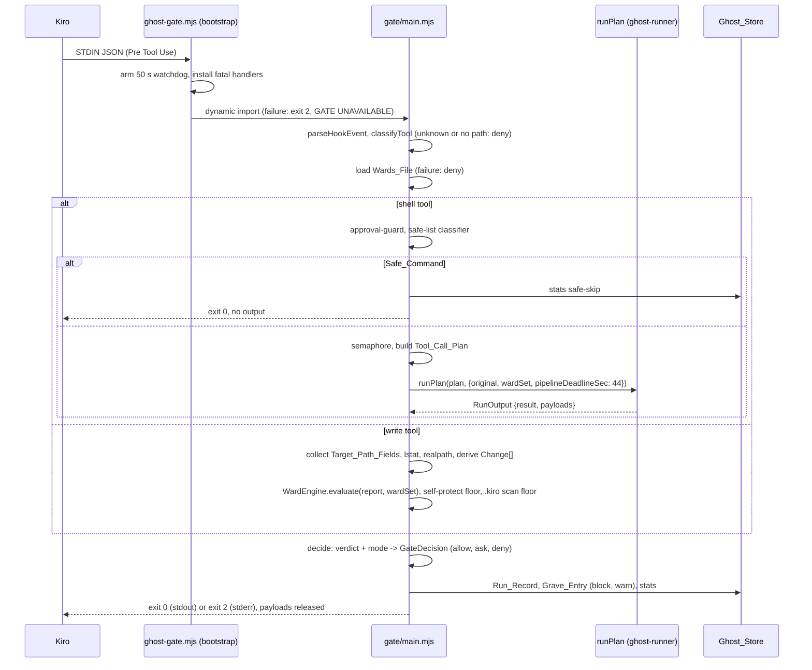

# Design Document: kiro-integration

## Overview

`kiro-integration` plugs Ghost Run+ into Kiro (IDE 1.4.x and CLI V3 3.4.x). It adds two workspace packages and one plugin folder:

- `@ghost-run/kiro-hook` (`integrations/kiro-hook/`): the hook scripts `ghost-gate` (Pre Tool Use), `ghost-log` (Post Tool Use), `contract-pbt` (file save), `world-scaffold` (file create), `blacklight-steering` (file save), the disabled probe hook, and the shared Ghost_Store module.
- `@ghost-run/mcp` (`integrations/mcp/`): the stdio MCP server `ghost-run` with the tools `ghost_run`, `ghost_diff`, `ghost_trace`, `wards_check`, and `blacklight`.
- `integrations/power/`: `plugin.json`, `skills/ghost-run/SKILL.md`, `mcp.json`, and the committed single-file server bundle (D6).

The gate decides from what a ghost run changed, not from the command shape (experiment B blocked 19 calls by shape and all were false positives or bypassed). All judgment logic is reused, not rewritten: `runPlan` of `ghost-runner`, `WardEngine.evaluate`, `renderMessage`, and the scanner of `possession`. The new code is glue with four hard properties: it fails closed, it has no LLM or network call, it never writes a secret to disk or output, and it states its claims per run.

### Design decisions at a glance

| # | Question | Decision |
|---|---|---|
| D1 | `warn` approval channel | Host `ask` decision of the Pre Tool Use output. `WARN_MODE` is committed as `ask` (human decision of 2026-11-21, after the IDE 1.4.236 and CLI prompt tests); `exit2` is only the fallback value. A `warn` never exits 0 without the ask JSON, a `block` stays exit 2, and the human answers the host prompt. PermissionRequest and a human-run approve command are not built; `ghost-run approve` stays a denied command. See "Approval channel". |
| D2 | One matcher or two | Two hook entries in `ghost-gate.json` (`shell`, `write`) with the same command. The tool is identified by `tool_name`. `ghost-log.json` has one entry per category for the same reason. |
| D3 | Loading built packages | `ghost-gate.mjs` is a bootstrap with `node:` imports only. It loads `lib/gate/main.mjs` through a dynamic `import()` inside `try/catch`, so a missing build or a syntax error exits with code 2 and not with the Node default code 1. |
| D4 | Time budget | Watchdog 50 s. `runPlan` gets `pipelineDeadlineSec: 44` so that the runner cleans up before the watchdog. The watchdog is the backstop for a hung runner. |
| D5 | Provenance `kind` | File read tools map to `file`, web tools to `web`, every MCP tool to `other`. `issue` is used by no default mapping. Unknown tools are not recorded. |
| D6 | Server launch in a power | A committed single-file bundle `integrations/power/server/ghost-run-mcp.mjs` built with esbuild (MIT). `mcp.json` points at it by a path relative to the power folder. The power also carries a copy of `ghost-runner/box` as `integrations/power/box/`, so the box lookup from the bundle finds it. The CLI 3.5.0 install test (2026-11-21) showed that the server starts in the install folder, so the workspace root is resolved by D11. Kiro IDE 1.4.236 (2026-11-21) also starts the server in the install folder, one server per window; fallback for a host that does not is a user-run link helper (see "Power"). |
| D7 | World registration | A convention, no `core` change: `worlds/<name>/world.config.ts` with a default export of fixed shape, one generated `tests/contract.test.ts` per world, and a root `vitest.worlds.config.ts`. See "world-scaffold". |
| D8 | `timeout` placement | Entry level (`hooks[].timeout`), as kiro.dev/docs/hooks documents. The two exp-b files put it inside `action`. See "Hook file format". |
| D9 | Concurrent ghost runs | A lock-file semaphore of 2 slots in the Ghost_Store, wait at most 5 s, then `deny` ("gate busy"). Bounds Docker load (O5). |
| D10 | Where the Grave_Entry is written | By the gate, before it exits (blocked calls are assumed to fire no Post Tool Use; the probe confirms). |
| D11 | Workspace root of the MCP server | Resolved per tool call by `src/workspace.mjs`, in this order: MCP `roots/list` (only when the client declared the `roots` capability), `GHOST_RUN_WORKSPACE`, the working directory unless it is the Own_Folder, then the optional `workspace` input of each tool call (used only when no root exists; absolute, realpath of an existing folder, not `/`, not the home folder, not the Own_Folder). `PWD` is not a source (it names the launch folder of the host, not the window's project). With no root every tool returns ``Pass `workspace` (the absolute path of your project root) and call again. Workspace root unknown: the server has no project root of its own (set GHOST_RUN_WORKSPACE to give it one)`` and does nothing else. The Ghost_Gate is unchanged (it takes `cwd` from the Hook_Event). See "Workspace root resolution". |

### Research summary

Sources are the Kiro documentation pages fetched on the authoring day: [Hooks](https://kiro.dev/docs/hooks/), [Hook triggers](https://kiro.dev/docs/hooks/types/), and [Hook actions](https://kiro.dev/docs/hooks/actions/). The pages were summarized, not quoted.

| Finding | Source | Consequence |
|---|---|---|
| The hook entry fields are `name`, `description`, `trigger`, `matcher`, `action.type`, `action.command`, `action.prompt`, `timeout`, `enabled`, `confirm`. `timeout` and `enabled` sit at entry level. `confirm` applies to the `Stop` trigger only. | hooks | D8. The format test checks entry-level `timeout`. |
| A shell command action: exit 0 adds STDOUT to the agent context. Any other exit code sends STDERR to the agent, and on Pre Tool Use blocks the call. Default timeout 60 s, 0 disables it. | hooks/actions | Requirement 7. The devlog shows the CLI treats exit 2 as the block, so the gate uses only 0 and 2. |
| File triggers exist for create, save, and delete (IDE and CLI V3). The page does not print the identifiers. The authoring environment's own hook tool lists `PostFileCreate`, `PostFileSave`, `PostFileDelete`. | hooks/types | `PostFileCreate` is the strong candidate for world-scaffold. It stays unconfirmed until the probe (O1). Resolved (CLI 3.4.0, 2026-11-18): the CLI fires `PostFileCreate` then `PostFileSave` for a file created by the write tool; `PostFileDelete` is not confirmed. Resolved (IDE 1.4.215, 2026-11-19): the same in the IDE; `PostFileDelete` is not confirmed there either (the default agent has no delete tool). |
| `PermissionRequest` exists in CLI V3 3.4.0 or later only. It runs after the permission policy was evaluated, immediately before a prompt, and does not run when policy already allows or denies the call or when a Pre Tool Use hook already allowed it. It can answer `allow` or `deny` through `hookSpecificOutput.decision.behavior`. No valid decision shows the normal prompt. | hooks/types | It cannot force a prompt, and the IDE has no equivalent. Rejected as the warn channel. |
| `permissionDecision` and `permissionDecisionReason` are Pre Tool Use output fields. CLI 3.4.0 or later can also rewrite a tool input before it runs. The authoring environment's hook tool documents the Pre Tool Use value `ask`. | hooks/types, environment | `ask` is the warn channel. Measured 2026-11-21 in IDE 1.4.236 and the CLI: both prompt and Deny blocks (Approval channel). |
| MCP tools appear in hook events as `mcp_<server>_<tool>`, and matchers accept `@mcp`, `@<server>`, or a regex. Hook JSON also accepts `*` and `?` wildcards. | hooks/types | ghost-gate matchers `shell` and `write` match no MCP tool (Requirement 2.5). ghost-log matches `@mcp`. |
| Categories `read`, `write`, `shell`, `web`, `spec` and the selectors `@builtin`, `@mcp`, `@powers` exist. The editor treats a plain name as a regular expression. | hooks/types | A combined `shell\|write` matcher is not documented. D2 uses separate entries. |

---

## Architecture

### Package layout and dependency direction

```
integrations/
  kiro-hook/                       # @ghost-run/kiro-hook (ESM .mjs, JSDoc, tsc checkJs strict)
    package.json                   # deps: @ghost-run/core, ghost-runner, wards-config (workspace:*), type-only @ghost-run/ui
    tsconfig.json                  # allowJs, checkJs, strict, noEmit
    ghost-gate.mjs                 # bootstrap, node: imports only (D3)
    ghost-log.mjs  contract-pbt.mjs  world-scaffold.mjs  blacklight-steering.mjs
    probe-host-facts.mjs           # disabled after the probe task
    exp-b-gate.mjs                 # kept, unchanged, not imported by anything
    gate-config.mjs                # constants: WARN_MODE, WATCHDOG_MS, caps (self-protected path)
    lib/
      hook-io.mjs                  # bounded STDIN read, fatal handlers, flush-then-exit
      event.mjs                    # parseHookEvent, TOOL_TABLE, classifyTool
      gate/main.mjs                # loaded dynamically; wires deps, calls decide
      gate/decide.mjs              # pure: (event, deps) -> GateDecision
      gate/safe-list.mjs           # grammar, tokenizer, classifier
      gate/write-judgment.mjs      # target paths -> Change[] -> GhostReport -> evaluate
      gate/shell-judgment.mjs      # Tool_Call_Plan, runPlan call, RunResult -> verdict input
      gate/self-protect.mjs        # Self_Protected_Paths matcher (core compilePathSet)
      gate/approval-guard.mjs      # reserved approval-command recognizer (deny only)
      gate/output.mjs              # messages, diff summary, ask JSON, exit mapping
      gate/grave.mjs               # buildGraveEntry
      gate/semaphore.mjs  gate/watchdog.mjs
      store/ghost-store.mjs        # paths, line-atomic append, caps, modes 0700/0600
      store/redact.mjs             # canary loading and [redacted] replacement
      store/stats.mjs  provenance.mjs  graveyard.mjs  runs.mjs  session-key.mjs
      wards-file.mjs               # resolveWardsFile, loadWardsForHook (shared with MCP)
      file-event.mjs               # path extraction from file events (names set by the probe)
      pbt/select.mjs  pbt/run.mjs  pbt/reporter.mjs
      scaffold/templates.mjs  scaffold/scaffold.mjs
    index.mjs                      # public exports for the MCP server and apps
    tests/
  mcp/                             # @ghost-run/mcp
    package.json                   # deps: @modelcontextprotocol/sdk 1.32.2, zod 4.6.7, workspace packages, @ghost-run/kiro-hook
    bin/ghost-run-mcp.mjs  src/server.mjs  src/schemas.mjs  src/result.mjs  src/confine.mjs
    src/workspace.mjs  src/tool-kit.mjs  src/default-wards.mjs  src/wards-source.mjs
    src/tools/{ghost_run,ghost_diff,ghost_trace,wards_check,blacklight}.mjs
    scripts/bundle.mjs  scripts/power-link.mjs
    tests/
  power/
    plugin.json  mcp.json  skills/ghost-run/SKILL.md  server/ghost-run-mcp.mjs  box/  README.md
```

Dependency direction (Requirement 1): `integrations/*` import `@ghost-run/core` (public entry; `@ghost-run/core/possession-node` for `scanFiles`, which `possession` exports only from that subpath), `@ghost-run/ghost-runner`, and `@ghost-run/wards-config` (`/node` for file reading). `@ghost-run/mcp` imports `@ghost-run/kiro-hook` through its `index.mjs` because Requirement 12 criterion 10 makes the Hook_Package the owner of the Ghost_Store module. This integration-to-integration edge is not in the structure steering today. The task of Requirement 1 criterion 9 adds it to the same sentence that adds `ghost-runner/` and `wards-config/`. `core/`, `ui/`, `ghost-runner/`, and `wards-config/` import nothing under `integrations/`; their `no-restricted-imports` rules get a pattern for `**/integrations/**` and the two package names.

Import bans as implemented (task 2.2, partly done). The `no-restricted-imports` rules of `core`, `ghost-runner`, `ui`, `wards-config`, `worlds/playground-shell`, and `apps/ghost-shell` ban `**/integrations/**`, `@ghost-run/kiro-hook`, `@ghost-run/kiro-hook/**`, `@ghost-run/mcp`, and `@ghost-run/mcp/**`. The `core` rule also bans `@ghost-run/ui` (ui-kit task 13.1), because `core/` must not depend on any other folder. The test is `integrations/kiro-hook/tests/import-ban.test.mjs`. It runs ESLint in a separate child process for each probe file, because the typescript-eslint parser keeps per-process project state and fails with "multiple candidate TSConfigRootDirs" when one process lints files of several packages.

```mermaid
flowchart LR
    Kiro[Kiro IDE / CLI] -->|STDIN JSON| Gate[ghost-gate.mjs bootstrap]
    Gate --> Main[lib/gate/main.mjs]
    Main --> WF[wards-file.mjs]
    WF --> WC[@ghost-run/wards-config/node loadWardsFile]
    Main --> Dec[decide.mjs]
    Dec --> SL[safe-list.mjs]
    Dec --> WJ[write-judgment.mjs]
    Dec --> SJ[shell-judgment.mjs]
    SJ --> GR[@ghost-run/ghost-runner runPlan]
    WJ --> Core[@ghost-run/core WardEngine, renderMessage, scanTexts]
    SJ --> Core
    Dec --> Out[output.mjs]
    Main --> Store[store/ghost-store.mjs]
    Log[ghost-log.mjs] --> Store
    Pbt[contract-pbt.mjs] --> Store
    BL[blacklight-steering.mjs] --> Poss[core/possession-node scanFiles]
    MCP[mcp server] --> Store
    MCP --> GR
    MCP --> Core
```

### Gate pipeline



---

## Components and Interfaces

### Hook file format (Requirement 2)

Comparison. The documentation (hooks page, schema table) lists `timeout` and `enabled` as entry-level fields: `hooks[].timeout`, `hooks[].enabled`. The two existing files `.kiro/hooks/exp-b-*.json` put `timeout` inside `action` (`action: { type, command, timeout }`) and `enabled` at entry level. Result: the documented placement is entry level. Whether the host also honors `action.timeout` is not shown by any log (the devlog says latency was not measured), so it is unknown. The new hook files use the documented entry-level placement only. Resolved (CLI 3.4.0, 2026-11-18): the host honors `timeout` at entry level (a 3 s wait with `timeout: 1` was cut after about 1 s) and ignores `action.timeout` (the same wait ran 3 s). The IDE (1.4.215, 2026-11-19) gives the same result: the entry-level `timeout: 1` cut the 3 s wait and the one inside `action` did not. Consequence recorded: the `action.timeout` of the `exp-b-` files has no effect in the CLI or the IDE, so those two files run under the default 60 s; Requirement 21 retires them, so no decision changes. The exp-b files keep their `action.timeout` and only change `enabled` (Requirement 21), so the format test exempts files whose name starts with `exp-b-` from the placement check and checks them for `enabled` only. The probe (criterion 4(f) of Requirement 24) settles the host behavior with two probe entries, one per placement, each with `timeout: 1` and a script that waits 3 s.

```json
{
  "version": "v1",
  "hooks": [
    {
      "name": "ghost-gate (shell)",
      "description": "Rehearses a shell call as a ghost run and blocks it when a ward is violated.",
      "trigger": "PreToolUse",
      "matcher": "shell",
      "action": { "type": "command", "command": "node integrations/kiro-hook/ghost-gate.mjs" },
      "timeout": 60,
      "enabled": true
    },
    { "name": "ghost-gate (write)", "trigger": "PreToolUse", "matcher": "write",
      "action": { "type": "command", "command": "node integrations/kiro-hook/ghost-gate.mjs" },
      "timeout": 60, "enabled": true }
  ]
}
```

| File | Entries | Trigger and matcher | Notes |
|---|---|---|---|
| `ghost-gate.json` | 2 | `PreToolUse`, `shell` and `write` | `timeout: 60`. The script's own watchdog fires at 50 s. |
| `ghost-log.json` | 4 | `PostToolUse`, `read`, `web`, `shell`, `@mcp` | The `ghost-run` server's own tools are skipped in the script. |
| `contract-pbt.json` | 1 | `PostFileSave`, `(^\|/)(core\|worlds)/` | The matcher is a prefilter. The script checks the workspace-relative path with `^(core\|worlds)/`. `timeout: 60`. |
| `blacklight-steering.json` | 1 | `PostFileSave`, `(^\|/)\.kiro/` | Script checks `^\.kiro/`. `timeout: 10`. |
| `world-scaffold.json` | 1 | file-create trigger (candidate `PostFileCreate`), `(^\|/)worlds/[^/]+/` | Written only after the probe confirms the identifier (O1). `timeout: 10`. Resolved (CLI 3.4.0, 2026-11-18): the trigger `PostFileCreate` is confirmed in the CLI, so the file may be written with `FILE_CREATE_TRIGGER = 'PostFileCreate'`. Resolved (IDE 1.4.215, 2026-11-19): the IDE fires the same trigger, so the file is written for both hosts. |
| `probe-host-facts.json` | several | all candidate triggers | Created first. `enabled: false` once the results table exists in `docs/measurements.md`. |
| `docker-warmup.json` | 1 | `PreToolUse`, `shell` | `timeout: 5` (entry level). Committed with `enabled: false` until task 19.1. The script never blocks and prints nothing (section Docker wake retry and warm-up, Requirement 25). |
| `exp-b-block-rm-rf.json`, `exp-b-log-write.json` | 1 each | unchanged | `enabled: false`. |

The file-event matcher is a regular expression over a path whose form (absolute or workspace-relative) is unconfirmed, so the matchers are unanchored prefilters and the script is the authority (`file-event.mjs` makes the path workspace-relative first).

Format test (`tests/hook-files.test.mjs`): parse every `.kiro/hooks/*.json`; require `version: "v1"`; non-empty `name`; a trigger from the list `PreToolUse, PostToolUse, PostFileCreate, PostFileSave, PostFileDelete, PermissionRequest`; for file triggers a matcher that compiles with `new RegExp`; `action.type: "command"`; a `command` that matches `^node integrations/kiro-hook/[a-z0-9-]+\.mjs$` with an existing script (the probe entries may add `--timeout-test=<placement>`); entry-level `timeout` of 1 to 60 for non-`exp-b-` files; an explicit boolean `enabled`; no absolute path and no user name. The format test also requires `enabled: false` in `docker-warmup.json` until task 19.1 sets it. A second test fails when any `exp-b-` file has `enabled: true` while `ghost-gate.json` has any enabled entry (Requirement 21 criterion 3), and a third fails when `probe-host-facts.json` is enabled while the devlog results table exists (Requirement 24 criterion 6).

### Hook I/O and bootstrap (`hook-io.mjs`, `ghost-gate.mjs`)

```js
/** @typedef {{ exit: 0 | 2, stdout: string, stderr: string }} HookOutcome */
export async function readStdinBounded(stream, maxBytes /* 1 MiB */) {}   // rejects with {code:'too-large'}
export function runHook(name, load /* () => import(...) */, opts) {}      // bootstrap helper
```

`ghost-gate.mjs` contains only: `import` of `node:` built-ins and `./lib/hook-io.mjs`, the arming of the watchdog, `process.on('uncaughtException' | 'unhandledRejection')` handlers that call `fatal('internal-error')`, a bounded STDIN read, and `await import('./lib/gate/main.mjs')` in `try/catch`. Any failure in that chain prints one fixed line and exits 2:

| Failure | STDERR line (fixed, no input text) |
|---|---|
| dynamic import throws (missing `dist/`, syntax error) | `GHOST RUN GATE UNAVAILABLE: build the packages first (pnpm -r build).` |
| unhandled error or rejection | `GHOST RUN GATE ERROR: internal-error; the tool call was not allowed.` |
| watchdog | `GHOST RUN GATE TIMEOUT: no verdict within 50 s; the tool call was not allowed.` |

Output is written with `process.stdout.write(text, cb)` / `process.stderr.write(text, cb)` and `process.exit(code)` runs in the callback, so a pipe is flushed before exit. The reason for the dynamic import: a static import of a missing workspace build makes Node exit with code 1 before any handler runs. The IDE blocks on any non-zero code, but the CLI treats only 2 as a block, so code 1 would let the call through. A failure before Node starts (no `node` binary, exit 127) is outside the gate's control and is stated in the README.

### Tool classification (`event.mjs`)

```js
/** @typedef {{ hook_event_name: string, cwd: string, session_id: string, tool_name: string, tool_input: Record<string, unknown> }} HookEvent */
export function parseHookEvent(text) {}          // -> { ok: true, event } | { ok: false, field }
export const TOOL_TABLE = { /* below */ };
export function classifyTool(event) {}           // -> { class, targets, texts, reason? }
```

`parseHookEvent` requires a JSON object, `hook_event_name` equal to `PreToolUse`, string `cwd` and `session_id`, string `tool_name`, and an object `tool_input` (not null, not an array). It reads own properties only and rebuilds a fresh object, so `__proto__` keys are never assigned. Depth is not a risk because `JSON.parse` is wrapped in `try/catch`, and the 1 MiB cap bounds size.

| Tool (`tool_name`) | Class | Target_Path_Fields read | Text fields (new content) | Notes |
|---|---|---|---|---|
| `execute_bash` | shell | none | none | `command` (string, required), `cwd`, `description`, `run_in_background`, `timeout`. `description` is never printed. `run_in_background` and `timeout` of the call are ignored; the ghost runs synchronously within the runner limits. |
| `fs_write` | write | `path` | `text` | creates or overwrites |
| `fs_append` | write | `path` | `text` | existing file: overwrite; missing: create |
| `str_replace` | write | `path` | `newStr` | edits an existing file; `oldStr`, `replace_all` ignored for judgment |
| `delete_file` | write | `targetFile` | none | `explanation` ignored |
| `code` | write or read-only | `file_path`, `path` | `replacement`, `new_name` | see below |
| anything else | unknown | none | none | `deny` (fail closed) |

The classifier reads every Target_Path_Field named in the table for the tool, and also any of `path`, `targetFile`, `file_path` that is present on a tool not listed for it (a present field on an unexpected tool is judged too, so a host that adds a field cannot slip past). A target field with a non-string value, or a write tool with no non-empty target, gives `deny` with the message `tool or input not recognized by the gate: not allowed.`.

The `code` tool. Its `operation` values, taken from the tool description visible to the authoring agent, are: read-only `search_symbols`, `lookup_symbols`, `get_document_symbols`, `generate_codebase_overview`, `search_codebase_map`, `pattern_search`, `goto_definition`, `find_references`, `hover`, `completion`, `diagnostics`; writing `rename_symbol`, `format_code`, and `pattern_rewrite` (documented as preview only, but treated as writing). The set `CODE_READ_ONLY_OPERATIONS` holds the first eleven. A `code` call whose `operation` is in that set is classified `read-only` and allowed without judgment. Any other value, a missing `operation`, or a non-string `operation` is `write`, so it needs a Target_Path_Field naming a file; a directory in `path` or no target gives `deny` (Requirement 6 criterion 11). A fixture `tests/fixtures/code-tool-operations.json` records the operation list, and the probe records the field names of real `code` calls. The list is unverified against the host schema and is re-checked when the probe results exist (O6). Resolved (CLI 3.4.0, 2026-11-18): the CLI `code` tool has 14 operations, the 11 read-only names above and the 3 writing names above, so `CODE_READ_ONLY_OPERATIONS` is unchanged and equals the first eleven. The input fields observed were `{file_path, operation}` and `{operation, symbol_name}` (both read-only operations); the fields of the writing operations were not observed, so the Target_Path_Field order for `code` stays as designed and is re-checked when a writing call is observed. Only the CLI was measured: the IDE default agent has no `code` tool (IDE 1.4.215, 2026-11-19), so no `code` call was logged there. The gate does not claim P5 for the other files that a symbol rename touches.

### Wards file resolution (`wards-file.mjs`, shared with MCP)

```js
export function resolveWardsFile(root, env) {}   // GHOST_RUN_WARDS_FILE, else <root>/wards.yaml, else <root>/apps/ghost-shell/wards.yaml
export async function loadWardsForHook(root, env) {}  // -> { ok: true, wardSet, safeCommands, file } | { ok: false, errors: string[] /* max 5, formatConfigError */ }
```

`loadWardsForHook` calls `loadWardsFile` from `@ghost-run/wards-config/node`. On `ok: true` it reads `result.safeCommands ?? []`. The field is added by the wards-config change that Requirement 4 criterion 6 names ("wards task 6"). That change is not in `wards/tasks.md` today (O7); until it lands, `safeCommands` is `[]` and only the built-in grammar applies. The `WardSet` of `core` is unchanged. The wards are loaded before the safe-list check, so a broken Wards_File blocks every call, including `ls`. That is the fail-closed rule, and it is also why the safe-list rule for secret paths can read the loaded `egress` wards.

### Safe list (`safe-list.mjs`, Requirement 4)

```js
/** @typedef {{ name: string[], options: readonly string[], intOptions?: readonly string[], paths: 'none'|'words'|'after--', extra?: 'words' }} GrammarEntry */
export const BUILTIN_GRAMMAR = [ /* entries below */ ];
export function tokenize(line) {}                      // -> { ok: true, words: string[] } | { ok: false }
export function classifySafe(line, grammar, secretMatcher) {}  // -> { safe: boolean, entry?: GrammarEntry }
```

Built-in entries (exactly Requirement 4 criterion 2): `pwd` (no argument); `ls` with options `-a -l -la -al` and path words; `cat`, `head`, `tail`, `wc` with path words, plus `-n <integer>` for `head` and `tail` and `-l -w -c` for `wc`; `git status`; `git diff` and `git log` (no further word, or path words after `--`); `git show`; `git branch` (no further word); `echo` with word arguments.

The classifier runs these steps in order and returns `not safe` at the first failure:

1. Reject the raw line when it contains any of: `;`, `&`, `|`, `<`, `>`, a backtick, `$`, `\`, a newline or carriage return, a NUL, or any code point in the hidden ranges of `hasHiddenChar`. This single character screen covers `&&`, `||`, `$(`, `${`, `$NAME`, redirects, and line continuation. Because `$` and `\` are rejected everywhere, double quotes never need escape handling.
2. Tokenize with a hand-written scanner: whitespace separates words, single quotes take everything literally to the next single quote, double quotes take everything to the next double quote (an unterminated quote is `not safe`). The scanner has no escape, no expansion, and no comment syntax; `#` at the start of a word is `not safe`.
3. Reject any word that contains `*`, `?`, or `[` outside quotes (glob), starts with `~`, or contains a `..` path segment (split on `/`).
4. Match `words[0]` (and `words[1]` for `git`) to a grammar entry. Every remaining word must be an allowed option, an integer after an `intOptions` option, or a path word where the entry allows paths (`after--` means path words are accepted only after a literal `--` word). An option not in the entry is `not safe` (so `git diff --output=file` fails). A word starting with `-` that is not a listed option is `not safe`.
5. For `cat`, `head`, `tail`, `wc`, and `git show` path words (and `git diff -- <path>` words), normalize with `normalizePath` and test against a `compilePathSet` of every `secrets` pattern of the `egress` wards (case-insensitive, as the engine does). A match is `not safe`, so a secret read always goes through the ghost.
6. Extension entries from `safeCommands` use the same grammar shape and the same steps. An extension entry is validated at load: its command name must not be a shell or interpreter word, and each entry is run through the steps with generated arguments in a test. An entry that would make a command with a forbidden character safe cannot exist, because step 1 runs before any entry is consulted.

The classifier is pure, has no I/O, and returns `not safe` for an unparsable line, so the ghost runs.

### Shell judgment (`shell-judgment.mjs`, Requirement 5)

```js
/** @typedef {import('@ghost-run/ghost-runner').RunOutput} RunOutput */
export function buildToolCallPlan(command, cwdRel) {}        // -> [{ command, cwd? }]; throws PlanBoundsError-like for 0 or > 4096 code points
export async function judgeShell(ctx, deps) {}               // deps.runPlan injectable; -> { result, summary } or throws
```

Steps: reject an empty command or one longer than 4,096 code points (counted by code point, not UTF-16 unit) with `deny`. Resolve `tool_input.cwd` against the workspace root with `path.resolve` and `fs.realpath` of the nearest existing parent; inside the root it becomes the Copy-relative `ShellAction.cwd` (`/` separators), outside it the verdict floor is `warn` with the notice `step 0: cwd outside the workspace, not rehearsed.` and no ghost starts. Acquire a semaphore slot (D9). Call `runPlan(plan, { original: root, wardSet, pipelineDeadlineSec: 44 })`. The runner's `RunResult.verdict` is taken as is. The gate does not recompute it and never passes the command text to a pattern check. After `runPlan` returns, `output.payloads` is dropped (`payloads.clear()` then the reference) before anything is printed or stored; the gate never reads it.

The runner option `pipelineDeadlineSec` is documented as configurable down to a lower value and fixed above 55; the design relies on 44 being accepted (O8, confirmed by the first gate task against the `ghost-runner` implementation). The Docker check (2 s), copy (20 s), and exec limit (25 s) are the runner defaults, and the five-scenario budget of 30 s each fits inside 44 s.

### Write judgment (`write-judgment.mjs`, Requirement 6)

```js
/** @typedef {{ lstat(p: string): Promise<import('node:fs').Stats | null>, realpath(p: string): Promise<string | null>, readdir(p: string): Promise<string[]> }} FsView */
export async function judgeWrite(classified, ctx, fsView) {}   // -> { verdict, report, notices, floors }
```

For each target (every Target_Path_Field value, strictest verdict wins):

1. Resolve against the workspace root with `path.resolve`. If the lexical result is outside the root, add `Effect { kind: 'file-write', destination }` (sanitized), floor `warn`, and skip the path wards.
2. Compute the lexical Copy-relative path and the real path (`realpath` of the target, or of its nearest existing parent joined with the missing tail). Judge both with `normalizePath`; an escaping real path is the outside case above. This is the symbolic-link rule of `wards` Requirement 5 criterion 5.
3. `lstat` the target (no follow). Derive the Change: `delete_file` gives `file-deleted` (for a directory, one per entry below it by a bounded breadth-first `readdir` walk of at most 10,000 entries, else the floor `warn` with `delete target too large to enumerate.`); a write to an existing regular file gives `file-overwritten` with `sizeBefore` and `sizeAfter` unknown, set to the current size and the size of the new text bytes; a write to a missing path gives `file-created`. A write through a symbolic link overwrites the link target, so the Change is `file-overwritten`, judged on both the lexical path and the real path (step 2).
4. Build a `GhostReport` with one step (`changes: [changes]`, no events) and call `WardEngine.evaluate(report, wardSet)`. No `secretValues` are passed (no payload exists to inspect).
5. Floors: a Change under Self_Protected_Paths gives `warn` with `step 0: change to a gate-protected path needs human approval.`; for a path under `.kiro/`, `scanTexts` over the text fields (markdown option by the file extension) with any Finding gives `warn` with `step 0: hidden text in new content for a Kiro file.`. Finding renderings are not printed by the gate. The notice has fixed text only.

`FsView` is injected so tests run against an in-memory tree with symbolic links modeled, and the real adapter is a thin `node:fs/promises` wrapper that reads only. The Write_Judgment claims no P1. It claims P5 only for the declared target path at judgment time.

### Self-protection (`self-protect.mjs`, Requirement 10 criteria 5 to 9)

`SELF_PROTECTED = ['.kiro/hooks/**', 'integrations/kiro-hook/**', 'integrations/mcp/**', '.ghost-run/**', <resolved Wards_File, workspace-relative>]`, compiled with `compilePathSet` (case-insensitive). The floor applies to write-tool targets (above) and to the Changes of a shell ghost run: after `runPlan` returns, any `file-created`, `file-overwritten`, `file-deleted`, or `symlink-changed` Change whose path matches raises the verdict to at least `warn` and adds the fixed notice to the message. Because the ghost runs on a Copy, a shell command that edits the gate is caught by diff and not by shape. The Plan_B case (no Changes) cannot see these edits; it is already `warn`. The Wards_File outside the workspace (`GHOST_RUN_WARDS_FILE` pointing elsewhere) is protected only through the tools the gate judges, as the README states. The `.ghost-run/**` entry is kept even though no approval store exists (D1), so an agent cannot rewrite the graveyard, the stats, or the provenance log without a human seeing a prompt.

### Approval channel (D1)

Constraints from Requirement 10: (a) the agent cannot approve its own `warn`, including by running an approval command through the shell; (b) from 2026-11-22 a rare necessary command such as `pnpm install` proceeds after one human approval of that tool call, with no second prompt, no file edit, and no gate disable. The same requirement forbids the gate from emitting `allow` for a `pass`.

| Option | (a) agent cannot self-approve | (b) one approval for an install | IDE and CLI | Failure if the host differs | Verdict |
|---|---|---|---|---|---|
| 1. Pre Tool Use `ask`: exit 0 and `{"hookSpecificOutput":{"permissionDecision":"ask","permissionDecisionReason":"<warn message>"}}` | Yes. The human answers in the host prompt. No state the agent can write exists. | Yes. One prompt for that call. No retry cycle. | Documented as a Pre Tool Use output field; the CLI side is plausible (3.4.0 docs name the field). Measured 2026-11-21 in Kiro IDE 1.4.236 and Kiro CLI: both show the prompt with the reason, and Deny blocks the call. | A host that ignored `ask` and treated exit 0 as allow would run a `warn` unapproved. The measurement shows this does not happen in either host, in all three trust settings. | **Chosen and committed** (`WARN_MODE = 'ask'`). |
| 2. CLI V3 3.4.0+ `PermissionRequest` | Yes for a hook that only denies. A hook that auto-allows would turn a ghost pass into a grant (excluded by Requirement 10 criterion 6). | The hook can only answer a prompt that already exists. It does not run when policy already allows the call (for example a trusted `execute_bash`) or when Pre Tool Use already allowed it, so it cannot force a human decision for a `warn`. | CLI only. The IDE has no equivalent. | Not applicable. | Rejected as the channel. README warns that a user-added auto-allow hook would bypass prompts. |
| 3. Human-run `pnpm ghost-run approve <Grave_Id>` writing `.ghost-run/approvals/` | Weak. The agent has the developer's OS privileges and can create the file by any process the gate does not see, and the only defense is recognizing the command text, which wrappers (`sh -c`, `env`, a script the same call writes) can evade. | Two interactions (block, then approve, then the agent retries the identical call). | Same on both hosts. | Deterministic. | Not built. |
| 4. Human runs the blocked command in their own terminal after a plain `exit 2` | Yes, by construction. | Yes in effect (the human types the install once), but the agent gets no result unless the human relays it. | Same on both hosts. | None. | The baseline and the fallback. |
| 5. Deny and tell the agent to ask the user in chat | No. The agent mediates and can claim approval. | n/a | n/a | n/a | Rejected. |

Decision (human decision of 2026-11-21, task 17.3). Option 1 is committed, option 4 is the fallback, and options 2, 3, and 5 are not built. `gate-config.mjs` exports `WARN_MODE`, one of `'exit2'` or `'ask'`, committed as `'ask'`. The file is a Self_Protected_Path, so an agent edit of it needs the human prompt; flipping the value to `'exit2'` is always safe and is the answer if a later host version stops honoring `ask`.

Behavior by mode for a `warn` verdict: `ask` (committed) prints the ask JSON on STDOUT and exits 0 (Requirement 10 criterion 4); `exit2` (fallback only) prints the warn message of `renderMessage` on STDERR and exits 2. the reason text is the same warn message cut to 1,200 code points and ASCII-escaped by the sanitizer. A `block` and every `deny` always exit 2. A `pass` exits 0 with the pass line on STDOUT and no permission field. Requirement 7 criterion 3 and KI-P1 state that a `warn` never proceeds without a human approval: exit 2 in `exit2` mode, and in `ask` mode exit 0 only together with the `ask` JSON (never `allow`, never empty STDOUT). The exit-0 output hands the decision to the host prompt, which is the Approval_Channel: the human answers that prompt, the tool runs only if the human accepts, and a Deny blocks the call (O9). A `block` stays exit 2 in both modes. The command `ghost-run approve` stays denied by `approval-guard.mjs` (below).

The `ask` approval per call, single use, and expiry within 10 minutes (Requirement 10 criterion 2) are properties of the host prompt, which Kiro creates per tool call. The gate stores no approval and has no approval token. Requirement 10 criterion 10 holds by construction and is also defended by a reserved-word rule: `approval-guard.mjs` denies a shell call whose command text, after lowercasing and removing quote characters, contains `ghost-run approve` or `ghost-run-approve` (the reserved names of a future command). The rule reads the command text and can only deny, which is the exception that Requirement 5 criterion 4 allows. A source-scan test requires that no gate module reads any file under `.ghost-run/approvals/` or `.ghost-run/` for a decision input.

Verification result (task 17.3, 2026-11-21, `docs/measurements.md`). The disabled `probe-ask.json` hook (script `probe-host-facts.mjs --ask-test`, answering `ask` only for a call to `echo ghost-run-ask-probe`) was run in Kiro IDE 1.4.236 and in Kiro CLI with three settings: (a) shell not trusted, (b) shell trusted, (c) trust all. Both hosts show a prompt that carries the reason, and Deny blocks the call, in all three settings. IDE details: (a) Supervised with no trusted commands shows `Your approval is required to continue: probe: ask test` with Allow and Deny, and after Deny the agent reported that the Pre Tool Use hook blocked the call and gave the reason; (b) with `kiroAgent.autoApproveAgentCommands` set to `["echo *"]` a plain `echo` ran without a prompt, the probe command still prompted, and Deny blocked; (c) with `["*"]` and the mode `Approve for me` the prompt still appeared and waited, and Deny blocked; the `ask` test was logged three times as `asked`. CLI: the prompt waits for the human and Allow is preselected. The decision rule of task 17.2 is met, so `WARN_MODE` is `ask` for both hosts (one hook file serves both). Remaining limit: a tool call that the host policy auto-approves without any hook output is outside the gate, as before (Requirement 10 criterion 8). After 2026-11-22 the devlog records how many approvals a development day needed (Requirement 10 criterion 11).

### Decision and output (`decide.mjs`, `output.mjs`, Requirements 7, 9)

```js
/** @typedef {{ kind: 'allow' | 'ask' | 'deny', exit: 0 | 2, stdout: string, stderr: string, grave?: object, stats: string[] }} GateDecision */
export function decide(input, deps) {}                    // pure given deps: wards, runPlan, fsView, clock, uuid, warnMode
export function decisionFromRunResult(result, ctx) {}     // RunResult -> GateDecision (pure)
export function diffSummary(changesPerStep) {}            // string, <= 1,200 code points
export function askJson(reason) {}                        // string
```

`decisionFromRunResult` mapping (pure, KI-P1):

| Runner verdict (after floors) | `WARN_MODE` | Decision | Exit | Output |
|---|---|---|---|---|
| `pass` | any | allow | 0 | STDOUT pass line `GHOST RUN PASSED: all <n> wards cleared.` (plus the claim line when a claim is lowered) |
| `warn` | `ask` (committed) | ask | 0 | STDOUT ask JSON, same text as reason |
| `warn` | `exit2` (fallback only) | deny | 2 | STDERR warn message, diff summary, seance link |
| `block` | any | deny | 2 | STDERR block message, diff summary, seance link |
| any, internal failure, timeout, bad input | any | deny | 2 | one fixed STDERR line |

Message construction. The ward text comes from `renderMessage(verdict, { wardCount, claims, seance: { id: graveId, base: env.GHOST_RUN_SEANCE_BASE } })` of `wards`. `verdict` is `result.wardVerdict` when present. When `result.verdict` is higher than the ward verdict (a runner floor such as a timeout, a diagnostic, or Plan B), the gate passes a copy of the ward verdict with its `verdict` field set to the runner verdict, and appends one fixed line per floor reason from a table `FLOOR_TEXT` keyed by `status` or diagnostic `name` (for example `recorder-failure`, `sqlite-unreadable`, `secret-values-unreadable`, `protected-path-excluded`, `external-change`, `copy-timeout`, `pipeline-deadline`, `timeout`). The lines hold no input text. When `wardVerdict` is absent (Plan B) the gate uses an empty verdict. `claims` is `{ p5: isolation.p5Claimed, p6: isolation.p6Claimed }`. In Plan B both are `false`, so `renderMessage` appends the line `P5 and P6 protections are NOT guaranteed for this run: no ghost rehearsal took place (static analysis only).`, and the gate adds the exact line `P1 isolation is NOT guaranteed: Docker box unavailable, static analysis only.` The assumption that `renderMessage` keys its template on `verdict.verdict` and prints a warn template for a verdict with no violation is checked by a test (O10).

Diff summary. `diffSummary(changes)` counts per kind over all steps (`file-deleted`, `file-overwritten`, `file-created`, `symlink-changed`; rows lost from `sql-row-count` by the rule `dropped ? max(0, rowsBefore) : max(0, rowsBefore - rowsAfter)`), writes the header `Diff summary: <a> deleted, <b> overwritten, <c> created, <d> symlinks changed, <n> rows lost.`, then at most 10 lines `  <kind> <path>` with `sanitizeJudgeText(path)` in `compareCodePoints` order of the path (tie-break kind), then `+<k> more changes.` when more exist, and finally cuts at 1,200 code points on a line boundary. A Write_Judgment summary uses the derived Changes the same way. The wards sanitizer is imported under the name `sanitizeJudgeText`. `core` exports a `sanitizeText` from both `wards` and `possession`, which cannot both be exported under one name (O11), so the Hook_Package depends on `wards` exporting its function as `sanitizeJudgeText`, as the requirements already call it.

Messages contain only ward ids and reasons from the engine, the claim line, the diff summary, the floor lines, and the seance link (Requirement 7 criterion 5). The gate never forwards `description`, `explanation`, ghost stdout, payload bytes, or `secretValues`. The words `sealed` and `isolated` appear in no gate-owned fixed string; the exact Plan B sentence required by Requirement 9 contains `isolation` and that is the only form used.

### Docker wake retry and warm-up (`gate-config.mjs`, `docker-warmup.mjs`, `lib/warmup.mjs`, Requirement 25)

Cause (measured 2026-11-21, `docs/measurements.md`, heading `Docker Resource Saver wake-up`). Docker Desktop Resource Saver stops the VM after 5 idle minutes. With the VM stopped, the first `docker info` took 1.88 s. The IDE gate's availability check has a 2 s deadline and timed out at 2010 to 2021 ms in 4 runs, so the runner fell back to static analysis. Replays from a shell took 55 to 158 ms because the VM was already awake.

Flow of the retry. The gate passes `dockerWakeRetryMs: DOCKER_WAKE_RETRY_MS` from `lib/gate/shell-judgment.mjs` to `runPlan`. The runner (`ghost-runner` Requirement 3, criterion 11) then works as follows.

1. Run the availability check with the 2 s deadline. If it succeeds, continue with the docker box as before (fast path, no retry).
2. If it times out, repeat it once with the `dockerWakeRetryMs` deadline, capped by the remaining pipeline deadline.
3. If it fails with a daemon error or the `docker` binary is missing, do not retry; the result is Plan B.
4. If the retry also times out, the result is Plan B (static analysis, NEEDS HUMAN APPROVAL). Fail-closed is unchanged: a non-safe command is never allowed without a rehearsal or a human approval.
5. The Run_Record (the serialized `RunResult`) holds `phases.dockerCheckMs` and `dockerWakeRetried` (boolean).

| Constant | Value | File | Meaning |
|---|---|---|---|
| `DOCKER_WAKE_RETRY_MS` | 10,000 | `integrations/kiro-hook/gate-config.mjs` | Deadline of the single retry |
| `WARMUP_BUDGET_MS` | 1,000 | `integrations/kiro-hook/gate-config.mjs` | The warm-up hook exits within this time |
| `THROTTLE_MS` | 60,000 | `integrations/kiro-hook/lib/warmup.mjs` | At most one warm-up start per 60 s |
| `RUNNER_DEADLINE_SEC` | 44 | `gate-config.mjs` (existing) | Upper bound of `runPlan` |
| `WATCHDOG_MS` | 50,000 | `gate-config.mjs` (existing) | Gate watchdog |

Why 2 s + 10 s fits. The two checks add at most 12 s, which is inside `RUNNER_DEADLINE_SEC` (44 s). The gate already starts `runPlan` with `pipelineDeadlineSec = min(44, floor(48 - elapsedSec))`, and the retry is capped by that deadline, so the runner still returns its own `pipeline-deadline` result before 48 s. The 50 s watchdog and the 60 s Hook_Limit are therefore not reached by the retry. A worst case of 12 s for the check leaves at least 32 s for the ghost run.

Warm-up script control flow (`docker-warmup.mjs` calls `warmUp` of `lib/warmup.mjs`).

1. Arm a timer of `WARMUP_BUDGET_MS` that exits with code 0.
2. Read the stamp file in the OS temp folder. If its time is less than `THROTTLE_MS` old, exit 0 without starting a process.
3. Otherwise write the stamp, then start one `docker info --format {{.ServerVersion}}` (an engine call; `docker version` does not wake a stopped Docker Desktop VM, see `docs/measurements.md`) with `spawn(..., { detached: true, stdio: 'ignore', shell: false })` and `unref()`. The child outlives the hook process and wakes the VM.
4. On any error (missing `docker` binary, unwritable stamp, spawn error) exit 0.

The script never reads STDIN, prints nothing on STDOUT or STDERR, never denies or asks, has no shell-string execution and no network code, and exits 0 on every path. A hook exit code other than 2 does not block, and the output is empty, so nothing reaches the agent.

Fallback trigger decision. The warm-up is most useful at the start of a prompt. The host probe (CLI 3.4.0, IDE 1.4.215) never registered a prompt-submit trigger, and `ALLOWED_TRIGGERS` of the format test has none. The design therefore warms up on the Pre Tool Use of the shell call (`PreToolUse`, matcher `shell`). The warm-up and the gate hook then start at the same event, so the warm-up helps the later shell calls and only partly the first one; the gate retry covers the first call. A prompt-submit trigger stays a candidate for a later probe (open item O20).

Tests (`integrations/kiro-hook/tests/`).

| File | Tests | Covers |
|---|---|---|
| `gate-wake.test.mjs` | 5 | constants; the option passed to `runPlan`; daemon down gives static analysis without retry; a timeout past both deadlines gives static analysis with `dockerWakeRetried` recorded; `[docker]` slow first check then fast retry gives a full docker-box run with `rehearsed: true` |
| `docker-warmup.test.mjs` | 8 | exit 0 within the budget with no output; the detached process survives the parent; throttle; docker missing; no shell and no network code; unit tests of `warmUp`; hook entry committed disabled |
| `worlds-config.test.mjs` | 3 | `vitest.worlds.config.ts` imports only `node:` modules and the documented command loads it |
| `hook-io.test.mjs`, `gate-shell-judgment.test.mjs` | existing files | the constant values and the option value |

The `[docker]` test reports `skipped (docker unavailable)` when Docker is unavailable.

### Watchdog and failure handling (`watchdog.mjs`, Requirement 8)

```js
export function armWatchdog({ ms = 50_000, onFire }) {}   // returns { disarm() }; timer is ref'ed
```

Time budget (D4). The maxima are: process start and module load 1 s, semaphore wait 5 s, `runPlan` 44 s, decision, store writes, and flush 1 s. Their sum is 51 s, one second over the watchdog, so `runPlan` is started with the remaining budget instead of a fixed value: `pipelineDeadlineSec = min(44, floor(48 - elapsedSec))`, never below 5. The runner then returns its own `pipeline-deadline` result (floor `warn`) before 48 s, and the store writes finish before the 50 s watchdog. The watchdog only fires when the runner hangs. It performs a best-effort cleanup and exits 2 with the timeout line. The cleanup removes the container and Copy that this process created. This needs the run id up front, which `runPlan` generates internally. The gate therefore needs an additive optional option `RunnerOptions.runId` (a caller-supplied UUID that the runner uses for the `ghost-run.run-id` label and the Copy path) so the watchdog can run `docker rm -f -v` by label and remove `os.tmpdir()/ghost-run/<runId>`. This is a small change in `ghost-runner` (O12). Without it the watchdog still exits 2, and the leftover container is removed by the next runner start sweep only for pool slots, so Requirement 8 criterion 9 would not hold for a hung runner. The first gate task therefore depends on that option.

On a rejected `runPlan`, the gate exits 2 with `GHOST RUN GATE ERROR: runner-failed; the tool call was not allowed.` and does not retry. On every path the gate releases the semaphore slot and clears the payload map.

### Ghost_Store (`store/ghost-store.mjs`, Requirement 12)

```js
export function storePaths(root) {}                          // { dir, graveyard, stats, runs, sessions, pbt, blacklight, probe, locks }
export async function appendLine(file, line) {}              // one fs.write of `${line}\n` to an fd opened with O_APPEND, mode 0o600; dirs 0o700
export function readLines(text) {}                           // pure: { lines: string[], corrupt: number }
export async function enforceCaps(root, caps) {}             // sessions 20, runs 200, graveyard 2000 lines, provenance 1000 per session
export function sessionKey(sessionId) {}                     // pure
export function redactCanaries(text, canaries) {}            // pure
export async function loadCanaries(root, wardSet) {}         // reads egress `secrets` files, max 16 files, 64 KiB each, in memory only
```

Line-atomic append: `fs.open(file, 'a', 0o600)`, one `write` of the whole line below the platform's atomic append size (lines are capped; a provenance record up to 1 MiB uses the same single write, and the reader skips a torn line and counts it `corrupt`). Layout: `sessions/<Session_Key>/provenance.jsonl`, `graveyard.jsonl`, `stats.jsonl`, `runs/<Run_Id>.json`, `pbt/last.json`, `blacklight/last.txt`, `probe/events.jsonl`, `locks/`. `approvals/` is not created (D1). `.gitignore` gets `.ghost-run/` and a test requires the entry.

`sessionKey(id)`: if `id` matches `^[A-Za-z0-9_-]{1,64}$` it is the key; otherwise the lowercase SHA-256 hex of the UTF-8 bytes of `id` (64 characters, which also matches the pattern). The mapping is deterministic, and a valid id never collides with a hashed one because only ids that fail the pattern are hashed.

Redaction. `loadCanaries` reads the files that match the `secrets` patterns of the `egress` wards from the workspace (not from a Copy), at most 16 files in code-point order of the path and 65,536 bytes each, and runs `extractCanaries(path, bytes)` from `core`. The canary set lives in memory for the process. `redactCanaries` replaces every occurrence of every canary in a string with `[redacted]` before the string reaches any `appendLine`, `fs.writeFile`, STDOUT, or STDERR call. It covers the raw form; the base64, hex, and percent forms of a canary typed into a command are covered by running the same `wards` inspector over the outgoing string (the leak guard approach of the `wards` design), so a command that carries an encoded canary is also replaced. All writes go through `storeWrite(text)`, which redacts first. A source-scan test requires that no module outside `ghost-store.mjs` calls `fs.writeFile`, `fs.appendFile`, or `fs.write` for a path under `.ghost-run`.

Run_Record. `runs/<Run_Id>.json` is `serializeRunResult(result)` of `ghost-runner` (payload bytes replaced by length and SHA-256; no `secretValues` field exists on a `RunResult`). The Write_Judgment gets a Run_Record too, built from the report and the verdict, with a random UUID.

### ghost-log (`ghost-log.mjs`, Requirement 13)

Post Tool Use event handling:

```js
export function buildProvenanceRecord(event, ctx) {}      // -> { record } | { skip: 'secret-path' | 'canary' | 'too-large' | 'unknown-tool' | 'outside-workspace' }
export function summarizeStats(lines) {}                  // pure -> { commandsSeen, commandsGhosted, commandsBlocked, commandsWarned, commandsSafeSkipped, commandsExecuted }
export function formatStatsTable(summary) {}
```

| Tool class (from `tool_name`) | Provenance `kind` | `source` |
|---|---|---|
| built-in read tools (`read_file`) | `file` | workspace-relative path with `/`, from `tool_input.path` (or `file_path`) |
| web tools (`web_fetch`) | `web` | the URL with userinfo removed |
| `mcp_*` tools, except those of the `ghost-run` server | `other` | `mcp:<tool_name>` |
| shell tools | none (Stats_Event `executed` only) | |
| anything else | none | |

Content comes from the tool response field, whose name was unconfirmed (candidates: `tool_response`, `tool_result`, `response`; set by the probe, O2). Resolved (CLI 3.4.0, 2026-11-18): the CLI field is `tool_response` and it is not an object (the probe records only field names of object-valued fields; the exact type is not recorded). Resolved (IDE 1.4.215, 2026-11-19): the IDE delivers the same field, also not an object. `POST_RESPONSE_FIELDS = ['tool_response']`. A string is used as is; a value of any other non-object type is treated as no response and takes the file-read fallback below; an object (not seen in the CLI or the IDE, kept as a defensive path) contributes its string leaves joined with newlines up to the 1 MiB cap. When the host does not deliver a response, a `file` record is built by reading the named workspace file (bounded read of at most 1 MiB; a path outside the workspace is skipped); other kinds record nothing. Skips: a `file` source matching an `egress` `secrets` pattern (after `normalizePath`) is not recorded and its path is not written anywhere else; content containing a canary (raw or encoded) is not recorded; content over 1 MiB is not recorded; each skip appends the Stats_Event `provenance-skipped`.

Record format. A line of `provenance.jsonl` is one JSON object with the keys `source`, `kind`, `content` in that order (the same builder as `serializeProvenanceLog`), validated before writing with `parseProvenanceLog('[' + line + ']')`; only a parseable record is written. Reading splits lines, parses each line alone, skips and counts corrupt lines, then validates the survivors as one log. There is no clock, session, or secret field in the record. `kind: 'issue'` is not produced by default (D5).

Stats. A Stats_Event line is `{"kind":"<token>","at":"YYYY-MM-DDTHH:MM:SSZ"}` with the tokens `seen`, `safe-skip`, `ghosted`, `passed`, `warned`, `blocked`, `executed`, `provenance-skipped`. The gate writes the first six, ghost-log writes `executed` and `provenance-skipped`, and a Write_Judgment writes `seen`, then one of `passed`, `warned`, `blocked`. `ghosted` counts only runs that called `runPlan`. In `ask` mode a `warn` counts as `warned`. `summarizeStats` counts the lines of each token; `commandsSeen` is the number of `seen` lines, and `commandsGhosted` is the number of `ghosted` lines. Corrupt lines are ignored. `formatStatsTable` prints one table for `docs/devlog.md`.

Post Tool Use never changes the call: success exits 0, failure writes the failure class on STDERR and exits 1 (a non-zero code of a Post hook does not alter the executed call; the message to the agent is harmless text and carries no claim that the tool failed). Latency stays within 5 s for a 1 MiB record.

Cross-call exfiltration (Requirement 13 criterion 13). What the records can do: after the fact, `ghost_trace` and the Grave_Entry `links` can show that a text read in an earlier call (for example a README with a destination hidden in tag characters) contains the destination of a later blocked or warned action, and the stats and the provenance log support a human review. What they cannot do: block, warn on, or change the verdict of a later call. A secret read in call A and sent in call B is two separate Plans; the gate rehearses B alone, sees no `secret-read` in B's own Copy run unless B reads it again, and so the P6 behavior criterion does not fire. The gate never reads the Provenance_Log (a source-scan test enforces that no `gate/` module imports `store/provenance.mjs`), and the red thread is built after the verdict is fixed. P6 stays "within one tool call".

### Graveyard records (`gate/grave.mjs`, Requirement 14)

```js
/** @typedef {import('@ghost-run/ui').GraveEntry} Grave_Entry */   // type-only import, ui-kit name GraveEntry
export function buildGraveEntry({ runId, command, recordedAt, result, provenance }) {}   // pure
export async function readGraveyard(file) {}   // -> { entries: Grave_Entry[], corrupt: number }
```

`id` is `g-<runId>` (UUID characters, `-`, and `g`, at most 38 characters, so it matches `^[A-Za-z0-9_-]{1,64}$`). `command` is the shell command, or `<tool_name> <workspace-relative path>` for a Write_Judgment. `recordedAt` is `new Date().toISOString()` cut to `YYYY-MM-DDTHH:MM:SSZ`. `wardIds` are the distinct `wardId` values of `wardVerdict.violations` in order of first appearance. `detail` holds `wardVerdict`, `changes` (`report.changes`), `claims` (`{ mode, p1Claimed, p5Claimed, p6Claimed }` from `isolation`), `actionLabels: [command]`, and, when a session Provenance_Log exists and `collectNeedles(report)` is not empty, `sources` (records mapped to `{ source, text, scan }` with `scan = scanText(content)`), `needles`, and `links` from `traceRedThread`. The red thread is computed after the verdict is final and cannot change it. The whole entry passes `redactCanaries` as one serialized string before the write. A Grave_Entry is written only for `block` and `warn` (including `ask` and Plan B), before the process exits, in the same code path as the message so the seance link and the entry carry the same id. If the write or the Run_Record write fails, the gate exits 2 with `GHOST RUN GATE ERROR: store-failed; the tool call was not allowed.` even in `ask` mode.

Assumption (D10): a call blocked by exit 2 fires no Post Tool Use event, so ghost-log writes no second entry. If the probe shows that a blocked call does fire Post Tool Use, ghost-log skips events whose `tool_use_id` (if present) or `(tool_name, tool_input digest)` matches a graveyard entry of the same session written within the last 60 s. The skip is written only if the probe finds the duplicate (O2). Resolved (CLI 3.4.0, 2026-11-18): the CLI fires no Post Tool Use for a blocked call, so the assumption holds and the duplicate-skip rule is NOT implemented for the CLI. Resolved (IDE 1.4.215, 2026-11-19): the IDE also fires no Post Tool Use for a blocked call, so the duplicate-skip rule is not needed in either host and stays unimplemented; it remains a documented fallback in case a later host version changes this. The CLI create sequence `PostFileCreate` then `PostFileSave` needs no duplicate-skip in ghost-log, because ghost-log registers `PostToolUse` and not file events; `contract-pbt` and `blacklight-steering` register `PostFileSave` only and run once per create.

### Seance viewer and auto-start (`seance.mjs`, `lib/seance/`, Requirement 26)

```js
export function parseSeanceBase(base) {}            // -> { local, port }; default http://localhost:5317
export function createSeanceServer({ root, idleMs, onIdle }) {}   // http.Server, not listening
export function startSeanceServer({ root, port, idleMs, onIdle }) {}   // listens on 127.0.0.1
export function renderList(entries, corrupt) {}     // pure HTML
export function renderGrave(entry) {}               // pure HTML
export async function maybeStartSeance({ root, env, probe, spawnViewer }) {}   // never throws
```

The viewer reads `graveyard.jsonl` with `readGraveyard` on every request, so it keeps no state and needs no restart. Routing works on the raw request path (no decoding): `/seance/health`, `/seance` or `/seance/` (list), and `/seance/<id>` where `<id>` matches the id pattern and exists in the file. Everything else is 404, and a method other than GET is 405.

Rendering decision: the kit's `Graveyard` and `SeanceView` are TSX source in `@ghost-run/ui` with click handlers and focus effects. The hook package is plain `.mjs` that no build step compiles and that may not import `ui` source. So the pages are plain HTML in the kit's dark tokens, with no script, built by the pure functions of `lib/seance/render.mjs`. Every value passes `text()`: hidden and control characters become `\u{...}` text, the value is cut at 500 code points, and it is HTML-escaped. The CSP is `default-src 'none'; style-src 'sha256-<hash of the one style block>'`.

Auto-start: `decide` takes an optional `deps.onGrave` that it calls after a Grave_Entry write succeeded (a throw is swallowed). `main.mjs` records the call and, after `decide` returns, awaits `maybeStartSeance` raced against 500 ms. `maybeStartSeance` does nothing when `GHOST_RUN_SEANCE_AUTOSTART` is `0` or the base is not `http://localhost` or an http base on the IPv4 loopback address. Otherwise it probes `GET 127.0.0.1:<port>/seance/health` (300 ms). A refused connection starts `node seance.mjs --root <root> --port <port> --idle-ms 1800000` detached with `stdio: 'ignore'` and `unref`. A viewer answer, any other answer, or a timeout starts nothing. A refused connection takes about 1 ms, so the hook pays that and the spawn call. The decision, the output text, and the exit code are produced before this step and are not read by it.

Limit: one port serves one workspace. A second workspace whose gate finds a viewer on the port starts nothing, and its link shows the first workspace's graveyard (404 for its ids). Use `GHOST_RUN_SEANCE_BASE` with another port per workspace.

### contract-pbt (`contract-pbt.mjs`, Requirement 15)

```js
export function selectSuites(relPath) {}      // pure -> { kind: 'core' | 'world' | 'none', world?: string }
export async function runSuites(sel, deps) {} // deps: spawn, clock, store; -> PbtSummary
```

`selectSuites` maps a workspace-relative path: `core/...` gives `core`; `worlds/<name>/...` with a valid world name gives `world`; anything else gives `none` and the hook exits 0 silently. The run uses the vitest of the repository and the counts of the owning specs; the hook defines no count. It sets `GHOST_PBT_MODE=short` (the `pbt-config.ts` of `core` then uses 100 runs and a 60 s per-suite timeout). The Docker-bound Repo_World properties read their own on-save count of 20 from the `ghost-runner` test configuration (`ghost-runner` Requirement 17 criterion 8, O13 confirms the variable that selects it). The hook adds no per-property count of its own.

| Saved path | Command (spawned with `process.execPath`, no shell) |
|---|---|
| `core/**` | vitest in `core/` (all `core` property tests), then vitest with `vitest.worlds.config.ts` over `worlds/*/tests/contract.test.ts` (every registered world) |
| `worlds/<name>/**` | if `worlds/<name>/package.json` exists, vitest in that folder for `tests/contract.test.ts`; otherwise vitest with `vitest.worlds.config.ts` for that one file; plus the `core` judgment-engine property files |

Results stream through a small reporter module (`lib/pbt/reporter.mjs`, registered with `--reporter`) that prints one JSON line per finished test. The hook reads the lines, so when the deadline stops the run the finished tests are known. Deadline handling: an internal timer at 55 s kills the child process group (SIGTERM, then SIGKILL after 2 s), prints `incomplete: deadline reached` with the names of the tests that did not finish, and never reports `passed` for them. A failing property prints on STDERR the property id (`P1`), the shrunk counterexample, the violated criterion id, and the seed in the form of `VerificationError` (`propertyId`, `criterionId`, `counterexample`) of `core-contract`, then exits 1. A Docker-bound test that the runner marks skipped is printed `skipped (docker unavailable)` and counted as not passed. The summary goes to `.ghost-run/pbt/last.json` and to STDOUT (whether STDOUT of a file-event hook reaches the agent is O2 and nothing depends on it; Resolved (CLI 3.4.0, 2026-11-18): in the CLI it does not reach the agent, so `.ghost-run/pbt/last.json` is the only channel there. Resolved (IDE 1.4.215, 2026-11-19): the same in the IDE, so the file is the only channel in both hosts.). A lock file `locks/pbt.lock` holds the PID of the running child. A new save stops the older child (kill by PID after checking the lock owner is a process of this user and the command line matches) and takes the lock, so two runs never write `last.json` together. The nightly mode is never started by the hook.

The vitest reporter API differs between vitest majors. The reporter module is written against the version in `pnpm-lock.yaml` and a test fails when the reporter hook it needs is absent; if the repository's vitest cannot stream per-test results, the fallback is `--reporter=verbose` line parsing (O14).

### world-scaffold and world registration (`world-scaffold.mjs`, Requirement 16, D7)

Search for a registration mechanism that changes nothing in `core`. `core` has no registry type (the `core-contract` design removed `register()` and the runtime map: "the playground loads a pre-validated world manifest"). `ghost-shell` already uses a local convention: `worlds/playground-shell/world.config.ts` with a default export `{ id, deterministic, wardsFile, create }`. That is the shape the scaffold generates. Three consumers need to find a world, and none needs a `core` type:

| Consumer | How it finds worlds | `core` change |
|---|---|---|
| contract-pbt and the CI test run | `vitest.worlds.config.ts` at the repository root includes `worlds/*/tests/contract.test.ts`. A world is registered when its folder has `world.config.ts` and a passing contract test. | none |
| Playground and apps (Vite) | `import.meta.glob('../../worlds/*/world.config.ts', { eager: true })` in app code, filtered by a manifest of world ids that passed `verifyWorld` (the manifest is produced by the apps, not by this spec). | none |
| Node tools | read the folder names of `worlds/` and run the generated test. They never import the `.ts` config. | none |

No `core` change is needed. The generated `contract.test.ts` carries a 12-line `assertWorldConfigShape(config)` check (id matches `^[a-z][a-z0-9-]{0,63}$`, `deterministic` is a boolean, `wardsFile` is a string, `create` is a function), so the shape is enforced without a shared type. If `core-contract` later adds a `WorldConfig` type, the generated file switches from the local assertion to `satisfies WorldConfig`; that is an optional later edit, and nothing in this design waits for it. The only repository-level addition is the root `vitest.worlds.config.ts` (aliases `@ghost-run/core` to `core/src/index.ts` and `@ghost-run/core/verify` to `core/verify.ts`, as `ghost-runner` does for its tests).

Generated files (only those that do not exist; never overwritten, truncated, or deleted):

| File | Content |
|---|---|
| `worlds/<name>/world.config.ts` | `export default { id: '<name>', deterministic: false, wardsFile: './wards.yaml', create: () => { throw new Error('implement create() for <name>'); } } as const;` with the comment that P2 is claimed only after the world is shown to be deterministic |
| `worlds/<name>/tests/contract.test.ts` | imports `verifyWorld` from `@ghost-run/core/verify`, `loadWardsFile` from `@ghost-run/wards-config/node`, and `fast-check`; calls `assertWorldConfigShape`; runs `verifyWorld(world, { id, deterministic, wardSet, actionArb, numRuns: NUM_RUNS })`; `actionArb` is a placeholder that throws `define actionArb for <name>` so the test fails until the author supplies it |
| `worlds/<name>/wards.yaml` | `wards: []` plus a comment (parses with `parseWards`, `ok: true`) |
| `worlds/<name>/README.md` | the six `World<S, A>` functions, the checklist of the world-contract steering, and a claims table that lists P1, P3, P4 and the ward properties as claimed once tests pass and P2 as not claimed |

Control flow: read the file event, extract the workspace-relative path (`file-event.mjs`), match `^worlds/([^/]+)/`, validate `<name>` against `^[a-z][a-z0-9-]{0,63}$` (an invalid name prints the rule and creates nothing), verify no `..`, no separator, and no symbolic-link component between the root and the world folder (`lstat` each component), then create each missing file with `open(path, 'wx')` (exclusive create, so a race cannot overwrite). Running twice yields the same set and bytes (the templates are constants with the name substituted; a name is validated before substitution, so it cannot inject text). The files it generated trigger further file-create events whose paths exist, so the hook creates nothing and cannot loop. The summary printed: the files created and `next step: implement the six functions, then save to run contract-pbt`. The hook makes no network call and finishes within 5 s. Generated text uses reserved domains and canary values only and has no hidden character (a test scans every template).

### blacklight-steering (`blacklight-steering.mjs`, Requirement 17)

```js
import { scanFiles } from '@ghost-run/core/possession-node';
import { formatReport, exitCodeFor } from '@ghost-run/core';
```

Flow: extract the path, require `^\.kiro/` (workspace-relative, no `..`), call `scanFiles([path], { markdown: 'by-extension' })` from the possession-node entry (the exact `scanFiles` signature is owned by `possession`; this design calls it with workspace-resolved paths and the by-extension option), `formatReport(report)` to STDOUT, to STDERR when the outcome is not `clean`, and to `.ghost-run/blacklight/last.txt`. The process exit code is `exitCodeFor(outcome)` (0, 1, 2); the exit code of a file-save hook is a report, not a block. The hook reads one file, writes none of the scanned files, and finishes within 5 s. `pnpm blacklight` (script in the Hook_Package) calls the same functions over the whole `.kiro/` tree, so human edits can be checked on demand. The README states the limits of Requirement 17 criteria 6 and 7.

### Probe hook (`probe-host-facts.mjs`, Requirement 24)

It is the first implementation task. The script has no workspace-package imports (only `node:fs`, `node:path`), exits 0 on every path including its own errors, prints nothing, and writes one JSON line per event to `.ghost-run/probe/events.jsonl`:

```json
{ "trigger": "PostFileSave", "fields": ["cwd","hook_event_name","session_id","tool_input","tool_name"], "toolInputFields": ["path","text"], "toolName": "fs_write", "paths": ["worlds/example/README.md"] }
```

Only these values are recorded: the `hook_event_name`, the sorted top-level field names, the sorted `tool_input` field names, the `tool_name`, and workspace-relative paths taken from `path`, `targetFile`, `file_path`, and from any top-level string field whose name contains `path` or `file` (path values only; the paths of files outside the workspace are recorded as `<outside>`). For Post Tool Use, field names of any object-valued top-level field other than `tool_input` are recorded (so the tool response field is found), never its values. File content, command text, and response text are never read into the record. It makes no network or LLM call.

| Open fact | How the probe settles it |
|---|---|
| (a) file-create and file-delete trigger identifiers | the probe file registers `PostFileCreate` and `PostFileDelete` next to `PostFileSave`; the log shows which fired when a file is created and deleted through the agent (O1) |
| (b) STDIN fields of file events and the path form | `fields`, `paths` of a file event |
| (c) whether Post Tool Use carries the response | field names present on `PostToolUse` events |
| (d) whether a blocked call fires Post Tool Use | one temporary `PreToolUse` entry with `--deny-test` that exits 2 for a call to `echo ghost-run-block-probe`; the log shows whether a matching `PostToolUse` follows |
| (e) whether STDOUT of a file-event hook reaches the agent | `--stdout-test`: the file-save entry prints a fixed marker line; a human or the agent reports whether it appears in the context |
| (f) `timeout` placement | two entries, one with `timeout: 1` at entry level and one with `timeout: 1` inside `action`, each running `--timeout-test=<placement>` that records `start`, sleeps 3 s, records `end`; a missing `end` shows the host honored that placement |
| (g) `ask` behavior | `probe-ask.json` (disabled; enabled by hand), see Approval channel |
| (h) `code` tool fields | the `toolInputFields` of `code` calls, and the operation list compared with `CODE_READ_ONLY_OPERATIONS` |

The probe script takes its test modes from one optional argument, so the file-name set stays at one script. This is a small deviation from Requirement 2 criterion 2 (a `command` of the form `node integrations/kiro-hook/<script>.mjs`) that applies only to probe entries, and from Requirement 24 criterion 3 ("prints nothing") in the `--stdout-test` mode, which prints the marker. O15 records both. The agent creating the probe hook is a change under `.kiro/hooks/**`; it is exempt from the gate only in the sense that the gate is not yet enabled when the probe task runs (the gate and the probe are not both live before the probe results exist), and later changes go through the ordinary warn.

After the results table is written to `docs/measurements.md`, the probe file gets `enabled: false` and stays in the repository; a test fails if it is enabled while the table exists. The results fix the constants `FILE_EVENT_PATH_FIELDS`, `FILE_CREATE_TRIGGER`, `POST_RESPONSE_FIELDS`, and the `WARN_MODE` decision in `gate-config.mjs` and `file-event.mjs`. Resolved (CLI 3.4.0, 2026-11-18): `FILE_EVENT_PATH_FIELDS = ['file_path']`, `FILE_CREATE_TRIGGER = 'PostFileCreate'`, `POST_RESPONSE_FIELDS = ['tool_response']` (a non-object value). `WARN_MODE` was unchanged by the file-event probe; the later `ask` test (task 17.3, 2026-11-21) set it to `ask` (O9 and O18). The IDE (1.4.215, 2026-11-19) gives the same values, so no constant changes. The raw form of `file_path` (absolute or workspace-relative) was not recorded in either host, and `extractFilePath` accepts both.

### MCP server `ghost-run` (Requirements 18, 19)

```js
// src/server.mjs
import { McpServer } from '@modelcontextprotocol/sdk/server/mcp.js';
import { StdioServerTransport } from '@modelcontextprotocol/sdk/server/stdio.js';
import { z } from 'zod';
```

`@modelcontextprotocol/sdk` 1.32.2 (MIT, Node 18 or later) with `zod` 4.6.7 (MIT; the SDK peer range is `^3.25 || ^4.0`). Both are listed in the README table on the day they are added (license check). The exact import subpaths and the `registerTool(name, { description, inputSchema, annotations }, handler)` signature are taken from the installed SDK version in the first MCP task; the design fixes behavior, not SDK spelling (O16).

| Tool (`workspace?` is `z.string().optional()` on all five) | Input schema (zod) | Annotations | Result (`structuredContent`) |
|---|---|---|---|
| `ghost_run` | `{ workspace?, plan: z.array(z.object({ command: z.string().min(1).max(4096), cwd: z.string().optional() })).min(1).max(50) }` | not read-only, not destructive | `{ runId, graveId?, verdict, rehearsed, isolation: { mode, p1Claimed, p5Claimed, p6Claimed }, exitCodes, message, diffSummary, truncated }` |
| `ghost_diff` | `{ workspace?, id: z.string().regex(/^[A-Za-z0-9_-]{1,64}$/) }` | read-only | `{ runId, steps: Change[][], diffSummary, isolation }` or error `unknown run id` |
| `ghost_trace` | `{ workspace?, id, session?: z.string().regex(/^[A-Za-z0-9_-]{1,64}$/) }` | read-only | `{ needles, links, note, provenanceFound }` |
| `wards_check` | `{ workspace?, plan }` (same schema) | read-only | `{ wardsFile, validation: string[], wards: [{ id, kind }], actions: [{ safe: boolean, findings: Effect[] }], rehearsed: false, note }` with no verdict field |
| `blacklight` | `{ workspace?, path: z.array(z.string()).min(1).max(200) }` | read-only | `{ outcome, files, totalFindings, text }` plus per-path errors |

Common behavior (`result.mjs`): every handler returns `{ content: [{ type: 'text', text }], structuredContent, isError? }`. A result is serialized and, over 64 KiB, truncated at a line boundary with the marker `[truncated]` and `structuredContent.truncated = true`. Every untrusted string passes `sanitizeJudgeText`. No payload byte, no `secretValues`, no ghost stdout. STDOUT carries protocol messages only (a test spies `process.stdout.write` outside the transport); diagnostics go to STDERR with command text cut to 120 code points. Input outside a schema gives an `isError` result naming the field. Wards loading uses `loadWardsForHook`; a config error gives an error result with at most 5 `formatConfigError` strings and no verdict (a missing Wards_File uses the Default_Wards in `wards_check` and `ghost_run`, see "Default wards"). The workspace root is resolved per call, see "Workspace root resolution".

#### Workspace root resolution (D11, Requirements 18.6 and 18.11 to 18.18)

Implemented in `integrations/mcp/src/workspace.mjs`, `src/server.mjs`, and `src/tool-kit.mjs`. Amended 2026-11-21: the `PWD` source is removed and the `workspace` tool input is added.

Why a resolver. Measured with Kiro CLI 3.5.0 (2026-11-21, Introduction of requirements.md): a power's server starts with the power's install folder as its working directory, the host passes no `roots` capability, `${workspaceFolder}`, `${workspaceRoot}`, `${cwd}`, and `${env:PWD}` in `mcp.json` reach the server as literal text, and `PWD` equals the folder where `kiro-cli` was started. A server that used `process.cwd()` as the root therefore worked on the power folder (the first `wards_check` failed with `file-unreadable` for `<install folder>/wards.yaml`).

Kiro IDE 1.4.236 facts (measured 2026-11-21, two windows `ask2` and `gate-clone`, Kiro launched from the ghost-run repository): the server starts in the power's install folder and each window has its own server process; `${workspaceFolder}`, `${workspaceRoot}`, `${cwd}`, and `${env:PWD}` are passed literally; the client capabilities are `{ elicitation }` only (no `roots`); `PWD` and `VSCODE_CWD` are the folder from which Kiro was launched, not the workspace of the window.

Why `PWD` was removed. In the CLI `PWD` equals the start folder, which is the project, so `PWD` worked there. In the IDE it names the launch folder for every window, so the window `gate-clone` would have been judged against the ghost-run repository: a wrong-project verdict, written into the wrong Ghost_Store, with no error. A source that is right in one host and silently wrong in the other is worse than no source, so it is not a source. The CLI result stays recorded in `docs/measurements.md` (`Host checks before enabling the gate`). With the server's own cwd, env, and roots all unusable in the IDE, the only value that knows the window's project is the agent, which sees the open folder; hence the `workspace` input.

Alternatives compared:

| Option | Result | Verdict |
|---|---|---|
| 1. A `${workspaceFolder}` placeholder in `mcp.json` `args` or `env` | Kiro passes it literally, so the server would receive the text `${workspaceFolder}`. | Rejected |
| 2. The working directory only | The reported failure: the cwd is the install folder. | Rejected |
| 3. `PWD` as a source | `PWD` is the launch folder of the host. IDE 1.4.236 measured it as the launch folder for every window, so it names the wrong project for each window that was not the launch folder. | Rejected: removed as a source (amendment of 2026-11-21) |
| 4. Fall back to the Own_Folder when nothing else is known | The tools would rehearse a Copy of, and write the Ghost_Store into, the power install folder, and report a verdict about the wrong project. | Rejected: no root gives an error |
| 5. A `workspace` input passed by the agent, used only when the host gives no root | Works in the IDE and the CLI today. The value is untrusted agent input, so it is validated (absolute, realpath of an existing folder, not `/`, not the home folder, not the Own_Folder) and can never override a root that the server already has. A wrong or hostile value can only point the tools at a folder the user's own account can already read; confinement (KI-P8) is applied to it unchanged. | Chosen as the last source |
| 6. Ordered sources (chosen) | MCP roots, `GHOST_RUN_WORKSPACE`, cwd unless the Own_Folder, `workspace` input, otherwise `{ ok: false }`. | Chosen |

Module `workspace.mjs` (pure apart from two thin default adapters):

```js
export const WORKSPACE_ENV = 'GHOST_RUN_WORKSPACE';
export const ROOT_UNKNOWN_MESSAGE = 'Pass `workspace` (the absolute path of your project root) and call again. Workspace root unknown: the server has no project root of its own (set GHOST_RUN_WORKSPACE to give it one)';
export const WORKSPACE_MISMATCH_MESSAGE = "workspace does not match this server's workspace root";
export function createWorkspaceResolver({ env, cwd, home, ownDir, getRoots, isFolder, real }) {}   // -> { resolve(workspaceInput?): Promise<RootResult>, invalidate(): void }
export function ownFolderOf(moduleUrl) {}     // string
export function localRoots(roots) {}          // [{ uri }] -> string[] of local paths, file:// only
// RootResult = { ok: true, root, source: 'roots' | 'env' | 'cwd' | 'input' } | { ok: false, error }
// error: ROOT_UNKNOWN_MESSAGE | WORKSPACE_MISMATCH_MESSAGE | one of the reasons below for a bad `workspace` input
```

- Order in `resolve(workspaceInput)`: (1) the first entry of `getRoots()` that is an absolute path of an existing folder, (2) `env.GHOST_RUN_WORKSPACE` when it is an absolute path of an existing folder, (3) `cwd()` when it is a folder and not the Own_Folder, (4) `workspaceInput`, only when (1) to (3) gave no root, (5) `{ ok: false, error: ROOT_UNKNOWN_MESSAGE }`. `env.PWD` is never read.
- The `workspace` input (Requirement 18.15 to 18.18). Each of the five tool schemas gains `workspace: z.string().optional()`. When it is given, the check yields exactly one of these outcomes:
  - It fails a condition: error result naming the reason, one of `not an absolute path`, `not an existing folder`, `is the filesystem root` (the `realpath` is `/`), `is the home directory` (the `realpath` equals the `realpath` of `home()`, the user's home folder itself and not a folder inside it), or `is the server's own folder`. No container, no Ghost_Store access, no scan.
  - It passes and a root exists from (1) to (3): if the `realpath` of the input equals the `realpath` of that root it is accepted and changes nothing, otherwise the error result `workspace does not match this server's workspace root` and nothing else happens. A root from the server's own sources is never replaced by the input.
  - It passes and no root exists: the `realpath` of the input is the Workspace_Root (`source: 'input'`).
  Folders inside the home folder (for example `~/projects/app`) are valid; only the home folder itself is refused. The comparison is on real paths, so a link or a trailing separator does not get around the refusal of `/`, the home folder, and the Own_Folder. The input is not cached between calls: each call is resolved on its own, so two calls with different valid inputs on a server without a root each work on their own folder (the Ghost_Store of each is under its own root).
- The Own_Folder and home tests compare real paths (`realpathSync`, falling back to `path.resolve` for a missing path), so a symbolic-link spelling of the power folder is still the Own_Folder. `ownFolderOf(import.meta.url)` returns the parent of the folder when that folder is named `server` (the bundle: `import.meta.url` is the bundle file) or `src` (running from source), and the folder itself otherwise. The roots and `GHOST_RUN_WORKSPACE` sources are not compared with the Own_Folder: they are explicit. The `workspace` input is compared with `/`, the home folder, and the Own_Folder, because it comes from the agent and not from the user's configuration.
- `getRoots` is set by `createServer` only. It returns `null` when the client declared no `roots` capability (`server.server.getClientCapabilities()?.roots`), otherwise it calls `listRoots` with a timeout of 5,000 ms and passes the answer through `localRoots`, which keeps `file://` roots (converted with `fileURLToPath`) and drops every other scheme.
- The roots answer is cached, including a failed, timed-out, or empty answer, so a host that answers badly is asked once and not on every call. The cache is cleared by `invalidate()`, which `createServer` calls from the handler of `RootsListChangedNotificationSchema` (`notifications/roots/list_changed`). The other sources are read on each call because they are cheap and an injected clock-free double can change them.

`createServer(options)` builds the resolver from `process.env`, `process.cwd`, `ownFolderOf(import.meta.url)`, and the roots adapter; `options.workspace` overrides any of these sources (including `home`), so tests need no host. `options.root` still fixes a root (it sets no `resolveRoot`), which the older server-core tests use.

Per-call context. `defineTool` in `tool-kit.mjs` validates the input first (invalid input never reaches the resolver or the runner), then calls `ctx.resolveRoot(input.workspace)`. With no root, a bad `workspace`, or a mismatch it returns `errorResult(<the message of the RootResult>)` and runs no handler: no `runPlan` call, no Ghost_Store read or write, no scan, and no fallback to the Own_Folder. Otherwise it builds `callCtx = { ...ctx, root, notices: [] }` and passes that to the handler. Handlers read `ctx.root` and push to `ctx.notices` from the per-call context only. The registration context holds an empty root and no notices, so a handler that closes over it works on the wrong folder; this was the defect in `blacklight` and `wards_check` that is now fixed, and the tests of the next section cover it. `withNotices(result, root, notices)` then writes the first text line `Workspace root: <path>`, then one line per notice, sanitized and cut to 400 code points; sets `structuredContent.workspaceRoot`; sets `structuredContent.notices` only when there are notices; and re-applies the 64 KiB truncation (`truncateText`), so the added lines cannot push a result over the limit. The error result for an unknown root is returned without these lines, because there is no root to name.

Status of the roots path. The roots source is implemented from the MCP specification and tested over an in-memory client that declares the `roots` capability. It has not been observed in a host: Kiro CLI 3.5.0 and Kiro IDE 1.4.236 both declare only `elicitation` (O3). In both hosts today the working sources are the `workspace` input (the agent passes it on every call, as `SKILL.md` instructs) and `GHOST_RUN_WORKSPACE` when the user sets it; the working directory is the install folder and is skipped. Without either, every tool returns the root-unknown error and does nothing.

#### Default wards (Requirement 19.17 to 19.19)

`src/default-wards.mjs` exports `DEFAULT_WARDS_YAML`, a string with the same content as `apps/ghost-shell/wards.yaml` (wards `protect-data`, `no-data-loss`, `no-secret-egress`, and `safe_commands`). `src/wards-source.mjs` exports `DEFAULT_WARDS_NOTICE` (the exact text of Requirement 19 criterion 17), `hasNoWardsFile(root, env, exists)` (true when `GHOST_RUN_WARDS_FILE` is unset or empty, and neither `<root>/wards.yaml` nor `<root>/apps/ghost-shell/wards.yaml` exists), `parseDefaultWards()` (`parseWards` of the embedded text), and `loadWardsOrDefault(root, env)` (the defaults when `hasNoWardsFile`, otherwise `loadWardsForHook`, with `builtin` in the result). `wards_check` and `ghost_run` use these and push `DEFAULT_WARDS_NOTICE` to `ctx.notices` when the defaults apply. A Wards_File that exists but is invalid or unreadable is still an error result with the `formatConfigError` strings, no defaults, and no notice. The Ghost_Gate does not import `wards-source.mjs` and keeps failing closed for a missing Wards_File. The embedded text is a copy because an installed power has no `apps/` folder; a test pins it byte for byte.

- `ghost_run` loads the wards, looks up the Box_Dir with `(ctx.deps.findBoxDir ?? findBoxDir)({ env: ctx.env, workspace: root })` (`findBoxDir` is exported by `@ghost-run/ghost-runner`; `deps.findBoxDir` is an injectable seam for tests), and calls `runPlan(plan, { original: root, wardSet, pipelineDeadlineSec: 55, boxDir })`. When the lookup finds nothing, `boxDir` is omitted and the runner result is returned unchanged (Plan B, claims lowered). The lookup is needed because the committed bundle has no `box/` folder next to it (D6). In the MCP process there is no 60 s hook limit, so the runner default applies. It writes the Run_Record and, for `warn` or `block`, the Grave_Entry (same builder as the gate, same `decisionFromRunResult` message path), and returns the message and the claims from `isolation`. In Plan B it returns `rehearsed: false`, the exact line `P1 isolation is NOT guaranteed: Docker box unavailable, static analysis only.`, a verdict of at least `warn`, and no claim.
- `ghost_diff` and `ghost_trace` read the Run_Record through the shared store module. An id may be a Run_Id or a Grave_Id (a leading `g-` is stripped for lookup). A removed or unknown record gives `unknown run id`. `ghost_trace` runs `collectNeedles(record.report)` and `traceRedThread(log, needles)` against the session given or the most recently modified session folder, and with no provenance returns `not-found` links and `No provenance recorded.` The result states that the red thread finds literal occurrences only and that `not-found` does not mean safe.
- `wards_check` calls `classifySafe` for each action, the static analyzer of `ghost-runner` (`effectsOutside` of the Repo_World analysis) for findings, starts no container, and omits `verdict`. It states that it is a static check and not a rehearsal.
- `blacklight` confines each path (`confine.mjs`): `path.resolve(root, p)`, `fs.realpath`, then a check that the real path equals the workspace real root or starts with it plus a separator. A path that fails the check, or does not exist, gives a per-path error and the other paths are still scanned. A directory is scanned recursively up to 1,000 files, and beyond that the result reports the cap. Symbolic links inside the tree are not followed during the walk (`lstat` and skip, counted). The tool then calls `scanFiles` with only confined real paths.
- Determinism: equal inputs, store, and wards give equal results except `runId`, `graveId`, and timestamps.
- Advisory notice: the tool descriptions and `SKILL.md` say that the tools help a cooperating agent and that only the gate enforces. The server never claims that calling `ghost_run` makes a command safe.

Package metadata: `"bin": { "ghost-run-mcp": "bin/ghost-run-mcp.mjs" }`, `"type": "module"`, Node 20 or later. The integration test starts the server over stdio with the SDK client, lists the five tools, and calls `wards_check` and `blacklight` without Docker; the `ghost_run` test prints `skipped (docker unavailable)` when Docker is absent.

### Power (`integrations/power/`, Requirement 20)

```json
{
  "$schema": "https://agent-plugins.org/schemas/1.0.0/plugin.schema.json",
  "name": "ghost-run",
  "version": "0.1.0",
  "description": "Rehearse risky agent actions in a sealed copy before they run. Advisory MCP tools and a skill for Ghost Run+.",
  "author": { "name": "Ghost Run+" },
  "keywords": ["delete", "drop table", "migration", "deploy", "rm -rf", "destructive", "ghost run", "secret", ".env", "truncate", "force push"]
}
```

`skills/ghost-run/SKILL.md` has the front matter `name: ghost-run` and a one-line `description` that says when to use the skill (before a destructive or risky command such as `rm -rf`, `DROP TABLE`, a migration, a deploy, or a read of `.env`). A description that only said what the skill is did not load for the request "I want to run rm -rf build to clean up" in the CLI 3.5.0 install test (2026-11-21). Then the body of Requirement 20 criterion 3: when to call `wards_check` then `ghost_run` (a delete, a database change, a migration, a deploy, a command that reads secret files); how to read `pass`, `warn`, `block` and the claims `p1Claimed`, `p5Claimed`, `p6Claimed`; that a `block` needs a different plan and not the same effect through another command; that a `warn` needs a human; that the tools are advisory; that `pass` is not an approval; and the sentence ``Pass `workspace` = the absolute path of the current project root in every call.`` (Requirement 18 criteria 15 to 17; the agent is the only party that knows the window's project, D11). A test requires that exact sentence in `SKILL.md`. It contains no hidden character and no HTML comment opener.

`mcp.json`:

```json
{
  "$schema": "https://agent-plugins.org/schemas/1.0.0/mcp.schema.json",
  "mcpServers": {
    "ghost-run": { "type": "stdio", "command": "node", "args": ["server/ghost-run-mcp.mjs"], "env": {} }
  }
}
```

D6, server launch. Options: (a) a relative path to a committed single-file bundle inside the power folder, (b) a package command through `npx` (needs publishing, out of scope), (c) a host placeholder for the power directory (not documented in what was read). Choice: (a). `pnpm --filter @ghost-run/mcp bundle` builds `integrations/power/server/ghost-run-mcp.mjs` with esbuild (MIT, devDependency, added to the README table); the bundle includes the workspace packages. The runner's lookup order is `RunnerOptions.boxDir`, the environment variable `GHOST_RUN_BOX_DIR`, upward from the module, then upward from the workspace root. The bundle at `integrations/power/server/` finds `integrations/power/box/` by the upward search from the module (see "Power box" below), so an installed power can build and use the image without the template repository. The workspace lookup stays: `ghost_run` calls `findBoxDir` with the workspace root and passes the result as `boxDir` (Requirement 19 criteria 13 and 14), and without it a bundle started in a project that holds `ghost-runner/box` would always run in Plan B. The bundle content has no absolute local path and no user name (Requirement 19 criterion 15). The bundle is committed because a power installed from a GitHub repository is not built on install. A test rebuilds into a temporary folder and requires equal bytes, and a scan test runs the possession scanner over the power folder. Measured with Kiro CLI 3.5.0 (2026-11-21): `kiro-cli powers install <repo>/integrations/power` copies the folder to `~/.kiro/powers/installed/ghost-run/`, the server starts there, so `server/ghost-run-mcp.mjs` resolves; the project folder is found by D11. Kiro IDE 1.4.236 (2026-11-21, task 17.4): the power installed with `kiro-cli powers install` is listed under Installed in the Powers panel with the five tools, the server starts in the install folder with one server process per window, and the approval prompts name `@ghost-run` and `@ghost-run/ghost-run/wards_check`. If a host does not start the server in the power folder, the fallback is a user-run `pnpm power:link` that writes a git-ignored `mcp.local.json` with an absolute path for the developer to copy into the power install. The `env` object holds no secret. The Box image itself is not part of the power: in a project without Docker and the built image, `ghost_run` returns the Plan_B result, and the README says so (the full rehearsal needs `node <power folder>/box/build.mjs` once). In the CLI 3.5.0 the agent lists the tools as `blacklight`, `ghost_diff`, `ghost_run`, `ghost_trace`, and `wards_check`, and a call shows as `@ghost-run/ghost-run/<tool>`; the IDE panel and prompts show the same names, but Requirement 20 criterion 6 keeps the IDE names marked not confirmed in the README (O3). The `mcp.json` above stays free of any project-folder placeholder, because Kiro passes such placeholders literally (D11, option 1).

#### Power box (Requirement 19.20 and 19.21)

`scripts/bundle.mjs` exports `buildBundle(outFile)` and `copyBox(destDir, sourceDir)`. `copyBox` removes the destination, then copies `ghost-runner/box` (Dockerfile, BASE_DIGEST, build.mjs, `recorder/`) byte for byte with `fs.cp`, leaving out files that end in `.local`. Running the script without an argument (`corepack pnpm --filter @ghost-run/mcp bundle`) writes the bundle to `integrations/power/server/ghost-run-mcp.mjs` and then calls `copyBox()` for `integrations/power/box/`; with an output argument (the bundle test) only the bundle is written. The image tag is a hash of the box files, so the copy gives the same tag as the template. The copy is committed. `findBoxDir` from the folder of the bundle searches upward and finds `integrations/power/box`.

The Power_Folder contains no hook and no steering file (the template keeps them in its `.kiro/`). The README states that a project with only the power has advisory tools and no enforcement.

---

## Data Models

```js
/** @typedef {{ kind: 'seen'|'safe-skip'|'ghosted'|'passed'|'warned'|'blocked'|'executed'|'provenance-skipped', at: string }} StatsEvent */
/** @typedef {import('@ghost-run/core').ProvenanceRecord} Provenance_Record */   // { source, kind, content }
/** @typedef {import('@ghost-run/ui').GraveEntry} Grave_Entry */                // { id, command, recordedAt, wardIds, detail? }
/** @typedef {{ kind: 'allow'|'ask'|'deny', exit: 0|2, stdout: string, stderr: string, stats: string[], grave?: Grave_Entry, runRecord?: string }} GateDecision */
/** @typedef {{ class: 'shell'|'write'|'read-only'|'unknown', targets: string[], texts: string[], command?: string, cwd?: string, reason?: string }} ClassifiedCall */
/** @typedef {{ ok: boolean, outcome: 'passed'|'failed'|'incomplete', failed: {id:string, criterion:string, seed:number, counterexample:string}[], skipped: string[], unfinished: string[] }} PbtSummary */
```

| Store file | Line or document | Writer | Reader |
|---|---|---|---|
| `sessions/<key>/provenance.jsonl` | `{"source":"README.md","kind":"file","content":"..."}` | ghost-log | `ghost_trace`, gate (Grave_Entry `links` only, after the verdict) |
| `graveyard.jsonl` | one `Grave_Entry` JSON | gate, `ghost_run` | apps, `readGraveyard` |
| `stats.jsonl` | `StatsEvent` | gate, ghost-log | `summarizeStats` |
| `runs/<id>.json` | `serializeRunResult` output | gate, `ghost_run` | `ghost_diff`, `ghost_trace` |
| `pbt/last.json` | `PbtSummary` | contract-pbt | humans |
| `blacklight/last.txt` | `formatReport` text | blacklight-steering | humans |
| `probe/events.jsonl` | probe record | probe | measurements author |

Constants (`gate-config.mjs`, a Self_Protected_Path): `WARN_MODE = 'ask'` (`'exit2'` is the fallback value only), `WATCHDOG_MS = 50_000`, `RUNNER_DEADLINE_SEC = 44`, `SEMAPHORE_SLOTS = 2`, `SEMAPHORE_WAIT_MS = 5_000`, `STDIN_MAX_BYTES = 1_048_576`, `COMMAND_MAX_CODE_POINTS = 4096`, `DELETE_ENUM_MAX = 10_000`, `STORE_CAPS = { sessions: 20, runs: 200, graveyardLines: 2000, provenancePerSession: 1000, recordBytes: 1_048_576 }`. The environment variables read are `GHOST_RUN_WARDS_FILE` and `GHOST_RUN_SEANCE_BASE` only. No variable and no workspace file disables the gate (Requirement 8 criterion 6); the only disable path is `enabled: false` in the hook entry.

---

## Claims by component

P1 to P8 scopes follow the world-contract steering. A component asserts a property only where this table says so.

| Component | Claims | Does NOT claim |
|---|---|---|
| ghost-gate, shell, Docker box | P1 per run when `isolation.p1Claimed` (the gate reports the flag and never raises it). P5 per run when `p5Claimed`. P6 within one tool call when `p6Claimed`. | P2 (Repo_World is `deterministic: false`). P6 across tool calls. A `pass` as approval. |
| ghost-gate, shell, Plan B | Nothing. The message says P1 isolation is not guaranteed and P5 and P6 are not guaranteed. Verdict at least `warn`. | P1, P5, P6 |
| ghost-gate, Safe_Command | Nothing (not rehearsed). | P1, P5, P6 |
| ghost-gate, write tools | P5 for the declared target path as resolved at judgment time. | P1 (no ghost), P6, protection of other files a code-edit touches, time-of-check to time-of-use changes |
| ghost-gate, MCP and web tools | Nothing (outside the matchers). | everything |
| ghost-log | Records only what the hook receives. | P6 across calls; any verdict effect |
| contract-pbt | Evidence at 100 (or 20 for Docker-bound) examples per property on save. | A proof; P4 beyond the `core` tests |
| world-scaffold | Generated worlds claim no P2 (`deterministic: false`). | any property |
| blacklight-steering, MCP `blacklight` | P7 as the pure scan of `possession`. | that `clean` means free of injected instructions; invisible characters outside the possession categories |
| MCP `ghost_run` | The same per-run flags as the gate, copied from `isolation`. | enforcement (advisory); P2 |
| MCP `wards_check` | Nothing (static). | P1, P5, P6, any verdict |
| MCP `ghost_diff`, `ghost_trace` | Report stored data. | that `not-found` means safe |
| P3, P4, P8 | not asserted here (P4 evidence is in `core`; P8 is Ghost Hand only). | |

---

## Correctness Properties

*A property is a characteristic or behavior that should hold true across all valid executions of a system-essentially, a formal statement about what the system should do. Properties serve as the bridge between human-readable specifications and machine-verifiable correctness guarantees.*

PBT applies to the pure decision, classification, formatting, store, selection, and confinement functions, which have large input spaces. It does not apply to the hook JSON files, the power files, the Docker run, the host prompt behavior, or the probe; those use example, integration, and manual tests (see Testing Strategy). `Property N` is KI-P`N` of Requirement 23 for N from 1 to 9. Properties 10 to 21 are additions of this design and need a one-time extension of the Requirement 23 table (O17). These numbers are not P1 to P8 of the safety contract.

Reflection on the prework: about 40 testable criteria were merged as follows. the exit-code, fail-closed, and "no allow for pass" criteria (7.1 to 7.3, 7.8, 10.4, 10.6) into Property 1; the three secret-leak criteria (12.6, 12.7, 3.9, 14.4) into Property 4; the Plan B message and claim criteria (7.6, 9.1 to 9.4, 5.10) into Property 10; the write-tool protected-path criteria (6.10) and the self-protected-path floor (6.6, 10.7) are two clauses of Property 6, because one is a block and the other a warn floor. The command-shape metamorphic check (5.4) is part of Property 1's second clause. Timing and Docker-bound criteria are not properties.

### Property 1: Decision mapping

For all `RunResult` values (any verdict, status, isolation mode, diagnostics, ward verdict) and both `WARN_MODE` values, `decisionFromRunResult` returns exit 0 only for `pass` (STDOUT is the pass line, no `permissionDecision` field, so no `allow` decision) or, in `ask` mode, for `warn` (STDOUT is the ask JSON with `permissionDecision` equal to `ask` and nothing else, never an `allow` and never empty); a `warn` in `exit2` mode returns exit 2 with the warn message on STDERR, and `block` returns exit 2 in both modes; every other result returns exit 2. A `warn` never exits 0 without the ask JSON, so it never lets the call proceed without a human approval. The exit code is never a value other than 0 or 2. A `block` never returns exit 0, and a Plan B result (at least `warn`) never returns exit 0 without the ask JSON. For two non-safe commands that get the same `RunResult`, the decision is identical (the command text is not an input to the mapping).

**Validates: Requirements 5.3, 5.4, 7.1, 7.2, 7.3, 7.8, 7.9, 10.1, 10.4, 10.6**

### Property 2: Safe-list soundness

For all command lines built from safe words plus any injected forbidden character or construct (`;`, `&`, `|`, `<`, `>`, a backtick, `$`, `\`, newline, glob character, leading `~`, `..` segment, hidden code point), any unlisted option, any word outside the grammar, or an appended `;`, `&&`, pipe, or redirect, `classifySafe` returns `not safe`; for all path words that match a `secrets` pattern of the loaded `egress` wards under `cat`, `head`, `tail`, `wc`, `git show`, or `git diff --`, the result is `not safe`; for all extension entries from `safeCommands`, the same rules apply, and an unparsable line is `not safe`.

**Validates: Requirements 4.1, 4.2, 4.3, 4.4, 4.5, 4.7, 4.10**

### Property 3: Fail-closed totality

For all byte strings given as STDIN (empty, invalid UTF-8, truncated JSON, valid JSON of the wrong type, extra fields, deeply nested JSON, over 1 MiB, wrong `hook_event_name`, unknown `tool_name`, write tools with no or non-string target fields), `decide` returns a `GateDecision` without throwing, and the decision is `deny` with exit 2 unless the input is a valid `PreToolUse` event for a known tool whose verdict allows.

**Validates: Requirements 3.1, 3.2, 3.3, 3.4, 8.1, 8.3, 8.10**

### Property 4: No secret on disk or output

For all canary values placed in a command, a path, a tool response, a reason string, or a Grave_Entry field, in raw, base64, base64url, hex, and percent-encoded forms, no byte sequence of the canary appears in any Ghost_Store file, STDOUT, STDERR, or MCP result produced by the hooks and the server, and the serialized Run_Record contains neither a `secretValues` entry nor a payload byte.

**Validates: Requirements 3.9, 5.7, 12.5, 12.6, 12.7, 14.4**

### Property 5: Provenance and stats round trip

For all generated Provenance_Records, each written line parses with `parseProvenanceLog`, and `parseProvenanceLog(serializeProvenanceLog(readBack))` equals `readBack`, where `readBack` is the log read from the file; for all Stats_Event line lists (including corrupt lines), `summarizeStats` returns `commandsSeen` equal to the number of `seen` events and each other count equal to the number of events of its kind; for all concurrent line appends by several writers, every line either parses or is counted `corrupt` and the count of parseable lines equals the number of appends.

**Validates: Requirements 12.3, 13.3, 13.6, 13.7, 13.8, 13.12**

### Property 6: Write path judgment

For all spellings of a protected path (`./data/../data/x`, `data//x`, `data/./x`, upper-case in the case-insensitive default, a symbolic link in the workspace that points to the protected path) and for each of the five write tools with the protected path in each of its Target_Path_Fields, `judgeWrite` returns a `block` verdict and the decision is `deny`. For all spellings of a Self_Protected_Path (`.kiro/hooks/x.json`, `integrations/kiro-hook/lib/a.mjs`, `.ghost-run/graveyard.jsonl`, the resolved Wards_File) targeted by any write tool, and for all shell Change lists that contain a change under such a path, the verdict is at least `warn` and the decision is never `allow`.

**Validates: Requirements 6.1, 6.2, 6.5, 6.6, 6.10, 10.7**

### Property 7: Scaffold idempotence

For all world names (valid and invalid) and all pre-existing file sets, running the scaffold twice gives the same file set and the same bytes as running it once; no existing file changes; an invalid name or a path with `..`, a separator, or a symbolic-link component creates no file; the generated `wards.yaml` parses with `ok: true`.

**Validates: Requirements 16.1, 16.4, 16.5, 16.6, 16.7**

### Property 8: Path confinement

For all path strings given to the `blacklight` tool (with `..` segments, absolute paths, symbolic links to outside paths, empty strings, and non-existent paths), no `readFile` or `open` call of the filesystem spy receives a real path outside the workspace root, and the other paths of the same call are still scanned.

**Validates: Requirements 19.9, 19.10, 19.11**

### Property 9: Safe-list skip leaves no ghost

For all Safe_Commands, `decide` makes no `runPlan` call, writes no Run_Record, writes no Grave_Entry, appends exactly one `seen` and one `safe-skip` Stats_Event, prints nothing, and returns exit 0.

**Validates: Requirements 4.1, 4.8, 4.9**

### Property 10: Plan B never allows and never claims

For all `RunResult` values with `isolation.mode` equal to `static-analysis` (with and without static findings), the decision is not `allow`, the message contains the exact lines `P1 isolation is NOT guaranteed: Docker box unavailable, static analysis only.` and `P5 and P6 protections are NOT guaranteed for this run: no ghost rehearsal took place (static analysis only).`, the Grave_Entry `claims` has `mode: 'static-analysis'` and three `false` booleans, and no claim in the message exceeds the `isolation` flags for any mode.

**Validates: Requirements 5.10, 7.6, 9.1, 9.2, 9.3, 9.4**

### Property 11: Strictest target wins

For all write tool calls with one to three Target_Path_Fields (`path`, `targetFile`, `file_path`) holding generated paths, the verdict equals the maximum of the verdicts of the individual paths, each present field is judged, a missing or non-string field on a write tool gives `deny`, and a `code` call with a read-only `operation` and no target is allowed.

**Validates: Requirements 3.3, 3.4, 6.11**

### Property 12: Diff summary bounds

For all lists of Changes of any kinds and counts, `diffSummary` has the header with counts equal to the Change counts per kind (rows lost by the dropped-aware rule), at most 10 path lines in `compareCodePoints` order, the line `+<k> more changes.` exactly when more than 10 exist, a total length of at most 1,200 code points, and no hidden code point; for equal input the output is equal.

**Validates: Requirements 7.4, 7.5, 7.10**

### Property 13: Grave_Entry validity

For all `RunResult` values with verdict `warn` or `block` and all run ids, `buildGraveEntry` returns an entry whose `id` matches `^[A-Za-z0-9_-]{1,64}$` and equals the Grave_Id in the message link, whose `recordedAt` matches `YYYY-MM-DDTHH:MM:SSZ` and parses as a UTC time, whose `wardIds` are the distinct ward ids of the violations in order of first appearance, and whose serialization contains no `secretValues` content.

**Validates: Requirements 7.7, 14.1, 14.4, 14.5**

### Property 14: Verdict independent of provenance

For all `RunResult` values and all Provenance_Logs (empty, matching, non-matching, with hidden-character matches), the `GateDecision` kind, exit code, and message are identical with and without the log; only the Grave_Entry `detail.sources`, `needles`, and `links` differ.

**Validates: Requirements 13.13, 14.3**

### Property 15: Approval commands are denied

For all shell commands that contain the reserved approval command in any wrapper form (`sh -c '...'`, `env X=1 ...`, quotes, mixed case, a script written by the same call, a command line built by concatenation inside one call), `decide` returns `deny` with exit 2 and the rule message; no gate module reads any approval state.

**Validates: Requirements 10.5, 10.10**

### Property 16: Store caps

For all sequences of appends and session creations against injected caps (20 sessions, 200 run records, 2,000 graveyard lines, 1,000 provenance records per session, 1 MiB per record), the caps hold after every step, the oldest items are removed first, and a record over 1 MiB is not written and is counted as `provenance-skipped`.

**Validates: Requirements 12.8, 13.1**

### Property 17: MCP input validation and result bounds

For all inputs outside the zod schemas (plans of length 0 or over 50, commands of length 0 or over 4,096 code points, wrong types, ids outside the pattern, more than 200 paths), the tool returns `isError: true` with a sanitized message naming the field, and the runner is not called; for all tool results, the serialized result is at most 64 KiB and a truncated result carries the `[truncated]` marker and the flag.

**Validates: Requirements 18.2, 18.4, 18.5, 19.1, 19.4**

### Property 18: `wards_check` is static

For all plans, `wards_check` makes no `runPlan` call and starts no container, returns `rehearsed: false` and no `verdict` field, and reports for each action the same `safe` flag as the gate's classifier.

**Validates: Requirements 19.7, 19.8**

### Property 19: Suite selection

For all workspace-relative paths, `selectSuites` returns `core` exactly for paths under `core/`, `world` with the name exactly for `worlds/<valid-name>/...`, and `none` for every other path, including paths with `..`, absolute paths, and look-alike prefixes such as `corex/` and `worlds-old/`.

**Validates: Requirements 15.1, 15.3**

### Property 20: Blacklight hook reports and does not write

For all file contents (with and without hidden code points built from escapes, in markdown and non-markdown files), the hook's exit code equals `exitCodeFor(outcome)`, `outcome` is `findings` exactly when the scanner reports a finding, and the file's bytes are unchanged afterwards.

**Validates: Requirements 17.1, 17.2, 17.3, 17.4**

### Property 21: Session key

For all `session_id` strings, `sessionKey` returns a string that matches `^[A-Za-z0-9_-]{1,64}$`, returns the input itself when it already matches, is deterministic, and returns different keys for two different inputs that both match the pattern or whose hashes differ.

**Validates: Requirements 12.2, 13.1**

### Property 22: The workspace input never moves a rooted server

For all values of `workspace` (absolute and relative strings, empty, the real path of the root, other existing folders, links to either, non-existent paths) and for all servers whose sources (a)-(c) give a root, the Workspace_Root of the call is that root: a `workspace` with another real path returns the error `workspace does not match this server's workspace root` with no `runPlan` call, no Ghost_Store access, and no scan, and a `workspace` with the same real path returns the same result as a call without `workspace`.

**Validates: Requirements 18.6, 18.15, 18.17, 18.18**

### Property 23: Root, home folder, and own folder are always refused

For all values of `workspace` that resolve (by real path, through links, trailing separators, `.` and `..` segments) to `/`, to the home folder itself, or to the Own_Folder, and for all servers without a root, every tool returns an error result that names the matching reason (`is the filesystem root`, `is the home directory`, `is the server's own folder`), starts no container, reads and writes nothing in the Ghost_Store, and scans no file; a folder inside the home folder that is not the Own_Folder is accepted.

**Validates: Requirements 18.15, 18.16, 18.18**

---

## Error Handling

| Condition | Component | Result |
|---|---|---|
| STDIN over 1 MiB, invalid JSON, not an object, missing `tool_name` or `tool_input`, wrong `hook_event_name` | gate | `deny`, exit 2, message names the field |
| Unknown tool, write tool without a string target | gate | `deny`, `tool or input not recognized by the gate: not allowed.` |
| Wards_File missing or invalid | gate, MCP | gate: `deny` with at most 5 `formatConfigError` strings; MCP: error result, no verdict |
| `tool_input.cwd` outside the workspace | gate | verdict `warn`, no ghost, notice `step 0: cwd outside the workspace, not rehearsed.` |
| Command empty or over 4,096 code points | gate, MCP | `deny` naming the bound; MCP error result |
| `runPlan` rejects | gate | exit 2, `GHOST RUN GATE ERROR: runner-failed; ...` |
| Runner status `timeout`, `copy-timeout`, `pipeline-deadline` | gate | floor `warn`; `exit2` mode exits 2, `ask` mode asks; message has the fixed floor line |
| Runner status `isolation-violation` | gate | `block`, exit 2 |
| Docker unavailable (daemon error, missing binary, or a check that timed out twice) | gate | Plan B result, at least `warn`, exact Plan B lines, no claim; a first timeout is retried once with `DOCKER_WAKE_RETRY_MS` and a daemon error or missing binary is not retried (Requirement 25) |
| Semaphore wait over 5 s | gate | `deny`, `GHOST RUN GATE BUSY: ...` |
| Watchdog at 50 s | gate | cleanup by run id, exit 2, timeout line |
| Missing build or load failure | bootstrap | `GHOST RUN GATE UNAVAILABLE: ...`, exit 2 |
| Ghost_Store write fails for the Run_Record or Grave_Entry | gate | exit 2, `store-failed`, even in `ask` mode |
| Ghost_Store write fails | ghost-log, contract-pbt | failure class on STDERR, non-zero exit, tool call unaffected |
| Corrupt store line | readers | skipped and counted `corrupt` |
| Provenance record with secret path, canary, or over 1 MiB | ghost-log | not written, Stats_Event `provenance-skipped` |
| Test deadline at 55 s | contract-pbt | `incomplete: deadline reached`, unfinished names, never `passed` |
| Docker absent in a Docker-bound test | contract-pbt, tests | `skipped (docker unavailable)` |
| Invalid world name or unsafe path | world-scaffold | message naming the rule, no file created |
| No root and no valid `workspace` | MCP, every tool | ``Pass `workspace` (the absolute path of your project root) and call again. Workspace root unknown: the server has no project root of its own (set GHOST_RUN_WORKSPACE to give it one)``, nothing else happens |
| Bad `workspace` (`not an absolute path`, `not an existing folder`, `is the filesystem root`, `is the home directory`, `is the server's own folder`) | MCP, every tool | error result naming the reason, nothing else happens |
| `workspace` differs from the existing root | MCP, every tool | `workspace does not match this server's workspace root`, nothing else happens |
| Path outside the workspace | MCP `blacklight` | per-path error, other paths scanned |
| Unknown run id | `ghost_diff`, `ghost_trace` | `unknown run id` error result |
| Result over 64 KiB | MCP | truncated with `[truncated]` and the flag |
| Probe cannot write | probe | exit 0, nothing printed |

Residual limits (stated in the README): a failure before Node starts (no `node` binary) exits 127 and the CLI lets the call through; an agent with the developer's privileges can edit the hook files by any process the gate does not see; the gate does not judge tools outside its matchers; a secret read in one call and sent in a later call is not detected.

---

## Testing Strategy

Dual approach. Property tests (fast-check with vitest, at least 100 runs per property in the Short_Run, finishing within 60 s without Docker, at least 10,000 in the Nightly_Run, seed printed on failure; each tagged `Feature: kiro-integration, Property N: <title>`) cover the 23 properties. Example, integration, and manual tests cover the rest. Each shrunk counterexample becomes a fixed example test.

Testing without a live Kiro host: `decide(input, deps)` takes injected `runPlan`, `loadWards`, `fsView`, `clock`, `uuid`, and `warnMode`. Tests feed generated `RunResult` values through a `runPlan` double and a Hook_Event as a string (fake STDIN). The file-system, Docker, and clock are doubles; the store runs in a temporary folder outside the repository (Requirement 22 criterion 5). The bootstrap is tested by spawning `node ghost-gate.mjs` as a child process with a temporary workspace.

| Test group | Kind | Covers |
|---|---|---|
| Properties 1 to 23 | PBT | pure logic as listed |
| Hook file format, `exp-b` retirement, probe-disabled check, `docker-warmup.json` disabled check | example | Requirements 2, 21, 24.6, 25 |
| `gate-wake.test.mjs`, `docker-warmup.test.mjs`, `worlds-config.test.mjs` (see Docker wake retry and warm-up) | example, one `[docker]` test | Requirement 25 |
| Bootstrap: missing build (rename `dist`), syntax error in `main.mjs`, uncaught throw, watchdog with fake timers and a hanging runner | example | Requirement 8 |
| End-to-end gate run of the five Ghost Shell scenarios as a process with the event on STDIN | integration, Docker-bound, `skipped (docker unavailable)` | Requirement 23 criterion 4 |
| No leftover container after a finished or killed gate process, checked only for the run ids of the test's own gate runs (label `ghost-run.run-id=<id>`), not by comparing global counts | integration, Docker-bound | Requirement 8 criterion 9 |
| Example events: `rm -rf ./data` (exit 2, names `protect-data`, diff counts, no ghost stdout), `npm run clean` (blocked by diff), `rm tmp-scratch.txt` (allowed), `ls` (safe skip), Plan B, invalid JSON, `.env` write (blocked), `notes.md` write (allowed), write through a link to `data/`, a Grave_Entry that passes the ui-kit id and time checks | example | Requirement 23 criterion 4 |
| README with a destination hidden in tag characters: provenance record then `ghost_trace` finds it with `hidden: true` | example | Requirement 23 criterion 4 |
| `blacklight-steering` on a `.kiro` markdown file with a hidden character built from an escape | example | Requirement 17 |
| MCP stdio integration (five tools listed, `wards_check`, `blacklight`); `ghost_run` Docker-bound | integration | Requirement 18 criterion 10 |
| `integrations/mcp/tests/ghost-tools.test.mjs`: two cases with a `findBoxDir` double (result passed to `runPlan` as `boxDir`; `boxDir` omitted when it returns undefined) | example | Requirement 19 criteria 13, 14 |
| `integrations/mcp/tests/power.test.mjs`: bundle hygiene (no `/Users/...`, `/home/...`, repository root, home folder, or user name in the bundle) | smoke | Requirement 19 criterion 15 |
| `integrations/mcp/tests/power-bundle-box.test.mjs`: starts the committed bundle from a temporary workspace that holds a copy of `ghost-runner/box`, with only `PATH` in the environment, and expects `isolation.mode` `docker-box`; Docker-bound, reports `skipped (docker unavailable)` otherwise | integration | Requirement 19 criterion 16 |
| `integrations/kiro-hook/tests/import-ban.test.mjs`: ESLint in one child process per probe file | example | Requirement 1 criterion 4 |
| Power: parse `plugin.json`, `mcp.json`, `SKILL.md` front matter, no network; bundle rebuild equality; possession scan of the folder | example | Requirement 20 |
| `integrations/mcp/tests/workspace-root.test.mjs`: resolution order (roots, env, cwd, `workspace` input, none); `PWD` set to a project is ignored; relative or missing env value ignored; cwd skipped when it is the Own_Folder; the `workspace` input used only with no root, refused for each reason (`not an absolute path`, `not an existing folder`, `is the filesystem root`, `is the home directory`, `is the server's own folder`) with no `runPlan` call, no Ghost_Store access, and no scan, a folder inside the home folder accepted, a mismatch with an existing root answered with `workspace does not match this server's workspace root`, the same real path accepted; the root-unknown text is the new exact text; symbolic-link spelling of the Own_Folder; `ownFolderOf` for `server/` and `src/`; `localRoots` keeps `file://` only; failed or empty roots answer skipped and cached until `invalidate()`; over an in-memory client with the `roots` capability: first root named once as `Workspace root: <path>`, then `roots/list_changed` switches the root; every tool returns the root-unknown error with no `runPlan` call and no write into the Own_Folder; default wards pinned byte for byte to `apps/ghost-shell/wards.yaml`; default notice in `wards_check` and `ghost_run`; an invalid wards file is still an error with no notice; a project wards file wins | example | Requirements 18.6, 18.11 to 18.17, 19.17 to 19.19 |
| `integrations/mcp/tests/power-install.test.mjs`: the bundle copied to a fake install folder and started there (a) with `PWD` set to a project, where `PWD` is ignored and the tools answer root unknown, (b) with `GHOST_RUN_WORKSPACE`, (c) with neither but with the `workspace` input, (d) with neither and no input, where it refuses to work on its own folder | integration (no Docker) | Requirements 18.6, 18.11, 18.15, 20.4 |
| `integrations/mcp/tests/power-box.test.mjs`: `integrations/power/box` equals `ghost-runner/box` byte for byte (files that end in `.local` excluded); `findBoxDir` from `integrations/power/server` finds `power/box` with no environment value and no workspace | example | Requirements 19.20, 19.21 |
| Property tests of the workspace input: Properties 22 and 23 (the order of the sources stays example-tested; KI-P8 path confinement of `blacklight` is unchanged and applies to the resolved root) | PBT | Requirements 18.15 to 18.18 |
| Source scans: no LLM call, `eval`, `new Function`; no gate module imports `store/provenance.mjs`; no module outside `ghost-store.mjs` writes under `.ghost-run`; no `fs.write*` with a path from the command | smoke | Requirements 1.5, 12, 13.13 |
| `tsc` with `checkJs` and `strict`; ESLint `no-restricted-imports` in each package | smoke | Requirement 1 |
| `.gitignore` entry for `.ghost-run/` | smoke | Requirement 12.1 |
| Possession scan over `integrations/` (excluding `node_modules`, `dist`), `.kiro/hooks/`, `.kiro/specs/kiro-integration/` expects `clean`; fixtures built from escapes; hosts only reserved domains or `registry.npmjs.org` | smoke | Requirement 22 |
| Timing: Median_Of_5 and maximum for Safe_Command (1.0 s), Write_Judgment (1.0 s), gate overhead above the runner (1.0 s), ghost-log (5 s); recorded in `docs/devlog.md` | measurement task | Requirements 4.8, 6.9, 8.11, 13.9 |
| Host tasks: exit-code behavior in IDE and CLI, `ask` test (trusted and untrusted), install of the power in a second project, approvals per day after 2026-11-22 | manual, recorded in `docs/devlog.md` | Requirements 2.9, 10.3, 10.11, 20.8 |

Real-box tests and parallel runs (fix of 2026-11-18). Tests that start the Docker box count containers and volumes that carry the `ghost-run.run-id` label. Two package runs at the same time (`pnpm -r test`) started containers of each other and broke those counts. Two changes: (1) `integrations/kiro-hook` and `integrations/mcp` each have `tests/global-box-lock.mjs` (identical files), a vitest `globalSetup` that takes a machine-wide lock directory in the OS temp folder when a Docker daemon answers, so only one of the two packages runs its tests at a time; a lock whose owner process is gone, or older than one hour, is taken over. (2) The two real-box tests in `integrations/mcp` (`ghost-tools`, `power-bundle-box`) and the `gate-docker` test in `integrations/kiro-hook` check only the run ids of their own runs (`label=ghost-run.run-id=<id>` for containers and volumes) instead of diffing the global lists, because files of one package still run in parallel and a before-and-after comparison of all labeled containers sees the containers of other test files. The `gate-docker` test therefore collects the `runId` of each gate process it starts (the run id the gate passes to `runPlan`, read from the Run_Record or from `RunnerOptions.runId`) and asserts that no container and no volume with those ids is left; it never asserts on the total count. `tests/hygiene.test.mjs` also scans `.kiro/agents`.

Unit tests stay few because the properties cover input space; unit tests pin fixed strings (the Plan B lines, the pass line, the floor lines), integration points (SDK stdio, vitest reporter), and error paths.

---

## Requirement Traceability

| Requirement | Design sections | Properties and tests |
|---|---|---|
| 1 Placement, direction, purity | Architecture, Package layout | source scans, `tsc`, ESLint, README table |
| 2 Hook files | Hook file format | hook-file format test, example tests |
| 3 Input, classification, config | Hook I/O, Tool classification, Wards file resolution | 3, 11 |
| 4 Safe list | Safe list | 2, 9 |
| 5 Shell judgment | Shell judgment, Decision and output | 1, 10, 14 |
| 6 Write judgment | Write judgment, Self-protection | 6, 11 |
| 7 Verdict handling | Decision and output | 1, 10, 12, 13 |
| 8 Fail closed, time | Hook I/O and bootstrap, Watchdog | 3, bootstrap and watchdog examples, Docker-bound leftover test |
| 9 Plan B | Decision and output | 10 |
| 10 Warn, approval, self-protection | Approval channel, Self-protection | 1, 15, manual `ask` task |
| 11 Claims and docs | Claims by component | README test, claims table |
| 12 Ghost_Store | Ghost_Store | 4, 5, 16, 21 |
| 13 ghost-log | ghost-log | 4, 5, 14, 16 |
| 14 Graveyard | Graveyard records | 13, 14 |
| 15 contract-pbt | contract-pbt | 19, fake-timer deadline example |
| 16 world-scaffold | world-scaffold and world registration | 7 |
| 17 blacklight-steering | blacklight-steering | 20 |
| 18 MCP server | MCP server, Workspace root resolution (D11) | 17, 22, 23, stdio integration, `workspace-root.test.mjs`, `power-install.test.mjs` |
| 19 MCP tools | MCP server, Default wards, Power (D6), Power box | 8, 17, 18, 19-determinism example, Box_Dir tests, `workspace-root.test.mjs`, `power-box.test.mjs` |
| 20 Power | Power, Power box | power file tests, `power-install.test.mjs` |
| 21 exp-b retirement | Hook file format | `enabled` test |
| 22 Hygiene | Testing Strategy | possession scan test, fixtures |
| 23 Tests | Testing Strategy, Correctness Properties | all |
| 24 Probe | Probe hook | probe-disabled test, measurements table |
| 25 Docker wake retry and warm-up | Docker wake retry and warm-up, Hook file format | `gate-wake`, `docker-warmup`, `worlds-config` tests |

---

## Open Items

| # | Item | Resolved by |
|---|---|---|
| O1 | File-create and file-delete trigger identifiers (candidates `PostFileCreate`, `PostFileDelete`), file-event STDIN fields, path form | probe task (first task); `world-scaffold.json` is written only after. Resolved (CLI 3.4.0, 2026-11-18): create fires `PostFileCreate` then `PostFileSave`; file-event STDIN fields are `cwd`, `file_path`, `hook_event_name`, `session_id`; path field `file_path`; delete trigger not confirmed (the CLI default agent has no delete tool; a shell `rm` fires no file event). Resolved (IDE 1.4.215, 2026-11-19): the same in the IDE (create fires `PostFileCreate` then `PostFileSave`, the same fields, the same path field, no delete tool, a shell `rm` fires no file event). Not settled: `PostFileDelete`, and the raw form of `file_path`. |
| O2 | Whether Post Tool Use carries the response and under which field; whether a blocked call fires Post Tool Use; whether file-event STDOUT reaches the agent | probe task; ghost-log fallback (read the file) and the duplicate-skip rule are already designed. Resolved (CLI 3.4.0, 2026-11-18): `tool_response` is delivered and is not an object; a blocked call fires no Post Tool Use; file-event STDOUT does not reach the agent. Resolved (IDE 1.4.215, 2026-11-19): the same three results in the IDE. |
| O3 | Power server launch directory and the prefixed tool names after install | manual install task in a second project; fallback `pnpm power:link`. Resolved for Kiro CLI 3.5.0 (2026-11-21): the server starts in `~/.kiro/powers/installed/ghost-run/`, the tools are listed as `blacklight`, `ghost_diff`, `ghost_run`, `ghost_trace`, `wards_check` and a call shows as `@ghost-run/ghost-run/<tool>`; the client declares only `elicitation` (no `roots`), `PWD` is the launch folder, and `mcp.json` placeholders are passed literally. Resolved for Kiro IDE 1.4.236 (2026-11-21, task 17.4): the server starts in the install folder with one server per window, the placeholders are passed literally, the client declares only `elicitation`, `PWD` and `VSCODE_CWD` are the launch folder of Kiro and not the window's project (so the `PWD` source was removed and the `workspace` input added), the Powers panel lists the five tools, and the approval prompts name `@ghost-run/ghost-run/wards_check`; the README still marks the IDE names not confirmed (Requirement 20 criterion 6). Not settled: whether any host declares the `roots` capability (the roots source of D11 is implemented from the MCP specification and not yet observed in a host; today the `workspace` input and `GHOST_RUN_WORKSPACE` are what work). |
| O4 | Seance base default `http://localhost:5317` | apps' seance route; `GHOST_RUN_SEANCE_BASE` overrides. Resolved (2026-11-30, Requirement 26): the Hook_Package serves the link with its own viewer and the gate starts it after a grave |
| O5 | Parallel Pre Tool Use hooks | semaphore (D9) bounds load; the probe log shows whether two events overlap. Not measured (CLI 3.4.0, 2026-11-18): the probe records no timestamps for `PreToolUse` events, so overlap cannot be read. D9 stays as designed. Not measured in the IDE either (2026-11-19, same reason). Stays open: it needs a timestamp in the `PreToolUse` probe records, which the probe does not write. |
| O6 | `code` tool operation list and field names against the host schema | probe (h); update `CODE_READ_ONLY_OPERATIONS` and the fixture. Resolved (CLI 3.4.0, 2026-11-18): no difference; 14 operations, 11 read-only (the design list) and 3 writing. Fields seen: `file_path`, `operation`, `symbol_name`. IDE 1.4.215 (2026-11-19): the default agent has no `code` tool, so nothing was compared and `CODE_READ_ONLY_OPERATIONS` is unchanged. The `code` facts come from the CLI only. |
| O7 | `safeCommands` on `ParseResult` is not yet in the `wards` or `wards-config` tasks | add to wards task 6 or a wards-config task before the gate task that reads it; until then the field reads as `[]` Resolved (2026-11-18, task 18.5): `ParseResult.safeCommands` exists in `wards-config` (`parse.ts`, `schema.ts`) as a `string[]`, and `loadWardsFile` passes it on. Finding: the gate's `buildGrammar` accepts only object entries (`name`, `options`, `paths`), so the string entries of the default wards file (`safe_commands: [ls, pwd, cat, "git status", "git diff"]`) are dropped and counted as rejected today; the built-in grammar still covers those words. The shape of an extension entry is a decision for `wards-config` and this spec; still open. |
| O8 | `runPlan` accepting `pipelineDeadlineSec` below 55 | first gate task against the `ghost-runner` implementation Resolved (2026-11-18, task 18.5): `RunPlanOptions.pipelineDeadlineSec` is accepted from `MIN_PIPELINE_DEADLINE_SEC` up to 55 (`ghost-runner/src/config.ts`); the gate passes at most 44, and the five Ghost Shell scenarios ran through the gate process with it (`docs/measurements.md`, entry `Gate Docker tests`). |
| O9 | `ask` mode exits 0 for `warn` and defers to the host prompt; Requirement 7 criterion 3 and KI-P1 now state this | Requirement 7 criterion 9 and the Requirement 23 KI-P1 row now match Requirement 7 criterion 3; `WARN_MODE` is `ask` since 2026-11-21 (task 17.3), and `exit2` is the fallback only. Resolved |
| O10 | `renderMessage` must print a warn template for a verdict class `warn` with no violations | test in the first gate task; ask `wards` for a fix if it fails Partly resolved (2026-11-18, task 18.5): the gate has a test for a `warn` without violations. The `renderMessage` lead for that case is `0 notice(s) outside the copy or needing review. First: (none).`, and the gate replaces it with its own lead text (`lib/gate/output.mjs`, `EMPTY_WARN_LEAD`). This is the gate-side workaround that task 7.1 said not to use. Still open for the `wards` spec: a natural warn template. Finding: the Plan B lead text of the gate contains the word `sealed`, which Requirement 11 criterion 6 forbids in a fixed gate message; the test of that rule does not cover that constant. |
| O11 | Two `sanitizeText` exports in `core` (`wards` and `possession`) | `wards` exports its function as `sanitizeJudgeText`; core task before the gate imports it Resolved (2026-11-18, task 18.5): `core` exports the judge sanitizer as `sanitizeJudgeText`, and the gate imports it under that name. |
| O12 | Caller-supplied `RunnerOptions.runId` so the watchdog can clean up by label | additive change task in `ghost-runner` before the gate task; without it Requirement 8 criterion 9 does not hold for a hung runner Resolved (2026-11-18, task 18.5): `RunnerOptions.runId` exists in `ghost-runner/src/config.ts`, `RUNNER_SUPPORTS_RUN_ID` is `true` in `gate-config.mjs`, and the watchdog kill of a hung runner was measured (12.2 s with the watchdog set to 12 s, no container left; `docs/measurements.md`, entry `Gate Docker tests`). |
| O13 | The variable that selects the 20-example Docker-bound count on save | `ghost-runner` test configuration; confirmed in the contract-pbt task Resolved (2026-11-18, task 18.5): the variable is `GHOST_PBT_MODE`. `save` selects 20 examples, `explicit` (default) 100, and `nightly` 10,000 (`ghost-runner/tests/pbt-config.ts`). The hook sets `GHOST_PBT_MODE` per suite (`lib/pbt/run.mjs`). |
| O14 | vitest reporter API of the installed version | contract-pbt task; fallback to verbose parsing Resolved (2026-11-18, task 18.5): the reporter is written against the vitest 3.2.x Reporter API (`onTestRunStart`, `onTestModuleCollected`, `onTestCaseResult`; `lib/pbt/reporter.mjs`) and a test fails when a hook is missing. |
| O15 | Probe entries with an argument, and `--stdout-test` printing a marker, deviate from Requirements 2.2 and 24.3 | note in Requirement 24, or split into several probe scripts if the requirement is kept literally. Resolved (CLI 3.4.0, 2026-11-18): the note is in Requirement 24 and the argument modes ran in the CLI and in the IDE (1.4.215, 2026-11-19); no split. |
| O16 | MCP SDK 1.32.2 import subpaths and `registerTool` signature | first MCP task Resolved (2026-11-18, task 18.5): the server imports `@modelcontextprotocol/sdk/server/mcp.js` (`McpServer`) and `@modelcontextprotocol/sdk/server/stdio.js` (`StdioServerTransport`) and registers tools with `registerTool` (SDK 1.32.2). |
| O17 | Requirement 23 property table lists KI-P1 to KI-P9 only | extend the table with Properties 10 to 21 of this design, or keep them as design-level tests Resolved (2026-11-18, task 18.5): the Requirement 23 property table now lists Properties 10 to 21 (rows `Property 10` to `Property 21`; they carry no KI-P label). |
| O18 | Whether `ask` forces a prompt for a trusted tool and works in the IDE | manual `ask` task (Approval channel); decides `WARN_MODE`. Resolved (2026-11-21, IDE 1.4.236 and CLI): with shell untrusted, trusted, and trust-all, both hosts show the prompt and Deny blocks the call, so `WARN_MODE` is `ask`. |
| O19 | Timeout placement honored by the host (entry level or `action.timeout`) | probe (f); the documented entry-level placement is used meanwhile. Resolved (CLI 3.4.0, 2026-11-18): entry-level `timeout` is honored and `action.timeout` is ignored, so D8 is confirmed. Resolved (IDE 1.4.215, 2026-11-19): the same in the IDE, three runs for each placement. |
| O20 | Whether a prompt-submit trigger exists in a host release and fires before the first tool call, so that the warm-up can run earlier than the Pre Tool Use of the shell call | later probe. Not settled: the probe (CLI 3.4.0, IDE 1.4.215) registered none, so the warm-up uses `PreToolUse` with the matcher `shell` (Requirement 25). |
