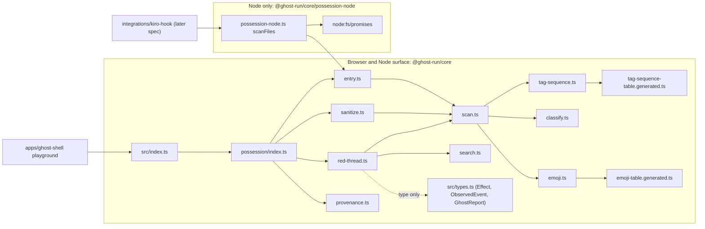
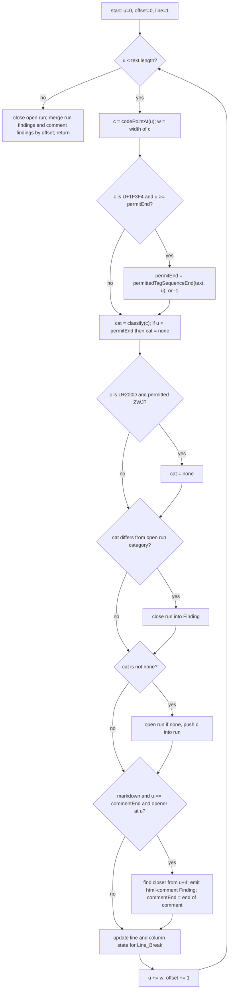
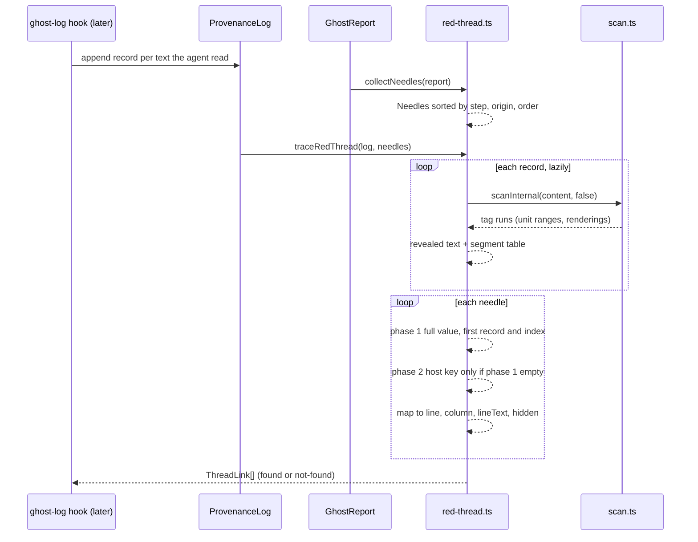

# Design Document: possession

## Overview

The possession detector finds text that an agent can read but a human cannot see, removes it, and links an address in a ghost action back to the text the agent read. It has four parts, matching the requirements:

1. **Blacklight** (`scanText`): a pure scan for hidden Unicode (tag characters that are not part of a listed RGI flag sequence, zero-width, bidi) and, for markdown, HTML comments.
2. **Sanitize** (`sanitizeText`): removes every finding and repeats until the scan is clean. Listed flag sequences are kept.
3. **Red thread** (`collectNeedles`, `traceRedThread`, `serializeProvenanceLog`, `parseProvenanceLog`): a record format for the texts the agent read and a pure first-occurrence lookup.
4. **Scan entry point** (`scanTexts`, `scanFiles`, `exitCodeFor`, `formatReport`): the interface the later `blacklight-steering` hook calls.

The detection logic is a set of ECMAScript-only functions with no runtime dependency. It runs unchanged in the browser Playground and in Node. It implements safety property P7 (hidden text is always flagged, ordinary Hangul, emoji, and combining marks are never flagged). The emoji in that claim include the England, Scotland, and Wales flags, which are built from tag characters. Allowing tag characters wholesale would let an instruction hide after a flag, and flagging all of them would make "text with only emoji is never flagged" false. The scanner therefore allows a tag run only when it forms a complete sequence listed under `RGI_Emoji_Tag_Sequence` in the pinned Unicode `emoji-sequences.txt` (Permitted_Tag_Sequence). Every other tag character is flagged. The world-contract steering claims P7 everywhere because the scanner is a pure function.

Claim boundaries (from Requirement 12, repeated here because the design must not widen them):

| Claim | Where | Status in this spec |
|---|---|---|
| P7 hidden text flagged, ordinary text (including the three RGI flag emoji) not flagged | Everywhere (pure function) | Claimed |
| Tag characters are allowed only as a complete sequence from the pinned RGI tag-sequence table | Everywhere (pure function) | Claimed as part of P7. The list is pinned to Unicode 16.0.0 (see Risk R2) |
| Red-thread lookup returns the earliest-read occurrence (O3) | Everywhere (pure function) | Claimed, as a lookup rule. Not a safety property |
| HTML comment detection | Only where `markdown` is true | Additional category. Not part of the P7 negative direction |
| P6 secret egress block (action-based) | Playground and Docker box | Owned by the `wards` spec. Not claimed here |
| Catching every injection by text analysis | Nowhere | Explicitly not claimed |

Resolved open items from the requirements (approved by the user, recorded here so the design is self-contained):

- **O1**: a leading U+FEFF is flagged like any other position. The file adapter must therefore decode with `ignoreBOM: true` (the default `TextDecoder` behavior silently strips the BOM and would hide it).
- **O2**: an HTML comment inside a fenced code block is flagged. The scanner does not parse markdown structure.
- **O3**: "first appeared" means the earliest-read record (lowest `recordIndex`), then lowest line, then lowest column.
- **Tag-sequence rule** (Requirements 2.9 to 2.12, 3.11): the base U+1F3F4 plus a tag run is unflagged only when the code points from the base through the first cancel tag U+E007F equal one entry of the generated tag-sequence table exactly. Tag characters after the cancel tag are flagged and their Finding starts right after it. Any other tag run is flagged in full.
- **R11 extension rule**: `.md`, `.markdown`, `.mdx` (case-insensitive) are scanned with `markdown: true`; every other path with `markdown: false`.

Hidden characters are never written literally in this document or in any file of this feature. They are named by code point. The four-code-point HTML comment opener is built in code as `String.fromCodePoint(0x3C, 0x21, 0x2D, 0x2D)` and is never spelled literally.

### Design Decisions Summary

| ID | Decision | Section |
|---|---|---|
| D1 | Pure module `core/src/possession/` re-exported from the core entry point. The Node file adapter is `core/possession-node.ts`, published as the subpath `@ghost-run/core/possession-node`. `core/tsconfig.json` is not changed. Tests that need Node live in `core/tests-node/` and are type-checked by a separate `core/tsconfig.test.json` | Architecture |
| D2 | Tests run under Node and once in a bare `node:vm` realm with only ECMAScript built-ins. An AST import/global test, ESLint rules (which block `node:` and unprefixed Node built-ins, generated from `node:module` `builtinModules`), and a test that proves the rule fires guard purity. No jsdom or happy-dom | Testing Strategy |
| D3 | `Extended_Pictographic` from Unicode 16.0.0 `emoji-data.txt` and the `RGI_Emoji_Tag_Sequence` list from the matching Emoji 16.0 `emoji-sequences.txt`, generated by one offline-capable dev script into two numeric, ASCII-only tables pinned by source and table checksums | Data Models |
| D4 | Single streaming pass over the string using UTF-16 cursor plus code point counters. No full code point array | Components and Interfaces |
| D5 | Tag sequences are recognized in the same pass by a bounded lookahead at each U+1F3F4 and an exact match against the generated table | Components and Interfaces |

---

## Architecture

### D1: Package placement

The structure steering says the possession detector lives in `core/`. The playground must run it in the browser, and `core/eslint.config.mjs` already forbids `node:*` imports anywhere in `core/src` (this design extends the ban to unprefixed Node built-in names, see "ESLint and TypeScript guards"). So the pure part goes in `core/src/possession/` and the Node-only reader goes outside `core/src`, following the precedent of `core/verify.ts` (a published entry point that is not part of `src/`). `core/tsconfig.json` (`types: []`) is not changed, so the type-check of `core/src` stays free of Node types.

| Alternative | Result | Verdict |
|---|---|---|
| A. Pure module in `core/src/possession/`; Node adapter in `core/possession-node.ts` as a subpath export | Browser surface (`@ghost-run/core`) never reaches `node:fs`. One package, no new workspace entry. Matches the structure steering and the `verify.ts` precedent | **Chosen** |
| B. New package `@ghost-run/possession` | Contradicts the structure steering ("possession detector" in `core/`). Adds a workspace package and a second published surface for roughly 600 lines | Rejected |
| C. Pure module in `core/`, adapter in `ghost-runner/` or `integrations/kiro-hook/` | `ghost-runner` is the Docker box package and the hook folder is created by the later `kiro-integration` spec. Requirement 11 puts the entry point in this spec, so it would ship untested | Rejected |
| D. Adapter inside `core/src` with an injected reader and a dynamic `import('node:fs')` | Violates the existing `no-restricted-imports` rule for `node:*` in `core/src` and blurs the browser-safe surface | Rejected |

Consequences of A:

- `core/src/index.ts` gains one line, `export * from './possession/index.js'`. This exports `scanText`, `sanitizeText`, `collectNeedles`, `traceRedThread`, `serializeProvenanceLog`, `parseProvenanceLog` (Requirement 1.8) plus the pure entry-point functions `scanTexts`, `exitCodeFor`, `formatReport` and all types. It does not export `scanFiles`.
- `scanFiles` is exported only from `@ghost-run/core/possession-node`. It imports the pure `scanTexts` through a relative path and adds file reading only.
- `core/package.json` gets a new `exports` entry `./possession-node`, a `"sideEffects": false` field (so bundlers drop the unused possession code from other apps), a `gen:emoji` script (generates both Unicode tables), and `@types/node` (`^20.19.0`, the version `ghost-runner` already uses) as a devDependency. No entry is added under `dependencies`. The `typecheck`, `lint`, and `build` scripts change as described under "ESLint and TypeScript guards".
- Dependency direction is unchanged: `core/` imports no other folder. `ghost-runner`, `ui/`, `apps/*`, and `integrations/*` may import the possession API through `@ghost-run/core`. The existing ESLint `no-restricted-imports` rule stays and is extended (see below).

#### File layout

```
core/
├─ src/
│  ├─ index.ts                      ← adds: export * from './possession/index.js'
│  └─ possession/                   ← pure, ECMAScript built-ins only, no node:*, no DOM
│     ├─ index.ts                   ← public surface of the module
│     ├─ types.ts                   ← Finding, ScanResult, ProvenanceRecord, Needle, ThreadLink,
│     │                                BlacklightReport (types only)
│     ├─ classify.ts                ← category tables, names, formatCodePoint(), escape helpers
│     ├─ emoji.ts                   ← isExtendedPictographic(), isEmojiModifier(), isPermittedZwj()
│     ├─ emoji-table.generated.ts   ← GENERATED numeric range table (ASCII only)
│     ├─ tag-sequence.ts            ← permittedTagSequenceEnd(): bounded lookahead and exact table match
│     ├─ tag-sequence-table.generated.ts ← GENERATED RGI_Emoji_Tag_Sequence table (ASCII only)
│     ├─ scan.ts                    ← scanText(), scanInternal()  (single pass)
│     ├─ sanitize.ts                ← sanitizeText()
│     ├─ provenance.ts              ← serializeProvenanceLog(), parseProvenanceLog()
│     ├─ red-thread.ts              ← collectNeedles(), traceRedThread()
│     ├─ search.ts                  ← KMP findAll for exact and ASCII-folded search
│     └─ entry.ts                   ← scanTexts(), exitCodeFor(), formatReport()
├─ possession-node.ts               ← Node-only: scanFiles() (reads files, calls scanTexts)
├─ scripts/
│  ├─ gen-emoji-table.mjs           ← dev-time generator for both tables (Node 20+, no dependencies)
│  └─ emoji-data.pin.json           ← pinned versions, URLs, and source SHA-256 of both source files
├─ tsconfig.json                    ← UNCHANGED (types [], include src, tests, verify.ts)
├─ tsconfig.possession.json         ← lib ES2022 only, types [], include src/possession
├─ tsconfig.node.json               ← types ["node"], include possession-node.ts (type-check and build of the adapter)
├─ tsconfig.test.json               ← extends tsconfig.json, types ["node"], include tests-node and possession-node.ts
├─ tests/                           ← Node-free tests, type-checked by the unchanged tsconfig.json
│  ├─ p7-hidden-text.test.ts        ← P7 properties (Properties 1 to 4, 20, 21)
│  └─ possession/
│     ├─ arbitraries.ts             ← fast-check arbitraries (escapes only)
│     └─ scan.test.ts, sanitize.test.ts, provenance.test.ts, red-thread.test.ts,
│        entry.test.ts, format.test.ts, tag-sequence.test.ts
└─ tests-node/                      ← tests that import node:* modules, type-checked by tsconfig.test.json
   ├─ purity.test.ts                ← AST import and global check
   ├─ eslint-builtins.test.ts       ← proves the ESLint rule fires on unprefixed Node built-ins
   ├─ bare-realm.test.ts            ← node:vm realm differential test
   ├─ bare-realm-loader.ts          ← transpile and load the module graph into the realm
   ├─ emoji-table.test.ts           ← emoji range table sanity, checksum, no hidden characters
   ├─ tag-sequence-table.test.ts    ← tag-sequence table structure, checksum, version, no hidden characters
   ├─ scan-files.test.ts            ← Node adapter tests
   └─ repo-clean.test.ts            ← Requirement 14.4
```

#### Module dependency and runtime surfaces



#### ESLint and TypeScript guards

`core/eslint.config.mjs` keeps its existing workspace-folder bans (`ui`, `apps`, `integrations`, `ghost-runner`) and replaces the single `node:*` pattern with a Node built-in ban that is generated, not hand-maintained.

**Generated built-in list.** The config imports `builtinModules` from `node:module` (the config file is not part of `core/src`, so it may use Node). `builtinModules` lists the unprefixed names, including subpaths such as `fs/promises`, `path/posix`, `stream/web`, and `dns/promises`. A helper in the config derives everything from it, so a new built-in in a newer Node release is covered when ESLint runs on that Node:

```js
import { builtinModules } from 'node:module';

const BUILTIN_EXACT = [...new Set(builtinModules.map((m) => m.replace(/^node:/, '')))];   // 'fs', 'fs/promises', 'crypto', 'vm', ...
const BUILTIN_BASES = [...new Set(BUILTIN_EXACT.map((m) => m.split('/')[0]))];            // 'fs', 'crypto', 'vm', ...
const escape = (s) => s.replace(/[.*+?^${}()|[\]\\\/]/g, '\\$&');
// Matches 'node:<anything>', a bare built-in name, and any subpath of a built-in name ('fs/promises', 'fs/whatever').
const BUILTIN_RE = `^(?:node:.*|(?:${BUILTIN_BASES.map(escape).join('|')})(?:\\/.*)?)$`;
```

**Static forms** use `no-restricted-imports` with `patterns: [{ group: ['node:*'] }, ...]` for the prefixed form and `paths: BUILTIN_EXACT.map((name) => ({ name, message }))` for the unprefixed form. `paths` entries match the import specifier exactly, so a relative import such as `./fs.js` or `./path.js` is never matched by accident (a gitignore-style `fs` pattern would match it). The rule covers `import ... from`, `import type ... from`, and `export ... from`.

**Dynamic and CommonJS forms** use `no-restricted-syntax` (the `no-restricted-imports` rule does not see them). Selectors, with `RE` standing for `BUILTIN_RE`:

| Selector | Blocks |
|---|---|
| `ImportExpression[source.value=/RE/]` | `import('fs')`, `import('node:fs')`, `import('fs/promises')` |
| `ImportExpression:not([source.type='Literal'])` | `import(name)` with a computed specifier, which could name a built-in |
| `CallExpression[callee.name='require'][arguments.0.value=/RE/]` | `require('fs')` and prefixed or subpath forms |
| `CallExpression[callee.name='require']:not([arguments.0.type='Literal'])` | `require(name)` with a computed specifier |
| `TSImportEqualsDeclaration[moduleReference.expression.value=/RE/]` | `import fs = require('fs')` |
| `TSImportType[argument.literal.value=/RE/]` | type-position `import('fs')` |

`no-restricted-syntax` is declared once as a constant array `SYNTAX_BAN` and spread into every block that needs it, because a later flat-config block that sets the same rule replaces the earlier options and does not merge them. The same holds for `no-restricted-imports`: each block builds its option object from shared constants.

**Blocks**:

1. `src/**/*.ts` (all of `core/src`): the built-in ban above (static and dynamic forms) plus the workspace-folder bans.
2. `src/possession/**/*.ts`: everything from block 1, plus `no-restricted-globals` for `process`, `Buffer`, `require`, `window`, `document`, `TextEncoder`, `TextDecoder`, `URL`, `console`, `fetch`, `crypto`, `performance`, `setTimeout`, `setInterval`, `Date`; `no-restricted-properties` for `Math.random`; and `no-restricted-syntax` entries (added to `SYNTAX_BAN`) for `new Function(...)`, `eval(...)`, and any import specifier that does not start with `./` or `../types.js` (type-only import of the core contract).
3. `possession-node.ts`: keeps the workspace-folder bans and the `paths` ban on unprefixed built-in names (the adapter must write `node:fs/promises`, never `fs/promises`), and drops only the `node:*` pattern, so the adapter may import `node:` modules.

Residual gap, stated so it is not mistaken for coverage: `process.getBuiltinModule('fs')` is a runtime path that no import rule sees. Under `core/src` it is blocked by the `types: []` type-check (`process` has no declaration) and, inside `src/possession`, by the `no-restricted-globals` rule.

**Scripts.** `lint` becomes `eslint src possession-node.ts`. `typecheck` becomes:

```
tsc --noEmit
&& tsc --noEmit -p tsconfig.possession.json
&& tsc --noEmit -p tsconfig.node.json
&& tsc --noEmit -p tsconfig.test.json
```

`build` runs `tsc -p tsconfig.build.json` and then `tsc -p tsconfig.node.json` (which emits the adapter). `tsconfig.possession.json` sets `"lib": ["ES2022"]`, `"types": []`, includes only `src/possession`, and so type-checks the detection logic with no DOM and no Node type library (Requirement 1.4). The only import that leaves the folder is `import type { Effect, ObservedEvent, GhostReport } from '../types.js'`, which has no runtime effect.

**`core/tsconfig.json` does not change.** It keeps `"types": []` and `"include": ["src", "tests", "verify.ts"]`. That config is the safety net that stops `core/src` from using a Node built-in (a `node:fs` import or a `process` reference fails to type-check), so it must not load `@types/node`. Tests that need Node therefore do not live under `tests/`; they live in the sibling folder `core/tests-node/`, which `tsconfig.json` does not include. The three tsconfig files that add Node are:

| File | Extends | Settings | Include | Used by |
|---|---|---|---|---|
| `tsconfig.node.json` | `tsconfig.build.json` | `types: ["node"]` | `possession-node.ts` (plus the pure files it imports) | adapter type-check and build |
| `tsconfig.test.json` | `tsconfig.json` | `types: ["node"]`, `noEmit: true` | `tests-node`, `possession-node.ts` | type-check of `tests-node/**` |
| `tsconfig.possession.json` | `tsconfig.json` | `lib: ["ES2022"]`, `types: []` | `src/possession` | Node-free and DOM-free check of the detection logic |

`tsconfig.test.json` pulls in `src/possession/**` and the shared `tests/possession/arbitraries.ts` through imports, so those files are type-checked once more with Node types loaded. That is harmless, because the Node-free check of the same files is done by `tsconfig.json` and `tsconfig.possession.json`.

**How vitest uses it.** vitest transpiles with esbuild and does not read `tsconfig` for the normal test run, so `tests-node/**/*.test.ts` run through the default include glob and need no change in `vitest.config.ts`. The existing `typecheck.include: ['tests/**/*.test-d.ts']` still resolves against `tsconfig.json`. Type errors in `tests-node` are found by `pnpm typecheck` (`tsconfig.test.json`), not by the test run.

**How the existing P1 to P4 tests stay covered.** `tests/p1-isolation.test.ts` to `tests/p4-monotonicity.test.ts`, `tests/fixtures/**`, `tests/verify.test.ts`, `tests/wards.test.ts`, and `tests/types.test-d.ts` are untouched and remain under the unchanged `tsconfig.json`; `tsc --noEmit` (the first command of `typecheck`) checks them with the same options as today, and `vitest run` runs them as today. The new Node-free possession tests under `tests/` are checked by the same command, which also proves they use no Node API.

### Single-pass scan

`scanText` makes one left-to-right pass over the string. It keeps a UTF-16 cursor `u` and a code point counter `offset`, plus the current line and the code point offset of the current line start. It never builds a full code point array, so it does not throw `RangeError` for very large strings (Requirement 6.6) and uses memory proportional to the number of findings.



---

## Components and Interfaces

All functions are pure unless stated. All are exported through `src/possession/index.ts`.

### Blacklight: `scanText`

```ts
export type HiddenCategory = 'tag' | 'zero-width' | 'bidi' | 'html-comment';

export interface ScanOptions {
  /** Detect HTML comments. Default true (Requirement 5.1). */
  readonly markdown?: boolean;
}

export interface Finding {
  readonly category: HiddenCategory;
  readonly line: number;         // 1-based
  readonly column: number;       // 1-based, in code points from the line start
  readonly offset: number;       // 0-based, in code points from the text start
  readonly length: number;       // code points covered
  readonly codePoints: readonly number[];
  readonly firstCodePoint: string;  // "U+" + at least 4 uppercase hex digits
  readonly rendering: string;       // printable ASCII only (U+0020..U+007E)
}

export interface ScanResult {
  readonly findings: readonly Finding[];
}

export function scanText(text: string, options?: ScanOptions): ScanResult;
```

Algorithm (Requirement 2, 3, 4, 5):

- **Classification** (`classify.ts`): `classify(c)` returns `tag` for U+E0000 to U+E007F, `zero-width` for U+200B, U+200C, U+200D, U+2060, U+FEFF, `bidi` for U+202A to U+202E and U+2066 to U+2069, otherwise `none`. U+034F, U+FE00 to U+FE0F, U+00AD, U+200E, and U+200F are `none` (Requirement 4.5). `classify` looks at one code point only. The tag-sequence exception is applied by the scan loop on top of it (next bullet), so `classify` stays a pure table lookup.
- **Tag sequences** (`tag-sequence.ts`, Requirements 2.9 to 2.12, 3.11). The loop keeps one more variable, `permitEnd` (UTF-16 index, initially -1). At a code point U+1F3F4 with `u >= permitEnd`, the loop calls `permittedTagSequenceEnd(text, u)`; at every code point with `u < permitEnd` it sets `cat = none` after `classify`. The function is a bounded lookahead:
  1. Let `i = u + 2` (the code unit after the base, which is the pair 0xD83C 0xDFF4). While `i - u < MAX_SEQ_UNITS` and the unit at `i` is the high surrogate 0xDB40 and the unit at `i + 1` is a low surrogate in 0xDC00 to 0xDC7F (a Tag_Character), step `i += 2`. Stop at the first tag whose low surrogate is 0xDC7F (the cancel tag U+E007F) and set `cancelEnd = i + 2`. If no cancel tag is found within the bound, the function returns -1.
  2. If `cancelEnd - u` is one of the unit lengths in the table (`TAG_SEQUENCE_UNIT_LENGTHS`, a small set built at module load), take `text.slice(u, cancelEnd)` and test it against the set `TAG_SEQUENCE_STRINGS` (built at module load by `String.fromCodePoint(...sequence)` for every table entry). A match returns `cancelEnd`; anything else returns -1.
  3. The base, the Tag_Characters, and the cancel tag of a match are therefore classified `none`, and a tag run directly before the base is already closed (the base is a `none` code point).
  
  The match is exact: the code points from the base through the first cancel tag must equal a whole table entry. So a tag run with no base, a prefix of a listed sequence without the cancel tag, a flag-shaped run that is not listed (for example tag letters `gbxyz`), and a run that begins like a listed sequence but has other tags before its first cancel tag all return -1, and every Tag_Character of those runs is classified `tag` and flagged in full, including the cancel tag. After a match, the Tag_Characters that follow the cancel tag directly have `u >= permitEnd`, so they classify as `tag`, open a new run, and produce a Finding that starts at the first appended tag, right after the cancel tag, and covers only the appended tags (Requirements 2.12, 3.11). Rendering uses those code points only. Cost: each base does at most `MAX_SEQ_UNITS / 2` steps (a constant, 7 for the current table), and a tag belongs to the lookahead of at most one base (the code point directly before its run), so the lookahead adds O(n) in total. The lookahead never reads past the end of the string. A U+200D after a flag stays flagged, because the cancel tag is neither an Emoji_Code_Point nor an Emoji_Modifier (existing ZWJ rule, unchanged).
- **Runs**: consecutive code points of the same non-`none` category extend one run. A `none` code point (including a permitted ZWJ) or a change of category closes the run. One `Finding` per run (Requirement 3.1). A run never crosses a Line_Break because Line_Breaks are not hidden.
- **Lone surrogates** (Requirement 2.7): `codePointAt` returns the unit itself for an unpaired surrogate. It classifies as `none`, counts as one code point of width 1, and never throws.
- **Positions**: `offset` increments once per code point. A Line_Break is U+000A, U+000D U+000A (the CR belongs to the current line, the LF ends it), or a lone U+000D. After a break, `line` increments and `lineStartOffset` is set to the offset of the next code point. `column = offset - lineStartOffset + 1`.
- **Permitted ZWJ** (`emoji.ts`, `isPermittedZwj(text, u)`): from a U+200D at index `u`, walk backward over code points that are Emoji_Modifiers (U+FE0F, U+1F3FB to U+1F3FF), read the first non-modifier code point `prev`, walk forward the same way to `next`, and return true only if both exist and both are Extended_Pictographic. Backward width detection checks for a low surrogate preceded by a high surrogate. A U+200D at the start or end of the text, next to another hidden code point, next to another U+200D, or next to a non-emoji is therefore flagged (Requirements 4.2, 4.3). Each modifier is scanned at most once backward (by the first U+200D after its run) and once forward (by the first U+200D before its run), so the walks add O(n) in total.
- **HTML comments** (`markdown` true): at each code point with `u >= commentEnd` and `c === 0x3C`, test the next three code units against the opener built from code points. On a match, search for the closer (U+002D U+002D U+003E, also built from code points) with `String.prototype.indexOf` starting at `u + 4`, so a closer cannot overlap the opener (an opener directly followed by U+003E is therefore not closed by its own two hyphens; this errs toward the longer, more conservative comment). The comment ends after the closer or at the end of the text. `commentEnd` is set to that end, so nested openers inside a comment produce no extra Finding (Requirement 5.5). The main loop continues through the comment so hidden code points inside it still get their own Findings (Requirement 3.9).
- **Rendering** (`classify.ts`):
  - `tag`: each code point in U+E0020 to U+E007E becomes `String.fromCharCode(cp - 0xE0000)`; every other tag code point becomes `<U+XXXX>` (Requirements 3.4, 3.7).
  - `zero-width` and `bidi`: concatenated `<U+XXXX NAME>` using a constant name table of the 14 names in Requirement 3.5.
  - `html-comment`: the text between the opener and the closer (or end of text); every code point outside U+0020 to U+007E becomes `<U+XXXX>` (lone surrogates included); every Line_Break (CRLF counts once) becomes the two characters backslash and `n`.
  - Hex is always uppercase with at least four digits: `'U+' + hex.toUpperCase().padStart(4, '0')`.
- **Ordering** (Requirement 3.8): run Findings and comment Findings are each produced in ascending offset order, so the final list is a linear two-way merge. A comment always starts with U+003C, which is never a hidden code point, so the two lists never tie on offset; the category-order tie-break (`tag`, `zero-width`, `bidi`, `html-comment`) is still implemented for completeness and is only reachable between runs of different categories, which never share an offset either.
- **Complexity**: O(n) time in code points, plus O(findings) memory. The comment closer search resumes only after the previous comment ends, so each code unit is searched at most once. 1 MiB of ASCII is one tight loop with two comparisons per code point and has a wide margin under the 1 second limit (Requirement 6.5).
- **Purity**: no state outside the call, arguments are read only, results are plain JSON objects (Requirement 6.1 to 6.3).

`scanInternal(text, markdown)` is the same pass, but each entry also carries `unitStart` and `unitEnd` (UTF-16 indices). `scanText` returns the public `Finding` of each entry. `sanitizeText` uses the unit range to cut strings without reconstructing from code points.

### Sanitize: `sanitizeText`

```ts
export function sanitizeText(text: string, options?: ScanOptions): string;
```

```
cur = text
loop:
  entries = scanInternal(cur, markdown)
  if entries is empty: return cur
  ranges = merge(sort(entries by unitStart), union of overlapping or touching [unitStart, unitEnd))
  cur = concatenate(cur slices outside ranges)
```

- Overlapping ranges (a comment that contains hidden runs) are merged, so each code unit is removed once.
- Each round removes at least one code point, so the loop terminates in at most n rounds. Removing hidden code points can join `<`, `!`, `-` and `-` into a new opener, and removing a comment can join the text on both sides into a new opener. The loop repeats until `scanInternal` is empty, which gives the clean result and idempotence (Requirement 7.2, 7.4, 7.5).
- Cost: O(n) per round. Typical input takes two rounds (one removal round, one clean check). A crafted nested input such as repeated opener fragments around comments needs one round per nesting level, so the worst case is O(n * depth). This is bounded by O(n^2) and is accepted, because capping the rounds would break the clean-result guarantee. See Risks.
- A permitted ZWJ and its emoji neighbors are never inside a Finding, so they are kept (Requirement 7.8). Removing a comment cannot turn a permitted ZWJ into a flagged one, because an adjacent comment starts with U+003C or ends with U+003E, which already made that ZWJ non-permitted before removal.
- **Flags** (Requirement 7.11): a Permitted_Tag_Sequence is never inside a Finding, so the base, its tags, and the cancel tag are kept; only the other tag code points are removed. A flag followed by appended tags becomes exactly the flag. Idempotence holds because, after round 1, every tag code point left in the text belongs to a Permitted_Tag_Sequence: every other tag was inside a `tag` Finding and was removed in the same round. Removing other findings cannot create a new Permitted_Tag_Sequence, because a new one would need tag code points that are not already in a permitted sequence. It also cannot break an existing one: the flag's code points are contiguous, and a comment that is removed either contains the whole flag (then the flag is removed with it, as part of the comment range) or none of it, since the comment opener and closer are ASCII and cannot start or end inside the flag. The loop still repeats until `scanInternal` is empty, so the clean-result guarantee does not depend on this argument; the argument only explains why idempotence holds.
- Output is built from slices of the input (`text.slice(a, b)` joined), so lone surrogates and all other kept code units are preserved exactly.

### Provenance records: `serializeProvenanceLog`, `parseProvenanceLog`

```ts
export type ProvenanceKind = 'file' | 'issue' | 'web' | 'other';

export interface ProvenanceRecord {
  readonly source: string;        // non-empty
  readonly kind: ProvenanceKind;
  readonly content: string;
}

export type ProvenanceLog = readonly ProvenanceRecord[];

export interface ProvenanceError {
  readonly index?: number;        // zero-based record index, absent for top-level errors
  readonly field?: string;        // 'source' | 'kind' | 'content' | name of the unknown field
  readonly message: string;
}

export type ProvenanceParseResult =
  | { readonly ok: true; readonly log: ProvenanceLog }
  | { readonly ok: false; readonly errors: readonly ProvenanceError[] };

export function serializeProvenanceLog(log: ProvenanceLog): string;
export function parseProvenanceLog(text: string): ProvenanceParseResult;
```

- `serializeProvenanceLog` builds each record as an object literal with keys in the fixed order `source`, `kind`, `content` and calls `JSON.stringify`. It does not spread the input record, so an extra field on a caller object is not written.
- `parseProvenanceLog` wraps `JSON.parse` in `try/catch` and returns `{ ok: false, errors: [{ message: 'invalid JSON: ...' }] }` on failure (Requirement 8.5), never throwing. A non-array top level returns one top-level error. For each element it checks, in order: the element is a non-null, non-array object; no key other than the three known keys; `source` is a non-empty string; `kind` is one of the four values; `content` is a string. It collects all errors (index and field named) and returns no log if any exist (Requirement 8.6). `[]` returns `{ ok: true, log: [] }` (Requirement 8.7).
- Valid records are rebuilt as fresh object literals with exactly the three fields. A JSON key named `__proto__` is rejected as an unknown field and is never assigned to a prototype.
- Lone surrogates survive the round trip because `JSON.stringify` escapes them (well-formed JSON.stringify, ES2019).
- The record has no clock, session id, or secret field (Requirement 8.9). The module only defines the shape. The `ghost-log` hook (later spec) fills it.

### Red thread: `collectNeedles`, `traceRedThread`

```ts
import type { GhostReport } from '../types.js';

export type NeedleOrigin = 'effect' | 'observed-destination' | 'observed-path';

export interface Needle {
  readonly value: string;          // non-empty
  readonly origin: NeedleOrigin;
  readonly stepIndex: number;
}

export type NeedleSource = Pick<GhostReport<unknown>, 'effectsOutside' | 'observedEvents'>;

export type ThreadLink =
  | {
      readonly status: 'found';
      readonly needle: Needle;
      readonly matchedKey: 'value' | 'host';
      readonly source: string;
      readonly kind: ProvenanceKind;
      readonly recordIndex: number;
      readonly line: number;       // 1-based, original content
      readonly column: number;     // 1-based, code points, original content
      readonly lineText: string;   // ASCII-escaped, at most 200 characters
      readonly hidden: boolean;
    }
  | { readonly status: 'not-found'; readonly needle: Needle };

export function collectNeedles(report: NeedleSource): Needle[];
export function traceRedThread(log: ProvenanceLog, needles: readonly Needle[]): ThreadLink[];
```

`NeedleSource` is a `Pick` of the two fields of the existing `GhostReport`, so any `GhostReport<S>` is accepted and no second report shape exists. `Effect`, `ObservedEvent`, and `GhostReport` are reused from `core/src/types.ts` with no new shape.

**`collectNeedles`** (Requirement 9):

- For `effectsOutside[i][j]` with a non-empty `destination`, emit `{ value, origin: 'effect', stepIndex: i }`. For each `observedEvents[k]`, emit `observed-destination` for a defined non-empty `destination` and `observed-path` for a defined non-empty `path`, both with `stepIndex = event.stepIndex`.
- Sort by `(stepIndex, originRank, sequence)` where `originRank` is `effect` 0, `observed-destination` 1, `observed-path` 2, and `sequence` is the index in the inner array (effects) or in `observedEvents` (events). `Array.prototype.sort` is stable (ES2019), and the explicit key makes order deterministic anyway.
- Duplicates are kept (Requirement 9.5). The report is only read.

**`traceRedThread`** (Requirement 10):

1. **Revealed text per record, built lazily once per call.** For a record, call `scanInternal(content, false)` and keep the `tag` entries. Build the revealed string as the visible slices between tag runs plus each run's decoded `rendering`, and a segment table `{ rStart, rEnd, uStart, uEnd, decoded }` (revealed index range to original UTF-16 range). Memory is proportional to the number of tag runs, not to the text length. Positions inside a decoded segment all map to `uStart` of the run (the first Tag_Character), which gives the required column (Requirement 10.6). Only `tag` Findings produce segments, so the Tag_Characters of a Permitted_Tag_Sequence are not decoded: they stay as literal characters in the revealed text and map one to one to the original (`hidden` is `false` for a match that lies in them). Tag_Characters appended after a flag form their own segment that starts right after the cancel tag, so a destination hidden after a flag is found with `hidden` equal to `true` and the column of the first appended tag.
2. **Line table per record**, computed on demand: UTF-16 indices of line starts using the same Line_Break rule as the scanner. A binary search maps an original unit index to a line. The column counts code points from the line start to the unit index (one counter loop, run once per found Needle).
3. **Search**:
   - Phase 1 (full value): for each record in order, find the first occurrence of `needle.value` (exact, case-sensitive; Requirement 10.9) in the revealed string using a KMP search from `search.ts`. The first record with a hit wins, and inside it the lowest revealed index wins. Revealed order is monotonic in original order, so lowest index is lowest line then column. This is the earliest-read rule (O3 and Requirement 10.3).
   - A match is rejected if it starts on a low surrogate preceded by a high surrogate, or ends between a high surrogate and its low surrogate (no matches inside a surrogate pair).
   - Phase 2 (host key): only when phase 1 found nothing in every record and `value` parses as `<scheme>://<host>[:<port>][/<rest>]` with non-empty host. Parsing: scheme is a letter followed by letters, digits, `+`, `-`, `.`; then `://`; the authority is the text up to the first `/`, `?`, or `#`; drop userinfo before the last `@`; drop a trailing `:` followed only by digits (a bracketed IPv6 host keeps its brackets). Search each record in order with an ASCII-folded comparison (only A to Z fold to a to z; length never changes), enumerate all occurrences in order, and accept the first one whose boundaries pass Requirement 10.8: the preceding code point is not in `A-Z a-z 0-9 _ . -` and the following code point is not in `A-Z a-z 0-9 _ -`. `matchedKey` is `host` for phase 2 and `value` for phase 1.
4. **Link fields**: `recordIndex` is the index in `log`; `line` and `column` use the original content; `hidden` is true if the match range overlaps any decoded segment (this includes the case where the match starts in visible text and ends inside a decoded run; `column` is then the column of the match start, which is the original position of the first matched code point). `lineText` is the original line (without Line_Break) with every code point outside U+0020 to U+007E replaced by `<U+XXXX>`; it is cut at the last whole token that fits in 200 characters, so the output is at most 200 ASCII characters (Requirement 10.5).
5. **No match**: `{ status: 'not-found', needle }`. An empty log gives `not-found` for every needle (Requirement 10.11). No guessing, no fuzzy match.

Complexity (Requirement 10.14): preprocessing is O(total content) once per call. Each needle costs O(total revealed length + key length) per phase using KMP, so total time is O(total content * needles). Per-needle failure tables are built once per needle per phase.

The result is JSON-safe plain data, the function reads its arguments only, and it never reads a clock or random source. A `not-found` link does not feed any verdict (Requirement 12.7). `traceRedThread` is not imported by the wards engine.



### Scan entry point: `scanTexts`, `scanFiles`, `exitCodeFor`, `formatReport`

```ts
export type Outcome = 'clean' | 'findings' | 'error';

export interface ScanInput { readonly path: string; readonly text: string; }

export interface FileScan {
  readonly path: string;
  readonly findings: readonly Finding[];
  readonly error?: string;
}

export interface BlacklightReport {
  readonly outcome: Outcome;
  readonly files: readonly FileScan[];
  readonly totalFindings: number;
}

export interface ScanEntryOptions {
  /** 'by-extension' (default) applies the R11 rule; a boolean forces markdown for every input. */
  readonly markdown?: boolean | 'by-extension';
}

// Pure, in core/src/possession/entry.ts
export function scanTexts(inputs: readonly ScanInput[], options?: ScanEntryOptions): BlacklightReport;
export function exitCodeFor(outcome: Outcome): 0 | 1 | 2;     // clean 0, findings 1, error 2
export function formatReport(report: BlacklightReport): string;

// Node only, in core/possession-node.ts
export interface ScanFilesOptions extends ScanEntryOptions {
  /** Injected for tests. Defaults to node:fs/promises readFile. Must return raw bytes. */
  readonly readFile?: (path: string) => Promise<Uint8Array>;
}
export function scanFiles(paths: readonly string[], options?: ScanFilesOptions): Promise<BlacklightReport>;
```

- **Extension rule**: `isMarkdownPath(path)` lowercases the text after the last `.` that follows the last `/` or `\` and tests it against `md`, `markdown`, `mdx`. A file with no dot, or only a leading dot such as `.env`, is not markdown.
- **`scanTexts`**: maps each input in order, with `markdown` from the rule or the option. `totalFindings` is the sum. `outcome` is `findings` if any entry has a Finding and none has an `error`, else `clean`. `scanTexts` itself never produces `error` (it has no I/O); `error` entries come from `scanFiles`. To keep one report builder, `entry.ts` exports an internal `buildReport(files: FileScan[])` used by both functions; it applies precedence `error` over `findings` over `clean` (Requirement 11.5).
- **`scanFiles`**: for each path, in order and sequentially (deterministic, avoids EMFILE for large path lists), call `readFile(path)`. On success, decode with `new TextDecoder('utf-8', { fatal: false, ignoreBOM: true })`. `ignoreBOM: true` is required: the default (`false`) strips a leading U+FEFF and would contradict O1. Invalid bytes become U+FFFD (Requirement 11.8). On failure, produce `{ path, findings: [], error: 'cannot read <path>: <code>' }` where `<code>` is `error.code` when it is a string (for example `ENOENT`) and `unreadable` otherwise. The raw `error.message` is not copied, because it can contain long or untrusted text. Remaining paths are still read (Requirement 11.5). The adapter calls only `readFile`. It never writes, renames, or deletes (Requirement 11.8).
- **`formatReport`** (Requirement 11.9 to 11.11):
  - Per Finding: `<path>:<line>:<column> <category> <firstCodePoint> "<rendering>"`, with `[truncated]` appended after the closing quote when the rendering was cut to 200 code points. Inside the quotes, `\` becomes `\\` and `"` becomes `\"`.
  - Per read error (a design extension to Requirement 11.9, needed so an `error` outcome is explained): `<path>: error "<message>"` with the same quoting.
  - Final line: `outcome=<outcome> findings=<totalFindings> files=<files.length>`.
  - `path` and `error` text go through the same ASCII escape (`<U+XXXX>` for anything outside U+0020 to U+007E, which covers file names that contain hidden characters). Lines are joined with U+000A. The output therefore contains only printable ASCII and U+000A.
  - A decoded hidden instruction is shown quoted and bounded, never as bare text (Requirement 11.10).
- `exitCodeFor` is a total mapping. No hook is installed or configured here (Requirement 11.14).

### Search helper: `search.ts`

```ts
export function findAll(haystack: string, needle: string, fold: boolean, from?: number): Iterable<number>;
```

A KMP implementation over UTF-16 code units. With `fold` true, both sides pass through `foldAscii(code unit)` which maps only 0x41 to 0x5A to 0x61 to 0x7A. Returns match start indices in ascending order. It keeps the worst case at O(n + m) per call, independent of the engine's `indexOf`.

### Dependency and effect summary

| Module | Imports | Effects |
|---|---|---|
| `classify.ts`, `emoji.ts`, `search.ts`, `tag-sequence.ts` | `emoji-table.generated.ts` (emoji only), `tag-sequence-table.generated.ts` (tag-sequence only) | none |
| `scan.ts`, `sanitize.ts`, `provenance.ts`, `red-thread.ts`, `entry.ts` | siblings, `../types.js` (type only) | none |
| `possession-node.ts` | `./src/possession/index.js`, `node:fs/promises` | read-only file I/O |
| `scripts/gen-emoji-table.mjs` | `node:fs`, `node:crypto`, global `fetch` | dev time only, network optional |

---

## Data Models

The public data types are defined in the Components section (`Finding`, `ScanResult`, `ProvenanceRecord`, `ProvenanceLog`, `Needle`, `ThreadLink`, `ScanInput`, `FileScan`, `BlacklightReport`). All are plain JSON values: numbers, strings, booleans, arrays, and objects. They contain no `undefined` field (optional fields are omitted), `Date`, `Map`, `Set`, function, or cycle, so `JSON.parse(JSON.stringify(x))` is structurally equal to `x`.

### Category tables (`classify.ts`)

```ts
export const TAG_RANGE = [0xE0000, 0xE007F] as const;
export const ZERO_WIDTH = [0x200B, 0x200C, 0x200D, 0x2060, 0xFEFF] as const;
export const BIDI_RANGES = [[0x202A, 0x202E], [0x2066, 0x2069]] as const;
export const NAMES: Readonly<Record<number, string>> = {
  0x200B: 'ZERO WIDTH SPACE', 0x200C: 'ZERO WIDTH NON-JOINER', 0x200D: 'ZERO WIDTH JOINER',
  0x2060: 'WORD JOINER', 0xFEFF: 'ZERO WIDTH NO-BREAK SPACE',
  0x202A: 'LEFT-TO-RIGHT EMBEDDING', 0x202B: 'RIGHT-TO-LEFT EMBEDDING',
  0x202C: 'POP DIRECTIONAL FORMATTING', 0x202D: 'LEFT-TO-RIGHT OVERRIDE',
  0x202E: 'RIGHT-TO-LEFT OVERRIDE', 0x2066: 'LEFT-TO-RIGHT ISOLATE',
  0x2067: 'RIGHT-TO-LEFT ISOLATE', 0x2068: 'FIRST STRONG ISOLATE', 0x2069: 'POP DIRECTIONAL ISOLATE',
};
export const HTML_COMMENT_OPENER = String.fromCodePoint(0x3C, 0x21, 0x2D, 0x2D);
export const HTML_COMMENT_CLOSER = String.fromCodePoint(0x2D, 0x2D, 0x3E);
```

All tables are written as hexadecimal numbers. No source file of this feature contains a literal hidden character or a literal opener.

### D3: Unicode tables (Extended_Pictographic and RGI tag sequences)

**Decision.** Use two tables from one Unicode/Emoji release, produced by one generator with one method: `Extended_Pictographic` from Unicode **16.0.0** `emoji-data.txt`, and the `RGI_Emoji_Tag_Sequence` entries of the matching Emoji **16.0** `emoji-sequences.txt`. Unicode 16.0.0 and Emoji 16.0 are the same release (emoji files are versioned by the major.minor of Unicode), and the pin file holds both numbers so a test can assert they agree.

- **Source URLs**: `https://www.unicode.org/Public/16.0.0/ucd/emoji/emoji-data.txt` and `https://www.unicode.org/Public/emoji/16.0/emoji-sequences.txt`.
- **License**: Unicode License v3 (SPDX `Unicode-3.0`), `https://www.unicode.org/license.txt`. The license permits use of the data files. The repository stores only derived numeric tables, not the data files, and keeps the attribution notice in each generated file header and in the README table.
- **Why 16.0.0**: it is a published release whose file layout is known and stable. The version is one constant in `scripts/emoji-data.pin.json`, from which the generator builds both URLs, so moving to a later Unicode release (for example 17.0.0) is a one-line change plus a regeneration of both tables. It is listed as an open item because neither URL could be fetched during this design session (see Risks R1).
- **Why not `\p{Extended_Pictographic}` or `\p{RGI_Emoji_Tag_Sequence}`**: the regex properties depend on the Unicode version of the JavaScript engine, which differs between browsers and Node versions (and the tag-sequence property is a property of strings that older engines lack). That breaks "same detection everywhere" and makes the P7 claim engine-dependent. Tables that ship with the code give one Unicode version everywhere, and Requirement 4.6 needs that version recorded.
- **New code only and README rule**: the tables are data from Unicode, not copied code. The README dependency table gets two rows: `Unicode emoji-data.txt (Extended_Pictographic)` and `Unicode emoji-sequences.txt (RGI_Emoji_Tag_Sequence)`, both version `16.0.0`, license `Unicode-3.0`, URLs as above, use `generated tables`. `fast-check`, `vitest`, `typescript`, and `@types/node` are already or will be listed as dev dependencies; there is no runtime dependency to list.

**Generated file 1** `core/src/possession/emoji-table.generated.ts` (ASCII only, numbers in hex):

```ts
// GENERATED by core/scripts/gen-emoji-table.mjs. Do not edit.
// Data: Unicode emoji-data.txt, Unicode 16.0.0, Unicode License v3 (https://www.unicode.org/license.txt).
export const EMOJI_DATA_UNICODE_VERSION = '16.0.0';
export const EMOJI_DATA_SOURCE_URL = 'https://www.unicode.org/Public/16.0.0/ucd/emoji/emoji-data.txt';
export const EMOJI_DATA_SOURCE_SHA256 = '<64 hex digits recorded by the generator>';
export const EXTENDED_PICTOGRAPHIC_TABLE_SHA256 = '<64 hex digits of the canonical range text>';
/** Flattened inclusive ranges [lo0, hi0, lo1, hi1, ...], ascending, merged. */
export const EXTENDED_PICTOGRAPHIC_RANGES: readonly number[] = [0xA9, 0xA9, 0xAE, 0xAE /* ... */];
```

**Generated file 2** `core/src/possession/tag-sequence-table.generated.ts` (ASCII only, numbers in hex; each entry is the whole sequence as code points, base first, cancel tag last):

```ts
// GENERATED by core/scripts/gen-emoji-table.mjs. Do not edit.
// Data: Unicode emoji-sequences.txt, Emoji 16.0 (Unicode 16.0.0), Unicode License v3 (https://www.unicode.org/license.txt).
export const TAG_SEQUENCE_UNICODE_VERSION = '16.0.0';
export const TAG_SEQUENCE_EMOJI_VERSION = '16.0';
export const TAG_SEQUENCE_SOURCE_URL = 'https://www.unicode.org/Public/emoji/16.0/emoji-sequences.txt';
export const TAG_SEQUENCE_SOURCE_SHA256 = '<64 hex digits recorded by the generator>';
export const RGI_TAG_SEQUENCES_TABLE_SHA256 = '<64 hex digits of the canonical sequence text>';
/** Listed RGI_Emoji_Tag_Sequence entries, ascending by code point list. England, Scotland, Wales in 16.0. */
export const RGI_TAG_SEQUENCES: readonly (readonly number[])[] = [
  [0x1F3F4, 0xE0067, 0xE0062, 0xE0065, 0xE006E, 0xE0067, 0xE007F],
  /* ... */
];
```

`tag-sequence.ts` derives `TAG_SEQUENCE_STRINGS` (a `Set` of the sequences as strings), `TAG_SEQUENCE_UNIT_LENGTHS`, and `MAX_SEQ_UNITS` from this table at module load. They are immutable constants computed from constants, so the module keeps no state between calls. Nothing else is hard-coded: a new listed sequence in a future release reaches the scanner only through regeneration.

**Generator** `core/scripts/gen-emoji-table.mjs` (dev-time script, Node 20+, no dependency, written new). One script produces both files with the same method:

1. Input: `--source <dir>` (a local directory that holds `emoji-data.txt` and `emoji-sequences.txt`, works offline) or, when absent, `fetch` of both URLs built from the pinned version (needs network). No network call happens when `--source` is given.
2. Compute SHA-256 of the raw bytes of each source file. If `scripts/emoji-data.pin.json` holds a source hash for that file, require a match and fail otherwise. With `--update-pin`, write both hashes. The pin file holds `unicodeVersion`, `emojiVersion`, and, for each of the two files, `url` and `sha256`.
3. Parse `emoji-data.txt` lines of the form `<lo>[..<hi>] ; Extended_Pictographic # ...`, ignore comments after `#` and other properties. Sort, merge overlapping and adjacent ranges.
4. Parse `emoji-sequences.txt` lines: split at `#`, then at `;`, trim; keep a line only when the second field is exactly `RGI_Emoji_Tag_Sequence`; read the first field as space-separated hexadecimal code points. Validate every kept sequence and fail without writing if any check fails: the first code point is U+1F3F4, the last is U+E007F, there are at least three code points, every code point between them is in U+E0020 to U+E007E, and no two sequences are equal. Sort ascending by code point list.
5. Write both TypeScript files using only ASCII characters: each number as `0x` plus uppercase hex. The script contains no literal hidden character, tag character, or emoji, and writes none. The emoji table checksum is SHA-256 over the canonical text `"<lo>-<hi>\n"` per range (lowercase hex, no padding). The tag-sequence checksum is SHA-256 over the canonical text of one line per sequence, `"<hex> <hex> ... <hex>\n"` (lowercase hex, no padding, single spaces). Both are computed in the script and stored in the constants.
6. `--check` regenerates both files in memory and exits non-zero if either committed file differs. It needs the sources (local or network), so it runs manually or in the nightly job, not on file save.

The package script is `"gen:emoji": "node scripts/gen-emoji-table.mjs"`. The generator is never imported by `src`, so no runtime dependency, no network call at runtime, and no Node API leaks into the browser bundle.

**Verification without network** (`emoji-table.test.ts` and `tag-sequence-table.test.ts` in `tests-node/`, run on every test run; both need `node:crypto` and `node:fs`):

- Emoji ranges are ascending, non-overlapping, merged (no two ranges touch), and within 0 to 0x10FFFF; the array length is even.
- The SHA-256 of the canonical emoji text, computed with `node:crypto` in the test, equals `EXTENDED_PICTOGRAPHIC_TABLE_SHA256`. A hand edit of the table fails here.
- Emoji spot checks: U+00A9, U+2764, U+1F468, U+1F469, U+1F466, U+1F525, and U+1F3F4 are in; U+0023, U+0030 to U+0039, U+0041, U+AC00, U+1F1E6 (regional indicator), U+1F3FB to U+1F3FF (skin tones), U+200D, U+FE0F, and U+E007F are out.
- Tag-sequence table structure: the list is non-empty; every entry starts with U+1F3F4, ends with U+E007F, has every code point between them in U+E0020 to U+E007E with at least one such code point, and contains U+E007F only at the end; entries are strictly ascending and unique.
- The SHA-256 of the canonical tag-sequence text equals `RGI_TAG_SEQUENCES_TABLE_SHA256`.
- Tag-sequence content for the pinned release: the table contains exactly the England, Scotland, and Wales entries (three entries, the code point lists in the requirements Glossary). This count is a fact about 16.0, so a version bump updates the pin and this test together.
- Version constants: `EMOJI_DATA_UNICODE_VERSION` and `TAG_SEQUENCE_UNICODE_VERSION` are both `16.0.0`, `TAG_SEQUENCE_EMOJI_VERSION` is `16.0`, each URL contains its version, and the two Unicode versions are equal to each other and to the `unicodeVersion` in `scripts/emoji-data.pin.json`.
- **No hidden characters**: the test reads both generated files and `scripts/gen-emoji-table.mjs` and runs `scanText(text, { markdown: true })` on each. It expects no Finding, and also checks every character of all three files is in U+0009, U+000A, or U+0020 to U+007E (so no literal tag character, which `scanText` alone would also flag unless it formed a flag). This uses the module's own scanner (Requirement 14.2).
- **Derived constants**: `TAG_SEQUENCE_STRINGS` has one string per table entry, each string equals `String.fromCodePoint(...entry)`, and `MAX_SEQ_UNITS` is at least the longest entry's length in code units.

**How the table decides ZWJ between emoji** (`emoji.ts`):

- `isExtendedPictographic(cp)`: return false when `cp < 0xA9`; otherwise binary search over the flattened ranges (O(log r), with about 80 ranges).
- `isEmojiModifier(cp)`: `cp === 0xFE0F || (cp >= 0x1F3FB && cp <= 0x1F3FF)`. These are skipped when finding the nearest emoji around a U+200D, so sequences such as base, skin tone, ZWJ, base, and base, U+FE0F, ZWJ, base are allowed.
- Regional indicators (U+1F1E6 to U+1F1FF) and digits, `#`, `*` are not `Extended_Pictographic`, so a U+200D next to them is flagged. Flags built from regional indicators and keycaps are not ZWJ sequences, so no allowed text is affected.
- Tag characters are allowed only inside a complete listed sequence (the England, Scotland, and Wales flags in 16.0), as described under "Tag sequences" in the scan algorithm. The base U+1F3F4 is `Extended_Pictographic`, but the cancel tag U+E007F is not an emoji and not an Emoji_Modifier, so a U+200D directly after a flag is flagged.
- U+FE00 to U+FE0E, U+034F, U+00AD, U+200E, U+200F are `none` for classification (Requirement 4.5).

### Fixed constants and limits

| Constant | Value | Source |
|---|---|---|
| `LINE_TEXT_MAX` | 200 | Requirement 10.5 |
| `RENDERING_MAX_IN_REPORT` | 200 | Requirement 11.10 |
| Exit codes | clean 0, findings 1, error 2 | Requirement 11.6 |
| Markdown extensions | `md`, `markdown`, `mdx` | R11 extension rule |
| PBT runs | Short 100, Nightly 10,000 | Requirement 13.1, `core/tests/pbt-config.ts` |


---

## Correctness Properties

*A property is a characteristic or behavior that should hold true across all valid executions of a system-essentially, a formal statement about what the system should do. Properties serve as the bridge between human-readable specifications and machine-verifiable correctness guarantees.*

**Scope of claims.** The scanner, sanitizer, and red-thread functions are pure, so P7 is claimed **everywhere** (Playground, Node, Docker box host, hook). Each property below carries a `Scope` line that says whether it is a P7 property or a supporting property, and what is not claimed. In all cases:

- The action-based exfiltration criterion (secret file read, then an unapproved network attempt, produces `block`) is **P6, owned by the `wards` spec**. No property here claims it.
- Text analysis does not catch every injection. Invisible characters outside the three Unicode categories, homoglyphs, and natural-language injection in visible text are not detected.
- The red-thread lookup finds a literal occurrence only. It is not a safety property and is never a verdict input.

### Property 1: Ordinary text is never flagged

*For any* Ordinary_Text string built from Hangul syllables, Hangul Jamo, emoji (including generated ZWJ sequences with U+FE0F and skin tone modifiers, and the three flag emoji England, Scotland, and Wales, each as the full listed tag sequence from the generated table), regional indicators, combining marks, neutral invisibles (U+034F, U+FE00 to U+FE0E, U+00AD, U+200E, U+200F), printable ASCII, and Line_Breaks, including the empty string, and *for any* `markdown` option value, `scanText(text, options).findings` is empty.

**Validates: Requirements 2.6, 2.8, 2.9, 4.1, 4.4, 4.5, 13.2**

**Scope:** P7, negative direction. Claimed everywhere. Not claimed: tag characters that are not part of a complete listed sequence are flagged by definition (Requirements 2.1, 2.10, 2.11) and are excluded from Ordinary_Text; a flag that a future Unicode release adds to the list is flagged until the table is regenerated (Risk R2).

### Property 2: A hidden code point inserted anywhere is flagged at its position

*For any* Ordinary_Text string that contains no emoji (so no U+1F3F4 and no flag), *for any* insertion position from 0 to the length in code points (including the first position, the last position, directly after a Line_Break, and inside a word), and *for any* code point from the Hidden_Code_Points (including U+200D and a leading U+FEFF), the text with that code point inserted yields a `scanText` result with a Finding whose category matches the code point and whose `offset`, `line`, and `column` identify the inserted code point, as computed by an independent reference implementation on the new text.

**Validates: Requirements 2.1, 2.2, 2.3, 2.4, 2.5, 3.3, 13.3**

**Scope:** P7, positive direction. Claimed everywhere. The text has no emoji because a U+200D between two emoji is permitted by design (Property 4), and a tag character next to a flag is covered by Properties 20 and 21. Every Tag_Character inserted here has no base U+1F3F4 before it, so it is never part of a listed sequence. Not claimed: any other invisible code point.

### Property 3: A tag run decodes to its ASCII source

*For any* Ordinary_Text string that contains no emoji (so no flag), *for any* insertion position, and *for any* non-empty printable ASCII string `t`, inserting `t` encoded as Tag_Characters (each code point plus 0xE0000) yields a `tag` Finding at that position with `rendering` equal to `t`, `length` equal to the length of `t`, and `firstCodePoint` equal to the formatted first encoded code point. Tag code points outside U+E0020 to U+E007E render as `<U+XXXX>`.

**Validates: Requirements 3.4, 3.7, 13.4**

**Scope:** Supporting property of P7 (positive direction, rendering). Claimed everywhere. Not claimed: decoding of non-tag encodings.

### Property 4: A ZWJ is allowed exactly between emoji

*For any* sequence made of a left context, one U+200D, and a right context, where each context is a generated sequence of Emoji_Code_Points, Emoji_Modifiers, non-emoji code points (ASCII, Hangul, combining marks, regional indicators, listed flag sequences), hidden code points, or the text boundary, the scan contains a `zero-width` Finding that covers that U+200D if and only if the nearest code point on either side that is not an Emoji_Modifier is missing or is not an Emoji_Code_Point. The oracle is a plain implementation written separately from `isPermittedZwj`.

**Validates: Requirements 2.2, 4.1, 4.2, 4.3**

**Scope:** P7 (the documented ZWJ pitfall, both directions at the boundary). Claimed everywhere. Not claimed: that a permitted sequence is semantically a valid emoji; only that the character before and after the joiner is Extended_Pictographic in the pinned Unicode version.

### Property 5: Findings are well-formed, maximal, sorted, and position-consistent

*For any* text (including hidden characters, Line_Breaks of all three forms, lone surrogates, and text with comments) and *for any* `markdown` option, every Finding satisfies: `length` equals `codePoints.length`; `codePoints` equals the code points of the text at `offset`; `firstCodePoint` matches `U+` followed by 4 or more uppercase hex digits and names `codePoints[0]`; `rendering` consists only of U+0020 to U+007E; the code point at `offset` is the code point at `line` and `column` computed by a reference line splitter; no two `tag`, `zero-width`, or `bidi` runs of the same category touch; and the findings are sorted by `offset` and then by category order.

**Validates: Requirements 3.1, 3.2, 3.5, 3.6, 3.8, 3.10, 13.7**

**Scope:** Supporting property for P7 (it fixes the meaning of a Finding). Claimed everywhere. Not claimed: that the findings are the complete set of hidden characters in the sense of other Unicode categories.

### Property 6: Scan is deterministic, total, and JSON-safe

*For any* string (including lone surrogates and very long generated strings) and *for any* options object, `scanText` does not throw, returns structurally equal results on two calls, leaves a frozen options object unchanged, and `JSON.parse(JSON.stringify(result))` is recursively structurally equal to `result`.

**Validates: Requirements 2.7, 6.1, 6.2, 6.3, 6.6, 13.6**

**Scope:** Supporting property for P7 (it is what makes "pure function" true). Claimed everywhere. Not claimed: running time (covered by a timing example, not a property).

### Property 7: HTML comments are found as one finding each, only where markdown is true

*For any* text assembled from ordinary segments and comment segments (each with a closer, or the last one without a closer, possibly containing nested opener text and hidden code points), `scanText(text, { markdown: true })` and `scanText(text)` return the same `html-comment` Findings: one per comment, starting at its opener, with `length` from the opener through the closer (or to the end of the text), and a separate Finding for each hidden run inside a comment. `scanText(text, { markdown: false })` returns no `html-comment` Finding.

**Validates: Requirements 3.9, 5.1, 5.2, 5.3, 5.4, 5.5, 5.6, 5.7, 5.8**

**Scope:** Supporting property, not P7. HTML comments are an additional category for markdown and are not part of the P7 negative direction (Requirement 12.2). Not claimed: that markdown renderers hide every comment form, or any structure-aware parsing.

### Property 8: Sanitize returns clean, idempotent output and leaves clean text alone

*For any* text and *for any* `markdown` option, `scanText(sanitizeText(text, options), options).findings` is empty; `sanitizeText(sanitizeText(text, options), options)` equals `sanitizeText(text, options)`; and when `scanText(text, options).findings` is empty the result equals `text`.

**Validates: Requirements 7.1, 7.2, 7.3, 7.4, 7.5, 7.10, 13.5, 13.6**

**Scope:** Supporting property for P7 (purification is the use of the positive direction). Claimed everywhere. Not claimed: that the sanitized text is semantically safe; it only has no finding of the four categories.

### Property 9: Sanitize preserves visible text

*For any* text, with `markdown` false the result equals the code points of `text` with every Hidden_Code_Point removed, in the original order, so a permitted ZWJ and its whole emoji sequence, every Permitted_Tag_Sequence (the base, its tags, and the cancel tag), Hangul, combining marks, and Line_Breaks stay unchanged. *For any* text with `markdown` true the result is a subsequence of the code points of `text`, and every code point that is outside every HTML comment and is not a Hidden_Code_Point is kept unless the repetition of a removal round has removed it as part of a comment that the removal created.

**Validates: Requirements 7.6, 7.7, 7.8, 7.9**

**Scope:** Supporting property for P7 (negative direction after purification). Claimed everywhere. Not claimed: preservation of text inside comments.

### Property 10: Provenance log round trip

*For any* valid Provenance_Log (non-empty `source`, `kind` in the four values, any `content` string including hidden characters and lone surrogates, including the empty log), `parseProvenanceLog(serializeProvenanceLog(log))` returns `{ ok: true }` with a log that is recursively structurally equal to `log`, in the same order.

**Validates: Requirements 8.1, 8.2, 8.3, 8.7, 8.8, 13.11**

**Scope:** Supporting property (record format). Claimed everywhere. Not claimed: that the hook fills the log correctly (later spec).

### Property 11: Invalid provenance input is rejected without a partial log

*For any* valid Provenance_Log with one record replaced by an invalid variant (empty `source`, `kind` outside the four values, non-string `content`, an unknown extra field, a non-object element) and *for any* top-level non-array JSON value or non-JSON string, `parseProvenanceLog` does not throw, returns `{ ok: false }` with no log, and the error names the zero-based record index and the field for record errors, or states that the JSON is invalid.

**Validates: Requirements 8.4, 8.5, 8.6**

**Scope:** Supporting property (error conditions). Claimed everywhere.

### Property 12: Needle collection is complete, ordered, and non-destructive

*For any* generated report with `effectsOutside` and `observedEvents` (including empty strings, undefined fields, duplicate values, and events with both `destination` and `path`), `collectNeedles` returns exactly one Needle per non-empty `Effect.destination`, per defined non-empty `ObservedEvent.destination`, and per defined non-empty `ObservedEvent.path`; the list is sorted by `stepIndex`, then origin order `effect`, `observed-destination`, `observed-path`, then original array order; no duplicate value is removed; the report is deeply equal to a deep copy taken before the call; and two calls return equal results.

**Validates: Requirements 9.1, 9.2, 9.3, 9.4, 9.5, 9.6**

**Scope:** Supporting property (red thread input). Claimed everywhere. Not claimed: that the report is correct (that is the ghost runner's job).

### Property 13: The red thread returns the first occurrence

*For any* generated Provenance_Log (with Line_Breaks of all three forms and tag runs that hide text) and *for any* generated Needle list, `traceRedThread` returns one Thread_Link per Needle in the same order, and every `found` Thread_Link with `matchedKey` equal to `value` points to the occurrence with the lowest `recordIndex`, then the lowest `line`, then the lowest `column`, as computed by a naive oracle that scans every record and every position of the revealed text. The oracle compares code points exactly (case-sensitive). The function is pure: arguments are unchanged and equal arguments give equal results.

**Validates: Requirements 10.1, 10.2, 10.3, 10.4, 10.9, 10.12, 13.8**

**Scope:** Supporting property (O3, earliest-read rule). Claimed everywhere as a lookup rule. Not claimed: that the cause line is the real cause, or that an address built from several pieces, encoded, compressed, or encrypted is found (Requirement 12.6).

### Property 14: A planted needle is found, including when hidden in tag characters

*For any* generated Provenance_Log, *for any* chosen record index and line, and *for any* Needle value (path or full URL on a reserved domain) planted there either as visible text or encoded as a run of Tag_Characters, `traceRedThread` returns a `found` Thread_Link whose `recordIndex` is not greater than the chosen index; when the plant is the earliest occurrence the `line` equals the chosen line, and when the plant is a tag run, `hidden` is `true` and `column` is the column of the first Tag_Character of the run.

**Validates: Requirements 10.2, 10.6, 13.9**

**Scope:** Supporting property (red thread over hidden text). Claimed everywhere. Not claimed: that the planted text was the cause of any action.

### Property 15: No occurrence gives not-found

*For any* generated Provenance_Log whose text alphabet cannot contain the Needle value or its host, and *for any* Needle list, every Thread_Link is `not-found` with no `source`, `line`, or `column`; and *for any* Needle list, an empty log gives `not-found` for every Needle.

**Validates: Requirements 10.10, 10.11, 13.10**

**Scope:** Supporting property (no guessing). Claimed everywhere. A `not-found` link never changes a verdict (Requirement 12.7).

### Property 16: Host fallback follows the boundary and case rules

*For any* Needle whose value has the form `<scheme>://<host>[:<port>][/<rest>]` with a non-empty host, *for any* log in which the full value does not occur, and *for any* surrounding characters placed directly before and after an occurrence of the host (letters, digits, `_`, `.`, `-`, and separators) with any ASCII case of the host letters, `traceRedThread` returns `found` with `matchedKey` equal to `host` if and only if some occurrence of the host in the log satisfies the boundary rule of Requirement 10.8, and the link points to the first such occurrence; otherwise it returns `not-found`. When the full value occurs, `matchedKey` equals `value` and the host is not consulted.

**Validates: Requirements 10.7, 10.8**

**Scope:** Supporting property. Claimed everywhere. Not claimed: international domain names, userinfo semantics, or DNS-level equivalence.

### Property 17: Link line text is bounded, safe ASCII

*For any* `found` Thread_Link, `lineText` consists only of U+0020 to U+007E, has at most 200 characters, equals the escaped (and, if needed, token-boundary-truncated) original line, contains no Line_Break, and `JSON.parse(JSON.stringify(link))` equals `link`.

**Validates: Requirements 10.5, 10.13**

**Scope:** Supporting property (safe display of untrusted text). Claimed everywhere. Not claimed: that a long line shows the occurrence (the line is cut from its start).

### Property 18: Report outcome, order, and markdown selection follow the rules

*For any* list of `{ path, text }` inputs with generated paths (extensions in any letter case, no extension, leading-dot names, directories containing dots), `scanTexts` returns one `files` entry per input in input order; `markdown` is applied exactly when the lowercased extension is `md`, `markdown`, or `mdx` (verified by an HTML-comment-only text); `totalFindings` equals the sum of the entry counts; `outcome` is `clean` when no entry has a Finding and `findings` otherwise; two calls return equal reports; and `exitCodeFor` maps `clean`, `findings`, `error` to 0, 1, 2.

**Validates: Requirements 11.1, 11.2, 11.3, 11.4, 11.6, 11.7, 11.12**

**Scope:** Supporting property (hook entry). Claimed everywhere for the pure function. Not claimed: file reading (an integration test) and hook behavior (later spec).

### Property 19: The formatted report is bounded ASCII

*For any* `BlacklightReport` (including paths and renderings with hidden code points, quotes, backslashes, 1,000-character renderings, and entries with `error`), `formatReport` returns a string whose only code points are U+0020 to U+007E and U+000A; it has one line per Finding, one per error entry, and one final summary line; every rendering is quoted with `\` and `"` escaped; a rendering longer than 200 code points is cut to 200 and followed by `[truncated]`; and no line contains an unquoted hidden-text rendering.

**Validates: Requirements 11.9, 11.10, 11.11**

**Scope:** Supporting property (safe output into the agent context). Claimed everywhere for the pure function.

### Property 20: A tag run is allowed only as an exact listed sequence

*For any* Ordinary_Text prefix and suffix that contain no tag characters, and *for any* tag case generated as one of: (a) a run of Tag_Characters with no U+1F3F4 directly before it, (b) U+1F3F4 followed by a proper prefix of a listed sequence (no cancel tag), (c) U+1F3F4 followed by flag-shaped tag letters plus the cancel tag that are not in the table, (d) U+1F3F4 followed by a listed sequence's tags with extra Tag_Characters inserted before the first cancel tag, (e) a listed sequence from the table, `scanText` returns a `tag` Finding that covers every Tag_Character of the case (including the cancel tag) in cases (a) to (d), and returns no Finding that covers any code point of the case in case (e). The expected result is computed by an independent reference implementation that compares code point arrays with the table, written separately from `permittedTagSequenceEnd`.

**Validates: Requirements 2.1, 2.9, 2.10, 2.11, 13.15, 13.17**

**Scope:** P7, both directions at the tag-sequence boundary. Claimed everywhere. Not claimed: sequences that a later Unicode release adds to the list are flagged until the pinned table is regenerated (Risk R2); the table content itself is checked by the table tests, not by this property.

### Property 21: Tags appended after a flag are flagged and the flag is not

*For any* Ordinary_Text string that contains no emoji, *for any* insertion position, *for any* sequence from the generated table, and *for any* non-empty sequence of Tag_Characters (any code point in U+E0000 to U+E007F, including U+E007F itself), inserting the table sequence followed directly by the appended Tag_Characters yields: a `tag` Finding that covers every appended Tag_Character; no Finding that covers any code point of the table sequence (the base, its tags, or its cancel tag); and a first covering Finding whose `offset` is the insertion position plus the length of the table sequence in code points, so it starts right after the cancel tag. When the appended code points are all in U+E0020 to U+E007E, that Finding's `rendering` equals their ASCII decoding.

**Validates: Requirements 2.12, 3.11, 13.14, 13.17**

**Scope:** P7, positive direction for tags that follow a flag (the instruction-hiding case that wholesale tag allowance would miss). Claimed everywhere. Not claimed: any text analysis of what the decoded tags say.

### Property 22: Sanitize keeps listed flags, removes other tags, and is idempotent

*For any* text generated from Ordinary_Text pieces, listed flag sequences from the table, appended Tag_Characters after a flag, tag runs of cases (a) to (d) of Property 20, and other hidden code points, *for any* `markdown` false option, `sanitizeText(text)` equals the reference result (every code point kept except the Hidden_Code_Points that are outside a Permitted_Tag_Sequence), contains every flag of the input that was a Permitted_Tag_Sequence in the input intact, contains no tag code point outside such a flag, is idempotent, and has an empty `scanText` result. A flag followed by appended tags becomes exactly the flag.

**Validates: Requirements 7.4, 7.5, 7.6, 7.11, 13.16**

**Scope:** Supporting property for P7 (negative direction after purification, for flags). Claimed everywhere. Not claimed: that removing tags makes the text safe in any other sense.

---

## Error Handling

The detection functions are total: they never throw for a string argument and report problems as data.

| Situation | Behavior | Requirement |
|---|---|---|
| Empty string | `findings: []` | 2.8 |
| Unpaired surrogate | Treated as one ordinary code point of width 1 | 2.7 |
| Opener without a closer | Comment runs to the end of the text | 5.4 |
| Very large string | Streaming pass with no array sized by text length; no `RangeError` from the scanner | 6.6 |
| `markdown` option absent | Behaves as `true` | 5.1 |
| Sanitize cascade | Repeats until clean; each round removes at least one code point, so it terminates | 7.2 |
| Invalid provenance JSON | `{ ok: false, errors: [{ message: 'invalid JSON: ...' }] }`, no throw | 8.5 |
| Invalid record | `{ ok: false }` with errors naming index and field; no partial log | 8.6 |
| Empty `destination` or `path` in a report | Skipped, no Needle | 9.4 |
| No match for a Needle | `not-found`, no guess | 10.10 |
| Empty provenance log | `not-found` for every Needle | 10.11 |
| Match would split a surrogate pair | Rejected as a match | 10 (design) |
| Unreadable file | Entry gets `error: 'cannot read <path>: <code>'`; other files are still scanned; outcome `error`, exit code 2 | 11.5 |
| Invalid UTF-8 bytes | Replaced by U+FFFD by `TextDecoder` (`fatal: false`) | 11.8 |
| Leading U+FEFF in a file | Kept (`ignoreBOM: true`) and flagged | O1, 2.5 |
| Generator input mismatch (`emoji-data.txt` hash differs from the pin) | The generator exits non-zero and writes nothing | D3 |

The adapter does not catch errors from `scanTexts`; `scanTexts` has no failure path that is not a programming error.

---

## Testing Strategy

### Why property-based testing applies

The scanner, sanitizer, record parser, needle collector, tracer, report builder, and report formatter are pure functions with large input spaces and clear universal properties (round trips, idempotence, invariants, model comparison). P7 itself is stated as a property in the safety contract and `docs/plan.md`, so it is tested with `fast-check` as the tech steering requires. The Node file adapter, the table generator, and the repository hygiene checks are I/O and tooling, so they use example-based and integration tests.

**Where tests live.** Tests that need no Node API (all property tests, `tag-sequence.test.ts`, and the example tests for pure functions) live under `core/tests/`, which the unchanged `tsconfig.json` type-checks with `types: []`; that also proves they use no Node API. Tests that import `node:*` modules (`purity`, `eslint-builtins`, `bare-realm`, `emoji-table`, `tag-sequence-table`, `scan-files`, `repo-clean`, and the package checks that read `package.json`) live under `core/tests-node/` and are type-checked by `tsconfig.test.json` (see "ESLint and TypeScript guards").

### Property-based tests

- Library: `fast-check` (already a devDependency), run by `vitest`. Nothing is implemented from scratch.
- Runs: each property runs `NUM_RUNS` times from `core/tests/pbt-config.ts` (100 in a Short_Run, 10,000 when `GHOST_PBT_MODE=nightly`) and uses `PBT_TIMEOUT` as the per-test timeout (60 s short, none nightly). `pbt-config.ts` is reused unchanged.
- Helpers: `deepEqual` and `createCounter` from `core/tests/pbt-stats.ts` are reused. `createPlanStats` is plan-specific and is not used. Each property keeps a non-vacuity counter (for example buckets `0 findings`, `1 finding`, `2 or more`, `markdown`, `with comment`, `with tag run`, `with ZWJ sequence`, `found`, `not-found`) and fails if a bucket the property depends on is empty.
- Each property is one test with one `fc.assert`, tagged by a comment: `Feature: possession, Property N: <title>` followed by the `Validates` line.
- Shrinking and seeds are the fast-check defaults. A failure prints the seed and the shrunk counterexample with hidden characters shown as `U+XXXX` (a custom `fc` `reporter` uses the module's own `escapeAscii` so the failure message is ASCII).

### Arbitraries (`tests/possession/arbitraries.ts`)

All hidden and emoji characters are built from numbers (`String.fromCodePoint(0x200B)`, range tables of hex numbers). No test file contains a literal hidden character, emoji, or opener (Requirement 14.1).

| Arbitrary | Construction |
|---|---|
| `hangul` | `fc.integer` in 0xAC00..0xD7A3, plus Jamo in 0x1100..0x11FF |
| `emojiBase` | One of a fixed list of Extended_Pictographic code points as numbers (0x1F600..0x1F64F range, 0x2764, 0x1F468, 0x1F469, 0x1F466, 0x1F525, 0x1F9D1), cross-checked against the generated table. U+1F3F4 is not in this list, so a bare base never appears by accident |
| `emojiUnit` | `emojiBase` plus optional U+FE0F plus optional skin tone in 0x1F3FB..0x1F3FF |
| `zwjSequence` | 2 to 4 `emojiUnit` joined by U+200D (family-like sequences) |
| `flagSequence` | One entry of `RGI_TAG_SEQUENCES` chosen with `fc.constantFrom` (the England, Scotland, and Wales sequences in 16.0), converted with `String.fromCodePoint`. A separate test asserts that three independently hard-coded hex lists (the glossary values) equal the table, so the arbitrary does not silently follow a wrong table |
| `appendedTags` | 1 to 12 Tag_Characters, each an integer in 0xE0000..0xE007F (includes U+E007F), plus a weighted ASCII variant in 0xE0020..0xE007E that decodes to printable text |
| `tagRunCase` | One of the five cases of Property 20: (a) tag run with no base, (b) base plus a proper prefix of a listed sequence, (c) base plus unlisted flag-shaped tag letters plus cancel tag (tag letters drawn from `a` to `z`, filtered so the result is not in the table), (d) base plus a listed sequence's tags with 1 to 3 extra tags inserted before its first cancel tag, (e) a listed sequence. Each case value carries its expected class (`flagged` or `permitted`) as data, not computed by the scanner |
| `regionalIndicator` | Pairs of code points in 0x1F1E6..0x1F1FF |
| `combining` | 0x0300..0x036F, which includes U+034F |
| `neutralInvisible` | U+00AD, U+034F, U+FE00 to U+FE0E, U+200E, U+200F |
| `asciiPrintable` | 0x20..0x7E |
| `lineBreak` | LF, CRLF, lone CR |
| `ordinaryText` | `fc.array` of the pieces above (weighted so each appears, including `flagSequence`), joined; filtered to contain no opener (the opener is built from code points). It contains no tag code point except inside a `flagSequence` piece. Used for Properties 1, 5, 8, 9 |
| `ordinaryNoEmoji` | `ordinaryText` without emoji, flags (so no U+1F3F4), regional indicators, and ZWJ sequences. Used for Properties 2, 3, 21 |
| `hiddenCodePoint` | One of tag (0xE0000..0xE007F), zero-width (0x200B, 0x200C, 0x200D, 0x2060, 0xFEFF), bidi (0x202A..0x202E, 0x2066..0x2069), as numbers |
| `anyText` | Union of the above, hidden code points, flags with and without `appendedTags`, `tagRunCase` pieces, lone surrogates (0xD800..0xDFFF built singly), and comment segments assembled from code points. Used for Properties 5, 6, 8, 22 |
| `commentSegment` | opener code points, body from `anyText` pieces (may include nested opener text and hidden code points), optional closer code points |
| `zwjContext` | Sequence of class tokens (emoji, modifier, non-emoji including flag, hidden) with a boundary flag. Used for Property 4 |
| `provenanceLog` | 0 to 6 records: `source` from reserved-domain URLs (`https://docs.example/...`, `https://evil.test/...`) and relative paths, `kind` from the four values, `content` from lines of `anyText` joined by LF, CRLF, CR |
| `needleValue` | Paths such as `/home/user/.env`, URLs on `.example`, `.test`, `.invalid`, `.localhost` hosts, canary token text `sk-CANARY-abc123` |
| `plantedLog` | A `provenanceLog` with a needle placed in chosen record and line as visible text or as tag-encoded text |
| `ghostReportPart` | `{ effectsOutside, observedEvents }` with random empty or defined values |
| `scanInputs` | Lists of `{ path, text }` with varied extension casing |

Generators bias toward edge positions (index 0, last index, adjacent to Line_Breaks) with `fc.oneof` and weights, so Property 2 covers Requirement 2.4 on a large share of runs. Tag-sequence generators bias toward the cases that sit on the boundary: a flag directly followed by one appended tag, a flag followed by appended U+E007F, a tag run that is one code point short of a listed sequence, and two flags in a row.

### Test oracles

- **Tag-sequence oracle** (Properties 20 to 22): converts the text to an array of code points and, for each U+1F3F4, takes the tag code points that follow, cuts them after the first U+E007F (if any), and compares the resulting array with each table entry using element-wise equality. It does not share `permittedTagSequenceEnd` code, only the table (validated by `tag-sequence-table.test.ts`). Every tag code point outside a matched span is expected to be flagged.
- **Reference positions**: `refPosition(text, offsetInCodePoints)` splits by Line_Break with a straightforward array of code points. It is written separately from the streaming counters.
- **ZWJ oracle**: converts to an array of code points, walks outward with a simple loop. It does not share `isPermittedZwj` code, but it does share the generated table (the table is validated separately by `emoji-table.test.ts`).
- **Revealed-text oracle**: builds the revealed text with `scanText(content, { markdown: false })` plus slicing, then scans every position naively with `startsWith` for the first occurrence.
- **Host oracle**: compares with a loop over all positions and `toLowerCase` on ASCII-only needles.

### Example-based and unit tests

| Test | Covers |
|---|---|
| Family emoji (man, ZWJ, woman, ZWJ, girl) is not flagged | 4.1, 13.12 |
| U+200D between two Latin letters is flagged | 4.2, 13.12 |
| Leading U+FEFF flagged at line 1, column 1, offset 0 | 2.5, O1, 13.12 |
| README text with a destination hidden in tag characters; the red thread returns `found` with `hidden: true` and the column of the first tag character | 10.6, 13.12 |
| Opener without closer runs to the end of the text | 5.4, 13.12 |
| Opener split by U+200B (for example `<!-`, U+200B, `-` built from code points): sanitize repeats and the result is clean | 7.2, 13.12 |
| Opener inside a fenced code block is flagged | 5.8, O2 |
| Opener immediately followed by U+003E is not closed by its own hyphens | 5 (design) |
| Name table: all 14 names | 3.5 |
| `exitCodeFor` returns 0, 1, 2 | 11.6 |
| Unicode version constant is `16.0.0` | 4.6 |
| Five Ghost Shell scenarios and the Korean plan headings: expect no Finding. The test reads `docs/plan.md` when present and skips with a visible message when it is absent (`docs/plan.md` is gitignored). Property 1 covers Hangul with no dependence on that file | 13.13 |
| Timing: 1 MiB ASCII scanned in under 1 second; adversarial inputs (a long run of U+200D with modifiers, many openers with no closer, 100,000 nested opener fragments) finish within a generous bound | 6.4, 6.5, 11.13 |
| Type tests (`types.test-d.ts` style): `collectNeedles` accepts a `GhostReport<S>`; `ProvenanceRecord` has exactly the three fields; no clock, session, or secret field | 8.9, 9.1 |
| Package checks: `core/package.json` has no `dependencies`; the core entry exports the eight Requirement 1.8 names; `scanFiles` is not exported from the core entry | 1.1, 1.7, 1.8 |
| Each of the three flags alone: no Finding | 2.9, 13.17 |
| A flag followed by the tags that encode a short ASCII word: one `tag` Finding that starts right after the cancel tag, covers only the appended tags, and has that word as `rendering` | 2.12, 3.11, 13.17 |
| U+1F3F4 and the tag letters `gbeng` without the cancel tag: flagged in full | 2.11, 13.17 |
| U+1F3F4 and an unlisted flag-shaped run (tag letters `gbxyz` plus the cancel tag): flagged in full | 2.11, 13.17 |
| Tag characters with no base: flagged in full | 2.11, 13.17 |
| A run that begins like England but has another tag before its first cancel tag: flagged in full | 2.11 |
| A flag followed by U+200D and an emoji: the U+200D is flagged | 4.2 (design) |
| Red thread: a destination hidden in tags appended after a flag is found with `hidden: true` and the column of the first appended tag | 10.6 |
| Sanitize on a flag followed by appended tags returns exactly the flag | 7.11 |
| `tag-sequence.test.ts` (pure): `permittedTagSequenceEnd` returns the end index for each table entry, -1 for each near miss, and never reads past the end of the string (flag at the very end of the text, truncated flag, lone high surrogate 0xDB40 after the base) | 2.10, 2.11 |

### D2: Test environment and purity checks

Requirement 1.5 asks for one run under a browser-like environment. Options:

| Option | Result | Verdict |
|---|---|---|
| vitest `environment: 'jsdom'` or `'happy-dom'` | Adds a dev dependency. These environments define `window`, `document`, `TextEncoder`, `URL`, so code that wrongly uses them would still pass. They do not prove absence of globals | Rejected |
| Playwright or a real browser | Heavy dev dependency, needs browser binaries, slow, not available offline | Rejected |
| Node `vm` bare realm (chosen) | No new dependency. A fresh `vm` context has only ECMAScript built-ins: no `process`, `Buffer`, `require`, `console`, `TextEncoder`, `URL`, `window`. Any use of such a global throws `ReferenceError`, so the run proves the detection logic needs nothing beyond ES2022 | **Chosen** |

Implementation (`tests-node/bare-realm-loader.ts`, `tests-node/bare-realm.test.ts`):

1. Read each file under `src/possession/` (and `src/types.ts` is type-only, so it is not loaded), transpile it with `ts.transpileModule` (target ES2022, module CommonJS; `typescript` is already a devDependency). Both generated tables are loaded like any other module file.
2. Evaluate each module in a `vm.createContext({})` realm with a tiny `require` that resolves only relative specifiers to the already-loaded sibling modules and throws for any other specifier. This also fails if a bare or `node:` import appears.
3. Call the exported functions with generated inputs in the realm and compare `JSON.stringify` output with the host realm result for a fixed battery (all example tests above) and for a short fast-check differential (Short_Run count) over `anyText`, `provenanceLog`, and `scanInputs`. Results are compared as JSON because arrays from another realm do not share prototypes.

Additional guards:

- **`tests-node/purity.test.ts`** parses each file of `src/possession/` with the TypeScript compiler API and asserts: every import specifier starts with `./` or is the type-only `../types.js`; no identifier refers to a banned global (`process`, `Buffer`, `require`, `window`, `document`, `TextEncoder`, `TextDecoder`, `URL`, `console`, `fetch`, `Date`, `performance`, `setTimeout`, `setInterval`, `crypto`); no `eval` and no `new Function`; no `Math.random`. It also asserts that nothing under `core/src/` outside `possession/` imports `red-thread.js`, so the wards engine never consumes the red thread (Requirement 12.7).
- **`tests-node/eslint-builtins.test.ts`** proves that the lint rule is live (a rule that is configured but never fires would give no protection). It uses the `ESLint` class of the installed `eslint` package with `overrideConfigFile: 'eslint.config.mjs'` and calls `lintText(code, { filePath })` for virtual files (no file is written). `filePath` is `src/__probe__.ts` for `core/src` and `src/possession/__probe__.ts` for the possession folder, and `possession-node.ts` for the adapter block. The test:
  1. Imports `builtinModules` from `node:module` and, for every name `m` in it, lints the forms `import x from 'm'`, `import type { T } from 'm'`, `export * from 'm'`, `import('m')`, `require('m')`, and `import x = require('m')`, and expects at least one message from `no-restricted-imports` or `no-restricted-syntax` for each. Table-driven, so a Node release with a new built-in is covered without editing the test.
  2. Lints the explicit cases `fs`, `fs/promises`, `path`, `crypto`, `vm`, `child_process`, `node:fs`, and `node:test` in the static and dynamic forms (a fixed list, so the test also fails if `builtinModules` were empty or the config helper silently produced an empty list).
  3. Lints computed specifiers (`import(name)`, `require(name)`) and expects a message.
  4. Negative controls expect no built-in message: `./fs.js`, `./path.js`, `../types.js`, and `@ghost-run/core`.
  5. For `possession-node.ts`, expects no message for `node:fs/promises` and a message for `fs/promises`.
  6. Expects zero errors from linting the real `src/possession` files and `possession-node.ts` (the same check as `pnpm lint`, run through the API).
- **ESLint** gives the same checks at lint time (see Architecture).
- **`tsc -p tsconfig.possession.json`** gives the no-DOM, no-Node type-check (Requirement 1.4), and the unchanged `tsc --noEmit` on `tsconfig.json` still rejects a Node import or a `process` reference anywhere in `core/src`.

Normal runs stay in vitest's default Node environment. No `vitest.config.ts` change is needed: the default include glob finds `tests-node/**/*.test.ts`, and `typecheck.include` keeps matching only `tests/**/*.test-d.ts`.

### Node adapter tests (`tests-node/scan-files.test.ts`)

Integration tests with at most three examples each, using a temporary directory created with `node:fs` in the test:

- Read a markdown file and a text file; markdown rule applied; outcome `findings` and `clean` as expected.
- A missing path and a readable path: the report has `outcome: 'error'`, the error string names the path and `ENOENT`, and the readable file is still reported (Requirement 11.5).
- A file with bytes `EF BB BF` then text: the finding at line 1, column 1 (BOM kept, O1). A file with an invalid byte: U+FFFD in the decoded text, no Finding.
- Injected `readFile` that throws an error with a hostile `message` (long, with hidden characters): the report error uses `code` or `unreadable`, never the raw message.
- The temporary files are written and removed by the test. The adapter itself performs no writes (checked by passing a read-only injected reader and by a source scan for `writeFile`, `rename`, `unlink`).

### Repository hygiene tests

- **`tests-node/repo-clean.test.ts`** (Requirement 14.4): `scanFiles` over every file in `.kiro/specs/possession/` and `.kiro/steering/` returns `clean`.
- **Source scan**: all files of this feature (`src/possession/**`, `possession-node.ts`, `scripts/gen-emoji-table.mjs`, both generated tables, `tests/possession/**`, `tests/p7-hidden-text.test.ts`, `tests-node/**`) are scanned with `markdown: true` and must produce no Finding, and contain only U+0009, U+000A, and U+0020 to U+007E (Requirement 14.2). The Hangul in test files is written as escapes or built from numbers, so this passes. Because flags are only ever built with `String.fromCodePoint` from table numbers, no literal flag emoji or tag character appears in any file.
- **Fixtures** that need hidden input build the text in memory (Requirement 14.5). Hosts use `.example`, `.test`, `.localhost`, `.invalid`; secrets use `sk-CANARY-abc123` and similar canary values (Requirement 14.6).

### Unicode table tests

See D3 (`tests-node/emoji-table.test.ts` and `tests-node/tag-sequence-table.test.ts`): table structure, SHA-256 of the canonical text of each table, spot checks, version constants and their agreement with the pin file, derived constants, and no hidden characters in both generated files and the generator. The generator's `--check` mode against the real `emoji-data.txt` and `emoji-sequences.txt` is a manual or nightly job.

### Where each test runs

| Test | Short_Run (on save) | Nightly_Run | Manual |
|---|---|---|---|
| Properties 1 to 22 | 100 runs each | 10,000 runs each | |
| Bare-realm differential | Yes (100 runs) | Yes (10,000 runs) | |
| ESLint built-in rule test | Yes | Yes | |
| Example, adapter, table, hygiene tests | Yes | Yes | |
| Generator `--check` against `emoji-data.txt` and `emoji-sequences.txt` | No (needs the files or network) | Optional | Yes |

The `contract-pbt` hook watches `core/**` and runs the short suite. The whole short suite for this feature must finish within the 60-second limit; the scanner is linear, and the property tests use strings of at most a few hundred code points.

---

## Security Considerations

- **Untrusted text is data.** A finding's `rendering` is the decoded hidden instruction. It could contain text that tries to instruct a reader. Every function that returns it makes it printable ASCII (Requirements 3.6, 10.5), and `formatReport` quotes it, escapes `\` and `"`, truncates it at 200 code points, and appends `[truncated]` when cut (Requirement 11.10). The hook caller is told to treat the output as data and not to place `rendering` into an agent prompt unquoted.
- **ASCII-only output.** `formatReport`, `lineText`, `rendering`, and error messages contain no literal hidden character, including file names, which are escaped as `<U+XXXX>` (Requirement 11.11). Printing a Finding can never reproduce the hidden character.
- **No hidden characters in the repository.** Both Unicode data tables are numeric hex, so the three flag sequences are never written as literal characters. The generator, the generated files, tests, and spec documents use code point names or escapes. A test enforces it with the module's own scanner. The opener is built from code points everywhere, including in this document.
- **Tag allowance is exact, not wholesale.** A tag character is accepted only inside a whole table entry, so an instruction cannot ride in tags after a flag: tags after the cancel tag are flagged, and unlisted or truncated runs are flagged in full. The table is pinned by source and table checksums, so it cannot widen without a visible diff and a failing checksum test.
- **No secrets, no real hosts.** Fixtures use reserved domains (`.example`, `.test`, `.localhost`, `.invalid`) and canary values (`sk-CANARY-abc123`). Needle values and provenance content that look like secrets are canaries only. `formatReport` does not print provenance content, and `serializeProvenanceLog` writes only what the caller passes in. Blocked actions logged to the graveyard must not include secret values even as canaries (security steering), so the `ghost-log` hook (later spec) should store `source` and a hash, not secret text; this spec only defines the record shape.
- **No code execution on untrusted input.** No `eval`, no `new Function`, no dynamic `import()`, no regular expression built from input (the search uses a KMP implementation over the input as plain data, so there is no ReDoS surface).
- **JSON hardening.** `parseProvenanceLog` rebuilds records from known fields only, so a `__proto__` key in JSON cannot change a prototype.
- **Read-only adapter.** `scanFiles` opens files for reading only, never follows instructions in a file, and never writes. Error text uses `error.code`, not the raw message. File size is not capped (see Risks).
- **Least privilege.** `possession-node.ts` imports only `node:fs/promises` and the pure module. The generator uses `node:fs`, `node:crypto`, and `fetch` at development time only and is never imported by `src`.
- **Claims stay inside their scope.** The README and tool descriptions state that text analysis does not catch every injection, that P6 belongs to `wards`, that undetected invisible characters exist (for example U+115F and U+3164), and that the red thread is a literal lookup (Requirement 12).

---

## Risks and Open Items

| ID | Item | Impact | Handling |
|---|---|---|---|
| R1 | The Unicode 16.0.0 `emoji-data.txt` URL and the Emoji 16.0 `emoji-sequences.txt` URL could not be fetched while writing this design (network tool unavailable). The URLs follow the standard `Public/<version>/ucd/emoji/` and `Public/emoji/<major.minor>/` layouts | Low | The generator verifies each file by SHA-256 on first generation and records both pins. If a URL or version changes, only `emoji-data.pin.json` changes. A later move to Unicode 17.0.0 is a one-line change and a regeneration of both tables |
| R2 | The list of `RGI_Emoji_Tag_Sequence` entries may grow in a future Unicode release (new subdivision or other tag flags). The table is pinned to 16.0 (England, Scotland, Wales), so a newly listed flag is flagged until the table is regenerated | Low false positive, never a missed detection | Accepted and documented in the README. The pin, the table checksum, the count test, and the `--check` mode make a version bump a visible, reviewed change. The scanner never widens the allowed set at runtime, so P7 stays engine-independent |
| R3 | Sanitize worst case is O(n * nesting depth) for crafted nested opener fragments | Low (DoS only for hostile input of megabyte size) | Accepted. Capping rounds would break the clean-result guarantee. The adversarial timing test records the actual cost |
| R4 | A comment is flagged even inside a code fence (O2). `.kiro/**` files that quote an opener would fail their own scan | Medium for documentation noise | Specs name the opener by code point (Requirement 14.3). If noise grows, a `skipFencedCode` option could be added to `ScanOptions` and set by the entry point. Not added now (YAGNI, O2 default stays "flag") |
| R5 | A leading U+FEFF is flagged (O1). Real Windows-edited `.kiro/**` files with a BOM would be reported | Low | Default stays "flag". If noise appears, add an entry-point option such as `ignoreLeadingBom`. Not added now |
| R6 | `lineText` is cut from the start of the line. For a very long line, the occurrence may fall outside the first 200 characters | Low | Follows Requirement 10.5. `line` and `column` still locate it |
| R7 | `formatReport` prints a line for read errors, which Requirement 11.9 does not list | Low | Treated as an extension so an `error` outcome is explained. Property 19 counts these lines. Flag for review in the requirements if a strict format is wanted |
| R8 | `docs/plan.md` is gitignored, so the plan-text example (Requirement 13.13) is skipped in a clean checkout | Low | The test reports a skip message. Property 1 and the Hangul arbitraries provide the same coverage without the file |
| R9 | `core/tsconfig.json` must stay Node-free (`types: []`), but the new tests need `node:fs`, `node:vm`, and `node:crypto` | Low | `core/tsconfig.json` is not changed. Node-using tests live in `core/tests-node/` (outside its `include`) and are type-checked by `tsconfig.test.json`. `pnpm typecheck` runs `tsc --noEmit` first, so the existing P1 to P4 tests and `core/src` keep the same type-check as today |
| R10 | The emoji definition is "Extended_Pictographic on both sides" (Requirement 4). It allows some sequences that are not valid emoji and does not treat keycap or flag sequences as joiner contexts (a U+200D after a flag is flagged because the cancel tag is not an emoji) | Low | Matches the requirement and the plan. Documented as not claimed (Property 4 scope) |
| R11 | The `scanFiles` adapter reads the whole file with no size cap | Low | Hook inputs are `.kiro/**` files. A `maxBytes` option can be added with an `error` outcome when exceeded if needed |
| R12 | Where `scanText` runs on hostile 1 GiB strings, memory is proportional to the number of findings (a string of only U+200B produces one Finding with a `codePoints` array as long as the text) | Medium for hostile input | `codePoints` is required by Requirement 3.2, so it is kept. A caller that scans untrusted large input should cap input size. Documented in the README |
| R13 | The generated Node built-in list comes from `builtinModules` of the Node that runs ESLint. A built-in that exists only on a newer Node than the one that runs lint, or a `node:`-only module without an unprefixed name, is not in the list | Low | `node:*` is always blocked by prefix, so prefixed-only modules are covered. Unprefixed names appear in `builtinModules` of the running Node, which is Node 20 or newer per the tech steering. The rule test iterates the same list, so a Node upgrade extends both |
| R14 | `process.getBuiltinModule('fs')` and similar runtime lookups bypass import rules | Low | Blocked in `core/src` by the Node-free `types: []` type-check (no `process` declaration) and in `src/possession` by `no-restricted-globals`. Documented as a residual gap in the guards section |
| R15 | `tsconfig.test.json` type-checks some `src` files a second time with Node types loaded, so a Node API used by mistake in `src/possession` is not caught by that pass | Low | The Node-free passes (`tsconfig.json`, `tsconfig.possession.json`) and ESLint are the guards for `src`. `tsconfig.test.json` only checks `tests-node` |

Next step: review this design. The user's next phase is task creation, which this document does not include.
