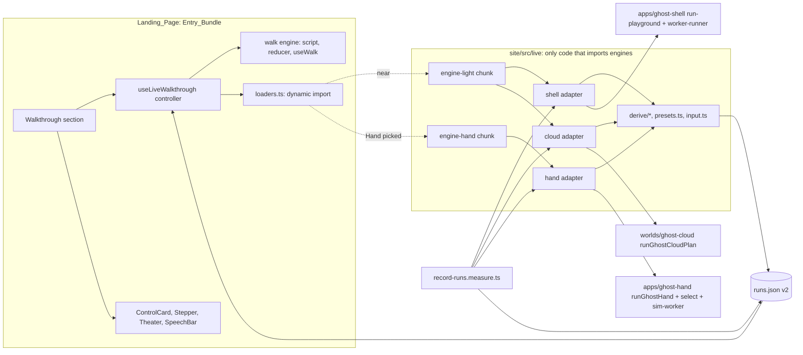

# Design Document: site-live

## Overview

The `site-live` spec turns section 3 of the landing page from a replay of recordings into a live demo, and ports the cleaner v5 layout. The page runs the same engines as the apps in the visitor's browser: `runPlayground` (Ghost Shell), `runGhostHand` with the app's worker executor (Ghost Hand), and `runGhostCloudPlan` (Ghost Cloud). It does this without a change to `apps/`, `worlds/`, `core/`, or `ui/`.

Four decisions shape the design.

1. **One folder imports engines.** `site/src/live/` is the only part of the page that imports `@ghost-run/*`, the world packages, and app source. Each world has one adapter that takes injected services (SQL executor, world factory, executor factory) and returns plain data. The code that creates a Worker lives in two small wiring modules, one per lazy chunk. The adapters run unchanged in Node tests with in-process services.
2. **A live run is data of the existing shape.** An adapter returns a `Plan_Record` (the `PlanRecord` type of `site/src/data/types.ts`). The same pure derivation code builds the live records and the recorded records, so the recorded run (`runs.json`) and the live run are the same page. The walkthrough engine (`script.ts`, `reducer.ts`) keeps its one definition of "what the page shows at step N" and gains outcomes: block with a fix, block without a fix, pass, warn, and unsupported input.
3. **Heavy code loads late, in two chunks.** The light chunk (Shell, Cloud, core, wards-config, the two world packages) loads when the section is near, and warms the SQL worker so that the 0.7 MB sql.js wasm is ready. The Hand engine loads only after Ghost Hand is picked. On the page it is a 1.8 kB proxy chunk that starts the Hand_Worker (`hand-worker.ts`), a dedicated module worker that holds the MuJoCo glue (the 11 MB wasm), the world, the pipeline, and the simulation worker. The reason is the page policy: `script-src 'self' 'wasm-unsafe-eval'` has no `'unsafe-eval'`, and MuJoCo's embind glue builds functions from strings and throws `EvalError` on the main thread. A worker script served from `/assets/` carries no page policy, so the run happens there and the page policy stays as it is.
4. **Failure shows the recording, never a fake.** An engine that cannot load or run falls back to the recorded run of a Preset and says "Recorded run". Visitor input has no recording, so it gets an honest message. "Live in your browser" appears only for a run that ran.

The package stays `site/` (`@ghost-run/site`). The only edits outside `site/` and `.kiro/specs/site-live/` are `.kiro/steering/structure.md`, `README.md`, and `docs/measurements.md` (Requirements 1 and 18).

## Architecture



### Package layout (new and changed files)

```
site/
  src/
    live/                         NEW: the only folder that imports engines
      types.ts                    LiveEngine, LiveAnswer, LiveRun, Outcome, inputs
      input.ts                    normalizeText, normalizeSliders, limits, echo
      presets.ts                  the nine Presets and four Fixed_Plans (read from plan files)
      derive/common.ts            check rows, destinations, facts helpers
      derive/shell.ts  derive/cloud.ts  derive/hand.ts   Plan_Record derivation shared with the record script
      shell.ts  cloud.ts  hand.ts adapters (injected services; no Worker, no fetch)
      hand-plan.ts                slider values -> five actions
      engine-light.ts             wiring: SQL worker, wards text, Shell and Cloud engines
      engine-hand.ts              wiring only: createHandProxy with new Worker(hand-worker.ts)
      hand-proxy.ts               page side: LiveEngine that forwards runs to the Hand_Worker
      hand-protocol.ts            message types, HAND_TIMEOUT_MS, HAND_GUARD_MS (no MuJoCo import)
      hand-worker.ts              module worker entry: world, pipeline, capabilities, sim-worker spawn
      loaders.ts                  LiveLoaders: dynamic imports, injectable
      classify.ts                 classify(answer, fixedAnswer) -> Outcome; toWalkRecord
    engine/
      useInView.ts                CHANGED: options (rootMargin, threshold); near and seen
      useWalk.ts                  NEW: record-driven hook (replaces the runs-driven useWalkthrough)
      script.ts reducer.ts types.ts   CHANGED: outcomes, candle state, stamps, shell entries
    data/
      types.ts runs.json          CHANGED: version 2 (presets)
      narration.ts                CHANGED: templates per world, step, outcome
    components/
      Walkthrough.tsx             CHANGED: section 3 shell and controller wiring
      walk/                       CHANGED: ControlCard, Stepper, Theater, Cards, panes (v5)
    styles/05-08                  CHANGED: v5 rules replace the section-3 rules
  scripts/
    record-runs.measure.ts        CHANGED: calls the adapters
    lib/csp.mjs                   NEW: the landing policy, shared by Vite config and headers
    lib/bundled-packages.mjs      NEW: Vite plugin that lists third-party packages of the bundles
    lib/notices.mjs               NEW: renders THIRD_PARTY_NOTICES.txt from that list
    lib/headers.mjs check-site.mjs build-site.mjs   CHANGED (Components 12 and 13)
  vite.config.ts                  CHANGED: policy from csp.mjs
```

### Dependency direction

| From | May import | Must not import |
|---|---|---|
| `site/src/**` except `live/` | `react`, `react-dom`, `@fontsource/fredoka`, files of `site/` (including `site/src/live/types.ts`, `loaders.ts`, `classify.ts`, `presets.ts`, `input.ts` through type-only or pure imports) | any `@ghost-run/*` package, `sql.js`, `@mujoco/mujoco`, `apps/`, `worlds/`, `core/`, `ui/` |
| `site/src/live/{shell,cloud,hand,presets,input,hand-plan}.ts` and `site/src/live/derive/*.ts` | `@ghost-run/core`, `@ghost-run/wards-config`, `@ghost-run/playground-shell`, `@ghost-run/drawer-arm`, `@ghost-run/ghost-cloud`, `@ghost-run/ui` (only `isHiddenDisplay` and `escapeForDisplay`), by relative path: `apps/ghost-shell/src/pipeline/run-playground`, `apps/ghost-shell/src/scenarios/project`, `apps/ghost-shell/src/plan/plan-file`, `apps/ghost-hand/src/pipeline/run`, `apps/ghost-hand/src/exec/select`, `apps/ghost-hand/src/capabilities`, `apps/ghost-hand/src/plan/plan-file`; plan files, wards files, and demo files through `?raw` | `react`, any DOM API |
| `site/src/live/engine-light.ts` | the adapters, `apps/ghost-shell/src/sql-worker/worker-runner` (it holds the `new Worker`), `createWatchdogExecutor` of `@ghost-run/playground-shell` | |
| `site/src/live/engine-hand.ts` | `hand-proxy.ts` only, plus `new Worker(new URL('./hand-worker.ts', import.meta.url), { type: 'module' })` | any world, app, or MuJoCo import |
| `site/src/live/hand-proxy.ts`, `hand-protocol.ts` | `types.ts`, each other | MuJoCo, world, app, or `@ghost-run/*` code |
| `site/src/live/hand-worker.ts` | `hand.ts`, `hand-protocol.ts`, `createGhostHandWorld`, the wards and variant-config files (`?raw`), `probeCapabilities` and `createExecutor` of the app, and `new Worker(new URL('../../../apps/ghost-hand/src/worker/sim-worker.ts', import.meta.url), { type: 'module' })` | `react`, page code |
| `site/scripts/record-runs.measure.ts` | `site/src/live/*` (not the wiring modules), `@ghost-run/core`, `@ghost-run/wards-config`, `@ghost-run/playground-shell`, `@ghost-run/drawer-arm`, `vitest` | `ui/`, `ghost-runner/`, `integrations/` |

The task that updates `.kiro/steering/structure.md` writes:

> `site/src/live/` may import `core/`, `wards-config/`, and `worlds/*` through their public entry points, and by relative path the pipeline modules, plan parsers, executor modules, and worker entry files of `apps/ghost-shell` and `apps/ghost-hand`. The rest of `site/src/` imports none of them. No package may depend on `site/`.

ESLint: the block for `src/**` keeps `PAGE_BANNED_IMPORTS`; a new block for `src/live/**` replaces the import ban by an allowlist of the table and keeps the syntax bans (`innerHTML`, `eval`, `new Function`, network and storage globals). `src/live/` has no React import. A fixture lint test covers one pass and one fail.

Packages `@ghost-run/core` and `@ghost-run/wards-config` resolve to their `dist/` (their `package.json` exports point there). The three app builds of `build:site` already need that `dist/`, so the precondition is the one the repository already has.

## Components and Interfaces

### Component 1: The live contract (`live/types.ts`)

```ts
type LiveInput =
  | { world: 'shell'; actions: readonly string[] }            // visitor: one line
  | { world: 'cloud'; lines: readonly string[] }              // visitor: one line
  | { world: 'hand'; speed: number; force: number; distance: number };

interface LiveRun {
  world: WorldId;
  ward: WorldRecord['ward'];          // headline ward: id, kind, kind line
  reality: RealityScene;              // from the live world's snapshot before the run
  plan: PlanRecord;                   // the Plan_Record of the run
}

type LiveAnswer =
  | { status: 'ran'; run: LiveRun }
  | { status: 'unsupported'; reason: string; stepIndexes: number[] }   // fixed engine reason; no input echo
  | { status: 'rejected'; problem: 'empty' | 'too-long' | 'invalid-character' | 'out-of-range' }
  | { status: 'failed'; cause: 'load' | 'run' | 'timeout' | 'internal'; detail?: string };  // detail: console only, never shown

interface LiveEngine {
  readonly world: WorldId;
  warm(): Promise<void>;                      // Shell: SQL worker and wasm; others: no-op
  run(input: LiveInput): Promise<LiveAnswer>; // never throws; serial per engine
  dispose(): void;                            // terminate workers, release MuJoCo objects
}
```

`run` never throws: an adapter catches every exception and returns `failed`. Runs are serial: a second `run` waits for the first (an internal promise chain), so a Hand run never overlaps another.

### Component 2: Input handling (`live/input.ts`)

| Function | Rule |
|---|---|
| `TEXT_LIMIT` | 256 code points (below the app limits, 4,096 for Shell and 1,024 for Cloud, so an app limit is never reached) |
| `normalizeText(raw)` | trims leading and trailing space characters; returns `{ ok: false, problem: 'empty' }` for an empty result, `'too-long'` above `TEXT_LIMIT` code points, `'invalid-character'` when a code point is a control (U+0000 to U+001F, U+007F to U+009F) or satisfies `isHiddenDisplay`; otherwise `{ ok: true, text }` |
| `normalizeSliders(v)` | clamps each value to `WORLD_CONFIG.actionRanges` (NaN and infinity give `'out-of-range'`), rounds speed and distance to two decimals and force to an integer |
| `echo(raw)` | `escapeForDisplay(raw)` shortened to 80 code points with a trailing "…"; the only way a rejected text is shown |
| `KNOWN_SHELL`, `KNOWN_CLOUD` | the command lists shown to the visitor; a test compares `KNOWN_SHELL` with the keys of `HANDLERS` (read through the world's tests or the README table of the app, see Open question O1) and `KNOWN_CLOUD` with the `case` labels of the Cloud parser |

The visitor's text reaches an adapter only as the `string` returned by `normalizeText`. Components never call an adapter with a raw value. The page never builds an element, attribute, style, or URL from the text; it appears as a React text child (plan input value, terminal bubble, `code` segment).

### Component 3: Ghost Shell adapter (`live/shell.ts`)

`createShellEngine({ sql, wardsText })` returns a `LiveEngine`. `sql` is a `SqlExecutor`.

Run, per call:

1. `buildProject(sql)` gives a fresh `VirtualProject` (the fixture `playground-demo`).
2. `parseWards(wardsText)` (parsed once at creation) gives the `WardSet` of `apps/ghost-shell/wards.yaml`.
3. `runPlayground({ project, plan: actions.map(command => ({ command })), wardSet, sql, worldFactory })`, where `worldFactory` wraps `createPlaygroundWorld` and records the two fingerprint hashes (the pipeline calls `fingerprint()` before and after the ghost run; the record script already does this).
4. If `run.unsupportedSteps.length > 0` the answer is `unsupported` with the reason of the first unsupported step (a fixed string of the world); the world did not execute those steps. If `run.watchdogFired` the answer is `unsupported` with the watchdog reason.
5. Otherwise `shellPlanRecord(...)` of `derive/shell.ts` builds the Plan_Record from the report's first and last scene, the verdict, the violations, the observed network events, and the hashes.

Wiring (`engine-light.ts`): `sql = createWatchdogExecutor({ spawn: createWorkerRunner })`. The SQL worker runs sql.js and the app's 5 s watchdog terminates a runaway statement, so a visitor's `sqlite3 app.db "WITH RECURSIVE ..."` cannot freeze the page (Open question O2). `warm()` runs `SELECT 1` through the executor, which spawns the worker and fetches `sql-wasm-*.wasm`. `dispose()` calls the watchdog's `dispose()`.

### Component 4: Ghost Cloud adapter (`live/cloud.ts`)

`createCloudEngine({ wardsText })`. Per call: `runGhostCloudPlan(lines, wardSet)`. The function never throws. The adapter classifies its result:

- `lines.length === 0 && p1.equal === false` (the internal-error run) gives `failed: 'internal'`.
- `unsupportedSteps.length > 0` gives `unsupported` with the engine's reason of the first unsupported line (`PARSE_REASONS` strings, which never echo the input).
- Otherwise `cloudPlanRecord(...)` of `derive/cloud.ts` from `scenes.before`, `scenes.after`, the verdict, violations, `effectsOutside`, and `p1`.

A line with `--endpoint-url` gives verdict `warn` by the world's effect and is a normal `ran` answer with Outcome `warn`.

### Component 5: Ghost Hand adapter (`live/hand.ts`, `live/hand-plan.ts`)

`createHandEngine({ createWorld, createExecutor, wardsText, variantConfigText, capabilities })`. All five are services; in the browser `hand-worker.ts` supplies them inside the Hand_Worker, in Node the tests supply `createGhostHandWorld` and `createInlineExecutor`.

`buildHandPlan(values)` reads `apps/ghost-hand/plans/first.plan.json` (through `?raw` and the app's `parsePlanFile`), keeps actions 0, 1, and 4 (reach, reach, release), and builds action 2 (`grasp` with `force`) and action 3 (`pull` with `distance` and `speed`). Each action passes `validateAction`. The sliders are rounded before (Component 2).

Run, per call: create the reference world (`createGhostHandWorld({ recordFrames: true })`, the setting of the record script) and an executor; call `runGhostHand({ plan, wardSet, variantConfig, seed: 42, variantCount: 8, world, executor, evidence: { selfCheck: { state: 'pending' }, capabilities }, planOrigin: 'scripted' })`; then `dispose` both in `finally`. A `GhostHandRunError` gives `unsupported` with the validator's message (a fixed string). A run longer than 30 s gives `failed: 'timeout'` (`HAND_TIMEOUT_MS`, a timer started by the adapter through an injected scheduler; `hand.ts` re-exports the constant from `hand-protocol.ts`). The adapter's `failed` answers carry a console-only `detail`.

The tile label rule moves from `scripts/lib/tile-label.ts` to `src/live/derive/tile-label.ts`, and the script file re-exports it, so that its tests stay valid. `handPlanRecord(...)` of `derive/hand.ts` builds checks (the three rows of `gentle-hands` from the ward's fields), tiles (label by `tileLabel` of the `site` spec, outcome, joint-limit flag from the structured `jointLimitExceeded` of the variant results, with the pattern of the `site` design as the fallback), and the facts.

`live/hand.ts` also re-exports `probeCapabilities` of the app as `handCapabilities()`, so that the record script and the tests get it through the adapter module and import no app file themselves.

Wiring. The page side (`engine-hand.ts`) is `createHandProxy({ spawn, scheduler })` with `spawn = () => new Worker(new URL('./hand-worker.ts', import.meta.url), { type: 'module' })`. The proxy is a `LiveEngine` that serves runs one at a time and matches answers to runs by id. It posts `{ type: 'run', id, speed, force, distance }` and receives `{ type: 'answer', id, answer: LiveAnswer }`, plain data safe for structured clone. It answers `failed` with cause `load` (worker error before any answer), `run` (worker error after an answer), or `timeout` (a guard at `HAND_TIMEOUT_MS + HAND_GUARD_MS` = 32 s, which outlasts the adapter's own 30 s timer). After an error or a timeout it stops the worker and spawns a fresh one for the next run. `dispose()` posts `{ type: 'dispose' }`, terminates the worker, and ends a pending run. The messages and the two constants (`HAND_TIMEOUT_MS = 30_000`, `HAND_GUARD_MS = 2_000`) live in `hand-protocol.ts`, which imports no MuJoCo code.

The worker side (`hand-worker.ts`) creates the adapter with `createGhostHandWorld`, the wards and variant-config texts (`?raw`), `probeCapabilities()` of `apps/ghost-hand/src/capabilities.ts`, and `createExecutor({ factory, spawn })` of `apps/ghost-hand/src/exec/select.ts` with `spawn = () => new Worker(new URL('../../../apps/ghost-hand/src/worker/sim-worker.ts', import.meta.url), { type: 'module' })`. On `run` it calls the adapter and posts the answer; on `dispose` it disposes the engine and closes. The capabilities module imports `react-dom/server` and `import * as ui from '@ghost-run/ui'`, so the whole kit lives in the Hand_Worker (584,599 B, 188,147 B gzip on 2026-11-21), not in a page chunk. The page chunk `engine-hand-HASH.js` is 1,797 B (Open question O4).

### Component 6: Lazy loading and the Vite build

| Item | Rule |
|---|---|
| `loaders.ts` | `interface LiveLoaders { light(): Promise<LightEngines>; hand(): Promise<HandEngine> }`. The default is `{ light: () => import('./engine-light').then(m => m.createLightEngines()), hand: () => import('./engine-hand').then(m => m.createHandEngine()) }`. Tests pass spies. A rejected promise is not kept, so the next call retries. |
| Chunk names | The module file names give `assets/engine-light-HASH.js` (the Light_Engine) and `assets/engine-hand-HASH.js` (the 1,797 B Hand proxy). The Hand_Worker is emitted as `assets/hand-worker-HASH.js` (584,599 B; 188,147 B gzip on 2026-11-21). The simulation worker is `assets/sim-worker-HASH.js` (144,750 B) and the Shell SQL worker is `assets/worker-entry-HASH.js`. No shared `common-*.js` chunk is emitted any more. The wasm files are `assets/mujoco-HASH.wasm` (found by `new URL('mujoco.wasm', import.meta.url)` inside `@mujoco/mujoco`, as in the Hand app, which passes no `locateFile`) and `assets/sql-wasm-HASH.wasm` (the app's worker entry imports it with `?url`). Vite config changes only the policy source; `base: './'`, `assetsInlineLimit: 0`, and the default worker format stay, as in the apps. A build task confirms the five emitted names. |
| Paths | The chunks and workers are resolved relative to the chunk URL (`import.meta.url`), so the Hand worker and wasm load from `<site root>/assets/` at a domain root and under a path prefix. Under CSP `worker-src 'self'` and `connect-src 'self'` they are same-origin. |
| Near | `useInView(ref, { rootMargin: '200px 0px', threshold: 0 })` reports `near` once. The controller then calls `loaders.light()` and `warm()`. |
| Seen | `useInView(ref, { threshold: 0.25 })` (the existing rule) starts the autoplay of the first Shell Preset. |
| Hand | `loaders.hand()` is called only by `submit('hand', ...)` when the Hand engine is not loaded. Nothing else calls it. The proxy starts the Hand_Worker when it is created, so the worker and the wasm load at that first pick and not before. |
| Missing IntersectionObserver | no engine loads by itself; the recorded final state of the first Preset shows with "Recorded run"; the first Run, Preset, or tab action loads the engine on demand. |
| Duplicates | `site/dist/assets/` and `site/dist/hand/assets/` both hold `mujoco-*.wasm` (11 MB each). The assembly copies the app as it is, so this is accepted (Open question O7). |

### Component 7: From a live run to the walkthrough

`classify.ts` holds two pure functions.

```ts
type Outcome = 'block-fixed' | 'block-open' | 'pass' | 'warn' | 'unsupported';
function classify(first: LiveAnswer, fixed: LiveAnswer | null): Outcome;
function toWalkRecord(run: LiveRun, fixed: LiveRun | null, outcome: Outcome, source: 'live' | 'recorded', unsupported?: UnsupportedNote): WorldRecord;
```

`classify`: `unsupported` or `rejected` first answer gives `unsupported`; verdict `pass` gives `pass`; `warn` gives `warn`; `block` with `fixed` of status `ran` gives `block-fixed`; `block` otherwise gives `block-open`. A failed Fixed_Plan run gives `block-open` with a note (the fix could not be shown); a `failed` first answer is handled by the controller (Component 8), not by `classify`.

`WorldRecord` gains `fixed: PlanRecord | null`, `outcome: Outcome`, `source: 'live' | 'recorded'`, and `unsupported?: { reason: string; known: string[] }`. The walkthrough engine reads only this record.

**Engine changes.** The state keeps its fields, with these changes: `candleOut: boolean` becomes `candle: 'lit' | 'out' | 'flicker'`; `stamp` is `'none' | 'BLOCKED' | 'PASS' | 'ASK A HUMAN'`; the Shell copy state becomes `{ tables: { name; bars; count; tag; cls }[]; entries: { name; kind; state: 'intact' | 'gone' | 'new' }[] }`; the Cloud bucket state gains `tag`; `WalkState` gains `disabledSteps: number`. `buildScript(record, step)` keeps the timing table of the `site` design (Component 7) for `block-fixed`, and differs by outcome as follows (`at` in ms after the step start):

| Step | `block-fixed` | `block-open` | `pass` | `warn` | `unsupported` |
|---|---|---|---|---|---|
| 1 Copy | as before | as before | as before | as before | copy appears; narration is the explanation; `disabledSteps = 4` (steps 2 to 5); no later step plays |
| 2 Run | as before (typing at 26 ms per character, action 250 ms after) | same | same | same | none |
| 3 Judge | check rows at 500 + 380 x k; tone at 600 + 380 x R | same | same (tone good) | tone by rows; effectsOutside chip shows the destination | none |
| 4 Verdict at 500 | candle out, stamp BLOCKED, block note, fingerprint badge if `p1.equal` | same | candle lit, stamp PASS, pass note, fingerprint badge if `p1.equal` | candle flicker, stamp ASK A HUMAN, warn note, fingerprint badge if `p1.equal` | none |
| 5 Fix and go | the Fixed_Plan run (events of the `site` design: plan box, re-copy, typing, action, checks at T3, final verdict at T3 + 1500) with the stamp, candle, note, and go badge from the fixed verdict; `act` 5 when it passes | at 0: note "Edit the plan above and run again."; `act` 4; plan box unchanged; no re-copy | at 0: go badge if verdict is `pass` and `p1.equal`, fingerprint badge off; `act` 5 | at 0: note "Nothing runs for real until a human says yes."; `act` 4; no go badge | none |

`settle(record, upTo)` folds the same events, so a jump, a play, and the Reduced_Motion final state agree (Property L7). For `unsupported`, `settle(record, 4)` equals `settle(record, 0)`.

**Check chips.** `derive/common.ts` holds `violationsOf` (the violations of one ward id), `reasonOf` (the engine's reason text), and `extraChips` (one chip per violated non-headline ward, in ward id order; `extraChip` builds one). A chip is ✗ exactly when its ward, or its kind of violation, appears in the live verdict. The step 3 tone event is `bad` when `violatedWardIds` is non-empty or any chip is ✗, and `good` otherwise (`checkEvents` in `script.ts`).

| World | Chip rules |
|---|---|
| Shell | headline chip "rows lost, at most 0" is ok when the verdict has no violation of the headline ward id; extra chips for `protect-data` and `no-secret-egress` carry the engine's reason |
| Hand | the three `gentle-hands` rows are ok when no violation matches `/^success rate /`, `/contact force .* exceeds max/`, and `/made forbidden contact/` respectively. A joint-limit or self-collision violation adds a fourth chip labelled with the ward id and the text "joint limit exceeded in N of 8 variants" or "self-collision in a variant" |
| Cloud | the `no-bucket-delete` chip is ok when that ward has no violation. Its text comes from the protected buckets removed ("prod-assets deleted") and from objects removed from protected buckets that stay ("2 objects deleted in prod-logs"), else from the engine reason. The unprotected cases read "tmp-build-cache is not prod-*", "2 objects deleted in tmp-build-cache, none in prod-*", and "no bucket deleted" |

The Cloud record gains the facts `objectsDeleted` and `objectsDeletedIn` only when a run empties a bucket that stays. `cloudEvents` then emits `bucketObjects` at the run time of step 2 for each surviving bucket that lost objects, and the Cloud Run narration says that those objects are gone in the copy.

**Notes and the verdict card.** `VerdictCard` renders the candle and the stamp only, with the badges: no `#vnote` and no `.vtxt` wrapper. `Walkthrough` renders no `#sealnote`, and the `.sealnote` CSS rule is gone. The engine's `note` state and the note texts stay in `reducer.ts` and `script.ts` and are not rendered; the Speech_Bar says what the notes said. The constant `CLOUD_NO_REAL = " Ghost Cloud has no real mode yet."` is part of the Cloud narration: the step 4 pass verdict, the fixed-pass sentence of `block-fixed`, and the `pass` sentence of step 5.

**Copy at step 5.** Only `block-fixed` emits `recopy`. `block-open`, `pass`, and `warn` have no `recopy`, so the copy at the end of step 5 equals the copy at the end of step 4 (a DOM test with the real Cloud world pins both).

**Per-world pane state.**

| World | Reality scene | Copy after the run |
|---|---|---|
| Shell | `project/` root; `app.db` with the tables of the database (`users` 1,206 rows and `orders` 3 rows in the fixture; bars = clamp(2, 12, round(rows / 100))); the non-hidden top-level entries of the project except any entry that matches a secret pattern of the egress ward: `app.db`, `build/`, `data/`, `package.json`, `README.md` | the same entries with state `intact`, `gone`, or `new` from the last scene; tables with state `intact`, `dropped` (the table is gone), or `soft` (rows kept and an `UPDATE <table> SET ...` names it; the tag is the SET text shortened to 24 code points) |
| Hand | `the real arm` | eight tiles with label, outcome, and `jointLimit` |
| Cloud | buckets with objects and the `protected` flag | buckets and objects that remain (the copy state keeps `objects: string[]` per bucket, filled by `initialCopy` from the reality scene and set by the event `bucketObjects { name, objects }`); a tag on a bucket whose ACL or public-access block differs from reality (`acl: public-read`, `public access open`) |

**Narration** (`data/narration.ts`) is a table of templates keyed by `(world, outcome, step)`; each template is a list of segments with number slots and a guard on the facts it names. The `block-fixed` Shell templates are those of Mockup_V5 with live numbers ("I run the plan on my copy… poof! {rowsLost} users are gone, but only in the copy." only when `rowsLost > 0` and the dropped or emptied table is `users`; otherwise "I run the plan on my copy. {entriesGone} entries are gone, but only in the copy." when entries vanished; otherwise "I run the plan on my copy. Nothing in the copy changed."). The ward sentences quote the engine's reasons through the segment type `code` or `text` (never HTML). The guard rule: a sentence names a fact only when the fact exists in `facts`, and the generic fallback names only the verdict and the ward ids.

### Component 8: The live controller (`useLiveWalkthrough`) and the record-driven hook

`useWalk({ scheduler })` replaces the `runs`-driven `useWalkthrough`. It holds the same state, the same timer registry, and the same controls, with these inputs: `show(record)` resets and plays the record (or settles it under Reduced_Motion), `replay()` plays the displayed record again, `jump(n)` as before. It owns no knowledge of engines. It exposes `animating` (true while a run's timers are pending) and `controls.cancel()`, which cancels the timers and resets the state to `initialState` of the displayed record.

`useLiveWalkthrough({ runs, loaders, scheduler, visibility })` composes `useWalk` with the engines. State: `world`, `plan` (the text or the slider values in the box), `known` (the Preset whose input equals the box, or none), `engineState` per engine (`idle | loading | ready | failed`), `busy`, `displayed` (`{ source: 'live' | 'recorded' | 'none' }`), and a run token.

```mermaid
sequenceDiagram
  participant V as Visitor
  participant C as Controller
  participant E as Live engine
  participant W as useWalk
  V->>C: Run, Preset, or tab
  C->>C: token++, normalize input
  alt rejected
    C->>V: speech: why, limits, examples
  else accepted
    C->>E: load if needed, run(input)
    E-->>C: LiveAnswer
    opt Preset with Fixed_Plan and verdict block
      C->>E: run(fixed input)
      E-->>C: LiveAnswer
    end
    C->>C: if token is stale, drop; classify; toWalkRecord
    C->>W: show(record)
    W-->>V: five steps, Live_Badge
  end
```

| Situation | Behavior |
|---|---|
| Mount | nothing scheduled, nothing loaded; displayed = none; badge hidden; if Reduced_Motion, `show(recorded first Shell Preset)` settled with badge "Recorded run" |
| Near (first) | `loaders.light()` then `warm()`; Cloud and Shell engines ready |
| Seen (first), not Reduced_Motion | `submit(shell, first Preset)` |
| Near, Reduced_Motion | after the engine is ready, `submit(shell, first Preset)`, shown settled; badge flips to live |
| Tab or Preset or Run | `submit(world, input, presetId?)` |
| Replay | `useWalk.replay()` (no engine call) |
| Step button | `useWalk.jump(n)` (disabled for unreachable steps) |
| Slider or text edit | `setText` and `setSliders` call `interrupt()`: when a run is busy (waiting for its engine) or animating, it bumps the run token, clears `busy` and the note, and calls `cancel()` on the walk. Every edit sets `edited`, which `execute`, `replay`, and `jump` clear. The plan updates; `known` becomes none unless the box equals a Preset; no engine call |
| Plan box view | `Walkthrough` passes `rev = view.plan.rev && !edited` to the box (tag, fixed text, fixed slider values) and keeps `view.plan.rev` for the theater's ward name. `PlanBox` takes `animating`: the text input is `readOnly` only while `animating` and not unlocked by pointer-down or focus (the unlock resets when `animating` changes); the sliders are never disabled |
| Engine load fails | `engineState = failed`; Component 9; one `console.warn` (see below) |
| A newer `submit` while one is pending | the older `submit` result is dropped (token compare after every `await`); the older engine call finishes in the background |
| Unmount | cancel timers, `dispose()` every engine, remove listeners, bump the token |

While a run is pending, the speech bar shows the loading line ("Summoning eight ghost arms…" for Hand; "Copying the project…" for Shell; "Copying the buckets…" for Cloud), which is a fixed template with the step label of step 1.

### Component 9: Presets, Fixed_Plans, visitor input, failures

| Item | Source and rule |
|---|---|
| Presets and Fixed_Plans | `presets.ts` reads the plan files and demo files by `?raw`, parses them with the apps' own parsers (`parsePlanFile` for Shell and Hand) and the Cloud demo reader (trim, drop empty lines), and exposes `PRESETS: Record<WorldId, Preset[]>` where `Preset = { id; label; input: LiveInput; fix: LiveInput | null }`. Hand inputs are derived from the plan files' actions (speed, force, distance of actions 3 and 2). The two Presets without a file (`strong grip`, `make it public`) hold the brief's values. |
| `known` | a Preset is known while the box equals its `input` exactly (text equal, or all three slider values equal after rounding) |
| Fix mapping | only `Preset.fix !== null` runs a second live run after a `block` verdict; a Visitor_Input has `fix === null` |
| Unsupported input | the adapter's `unsupported` answer becomes Outcome `unsupported`: step 1 only, the ghost's explanation (Requirement 9, criterion 5) built from fixed templates, the command list, and the slider ranges |
| Rejected input | no engine call; the speech bar explains the problem and shows `echo(raw)` |
| Engine failure with a Preset | `source: 'recorded'`: the Recorded_Run of that Preset from `runs.json`, built with `toWalkRecord(..., 'recorded')`; the badge "Recorded run"; one line of speech that the live engine did not start |
| Engine failure with Visitor_Input | no run; one line of speech; the box is kept |
| Hand timeout (30 s) | the adapter answers `timeout`, or the proxy guard at 32 s does; the proxy stops the Hand_Worker and starts a fresh one for the next run; failure as above |
| Hand worker error | before any answer the cause is `load`, after an answer `run`; the proxy replaces the worker; a failed engine load is not kept and retries on the next Ghost Hand action |
| Console | for every failed load, failed run, and failed Fixed_Plan run, the controller logs one `console.warn("[ghost-run] live <world> engine failed (<cause>: <detail>); showing the recorded run instead.")`. `detail` comes from `LiveAnswer.detail` and is never shown on the page |
| `p1.equal` false | the verdict is `block` as the pipeline returns it; no fingerprint badge, no go badge; narration says the isolation check failed |

### Component 10: The v5 components and CSS

The mockup markup maps to components as follows. Section-level ids and classes are those of Mockup_V5.

| Mockup_V5 block | Component | File |
|---|---|---|
| `.sec-head` with `.live` | `LiveBadge` in `Walkthrough` | `components/Walkthrough.tsx` |
| `.ctl`, `.ctl-top`, `.tabs`, `.tab`, `#replay` | `ControlCard`, `WorldTabs` | `components/walk/ControlCard.tsx` |
| `.plan-l`, `.rev-tag`, `.planbox`, `.cmd`, `.sl`, `.runbtn` | `PlanBox`, `Sliders` | `components/walk/PlanBox.tsx` |
| `.presets` | `PresetRow` | `components/walk/PlanBox.tsx` |
| `.stepper` | `Stepper` | `components/walk/Stepper.tsx` |
| `.theater`, `.panes`, `.pane`, `.gutter`, `.beam` | `Theater`, `RealityPane`, `CopyPane` | `components/walk/Theater.tsx` (changed) |
| `.judge`, `.ward`, `.checks`, `.chk`, `.eo`, `.verdict`, `.stamp`, `.bigcandle` | `JudgeRow`, `WardCard`, `VerdictCard` | `components/walk/Cards.tsx` (changed) |
| `.actor`, `.term` | `Actor` | `components/walk/Actor.tsx` (changed: bubble placement) |
| `.say` | `SpeechBar` with the step label inside `#sayt` | `components/walk/Cards.tsx` |

The CSS of Mockup_V5 replaces the section-3 rules of `05-walkthrough.css` (control card, stepper, theater), `06-pane-content.css` (trees, tiles, buckets), `07-judge.css`, and `08-actor-say.css`. The additions of Requirement 2, criterion 7 go into `06`, `07`, and `10-motion.css`: `.stamp.warn{color:#ffd36b;border-color:#ffd36b}`, `.bigcandle.flicker .flame` with a short opacity animation (at most 3 changes per second, and none under Reduced_Motion), `.live.rec` (neutral border and text), `.stepper button[aria-disabled="true"]`, `.tag.pub` on a Cloud bucket, and `.node.new` for created entries.

**Bubble fix.** `Theater.place()` clamps the Actor's y for `copy`: `y = max(y, 0)`. With `.term{top:6px}` the bubble top is then at least 6 px inside the Theater. The function is pure and takes rectangles, so the test needs no layout.

### Component 11: Presets row, Replay, and the Live_Badge in the DOM

`#replay` sits at the top right of `.ctl-top`. The Live_Badge is `<span class="live" hidden>` until a run is displayed, then `<i></i>Live in your browser` or `<i></i>Recorded run` with `.rec`. The badge text is not a live region (Requirement 16, criterion 3).

### Component 12: Headers and policy

`scripts/lib/csp.mjs` exports `LANDING_CSP_PARTS` (an ordered list of directives) and two functions: `landingHeaderPolicy()` (with `frame-ancestors 'none'`) and `landingMetaPolicy()` (without it). `vite.config.ts` and `scripts/lib/headers.mjs` both import them. The policy of `/` and `/index.html` is:

```
default-src 'none'; script-src 'self' 'wasm-unsafe-eval'; style-src 'self'; font-src 'self'; img-src 'self'; connect-src 'self'; worker-src 'self'; base-uri 'none'; form-action 'none'; frame-ancestors 'none'
```

This is the policy of the `site` design with the three changes of Requirement 14, criterion 1. The existing Site_Check rule against `'unsafe-eval'` matches the quoted token exactly (`/'unsafe-eval'/`), so `'wasm-unsafe-eval'` does not trip it; a test asserts this on the real policy. Nothing under CSP needs `style-src 'unsafe-inline'`: the Actor and the bars set styles through the CSSOM.

`'unsafe-eval'` stays out of the policy on purpose. MuJoCo's embind glue builds functions from strings and throws `EvalError` on the main thread under this policy. The live Hand run therefore happens in the Hand_Worker, whose script is served from `/assets/` and carries no page policy (the page policy applies to documents; the `_headers` rule for `/` does not cover `/assets/*`). A test asserts that no chunk that runs under the page policy contains a Function-constructor call (Component 13).

### Component 13: Site_Check and Build_Script changes

| Rule | Change |
|---|---|
| Engine_Bundles | `assets/engine-light-*.js`, `engine-hand-*.js`, `hand-worker-*.js`, `sim-worker-*.js`, `worker-entry-*.js` get the reference-form scan of the app bundles; the Entry_Bundle keeps the full string scan |
| Wasm and worker references | the extractor already handles `new URL("x", import.meta.url)` and `new Worker(new URL(...))`; the real-dist test asserts at least one `.wasm` reference from the Hand files (`findEngineReferences` includes `hand-worker-*.js` in its Hand pattern) and one from the Shell SQL worker, and a `new Worker` reference to the Hand_Worker, the simulation worker, and the Shell SQL worker; each target exists |
| First paint | fail when `index.html` has a `script`, `modulepreload`, or `preload` that names `engine-` or a `.wasm`, or when the Entry_Bundle has a static `import` of an `engine-` file |
| Entry size | fail above 360 kB (`ENTRY_MAX_BYTES`; 284 kB today) |
| Policy | the `/` blocks must contain `worker-src 'self'` and `connect-src 'self'` and `'wasm-unsafe-eval'` and nothing from the forbidden list; `/shell/*` unchanged |
| Notice | `THIRD_PARTY_NOTICES.txt` at the root of `site/dist/`, generated by `build-site.mjs` from `site/build/bundled-packages.json` (see below). The Site_Check requires the file and a link in `index.html` that resolves to it (the footer link of D6). With the option `bundledPackages` (a manifest path or the list; the CLI always passes the manifest) it adds the rules `RULE_NOTICE_PACKAGE` (a listed package has no section with heading, `License:` line, and text) and `RULE_NOTICE_LIST` (the list is missing or empty) |
| Shared chunk | `assets/common-*.js` (a Rollup chunk that the engine chunks might share; none is emitted since the Hand code moved into the Hand_Worker) is classified as an Engine_Bundle: reference-form check only, and never named or statically imported by the first paint |
| Reference forms | `new URL("x", self.location.href)` counts like `new URL("x", import.meta.url)` (the Shell SQL worker names its wasm file this way) |

**Build_Script and notices.** `scripts/lib/bundled-packages.mjs` exports `packageOfId`, `idsOfBundle`, `readManifest`, and the Vite plugin `bundledPackages({ root, out })`. `vite.config.ts` adds it to `plugins` (it writes `site/build/bundled-packages.json` on `closeBundle`) and to `worker.plugins` (it only collects; a module-level map is shared by the page build and its worker builds, so the Hand_Worker, the simulation worker, and the SQL worker are covered). `scripts/lib/notices.mjs` exports `renderNotices`, `missingFromNotices`, and `packageHeading`. It matches license files by `/^(licen[cs]e|copying|notice)/i`, takes the text for `@mujoco/mujoco` (which ships no license file) from `apps/ghost-hand/notices/mujoco.LICENSE.txt`, and adds the components compiled into `mujoco.wasm` from `apps/ghost-hand/notices/sources.json`. `build-site.mjs` no longer copies the Ghost Hand notice; its `writeNotices` dependency writes `site/dist/THIRD_PARTY_NOTICES.txt` and fails with `missing build output: site/build/bundled-packages.json (...)` or `no license text for <name> <version>`. The copy of the Hand app under `site/dist/hand/` stays as it is.

### Component 14: Record script and `runs.json` version 2

`record-runs.measure.ts` creates in-process services (`initInlineSql()` for Shell, `createGhostHandWorld` plus `createInlineExecutor` for Hand), builds the three engines through the adapters, and runs every Preset and every Fixed_Plan. It keeps the refusals of the `site` design (unexpected verdict for a named blocking Preset or a Fixed_Plan, unequal fingerprints, unparsable wards: exit non-zero, write nothing) and its deterministic printer. The expected-verdict table lives in the measure file as data: `DROP TABLE users`, `rm -rf ./data ./build`, `fast pull`, and `delete prod-assets` block; the four Fixed_Plans pass.

```ts
interface RunsFileV2 {
  format: 'ghost-site-runs'; version: 2; seed: 42; variantCount: 8;
  worlds: { shell: WorldRecordV2; hand: WorldRecordV2; cloud: WorldRecordV2 };
}
interface WorldRecordV2 {
  id: WorldId;
  ward: { id: string; kind: 'sql' | 'physics' | 'path'; line: string };
  reality: RealityScene;
  presets: { id: string; plan: PlanRecord; fixed: PlanRecord | null }[];   // order of Requirement 8, criterion 1
}
```

`toWalkRecord` builds a `WorldRecord` from a `presets` entry for the fallback. `PlanRecord.display` for Hand is the terminal text. The Shell reality scene lists the entries of Component 7.

## Data Models

| Model | Where | Limits and notes |
|---|---|---|
| `LiveInput`, `LiveAnswer`, `LiveRun`, `LiveEngine` | `live/types.ts` | plain data; `run` never throws |
| `Preset` | `live/presets.ts` | 9 Presets, 4 Fixed_Plans |
| `PlanRecord`, `WorldRecord`, `RealityScene`, `CopyScene` | `data/types.ts` | `WorldRecord` gains `fixed: PlanRecord or null`, `outcome`, `source`, `unsupported?`; `CopyScene.shell` gains `entries`; `CopyScene.cloud` buckets gain `tag?` |
| `RunsFileV2` | `data/types.ts`, `data/runs.json` | 9 Preset records, 4 Fixed_Plan records, sorted keys |
| `WalkState` | `engine/types.ts` | `candle`, `stamp`, `disabledSteps`; no field read by the Reality pane |
| `TEXT_LIMIT` | `live/input.ts` | 256 code points |

## Correctness Properties

*A property is a characteristic or behavior that should hold true across all valid executions of a system. Properties are the bridge between the requirements and the tests.* Tests that use generated inputs use `fast-check` with at least 100 examples in a Short_Run, tagged `// Feature: site-live, Property Ln: title`. Property n of this section is written Ln (L for live) in test tags, task names, and requirement references, so that it is not confused with Properties 1 to 12 of the `site` spec or with P1 to P8 of the safety contract. Where an input space is finite and small (the Presets), the test enumerates it and says so.

### Property 1: Live equals recorded (live-equals-recorded)

*For every* Preset of the nine and *for every* Fixed_Plan of the four, the `PlanRecord` that the live adapter returns, run in Node with in-process services, equals the entry in the committed `runs.json` field for field. For a Preset with no entry, it equals a fresh recording made into a temporary file. The Shell and Cloud cases run always. The Hand cases run in the gated project. The input space is the 13 plans, so the test enumerates it.

**Validates: Requirements 11.1, 11.3, 11.4, 11.5, 11.6**

### Property 2: Reality never changes (reality-never-changes-live)

*For any* world and *for any* sequence of user actions with any clock advance, the serialized content of `#realb` after each action equals its content right after the reset of the displayed run, and the badges are the only part of the Reality pane that may differ. *For any* generated visitor text accepted by the Shell and Cloud adapters, every run reports `p1.equal`, and a world built fresh from the fixture after the sequence has the fingerprint of a world built fresh before it.

**Validates: Requirements 12.1, 12.2, 12.3, 12.4**

### Property 3: Input reaches the engine escaped and limited (input-escaped-and-limited)

*For any* string (generated with control characters, hidden code points built from code points, markup, and strings longer than the limit), `normalizeText` either rejects it or returns a text of at most 256 code points with no control or hidden code point, equal to the input trimmed of space characters; an adapter spy receives only such a text; the rendered DOM after the run holds the text only in text nodes (the count of elements in the Live_Section equals the count for a fixed benign text of the same world and Outcome); and `echo` of any string contains no control or hidden code point and has at most 80 code points before the ellipsis.

**Validates: Requirements 9.1, 9.2, 9.3, 9.6, 9.7**

### Property 4: No request leaves the page (no-request-leaves-the-page)

*For any* sequence of tab, Preset, Run, and edit actions over all three worlds, with the engines running in-process or replaced by their wiring stubs, the recorders for `fetch`, `XMLHttpRequest`, `WebSocket`, `EventSource`, and `sendBeacon` receive no call except a same-origin URL ending in `.js` or `.wasm`; no stored value appears in `localStorage`, `sessionStorage`, or a cookie; and `curl` to a reserved host and `--endpoint-url` plans leave nothing but a recorded observation in the run.

**Validates: Requirements 13.1, 13.2, 13.4**

### Property 5: Nothing heavy loads before the section is near (nothing-heavy-before-near)

*For any* sequence of renders, scrolls reported as not near, hovers, resizes, and slider moves, the loader spies, the Worker constructor spy, and the fetch spy record no call until the observer reports `near`; after `near`, `light()` is called once and `hand()` never. With no IntersectionObserver, no loader is called before the first action.

**Validates: Requirements 6.1, 6.2, 6.6**

### Property 6: The Hand engine loads only after Ghost Hand is picked (hand-engine-only-after-pick)

*For any* sequence of actions that never selects the Ghost Hand tab and never runs a Hand input (near, seen, Shell and Cloud tabs, Presets and Runs, Replay, step jumps), `hand()` is never called and no simulation worker is created. After the first Ghost Hand action `hand()` is called once, and a second Ghost Hand action does not call it again unless the first call rejected.

**Validates: Requirements 6.3, 6.4, 10.5**

### Property 7: Settling equals playing through, for every outcome (live-walk-determinism)

*For any* world, *for any* Outcome (generated records of all five kinds with generated checks, verdicts, and facts), and *for any* step n in 0 to 4, folding the events of steps 0 to n in `at` order gives the same state as running the hook with a fake clock until step n's last event fired, apart from the narration (the settled narration is that of step n) and the typed text (the settled text is complete). The state after step 4 equals the Reduced_Motion final state. For `unsupported`, the state after any step equals the state after step 0.

**Validates: Requirements 7.1, 7.2, 7.6, 7.7, 16.6**

### Property 8: Outcome classification and no invented fix (outcome-classification)

*For any* pair of answers, `classify` returns `unsupported` for an unsupported or rejected first answer; `pass` or `warn` for those verdicts whatever the second answer; `block-fixed` only when the verdict is `block` and a second answer with status `ran` exists; and `block-open` otherwise. *For any* Visitor_Input, the walk record has `fixed === null`. *For any* walk record, the page shows a Fixed_Plan text only when `fixed !== null`, and the go badge only when the final verdict is `pass` and `p1.equal`; the fingerprint badge and the go badge are never both shown.

**Validates: Requirements 7.4, 7.5, 7.6, 8.3, 8.4**

### Property 9: A superseded run never reaches the page (stale-run-discarded)

*For any* sequence of controls (tab, Preset, Run, Replay, step, unmount) with generated delays and engine answer orders, after the last control the displayed record is the record of the latest accepted run; no event, narration, or badge of an older token is applied; the number of pending timers equals the events still to fire of the latest run (none after unmount, and none for an unsupported run after its step 1); engines are disposed on unmount; and an edit of the plan box while a run is animating or waiting for its engine cancels that run (its timers are cleared, its late answer is dropped, and `busy` is cleared).

**Validates: Requirements 3.10, 10.6, 10.7, 5.9**

### Property 10: Failure keeps the page working (fallback-keeps-page-working)

*For any* world, *for any* failure of the engine (load rejection, run exception, timeout, internal-error run) and *for any* Preset, the page shows the Recorded_Run of that Preset, the badge reads "Recorded run", and no exception escapes; *for any* Visitor_Input, no run is shown and the box is unchanged; the badge never reads "Live in your browser" for a displayed Recorded_Run.

**Validates: Requirements 10.1, 10.2, 10.3, 10.4, 10.5**

### Property 11: Policy of the landing page (headers-policy-for-root)

*For any* generated Headers_File built by `buildRootHeaders`, the blocks for `/` and `/index.html` carry the policy `landingHeaderPolicy()`; that policy differs from the `site` policy by exactly the three changes; the meta policy equals it without `frame-ancestors`; the Site_Check accepts it and rejects a policy with `https:`, `*`, `'unsafe-eval'`, `'unsafe-inline'`, or a `connect-src` other than `'self'`; no block has the scope `/*`.

**Validates: Requirements 14.1, 14.2, 14.3, 14.4**

### Property 12: Slider plans are valid and equal the plan files (slider-plan-valid)

*For any* three finite numbers, `normalizeSliders` returns values inside the ranges, rounded to the step, and `buildHandPlan` of them gives five actions that all pass `validateAction`, whose reach and release actions equal those of `first.plan.json`, and whose grasp force, pull distance, and pull speed equal the rounded values. The sliders (0.6, 20, 0.2) and (0.15, 15, 0.15) give exactly the actions of `first.plan.json` and `revised.plan.json`.

**Validates: Requirements 5.4, 3.2, 9.2**

## Error Handling

| Situation | Behavior |
|---|---|
| Empty, too long, or invalid-character text | rejected before any engine call; the ghost explains with `echo(raw)` |
| Unsupported command or parse rejection | `unsupported` answer; step 1 only; command list shown |
| Slider value out of range or NaN | clamped, or `out-of-range` when not finite |
| `runPlayground` throws or the SQL worker dies | `failed: 'run'`; fallback by Component 9; the worker is respawned by the watchdog on the next call |
| Shell SQL statement runs 5 s | the app's watchdog terminates the worker; the step is marked as the world marks it; the adapter returns `unsupported` with the watchdog reason |
| Engine chunk import rejects | `failed: 'load'`; not kept; retried on the next action |
| Worker cannot start, wasm fails to compile, or a policy blocks it | `failed: 'load'` or `'run'`; fallback by Component 9 |
| Hand run longer than 30 s | `failed: 'timeout'` (adapter timer, or the proxy guard at 32 s); the proxy stops the Hand_Worker and starts a fresh one for the next run |
| Hand_Worker error | `failed: 'load'` before any answer, `'run'` after one; the proxy replaces the worker |
| Edit while a run animates or waits | the run is cancelled (Component 8); no failure and no console warning |
| Cloud internal-error run | `failed: 'internal'` |
| Fixed_Plan run fails or does not pass | Outcome `block-open` with the fix not shown; its live verdict is shown only when it ran |
| `p1.equal` false | verdict `block` as the pipeline returns it; no fingerprint or go badge |
| No IntersectionObserver or `matchMedia` | as in Component 6 and the `site` design |
| `runs.json` has another `format` or `version` | the shape test fails; the page does not render partial data |
| Unmount during a run | token bumped; the late result is dropped; engines disposed |

## Testing Strategy

The suite uses Vitest with Testing Library and jsdom, plus `fast-check`. It runs in a Short_Run without a browser or a network. Tests that need the MuJoCo simulation are in the env-gated `record` project (`GHOST_SITE_RECORD=1`). DOM tests inject fake engines (stubs that return records of `runs.json`) through `LiveLoaders`, so they never start a worker.

| Test file | Covers |
|---|---|
| `tests/unit/live-input.test.ts`, `live-input.property.test.ts` | `normalizeText`, `normalizeSliders`, `echo`; Property L3 (engine side) |
| `tests/unit/live-presets.test.ts` | the nine Presets equal the plan and demo files; the four Fixed_Plans; Preset known-ness |
| `tests/unit/live-hand-plan.property.test.ts` | Property L12 |
| `tests/unit/live-shell.test.ts` | verdicts and checks for the three Presets and the fixed plans; fingerprint equality; unsupported (`git status`, `$(...)`); watchdog answer with a stubbed executor; limits; `.env` never in a record |
| `tests/unit/live-cloud.test.ts` | the three Presets, `--endpoint-url` (warn), unsupported lines, the internal-error run, the 50-line cut |
| `tests/unit/live-reality.property.test.ts` | Property L2, engine form (Shell and Cloud) |
| `tests/unit/live-parity.test.ts` | Property L1 for Shell and Cloud |
| `tests/record/live-parity-hand.test.ts` | Property L1 for Hand; the Hand slider sample of Property L2 |
| `tests/unit/classify.property.test.ts` | Property L8 |
| `tests/unit/live-walk.property.test.ts` | Property L7 on the engine with a recording scheduler |
| `tests/unit/narration-live.test.ts` | templates are chosen only when their facts exist; no HTML in segments; numbers formatted |
| `tests/unit/runs-shape.test.ts` | `runs.json` version 2: shape, expected verdicts for the named Presets, `p1.equal`, the values of Requirement 11, criterion 6 (from a fresh run in the gated project) |
| `tests/unit/csp.test.ts`, `headers.property.test.ts` | Property L11 and the updated header tests |
| `tests/unit/check-site*.test.ts`, `site-dist.test.ts` | the new Site_Check rules with fixtures (including `RULE_NOTICE_PACKAGE` and `RULE_NOTICE_LIST`); the real dist when it exists, with the found Hand_Worker, simulation worker, SQL worker, and wasm references |
| `tests/unit/build-site.test.ts` | the generated notice file in the assembled directory; failure when the manifest is missing or a package has no license text |
| `tests/unit/lint-fixture.test.ts` | `site/src/live/` may import an engine; `site/src/components/` may not |
| `tests/dom/page-loading.property.test.tsx` | Properties L5 and L6 with fake IntersectionObserver, loader spies, a Worker spy, and a fetch spy |
| `tests/dom/live-controller.property.test.tsx` | Properties L9 and L10 with fake engines and a fake clock; L9 models "typing while a run animates cancels its timers" |
| `tests/dom/live-edit.test.tsx` | edit during animation cancels; edit while the engine call is pending cancels; the input stays editable after "Fix and go"; the tag and fixed values clear on edit |
| `tests/dom/live-warn.test.tsx` | one `console.warn` per failed load, failed run, and failed Fixed_Plan run, with world, cause, and detail; none on the page |
| `tests/unit/hand-proxy.test.ts` | the proxy with a fake worker: id matching, serial runs, `load`, `run`, and `timeout` causes (32 s guard), fresh worker after an error, `dispose` ends the pending run |
| `tests/unit/chip-truth.test.ts` | chips follow the live ward verdict: every subset of the four Hand violation kinds, the Shell and Cloud cases with the real worlds, the tone event |
| `tests/unit/landing-build.test.ts` (`landing-build`) | the built chunks and workers; no chunk under the page policy contains a Function-constructor call (the Hand_Worker is exempt); the page-side Hand files import no MuJoCo, world, or app code |
| `tests/unit/notices.test.ts` | `renderNotices`, `missingFromNotices`, the license file match, the MuJoCo fallback, the components list, both failure messages |
| `tests/dom/live-input.test.tsx` | Property L3 (DOM side): typed `` text, hidden characters (built from code points), over-limit text |
| `tests/dom/live-reality.property.test.tsx` | Property L2, page form (extends `reality.property.test.tsx`) |
| `tests/dom/live-no-network.test.tsx` | Property L4 |
| `tests/dom/control-card.test.tsx` | tabs (`role`, `aria-selected`, arrow keys), Replay, Presets row and `on` class, slider labels, ranges equal `WORLD_CONFIG`, Run button busy state, the plan tag, the input `readOnly` only while animating and unlocked by pointer-down or focus, sliders never disabled |
| `tests/dom/stepper.test.tsx` | the dots, jump, disabled steps for `unsupported`, `aria-current` |
| `tests/dom/speech.test.tsx` | the step label, the live region updates once per step, the typed text never enters it |
| `tests/dom/outcomes.test.tsx` | the five Outcomes render the right stamp, candle, badges, and plan box; the verdict card holds only candle and stamp (no `#vnote`, no `#sealnote`); step 5 keeps the copy for `block-open`, `pass`, and `warn` and re-copies only for `block-fixed` |
| `tests/dom/chips.test.tsx` | chip rows and tone in the DOM for each world, including the Cloud object list after `rm --recursive` |
| `tests/dom/live-badge.test.tsx` | hidden before a run; "Live in your browser" only for live; "Recorded run" for the fallback and for the first Reduced_Motion paint |
| `tests/dom/a11y.test.tsx` | tab roles and roving tabindex, slider labels and `aria-valuetext`, one polite region, `aria-busy`, disabled steps with `aria-disabled` |
| `tests/dom/reduced-motion-live.test.tsx` | recorded final state at load; live final state after near; no timer |
| `tests/unit/theater-place.test.ts` | the bubble stays inside the Theater for every Actor position |
| `tests/unit/classes.test.tsx`, `contrast.test.ts` | the updated class list and the added color pairs |

**Gated tests and time.** The Hand simulation takes about 0.4 s per run in a browser with workers and several seconds in Node with the inline executor. The gated project holds every Hand test. The always-on suite holds the Hand plan builder, the record shape, and the Hand fallback and DOM tests with a fake engine.

**Owner checks, not tests** (the owner's agent, recorded in `docs/measurements.md`): the screenshot comparison of Requirement 2, criterion 9; the browser load of `/` under the root `_headers` with a Hand run (Requirement 14, criterion 5); the load times of the engines in Chrome; the keyboard and screen-reader pass.

## Requirement Traceability

| Requirement | Design section |
|---|---|
| 1 Scope and dependency direction | Overview; Dependency direction |
| 2 Fidelity | Components 10 and 11; Owner checks |
| 3 Control card | Components 8, 10, 11 |
| 4 Stepper and speech bar | Components 7, 10; Property L7 |
| 5 Live engines | Components 1 to 5 |
| 6 Lazy loading | Component 6; Properties L5, L6 |
| 7 From run to steps | Component 7; Properties L7, L8 |
| 8 Presets and Fixed_Plans | Components 8, 9; Property L8 |
| 9 Visitor input | Components 2, 9; Property L3 |
| 10 Failure and fallback | Components 8, 9; Properties L9, L10 |
| 11 Recorded data and parity | Component 14; Property L1 |
| 12 Reality unchanged | Components 3 to 5, 7; Property L2 |
| 13 No request | Components 2, 6, 12; Property L4 |
| 14 Headers and policy | Component 12; Property L11 |
| 15 Site_Check | Component 13 |
| 16 Accessibility and reduced motion | Components 10, 11; DOM tests |
| 17 Hygiene | Testing Strategy (hygiene test of the `site` spec) |
| 18 Docs | Component 13 (notice); Open question O8 |
| 19 Gates | Testing Strategy; last task |
| 20 Amendments | Open question table; the tasks that edit the `site` tests |

## Open questions

### Differences between the brief and the repository

Checked on 2026-11-21. The design follows the repository.

| # | Brief says | Repository says | What the design does |
|---|---|---|---|
| O1 | Shell commands: `cat`, `cp`, `curl`, `echo`, `ls`, `mkdir`, `mv`, `npm`, `rm`, `sqlite3`, `touch` (11) | The handler table of `worlds/playground-shell/src/shell/commands/index.ts` and the app README list 15: also `pwd`, `find`, `true`, `false` | `KNOWN_SHELL` holds 15 and a test compares it with the handler table or the README table. The visitor sees all 15. |
| O2 | Run through `runPlayground` and sql.js | The app runs sql.js in a Web Worker under a 5 s watchdog; `initInlineSql` is documented for tests and jsdom and would block the main thread on a runaway statement | The Shell adapter takes a `SqlExecutor`; the page uses `createWatchdogExecutor` with the app's `createWorkerRunner`. Node tests use the inline executor. |
| O3 | `_headers` for `/` gains `'wasm-unsafe-eval'`, `worker-src 'self'`, `connect-src 'self'`; the site check must keep passing | Nobody has loaded Ghost Hand under a policy (the `site` design D5); the Hand app has no policy. The three additions may not be enough (for example if the MuJoCo glue needs a `blob:` origin) | The design applies the three additions. The browser check of Requirement 14 decides. An engine blocked by the policy takes the fallback path, so the page works either way. If the check fails, the owner decides on a further directive. |
| O4 | Reuse the Ghost Hand pipeline and its worker executor | `runGhostHand` imports `capabilities.ts`, which imports `react-dom/server` and `import * as ui from '@ghost-run/ui'`; the executor and the plan parser also reach `@ghost-run/ui`. The Hand_Worker therefore holds the whole kit and `react-dom/server` | Accepted: changing the app is out of scope. The kit lives in the Hand_Worker (584,599 B; 188,147 B gzip), so neither the Entry_Bundle nor the page-side Hand chunk (1,797 B) carries it. Both budgets are unaffected because the worker loads only after Ghost Hand is picked. |
| O5 | The Hand worker "under the site's paths" | The worker is created in `apps/ghost-hand/src/main.tsx`, an entry with side effects that cannot be imported; the MuJoCo wasm is found by `new URL('mujoco.wasm', import.meta.url)` inside `@mujoco/mujoco`, with no `locateFile` | `hand-worker.ts` creates the `sim-worker.ts` workers (the app's `main.tsx` cannot be imported), and `engine-hand.ts` only wires `createHandProxy` with `new Worker(new URL('./hand-worker.ts', import.meta.url), { type: 'module' })`. The reason for the extra worker is that MuJoCo's glue throws `EvalError` on the main thread under the page policy, which has no `'unsafe-eval'`. Vite emits the Hand_Worker, the simulation worker, and the wasm into `assets/` of the Landing_Page build. A build task confirms the file names. |
| O6 | Check chips "using the ward engine's own reasons and numbers" | The ward engine returns only violations (`wardId`, `reason`); the existing chips (`rows lost, at most 0`, `contact force, at most 30 N`) are derived by the record script from scenes and ward fields | Shared derivation (Component 5, Requirement 11). The headline ward keeps the mockup's chips; every other violated ward adds one chip with the engine's reason. |
| O7 | `site/dist` unchanged apart from `_headers` | The Landing_Page build now emits its own `mujoco-*.wasm` (11 MB) and the Hand app's copy stays in `site/dist/hand/assets/` | Accepted. Both are copied as they are. The size is recorded in `docs/measurements.md`. |
| O8 | Nothing about third-party notices | `apps/ghost-hand/dist/THIRD_PARTY_NOTICES.txt` carries the MuJoCo and library notices; the Landing_Page now ships the MuJoCo wasm | The build generates `site/dist/THIRD_PARTY_NOTICES.txt` from the Bundled_Packages_List (Component 13) and fails when the list is missing or a package has no license text. Owner decision (D6): keep, and link the notice from the footer. |
| O9 | Cloud preset "make it public": `aws s3api put-bucket-acl --bucket prod-assets --acl public-read` | The repository demo `02-make-bucket-public.txt` has two lines (`delete-public-access-block`, then `put-bucket-acl`). The world's README says every ACL value change on a protected bucket is blocked by `no-public-bucket` | The Preset is the single line of the brief. Its verdict comes from the run, not from the spec; the committed `runs.json` records it. |
| O10 | Shell pane as in the mockup (`project/`, `app.db`, `package.json`, `data/`) | The Preset `rm -rf ./data ./build` removes `build/`, and a visitor can remove `README.md`; the mockup shows neither | The pane lists the non-hidden top-level entries (adds `build/` and `README.md`); `.env` is never listed. Listed as an addition in Requirement 2, criterion 7. |
| O11 | "The first preset of each world autoplays when the section scrolls into view" | The `site` page autoplays Ghost Shell only, and picking a tab plays the world | Ghost Shell autoplays when Seen. Picking Ghost Hand or Ghost Cloud runs that world's first Preset. |
| O12 | Slider plan passes "the app's plan validator" | `validateAction` (drawer-arm) is the range check inside the app's `parsePlanFile`; range inputs with step 0.05 give floats such as 0.15000000000000002 | Values are rounded to the step before the plan is built; a test pins (0.6, 20, 0.2) and (0.15, 15, 0.15) to the two plan files. |
| O13 | The step names are a slim stepper | The `site` spec fixes the class list (`rail`, `wchip`) and the step buttons with function names | Requirement 20 lists the amended criteria; the tasks change the old tests. |
| O14 | Warn look is "in the mockup's style" | Mockup_V5 has no warn style | The design adds `.stamp.warn` and `.bigcandle.flicker` and lists them in `docs/measurements.md`. |

### Decisions for the owner

| # | Question | Default in this design |
|---|---|---|
| D1 | Step 5 for a `warn` plan. The brief says nothing. | The step says a human must approve, shows no go badge, and fixes nothing. |
| D2 | Step 4 for a `pass` plan shows the fingerprint badge and step 5 the go badge, because the two badges share one position in the mockup. The brief says steps 4 and 5 show PASS and the "real run allowed" badge. | Step 4: PASS and the fingerprint badge. Step 5: PASS and the go badge. |
| D3 | Reduced motion: show the recorded final state first, then swap to the live final state. | Yes; the two are equal by Property L1. |
| D4 | The input limit. | 256 code points for Shell and Cloud text. |
| D5 | The Hand timeout. | 30 s, then the fallback. |
| D6 | Whether the footer links the third-party notice (O8). | Owner decision: yes. One small link "Third-party notices" at the end of the footer, `href="./THIRD_PARTY_NOTICES.txt"`; nothing else in the footer changes. The notice file is generated, not copied. |
