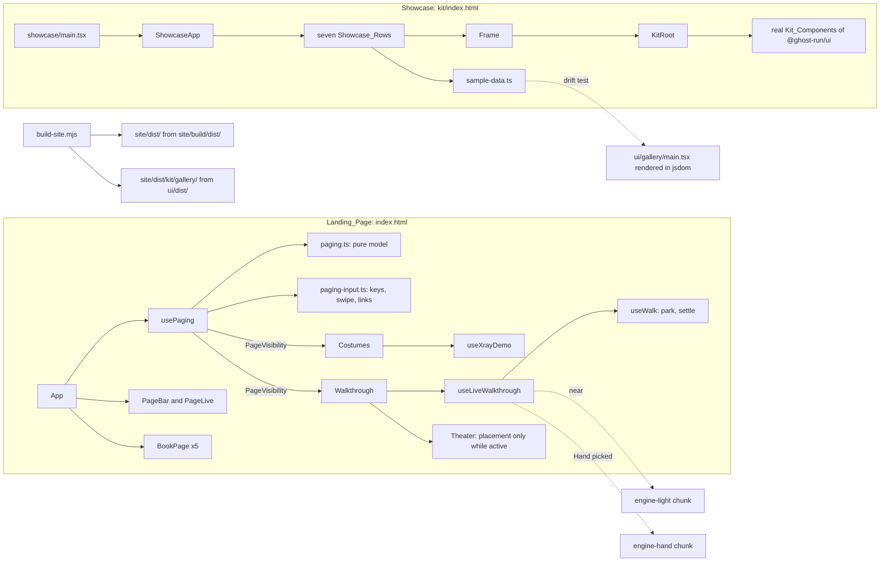

# Design Document: site-pages

## Overview

The `site-pages` spec makes three changes inside the package `site/` (`@ghost-run/site`): the landing page `/` becomes five pages that the visitor turns like a book, `/kit/` becomes a showcase page that renders the real UI kit, and the copy of both pages shrinks to the brief's copy deck. It touches no file of `apps/`, `worlds/`, `core/`, `ui/`, `wards-config/`, or `ghost-runner/`.

Five decisions shape the design.

1. **Paging is a pure model plus one hook.** `engine/paging.ts` holds the page order, the hash codec, and a transition function that takes a state and a request and returns the next state and the effects to run (write the hash, start the effect timer, announce, scroll, move focus). `engine/usePaging.ts` runs those effects. Keyboard, swipe, and link rules are pure functions in `engine/paging-input.ts`. The property tests run on the pure parts, so they need no browser.
2. **Sections learn about their page from one value.** The hook gives `App` a `PageVisibility` value (`current` page and which pages were `opened`). `Costumes` and `Walkthrough` take it as a prop. `IntersectionObserver` and `useInView` leave the page: a page that is not current has no layout and never intersects the window. "Near" means "page 3 or page 4 was opened". "Autoplay" means "page 4 was opened".
3. **The copy deck is data.** Every string of Requirements 11 and 13 lives in a data module (`data/copy.ts`, `data/skeleton.ts`, `showcase/copy.ts`). Components read the modules. The copy tests hold the same literals as their own expected values, so a change in a module alone fails a test. A second test holds the list of dropped texts.
4. **The Showcase is a second Vite entry in its own folder.** `site/kit/index.html` loads `site/src/showcase/main.tsx`. That folder is the only place outside `site/src/live/` that imports `@ghost-run/ui`. The gallery's fixtures are private to `ui/gallery/main.tsx`, so the Showcase keeps a site-owned copy of the values, and a drift test renders the real gallery and compares the output of each kit component (Component 9).
5. **`/kit/` keeps the policy of `/`.** The two `/kit/` header blocks are built from the same constants as the `/` blocks. The Showcase needs no wasm and no worker, so the Site_Check forbids the references instead of narrowing the policy (Open questions, O17).

The work leaves the live engines, the recorded runs, the parity tests, and the content of the Live_Section alone, apart from its heading copy and its start rule.

## Architecture



### Package layout (new and changed files)

```
site/
  index.html                       unchanged
  kit/index.html                   NEW: the Showcase entry (script /src/showcase/main.tsx)
  vite.config.ts                   CHANGED: two inputs, cssCodeSplit true, chunk names
  src/
    App.tsx                        CHANGED: five BookPages, PageBar, usePaging; wrapper renamed
    data/pages.ts                  NEW: PAGES (id, title, label), PAGE_IDS, hash codec inputs
    data/copy.ts                   NEW: hero, recipe, costumes, run, make strings of the deck
    data/skeleton.ts               CHANGED: parts without folder lines, cards without folder lines
    data/kit-links.json            NEW: Showcase link targets and row ids (read by check-site)
    engine/paging.ts               NEW: PagingState, transition, parseHash, formatHash
    engine/paging-input.ts         NEW: keyToStep, ignoreKey, swipeStep, ignoreSwipeStart, linkPage
    engine/usePaging.ts            NEW: hook, effects, listeners, live text
    engine/useXrayDemo.ts          CHANGED: starts on page open, stops on page leave
    engine/useWalk.ts              CHANGED: new control `park`
    engine/useLiveWalkthrough.ts   CHANGED: LiveVisibility = { near, started, active }
    engine/useInView.ts            DELETED: no user is left
    components/Book.tsx            NEW: Pages container and BookPage (classes, inert, data-page)
    components/PageBar.tsx         NEW: the Page_Bar and the Page_Live_Region
    components/Nav.tsx             CHANGED: root prefix, current 'home' | 'kit', onHome
    components/Hero.tsx Recipe.tsx Costumes.tsx Walkthrough.tsx Make.tsx Footer.tsx
                                   CHANGED: deck strings, heading tabIndex -1, visibility props
    components/walk/Theater.tsx    CHANGED: `active` prop; no placement while inactive
    showcase/                      NEW: the only folder besides live/ that imports @ghost-run/ui
      main.tsx ShowcaseApp.tsx     entry and page
      copy.ts sample-data.ts       deck strings; site-owned copy of the gallery fixtures
      Hero.tsx PartCards.tsx PartRow.tsx Frame.tsx
      rows/MirrorRow.tsx CandleRow.tsx BlacklightRow.tsx ThreadRow.tsx GraveRow.tsx LightsRow.tsx ControlsRow.tsx
      art/                        hero art and part icons (original SVG, from Mockup_Kit)
      styles/showcase.css         page around the Frames only
    styles/
      01-base.css                 CHANGED: gains html/body, .site, .sprite, .sr-only (moved from 99-page.css)
      01-nav.css                  NEW: nav and logo rules (moved from 02-nav-hero.css); phone rules at 560 px
      13-fit.css                  NEW: tighter spacing and sticky speech bar, scoped to #run
      12-book.css                 NEW: pages, page bar, turn keyframes, reduced-motion block
      99-page.css                 CHANGED: `.page` becomes `.wrap`; moved rules leave
  scripts/
    build-site.mjs                CHANGED: gallery goes to kit/gallery
    check-site.mjs                CHANGED: Showcase rules, kit/gallery as an app folder, closure size
    lib/headers.mjs               CHANGED: /kit/ and /kit/index.html blocks
    lib/csp.mjs                   unchanged
  tests/                          see Testing Strategy
```

### Dependency direction

| From | May import | Must not import |
|---|---|---|
| `site/src/**` except `live/` and `showcase/` | `react`, `react-dom`, `@fontsource/fredoka`, files of `site/` | any `@ghost-run/*` package, `ui/`, `apps/`, `worlds/`, `core/`, `sql.js`, `@mujoco/mujoco` |
| `site/src/showcase/**` | the files above, `@ghost-run/ui` through its public entry (every exported name), `@ghost-run/ui/styles.css`, `@ghost-run/core` as type-only imports | any other `@ghost-run/*` package, a deep path of `@ghost-run/ui` other than `styles.css`, `ui/gallery/**`, `apps/`, `worlds/`, `site/src/live/**` |
| `site/src/live/**` | unchanged (`site-live` design) | unchanged |
| `site/src/engine/paging*.ts`, `usePaging.ts` | `react`, files of `site/` | the clock (`Date`, `Math.random`) and every network or storage global (the ENGINE_BAN block already covers `src/engine/`) |

The task that updates `.kiro/steering/structure.md` changes the `site/` sentence to add: "`site/src/showcase/` may import `ui/` through its public entry point and `core/` as type-only imports. The rest of `site/src/` outside `site/src/live/` imports none of them." It runs before the first Showcase file imports `@ghost-run/ui` (Requirement 1, criterion 4).

ESLint (`site/eslint.config.mjs`) gets one new block for `src/showcase/**/*.{ts,tsx}`. It replaces `PAGE_BANNED_IMPORTS` by a path rule that allows `@ghost-run/ui`, bans `@ghost-run/ui/*` except `@ghost-run/ui/styles.css`, allows `@ghost-run/core` with `allowTypeImports: true`, and bans every other `@ghost-run/*` package and the folders `apps/`, `worlds/`, `core/`, `ui/` by relative path. It keeps `SYNTAX_BAN`, `NETWORK_BAN`, and the storage globals. A fixture lint test shows one pass (`src/showcase/` imports `@ghost-run/ui`) and two fails (`src/components/` imports it; `src/showcase/` imports `@ghost-run/ui/src/model/escape`). If the installed ESLint does not accept `allowTypeImports` on a path entry, the block uses `@typescript-eslint/no-restricted-imports`, which does; the fixture test decides.

## Components and Interfaces

### Component 1: The page registry (`data/pages.ts`)

```ts
type PageId = 'cover' | 'recipe' | 'costumes' | 'run' | 'make';
interface PageInfo { id: PageId; title: string; label: string }
const PAGES: readonly PageInfo[] = [
  { id: 'cover',    title: "Let your agent's ghost try it first", label: 'Cover' },
  { id: 'recipe',   title: "What's in the skeleton?",            label: 'Skeleton' },
  { id: 'costumes', title: 'One skeleton, three costumes',       label: 'Costumes' },
  { id: 'run',      title: 'Watch the ghost work',               label: 'Ghost at work' },
  { id: 'make',     title: 'Make your own costume',              label: 'Your own' },
];
```

This is the one source of the order, the titles (live region, dot names, `data-title`), the short labels, and the hash names. The cover title keeps the Mockup_V6 value (Difference D6). The page bar, the live text, the tests, and the `BookPage` components read it.

### Component 2: The paging model (`engine/paging.ts`)

```ts
type Source = 'bar' | 'key' | 'swipe' | 'link' | 'hash' | 'held';
type Direction = 'forward' | 'back';

interface PagingState {
  current: PageId;                       // the Current_Page; the target as soon as a Turn starts
  leaving: PageId | null;                // the page that the Turn_Effect still shows; inert
  direction: Direction | null;
  held: { to: PageId; source: Source } | null;   // the last request that came during an effect
  opened: Readonly<Record<PageId, boolean>>;     // true once the page was current
}

type PagingEvent =
  | { type: 'request'; to: PageId; source: Source; reduced: boolean }
  | { type: 'effect-end' }
  | { type: 'bad-hash' };                // a hash change that names no page

interface PagingEffects {
  hash: 'push' | 'replace' | null;       // write '#' + current
  startTimer: boolean;                   // start the EFFECT_MS timer
  announce: PageId | null;               // set the live region to "Page N of 5: <title>"
  scrollTop: boolean;
  focusHeading: boolean;                 // decided by the hook from the source and the active element
}

function transition(s: PagingState, e: PagingEvent): { state: PagingState; effects: PagingEffects };
const EFFECT_MS = 560;                   // end of the longest animation (60 + 480 ms) plus a small margin
function parseHash(hash: string): PageId | null;   // '#recipe' -> 'recipe'; anything else -> null
function formatHash(id: PageId): string;           // 'recipe' -> '#recipe'
function initialState(hash: string): { state: PagingState; repairHash: boolean };
```

Rules of `transition`, which the property tests check:

| Event and state | Result |
|---|---|
| `request` to the current page, no effect running | no change, no effect |
| `request` while an effect runs (`leaving !== null`) | `held = { to, source }` replaces the earlier held request; nothing else changes (Requirement 5, criterion 6) |
| `request`, no effect, `reduced` | `current = to`, `leaving = null`, `opened[to] = true`; effects: announce, scrollTop, and a hash write unless the source is `hash` |
| `request`, no effect, motion allowed | `leaving = current`, `current = to`, `direction` from the order, `opened[to] = true`; effects: startTimer, announce, scrollTop, hash write unless the source is `hash` |
| `effect-end` | `leaving = null`, `direction = null`. A held request for another page then runs as a `request` with its own source. A held request for the current page changes no page state; its effect is `hash: 'replace'` (whatever its source) so the hash agrees with the page. |
| `bad-hash` | no change to the page; clears `held`; effect `hash: 'replace'` (the hook writes the hash of `current`). No stale held request can end with a different hash. |

Because `current` is already the target while the effect runs, the Page_Bar, the counter, the live text, and `opened` agree with the new page from the first frame. The hash is written at the start of an accepted Turn, not at its end. At rest it always equals `formatHash(current)`.

`initialState(hash)` opens the page that `parseHash` names, with `opened[that page] = true` and no effect. For an empty or unknown hash it opens `cover` and sets `repairHash`, so that the hook replaces the hash with `#cover` after mount.

### Component 3: The hook (`engine/usePaging.ts`)

```ts
interface UsePagingOptions { scheduler?: Scheduler; win?: Window; doc?: Document }
interface Paging {
  state: PagingState;
  visibility: PageVisibility;                 // { current, opened }
  liveText: string;                           // "" until the first Turn
  go(to: PageId, source: Source): void;       // Back, Next, a dot
  step(delta: -1 | 1, source: Source): void; // keys, swipe
  siteProps: { onClick(e): void };            // delegated link handler for the whole .site
  pagesProps: { ref; onTouchStart; onTouchEnd; onTouchCancel };
}
interface PageVisibility { current: PageId; opened: Readonly<Record<PageId, boolean>> }
```

**Page state.** The hook keeps the state in a `useState` and a mirror ref, so that event handlers read the latest state without waiting for a render. A handler calls `transition`, sets the state, and runs the effects.

**Hash.** All writes go through `history.pushState(null, '', '#' + id)` or `history.replaceState(...)`. `pushState` adds no scroll and fires no `hashchange`, so the hook never hears its own write and the window does not jump to the section that has the same id (Requirement 7, criterion 2). The hook never assigns `location.hash`. One `hashchange` listener on `window` turns browser navigation (Back, Forward, an edited address) into a `request` with source `hash`, or into `bad-hash` when `parseHash` returns null. A `hash` request writes nothing, because the address already shows the page.

**Push or replace** (resolved in Open questions, O15). A Turn that the visitor starts pushes an entry, so the browser Back button walks back through the pages. The two repairs replace the current entry: the hash of an empty or unknown address on load, and the hash after a `bad-hash` event. Those two never add an entry, so Back from the cover leaves the site as before.

**Timers.** One timer per effect, set with the injected `Scheduler`. The hook clears it on unmount and when Reduced_Motion turns on during an effect (the effect then ends at once). `useReducedMotion()` is read through a ref when a request arrives, so the next Turn after a setting change uses the new setting (Requirement 6, criterion 2).

**Live text.** `announce(id)` sets `liveText` to `Page N of 5: <title>` from `PAGES`. The text changes once per accepted Turn. `liveText` is empty before the first Turn.

**Scroll.** At the start of an accepted Turn the hook calls `window.scrollTo({ top: 0, left: 0, behavior: 'instant' })`, so the arriving page shows from its top for the whole effect. The page is not scrolled again at the end (Open questions, O16).

**Focus.** `focusHeading` is true when the request came from a link inside a Book_Page (`source` `link` and the anchor is inside `#pages`), or when `document.activeElement` is inside the leaving page (any other source). The hook then calls `focus({ preventScroll: true })` on the arriving page's heading in a layout effect after the state update. The headings carry `tabIndex={-1}`. A Turn from the Page_Bar or from the nav keeps the focus where it is, because those controls are outside the pages (Requirement 7, criterion 6; Open questions, O12).

**Links.** `siteProps.onClick` is one delegated handler on the `.site` element. For a plain left click (no modifier key, `button === 0`, not `defaultPrevented`) on an anchor whose `href` is exactly `#recipe`, `#costumes`, `#run`, or `#make` it calls `preventDefault()` and `go(page, 'link')`. The nav link "Home" has a handler of its own (`onHome`) that does the same for `cover`. A modified click keeps the browser's default, which opens the address in a new tab, and that tab opens the right page from its hash.

### Component 4: Input rules (`engine/paging-input.ts`)

All functions are pure. The hook adds one `keydown` listener on `window` and the `pagesProps` touch listeners.

```ts
interface KeyLike {
  key: string; defaultPrevented: boolean; repeat: boolean;
  altKey: boolean; ctrlKey: boolean; metaKey: boolean; shiftKey: boolean;
  target: { tagName: string; isContentEditable: boolean; role: string | null } | null;
}
function keyToStep(key: string): -1 | 0 | 1;     // ArrowRight, PageDown: 1; ArrowLeft, PageUp: -1; else 0
function ignoreKey(k: KeyLike): boolean;
interface TouchPoint { x: number; y: number }
function ignoreSwipeStart(target: { tagName: string; role: string | null; insideSlider: boolean }): boolean;
function swipeStep(start: TouchPoint, end: TouchPoint): -1 | 0 | 1;
const SWIPE_MIN_PX = 60;
function linkPage(href: string | null): PageId | null;   // '#run' -> 'run'; 'shell/' -> null
```

- `ignoreKey` is true when the target is an `input` of any type, a `textarea`, a `select`, an element with `isContentEditable`, or an element with the role `tab`, `slider`, `switch`, or `textbox`; when `defaultPrevented`; when `Alt`, `Ctrl`, `Meta`, or `Shift` is held; and when `repeat` is true. The first four groups are the controls that the Landing_Page itself drives with arrow keys (the plan field, three range sliders, the world tabs, the X-ray switch; Difference D2). `repeat` is an addition of this design: a held key turns one page and does not run through all five.
- `swipeStep` returns `1` for a move to the left and `-1` for a move to the right when `|dx| > 60` and `|dx| > |dy|`, and `0` otherwise. A touch with more than one finger is not a swipe. `ignoreSwipeStart` is true for `input`, `textarea`, `select`, and for an element with the role `slider` or inside one.
- The touch listeners are passive and are attached to the `#pages` container only, so the nav and the Page_Bar are not swipe areas.

### Component 5: The book components and CSS

`components/Book.tsx` renders `<div id="pages" className="pages">` and five `BookPage` children:

```tsx
<div className={classOf(state, id)} data-page={id} data-title={title} inert={id !== state.current}>…</div>
```

`classOf` returns: `page on` for the current page at rest. For a forward Turn the arriving page is `page on enter-next` and the leaving page is `page leave-next`; for a back Turn the arriving page is `page on enter-back` and the leaving page is `page leave-back`. The arriving page is always the one in the layout (`on`), the leaving page is positioned absolutely over it. No other page has a class beyond `page`. When the effect ends, the classes fall back to `page on` and `page`, so no turn class stays (Requirement 5, criterion 7).

`inert` is set on every page that is not `current`, including the leaving page during the effect. The CSS removes the non-current pages from the layout (Requirement 3, criterion 3):

```css
.page { display: none; position: absolute; left: 0; right: 0; top: 0; }   /* transparent */
.page.on, .page.leave-next, .page.leave-back { display: flex; flex-direction: column; }
.page.on { position: relative; }
```

The slide (Requirement 5, criterion 5; option B of Page_Turn_Prototype):

```css
.page.leave-next{will-change:transform,opacity;animation:leaveNext .36s cubic-bezier(.4,0,.2,1) both}
.page.enter-next{will-change:transform,opacity;animation:enterNext .48s cubic-bezier(.22,.61,.36,1) .06s both}
@keyframes leaveNext{from{transform:translateX(0);opacity:1}to{transform:translateX(-9%);opacity:0}}
@keyframes enterNext{from{transform:translateX(9%);opacity:0}to{transform:translateX(0);opacity:1}}
/* leave-back / enter-back mirror these with +9% and -9% */
```

Only `transform` and `opacity` animate. There is no rotation, perspective, `transform-origin`, `backface-visibility`, or turning shadow. `will-change` is set only by the four turn classes, so it exists only on the two pages of a running Turn. Reduced_Motion sets `animation: none` on the four classes (and the hook does not start a Turn then).

*The sky stays still.* `.pages` is `position:relative; isolation:isolate`, and `.pages::before` is the one static sky layer (`position:absolute; z-index:-1; top:0; bottom:0; left:calc(50% - 50vw); width:100vw`, the page gradient). The pages have no background, so the gradient does not move with a page and no edge of the 1040 px column shows at any width. The stars and hills are part of the cover and move with it.

*No jump.* When a Turn starts, the hook reads `window.scrollY` and writes `--turn-dy: -<scrollY>px` on `#pages` (through the CSSOM); `.page.leave-next, .page.leave-back` use `top: var(--turn-dy, 0px)`. The window scrolls to the top for the arriving page, and the leaving page keeps its place on screen. The property is removed when the Turn state clears.

*Timing.* `EFFECT_MS` is 560: the end of the longest animation (60 ms delay + 480 ms = 540 ms) plus a margin of 20 ms. A request during the effect is held, as before.

*Heavy work after the Turn (Requirement 5, criterion 9).* `usePaging().visibility` is the visibility of the last settled state: while `leaving !== null` it keeps the page and the `opened` map from before the Turn, and it moves to the new page when the Turn state clears. A held request starts the next Turn in the same update, so a page that is only passed through never becomes visible. The X-ray start, the Autoplay, and the Light_Engine preload read only this value (Component 6), so they begin after the Turn.

Large screens (Requirement 8, criteria 10 to 13). `.page` has no background. The full-bleed sky layer is `.pages::before` (see above), so at rest and during a Turn no edge of the 1040 px column shows. The shown page is a flex column (`display:flex; flex-direction:column`); `.page>:first-child{margin-top:auto}` and `.page>:last-child{margin-bottom:auto}` center short content and let tall content start at the top and scroll. The cover has the page's own min-height calc (with the `100vh` fallback) and `align-content:center`. Above 820 px the cover is sized in `em` from `font-size:clamp(16px,1.25vw,25.6px)` (H1 `2.5em`: 40 px at 1280 px, 64 px from 2048 px), with `align-items:center` and a bottom padding that keeps the content above the hills. Above 1280 px the cover is `65em` wide, centered on the column. Phones keep the px rules.

The page bar rules are copied from Mockup_V6 into `styles/12-book.css`, with the slide above in place of the rotating page, and with its own `@media (prefers-reduced-motion: reduce)` block for `.page.leave-next`, `.page.leave-back`, `.page.enter-next`, `.page.enter-back` and the dot and button transitions. The minimum height of a page is `calc(100svh - var(--nav-h) - var(--bar-h))` with two custom properties whose values the owner comparison measures (Requirement 2, criterion 6). A page that is taller scrolls with the window, and the bar stays at the bottom because it is `position: sticky; bottom: 0` inside `.site`, which uses `overflow-x: clip` and so does not break sticky.

`components/PageBar.tsx` renders a `nav` with `aria-label="Pages"`, the buttons of Requirement 4, and the element `<div id="pgLive" className="sr-only" aria-live="polite">{liveText}</div>`. It reads `state.current`, never `leaving`. The ids and class names are those of Mockup_V6 (`pgPrev`, `pgNext`, `pgNextTitle`, `pgCount`, `pgDots`, `pg-btn`, `pg-dot`, `pg-count`). The dot names come from `PAGES` (`Page N: <title>`). The dot buttons and the two arrow buttons have a hit area of at least 24 by 24 CSS pixels.

`App.tsx` renders `<div className="site"><Sprite/><div className="wrap"><Nav/><Book/></div><PageBar/></div>`. The old wrapper class `page` becomes `wrap` (Difference D1). The page bar sits outside `.wrap`, so it spans the window width as in the mockup. The hero stays in the `cover` page, and the footer stays at the end of the `make` page.

### Component 6: Per-page start and lazy loading

**The visibility value.** `usePaging().visibility` is passed to two components:

| Section | Reads | Effect |
|---|---|---|
| `Costumes` | `opened.costumes`, `current` | the X-ray peek starts once when `opened.costumes` first becomes true; it stops when the page is left |
| `Walkthrough` | `opened.costumes`, `opened.run`, `current` | `near = opened.costumes \|\| opened.run`; `started = opened.run`; `active = current === 'run'` |

No section reads the address hash (Requirement 9, criterion 9).

**`useXrayDemo`** gets one more argument, `{ started: boolean; active: boolean }`. The two timers are set in an effect that runs when `started` turns true, not on mount. The peek runs once per load: the effect has a `played` ref. A second effect runs when `active` turns false: if the peek is still running (a `peeking` ref that is cleared by the off timer or by any input), it clears the timers, sets the switch off, and clears `peeking`. If the visitor has already used the switch, `peeking` is false and the page leaves their choice alone. Under Reduced_Motion the peek never starts, as before.

**`useLiveWalkthrough`** replaces `visibility: { near: InViewState; seen: InViewState }` by `{ near: boolean; started: boolean; active: boolean }`.

- `settledAtStart = reduced` (the "no IntersectionObserver" branch goes, Requirement 10, criterion 5).
- The near effect is as before with `near` as a boolean: load the light chunk, `warm()`, and under Reduced_Motion run the first Shell Preset once.
- The autoplay effect runs when `started` is true, `reduced` is false, and `autoplayed.current` is false. It replaces the `seen` effect.
- A new effect runs when `active` turns false after `started`: it increments the run token, clears `busy`, clears the message, and calls `walk.controls.park()`. A late engine answer of that token is dropped, as for any superseded run (`site-live`, Requirement 10, criterion 6). If the visitor left before the autoplay's first answer was shown, `autoplayed.current` is reset, so the autoplay runs on the visitor's return. If a walk had been shown, `autoplayed.current` stays true and the autoplay never repeats (Open questions, O13).

**`useWalk.park()`** is a new control. It cancels every timer, clears `animating`, and sets the state to `settle(record, max(step, 0))` when a step was reached, or to the initial state when none was. `settle` is the existing function that applies the events of steps 0 to n at once. `cancel()` stays as it is, because its meaning (reset to the first state) is the one the edit rule needs. Returning to the page shows the parked step. Replay and the stepper work as before.

**`Theater`** gets a prop `active`. While it is false, the layout effect that places the Actor and the bubble returns at once. When it turns true, the component marks the next placement `instant` and bumps its tick, so the Actor is placed from the rectangles of the visible Theater. The resize listener marks a resize and only the active Theater acts on it (Requirement 9, criterion 8).

**Loading rules.** Before page 3 or page 4 is opened, `near` is false: no loader, no Worker, no fetch. Opening either page calls the Light_Engine loader once and `warm()`. The Hand_Engine loads only after a Ghost Hand pick, unchanged. Opening the page `run` first by a hash at load makes `opened.run` true on the first render, so the near effect and the autoplay effect run after mount; the Theater is already in the layout then.

**`useInView.ts`** is deleted. No other file uses it, and keeping it would leave dead code and its tests.

### Component 7: The copy deck in the landing components

| Module or component | Change |
|---|---|
| `data/copy.ts` (new) | `COVER` (kicker, heading parts, text parts, button labels and hrefs), `RECIPE_HEADS` (heading, sub-heading, block titles and sub-lines, sticker pattern, chip text and its `title` list, result card), `COSTUMES_HEADS` (heading, sub-heading, legend), `RUN_HEADS` (heading, sub-heading), `MAKE_HEADS` (heading, sub-heading, spellbook title, agent card texts, command) |
| `data/skeleton.ts` | the eight skeleton parts keep a name and one line and lose `folder`; the cost cards keep name, tag, world line, Kiro line, button, and lose `folder`, `usedTitle`, and the prefixes "Costume: " and "World: " |
| `Hero.tsx` | texts from `COVER`; `h1` gets `tabIndex={-1}`; the two buttons keep `href="#recipe"` and `href="#run"`; a second `.cta.cta-apps` row below them holds two `.btn.small` anchors from `COVER.appLinks` (`shell/`, `hand/`) |
| `Recipe.tsx` | the three blocks and the bottom chip from `RECIPE_HEADS`; the chip is the only element of the bottom row; the sticker N comes from `world-size.json` through `roundLines`, as today |
| `Costumes.tsx` | heading and sub-heading from the deck; the legend replaces the old note; each card renders name, tag, world line, chips, Kiro line, button in that order; the sr-only " not used" stays |
| `Walkthrough.tsx` | sub-heading "Give the ghost a plan. It tries it on a copy first."; props `visibility`; `Theater active` |
| `Make.tsx` | deck texts; the code block and the command as today |
| `Footer.tsx` | unchanged (Difference D12) |

The chip text "Built from 6 Kiro specs" has a `title` that lists the six spec names in order (`core-contract`, `ghost-runner`, `wards`, `possession`, `ui-kit`, `kiro-integration`). The array lives in `data/skeleton.ts` as today, and the text is built from its length.

### Component 8: The Showcase page (`site/kit/index.html`, `site/src/showcase/`)

`kit/index.html` is the same static shell as `index.html` (title, viewport, favicon at `../favicon.svg`, `<div id="root">`, one module script) with no inline script, no inline style, and no `style` attribute. The Vite CSP plugin adds the meta policy to every HTML entry, from the same constant.

`showcase/main.tsx` imports the fonts, `00-fonts.css`, `01-base.css`, `01-nav.css`, `@ghost-run/ui/styles.css`, and `showcase/styles/showcase.css`, in that order, and renders `ShowcaseApp`. Nothing of the Landing_Page's other stylesheets loads.

`ShowcaseApp` renders, in order: `Nav` (current `kit`, root `../`), `main` with the hero, a `section` named "Parts" with the six part cards, the seven `PartRow` sections, and the footer. The nav is the shared `components/Nav.tsx`. It gets two props, `root` (`'./'` on `/`, `'../'` on `/kit/`) and `current`, and builds its hrefs from them. On `/kit/` they are `../`, `./`, and the GitHub URL. On `/` they are the values of today. A test renders both and compares the hrefs (Requirement 13, criterion 3).

**The rows.** `PartRow` renders a `section` with the id of the row, an `h2`, the lead line, at most two bullets, a decorative number (`aria-hidden`), and a `Frame`. Rows alternate sides with a CSS class. The texts come from `showcase/copy.ts`. The six part cards are anchors to `#p-mirror` and the five others, with `aria-hidden` icons. `data/kit-links.json` lists the nav hrefs, the card fragments, the row ids, and the footer link `./gallery/`. The components read it, the Site_Check reads it, and a DOM test compares it with the rendered page.

**The Frame.** `Frame` renders `<figure class="frame"><div class="frame-bar" aria-hidden="true">three dots</div><div class="frame-body">…</div></figure>`. The bar has no text (Difference D7). Each Frame body holds its own `KitRoot`, so a theme change in one Frame reaches no other.

| Row | Frame content | Kit components |
|---|---|---|
| Mirror world | the real mirror (the kit's own Lights switch is the theme control) | `KitRoot` > `MirrorWorld` |
| Candle | five tabs and the selected state | `KitRoot` > `Candle` |
| Blacklight | the kit's own switch, off at load | `KitRoot` > `BlacklightView` |
| Red thread | the thread of two needles | `KitRoot` > `RedThreadView` |
| Graveyard | the list; an open entry shows its seance | `KitRoot` > `Graveyard` or `SeanceView` |
| Lights on | dark and light candles side by side | two `KitRoot` with `initialTheme` `dark` and `light`, each with a `Candle` (Pass state) |
| Base controls | `gk-button`, `gk-input`, `gk-textarea` samples | `KitRoot` and plain elements with the kit's classes |

**The Candle tabs.** A `tablist` of five `button role="tab"` elements with roving `tabindex`, `aria-selected`, and `aria-controls` that names the panel. The arrow keys move between tabs, Home and End go to the first and last, and Enter or Space selects. The first tab is selected at load. Each tab picks one entry of `CANDLE_STATES` in `sample-data.ts` and the panel renders `<Candle verdict={…} claims={…} />` with exactly those props: Pass with the Docker claims, Warn with the playground claims, Block with the static-analysis claims, Unknown with an unknown verdict and no claims, No verdict with no props.

**Theme of a Frame** (my answer to Difference D10). The owner chose that the kit's own Lights switch, which `KitRoot` renders inside every Frame, is the only theme control. The Showcase adds no Dark / Lights on control, no `useFrameTheme` hook, and no `aria-pressed` group. Each Frame holds its own `KitRoot`, so each `data-theme` follows only that Frame's own switch. Three properties follow without extra code:

1. The Showcase never writes `data-theme`, never drives the kit's switch, never remounts a `KitRoot` to change its theme, and never overrides a kit token (Requirement 15, criteria 1 to 3).
2. Frames stay independent, because no code reads or writes the theme of a Frame.
3. No remount happens, so the state of the real `MirrorWorld` and of the other rows is kept (criterion 5).

**The Blacklight, Red thread, and Graveyard rows** render the real components with the sample data and no wrapper logic, except the Graveyard row, which holds `openId` state as the gallery does: `Graveyard` with `onOpenSeance={setOpenId}`, and `SeanceView` with `onBack` for the open entry.

**Decorative art.** The hero ghost, the six part icons, and the card icons are original SVG from Mockup_Kit, written as React components in `showcase/art/` with `aria-hidden="true"`. The page uses no `img` element and no `data:` URL. The ghost bob and the orbit animations have a reduced-motion block in `showcase.css`.

**Showcase CSS.** `showcase.css` styles the page around the Frames: hero, cards, rows, Frame look, the two keyframes, and the reduced-motion block. It selects no `gk-*` class except inside `.frame-body` for layout spacing of its own wrappers, never for a kit element. Custom properties come from `.site`.

### Component 9: Sample data and the drift test (`showcase/sample-data.ts`)

The module holds, as plain exports, the values of `ui/gallery/main.tsx` that the rows need: `README_TEXT` and `blacklightSources` (with the two hand-built Findings), `needles`, `links`, `actionLabels`, `changes`, `stepLabels`, `realScene`, `mirrorScene`, the five `CANDLE_STATES`, and `entries` (the two Grave entries). Hidden characters are built with `String.fromCodePoint` from the same code points as the gallery (the tag base `0xE0000` and U+200B). Secrets are `sk-CANARY-abc123`, hosts are `collector.example` and `unrelated.test`. The file holds no literal hidden character. `import type` brings `Change`, `Finding`, `Needle`, `Scene`, `ThreadLink`, and `WardVerdict` from `@ghost-run/core`, and the kit's types come from `@ghost-run/ui`.

**Comparison method** (resolved in Open questions, O14). The drift test `tests/dom/sample-data-drift.test.tsx`:

1. creates `<div id="root">` in jsdom and imports `ui/gallery/main.tsx` with a dynamic `import()`. The module renders the real gallery into `#root` when it loads, which is the behavior that stops the Showcase from importing it, and is what the test wants;
2. waits until the gallery shows its `main` element;
3. renders the Showcase's frames with the same kit components and the module's data;
4. compares, for each kit part, the serialized `outerHTML` of the gallery's component root with the Showcase's: the five candles (`section.gk-candle`, matched by `data-candle-state` and label), the mirror (`section.gk-section` with `table.gk-table`), the blacklight view, the red thread view, the graveyard list, and the two open seances (the test clicks each tombstone in both trees);
5. normalizes only the `useId` tokens (`id`, `for`, `aria-labelledby`, `aria-controls`) before it compares.

What it covers: every value that a kit component renders, with the hidden characters in their rendered form, so a drift in a code point, a string, a number, an order, or a Finding shows as a different DOM. What it does not cover: a fixture field that no component renders, which cannot change what a visitor sees. A small text check (`sample-data-text.test.ts`) also asserts that the gallery source still contains the two shared constants (`HOST = 'collector.example'` and the canary), which catches a rename of the data itself.

The first task of the Showcase part is a spike that confirms the dynamic import of a module outside `site/` works under the `dom` project of `vitest.config.ts`, and records the result. The kit stylesheet import in the gallery is replaced by an empty module by Vitest's CSS handling. If the spike fails, the test falls back to the text method (read the gallery source and compare the string and number literals of the helper constants), and the design names that as the second choice.

### Component 10: Build and assembly

**`vite.config.ts`.**

```ts
build: {
  rollupOptions: {
    input: { index: 'index.html', kit: 'kit/index.html' },
    output: {
      entryFileNames: (c) => (c.name === 'kit' ? 'assets/showcase-[hash].js' : 'assets/[name]-[hash].js'),
      manualChunks: { 'vendor-react': ['react', 'react-dom'] },
    },
  },
  cssCodeSplit: true,   // was false
}
```

- **Two entries, one output.** `kit/index.html` is emitted at `build/dist/kit/index.html`, with relative references (`../assets/…`) under `base: './'`. The landing build test asserts the `../assets/` form.
- **`cssCodeSplit: true`.** With `false`, Vite merges all CSS into one file that both pages would link, and the kit stylesheet would reach the Landing_Page (Requirement 14, criterion 1). With `true`, the kit stylesheet belongs to the Showcase chunk only. The shared files `00-fonts.css`, `01-base.css`, and `01-nav.css` are the first three imports of both entries, so if Rollup puts them in a shared chunk its CSS loads before the entry CSS. The cascade of the landing rules is unchanged, because the shared files are a prefix of the landing import order. That is why the base rules (`html`, `body`, `.site`, `.sprite`, `.sr-only`) move from `99-page.css` into `01-base.css`, and the nav rules move into `01-nav.css`.
- **`vendor-react`.** React and React DOM are one named chunk that both entries import, so neither entry carries a copy. The name is not in `ENGINE_BUNDLE`, so the Site_Check treats it as a landing file (scanned for URL strings; its React strings are covered by the existing `assets/*.js` allowlist entries).
- **Entry names.** The Showcase entry is `assets/showcase-[hash].js`, with its CSS `showcase-[hash].css`. The Site_Check uses the prefix `showcase-` to tell the two pages apart.

**`build-site.mjs`.** `COPIES` becomes:

```js
{ from: 'site/build/dist', to: '',            label: '/' },
{ from: 'apps/ghost-shell/dist', to: 'shell', label: '/shell/' },
{ from: 'apps/ghost-hand/dist',  to: 'hand',  label: '/hand/' },
{ from: 'ui/dist',               to: 'kit/gallery', label: '/kit/gallery/' },
```

The landing build is copied first and already holds `kit/index.html` and the page assets, so the gallery copy only adds files below `kit/gallery/`. The two folders do not clash: the gallery's `assets/` is `kit/gallery/assets/`. The gallery files are copied unchanged. The summary prints the file count of `/kit/gallery/`. The error for a missing `ui/dist` is unchanged. `checkSources` stays as it is. The existing `count` line for the landing build now includes the `kit/` files of the landing build.

### Component 11: Headers, policy, and Site_Check

**`lib/headers.mjs`.** `buildRootHeaders` adds two blocks built from `LANDING_HEADERS`:

```
/            (existing)
/index.html  (existing)
/kit/        NEW   the three headers of LANDING_HEADERS
/kit/index.html NEW the same three
/shell/…     (existing, scoped)
```

There is no block for `/kit/*`, none for `/kit/gallery/*`, and no bare `/*`. The gallery keeps the policy of its own meta tag (`default-src 'none'; script-src 'self'; style-src 'self'; img-src 'none'; font-src 'none'; connect-src 'none'; …`). The meta policy of `kit/index.html` is `landingMetaPolicy()` through the same Vite plugin that serves `index.html`. `csp.mjs` does not change.

The policy of the `/kit/` blocks keeps `'wasm-unsafe-eval'` and `worker-src 'self'` (Open questions, O17). It contains no `'unsafe-eval'`, no `'unsafe-inline'`, no `http:`, no `https:`, and no `*`.

**`check-site.mjs`.**

| Rule | Change |
|---|---|
| `REQUIRED_PATHS` | adds `kit/gallery/index.html` |
| `APP_FOLDERS` | `isLandingFile` treats `shell/`, `hand/`, and `kit/gallery/` as app folders and every other file, including `kit/index.html`, as a Landing_Page file (full external-URL, inline, and font rules) |
| structure checks on `index.html` | the inline-script, `style`-attribute, and meta-policy checks run for every page in `PAGE_FILES = ['index.html', 'kit/index.html']`; the notice-link rule stays for `index.html` only |
| `RULE_SHOWCASE_ENGINE` (new) | `kit/index.html` or a chunk in its static closure names an Engine_Bundle, a worker file, or a `.wasm` file |
| `RULE_LANDING_SHOWCASE` (new) | `index.html` or a chunk in its static closure names an asset with the prefix `showcase-` |
| `RULE_SHOWCASE_SIZE` (new) | the closure size of the Showcase is larger than `SHOWCASE_MAX_BYTES` |
| `RULE_ENTRY_SIZE` | the closure size replaces the file size, because the entry shares `vendor-react` with the other page. The limit stays 360 kB. |
| `RULE_KIT_BLOCK` (new) | a `_headers` block whose path starts with `/kit/` differs from the block of `/` apart from the path |
| `policyRequirements` | also applied to the blocks `/kit/` and `/kit/index.html` and to the meta policy of `kit/index.html` |
| declared links | for each entry of `data/kit-links.json`: the target resolves from `kit/index.html` to a file of the dist, and each fragment names a row id of the list; this checks the links that the JS renders, which a scan of the static HTML cannot see |

The closure size is the size of the entry script plus the sizes of the local files it imports statically, found with the existing `extractStaticImports` and followed to any depth. It is what the browser fetches before first paint, so the limit keeps its meaning with a shared chunk.

`SHOWCASE_MAX_BYTES` is a constant with a comment that names Requirement 16, criterion 7. The gallery's bundle (React, React DOM, and the kit) is 269,934 B today, so the Showcase closure is expected near 300 kB. The provisional value is 340,000 B. The task that builds the Showcase measures the closure and sets the constant to that size times 1.15, rounded up to the next 10 kB, and records both numbers in `docs/measurements.md` (Open questions, O18). Today's landing entry is 338,154 B, so the 360 kB limit leaves 21.8 kB for the paging code and the deck. The deck removes text, so the margin should hold. The task that measures the landing closure reports it.

### Component 12: Documentation and final gates

- **README.** The "Landing site" section gains three lines (Requirement 20, criterion 1). The build section's sentence "the kit gallery at `/kit/`" becomes "the kit showcase at `/kit/` and the kit gallery at `/kit/gallery/`". The "Live site" line keeps `/kit/` for the UI kit. The "Not written by Kiro" paragraph gains the one line of Requirement 20, criterion 3. `readme.test.ts` checks the statements.
- **`docs/measurements.md`.** A new section "Paged landing and showcase measurements" holds the items of Requirement 20, criterion 4. `docs/devlog.md` is not edited.
- **Last task.** `corepack pnpm build:site` from the repository root, then the package's tests, typecheck, and lint, the gated `test:record`, and the possession scan of `site/` and `.kiro/specs/site-pages/`.

## Data Models

| Name | Where | Shape |
|---|---|---|
| `PageId`, `PageInfo`, `PAGES` | `data/pages.ts` | Component 1 |
| `PagingState`, `PagingEvent`, `PagingEffects` | `engine/paging.ts` | Component 2 |
| `PageVisibility` | `engine/paging.ts` | `{ current: PageId; opened: Readonly<Record<PageId, boolean>> }` |
| `LiveVisibility` | `engine/useLiveWalkthrough.ts` | `{ near: boolean; started: boolean; active: boolean }` (was two `InViewState` values) |
| `KeyLike`, `TouchPoint` | `engine/paging-input.ts` | Component 4 |
| `CandleStateSample` | `showcase/sample-data.ts` | `{ id: 'pass' \| 'warn' \| 'block' \| 'unknown' \| 'none'; label: string; verdict?: WardVerdict; claims?: IsolationClaims }` |
| `KitLinks` | `data/kit-links.json` | `{ from: 'kit/index.html'; links: string[]; rowIds: string[] }` |

| Constant | Where | Value |
|---|---|---|
| `EFFECT_MS` | `engine/paging.ts` | 560 |
| `SWIPE_MIN_PX` | `engine/paging-input.ts` | 60 |
| `ENTRY_MAX_BYTES` | `scripts/check-site.mjs` | 360,000 (closure size) |
| `SHOWCASE_MAX_BYTES` | `scripts/check-site.mjs` | 340,000 provisional; set by measurement |
| `UI_RENDER_RULES` | `showcase/copy.ts` | 11, compared with UI-P1 to UI-P11 of the `ui-kit` spec |

## Correctness Properties

*A property is a characteristic or behavior that should hold true across all valid executions of a system. Properties are the bridge between the requirements and the tests.* Tests that use generated inputs use `fast-check` with at least 100 examples in a Short_Run, tagged `// Feature: site-pages, Property Pgn: title`. The n-th property of this section is written Pgn (Pg for pages) in test tags, task names, and requirement references, so that it is not confused with Properties 1 to 12 of the `site` spec, with L1 to L12 of `site-live`, or with P1 to P8 of the safety contract. Where an input space is finite and small (the five pages, the deck strings, the frames), the test enumerates it and says so. None of these properties claims a safety property of the world contract: the pages show what they are given and decide nothing.

Reflection on the prework: the prework found several criteria that the same generated request sequence checks (one current page, the bar, the live text, the classes after the effect, the hold rule, reduced motion, and the timers). They are one property (Pg1). The hash criteria are a second property (Pg2) because they add a fake history and browser hash events. The key and swipe rules (Pg9) are pure functions with their own input space. The X-ray peek, the autoplay, and the leave rules (Pg8) share one generator of page sequences, and the loading rule (Pg7) uses the same generator with other spies. The two copy properties (Pg3, Pg4) stay separate because the first pins what must be there and the second pins what must not.

### Property 1: Exactly one page is active and reachable (one-page-reachable)

*For any* sequence of Turn requests (Back, Next, a dot, a key, a swipe, a hash change, an in-page link) over any starting page, with Reduced_Motion on or off, and with effect-end events at any points of the sequence, the state has these properties: (a) exactly one page is current, and at rest exactly one page is in the layout, has no `inert`, and carries the class `on`, while the other four have `inert` and no layout; (b) while an effect runs, the leaving page is the only other page in the layout and it is `inert`; (c) after the last effect-end, the current page is the page that the last request named (a held request for the then-current page changes nothing); (d) no page carries `leave-next`, `enter-next`, `leave-back`, or `enter-back` at rest; (e) the Page_Bar shows the counter `N / 5`, the next-page title (or "The end"), the disabled state of Back and Next, and the single dot with `aria-current="page"` of the current page; (f) the live region text changed once per accepted Turn and equals `Page N of 5: <title>` of the current page; (g) with Reduced_Motion on, no timer is ever set and the leaving page is null right after each request; (h) after unmount no timer is pending. *For every* ordered pair of pages there is a dot press that turns from the first to the second (the five pages enumerate the pairs).

**Validates: Requirements 3.3, 3.5, 4.2, 4.3, 4.4, 4.5, 4.6, 5.1, 5.5, 5.6, 5.7, 5.8, 6.1, 6.2, 8.1, 8.2, 8.3**

### Property 2: Hash and page agree (hash-and-page-agree)

*For any* generated sequence of Turn requests and browser hash changes (valid page names and unknown strings), run against a fake history that records every `pushState` and `replaceState`, and *for any* initial hash (a page name, empty, or unknown), after the last effect-end the last written or observed hash equals `#` plus the current page's id. A browser hash change to a page name turns to that page and writes nothing. A browser hash change to an unknown string leaves the page unchanged and is repaired by a `replaceState`. A visitor's Turn writes exactly one `pushState`. The two repairs add no history entry. The page never assigns `location.hash`. `parseHash(formatHash(id)) === id` for every page id, and `parseHash(s)` is null for every string that is not `#` plus a page id.

**Validates: Requirements 7.1, 7.2, 7.3, 7.4, 7.5, 1.7**

### Property 3: The copy deck is pinned (copy-deck-pinned)

*For every* string of the deck (the cover, the three recipe blocks and the chip with its `title`, the three costume cards in field order, the legend, the Live_Section heading and sub-heading, the make page, the footer, and the Showcase hero, cards, row leads, bullets, and footer), and *for any* page state of the rendered page (each of the five pages current, X-ray on or off, each Candle tab, each theme), the rendered page holds that string at its place with the expected `href`, `title`, and accessible name, and the test's own literal equals the data module's value. The deck is a finite set, so the test enumerates it. The number N of the sticker equals the rounded line count of the world-size data, and the number 11 of the Showcase chip equals the count of the render properties UI-P1 to UI-P11 in the `ui-kit` spec.

**Validates: Requirements 11.1, 11.2, 11.3, 11.4, 11.5, 11.6, 11.7, 11.8, 12.4, 13.3, 13.4, 13.5, 13.6, 13.7, 13.8**

### Property 4: Dropped texts stay dropped (dropped-texts-stay-dropped)

*For any* page state of the rendered Landing_Page and Showcase (the same generator as Pg3), the text content, the `title` and `aria-label` attributes, and the sr-only text contain none of the dropped texts of Requirement 12, criteria 1 and 2 (the folder lines, the old sub-headings, the old hero text, the prefixes "Costume: " and "World: ", the Mockup_Kit lines, the Frame bar captions, and the rest of the list), apart from the exceptions of criterion 3. The same texts are also absent from the source of `site/src/` outside the test files and from the text of `site/dist/` after the build. A fixture with the folder line `core/ · ui/` added to a rendered part makes the test fail.

**Validates: Requirements 12.1, 12.2, 12.3, 12.5, 12.6, 12.7**

### Property 5: The showcase renders the real kit components (showcase-renders-real-kit)

*For any* row of the seven and *for any* sequence of tab selections, Blacklight switch toggles, tombstone opens and back actions, and Lights controls, the Frame of that row contains the root element that the real component of `@ghost-run/ui` produces for the same props (the candle section with its `data-candle-state`, the mirror table, the blacklight switch, the thread view, the graveyard list or the seance view), the Candle row shows the verdict that the real `Candle` shows when it is rendered on its own with the inputs of the selected tab, and the page holds no `img` element and no `data:` URL. The Showcase's rendered output for each kit part equals the output of the same part in the real gallery (the drift test).

**Validates: Requirements 14.1, 14.2, 14.3, 14.5, 14.6, 14.7, 14.8, 14.9, 14.10, 14.13**

### Property 6: No `'unsafe-eval'` anywhere (no-unsafe-eval)

*For any* Headers_File built by `buildRootHeaders` from a generated shell headers text, every block for `/`, `/index.html`, `/kit/`, and `/kit/index.html` equals the Landing_Policy block apart from the path, none of them nor the meta policy of `index.html` and `kit/index.html` contains `'unsafe-eval'`, `'unsafe-inline'`, `http:`, `https:`, or `*`, no block has the scope `/*` or `/kit/*`, and scoping the shell blocks under `/shell` leaves the `/kit/` blocks unchanged. The Site_Check accepts that file and rejects a copy in which any one of the five tokens is added to a `/kit/` block, or one `/kit/` block differs from the `/` block. *For every* JavaScript chunk that the built `kit/index.html` loads, the text contains no call of `eval` and no `Function` constructor call, and it names no Engine_Bundle, worker, or wasm file.

**Validates: Requirements 16.6, 17.1, 17.2, 17.3, 17.5, 17.6, 17.7**

### Property 7: Nothing heavy loads before its page is near (nothing-heavy-before-near)

*For any* sequence of page openings (any first page, any order, with repeats), world picks, and Replay or step actions, the spies for the loaders, the Worker constructor, and `fetch` record no call until the page `costumes` or the page `run` was opened. After that the Light_Engine loader is called once, the SQL worker is created once, and `warm()` is called once. The Hand_Engine loader and the simulation worker are never called unless a Ghost Hand action happened, and then the Hand loader is called once. The Landing_Page never loads the Showcase code, and no `IntersectionObserver` is created by the Live_Section.

**Validates: Requirements 10.1, 10.2, 10.3, 10.4, 10.5, 10.6, 10.8**

### Property 8: Per-page start happens once and leaving cancels (page-start-once)

*For any* sequence of page openings with a recording scheduler and fake engines, with Reduced_Motion off, (a) the X-ray peek timers are set exactly once, when the page `costumes` is first opened, and never before; (b) the first Shell Preset autoplay starts exactly once per load, when the page `run` is first opened (also when the load hash is `#run`), and never before; (c) leaving the page `costumes` while the peek runs clears both timers and leaves the switch off, and a peek that the visitor ended by input stays ended; (d) leaving the page `run` at any step of a walk leaves no pending timer, drops a pending engine answer, and leaves the walk in `settle(record, step)` for the step reached; (e) returning shows that state, places the Actor from a visible Theater only, and does not start the autoplay again, except when the visitor left before the first answer was shown; (f) no placement is computed while the page `run` is not current. With Reduced_Motion on, no peek timer is set.

**Validates: Requirements 9.1, 9.2, 9.3, 9.4, 9.5, 9.6, 9.7, 9.8, 6.4**

### Property 9: Key and swipe rules (input-rules)

*For any* generated key event, `keyToStep` gives `1` for ArrowRight and PageDown, `-1` for ArrowLeft and PageUp, and `0` for every other key; `ignoreKey` is true exactly when the target is an `input`, `textarea`, `select`, a content-editable element, or an element with the role `tab`, `slider`, `switch`, or `textbox`, or the event is `defaultPrevented`, or `repeat` is set, or any of Alt, Ctrl, Meta, Shift is held. *For any* pair of touch points, `swipeStep` is `1` when `dx < -60` and `|dx| > |dy|`, `-1` when `dx > 60` and `|dx| > |dy|`, and `0` otherwise, and `ignoreSwipeStart` is true exactly for `input`, `textarea`, `select`, and an element with or inside the role `slider`. At the first or last page a step in the blocked direction changes nothing.

**Validates: Requirements 5.1, 5.2, 5.3, 5.4**

### Property 10: A frame's theme follows its own kit Lights switch and no other frame (frame-theme-agrees)

*For any* sequence of clicks on the real Lights switch of any frame, the `data-theme` of each frame follows its own kit Lights switch (`dark` at load, except the light candle of the Lights row, which starts `light`), the frames stay independent, and every other frame keeps its attribute and the state of its kit components (the selected Candle tab, the Blacklight switch, the open tombstone). The page around the frames keeps its dark palette. The Showcase never writes `data-theme`.

**Validates: Requirements 15.1, 15.2, 15.3, 15.4, 15.5, 15.6**

## Error Handling

| Situation | Behavior |
|---|---|
| Hash names no page on load (empty or unknown) | `cover` opens and the hash is replaced by `#cover` (no history entry) |
| Browser hash change to an unknown string | the page stays; the hash is replaced by that of the current page |
| Request during a Turn_Effect | held; the last held request runs when the effect ends; a held request for the then-current page changes nothing |
| Request for the current page | no state change, no hash write, no announcement |
| Reduced_Motion turns on during an effect | the effect ends at once and the timer is cleared |
| `window.scrollTo` or `history.pushState` throws or is missing (a test environment, a sandbox) | the Turn still happens; the hash write or scroll is skipped, and the page keeps one current page |
| Keyboard, touch, or click event with an unexpected target (null, a text node) | treated as "not ignored" only when the target is an element; a null target is ignored |
| Heading of the arriving page not found | focus stays where it is; no error |
| Unmount during an effect | the timer, the three window listeners, and the touch listeners are removed |
| Engine chunk import rejects, worker cannot start, wasm blocked | as in `site-live` (recorded run); paging does not change those paths |
| Leave page 4 while an engine answer is pending | the token is bumped and the answer is dropped; no console warning and no message |
| `ui/dist` missing at assembly | `missing build output: ui/dist (build it with: corepack pnpm --filter @ghost-run/ui build)`, as today |
| `site/build/dist/kit/index.html` missing at assembly | the existing `checkSources` message for `site/build/dist/index.html` is extended to name `kit/index.html` |
| `kit/gallery/index.html` missing from `site/dist/` | `RULE_PATH_MISSING` of the Site_Check |
| `data/kit-links.json` lists a link whose target is missing | `RULE_LOCAL_LINK` or `RULE_FRAGMENT` of the Site_Check |
| The gallery module cannot be imported by the drift test | the test fails with the import error; the fallback text method is a task decision (Component 9) |

## Testing Strategy

The suite uses Vitest with Testing Library and jsdom, plus `fast-check`, in the existing `unit` (node) and `dom` (jsdom) projects. It runs in a Short_Run without a browser, a network, or Docker. The model and input properties (Pg1, Pg2, Pg9) run in the `unit` project on the pure functions and on `usePaging` with a fake `Window`, fake history, and the recording scheduler. DOM tests install no `IntersectionObserver`; they pass `visibility` or drive `usePaging` through `App`. A shared helper `tests/lib/page-visibility.ts` builds `PageVisibility` values and a fake history.

### New test files

| Test file | Covers |
|---|---|
| `tests/unit/paging.property.test.ts` | Pg1 (model part) and Pg2 (model part): the transition function over generated requests, `parseHash` and `formatHash` round trip |
| `tests/unit/paging-input.property.test.ts` | Pg9 |
| `tests/dom/paging.property.test.tsx` | Pg1 and Pg2 in the DOM with `App`, a fake history, a recording scheduler, a stub for `scrollTo`; timer hygiene on unmount |
| `tests/dom/paging.test.tsx` | the page bar texts and names, the dots, the first render at each hash, the link handler for the four hrefs and "Home", a modified click, the focus rule, scroll to top, the live region text, the wrapper rename, and the nav above the pages |
| `tests/dom/page-start.property.test.tsx` | Pg8 and the X-ray and Autoplay examples (start on first open, from `#run`, leave, return, Replay) |
| `tests/dom/page-loading.property.test.tsx` | Pg7 with fake loaders, a Worker spy, and a fetch spy (replaces `live-loading.property.test.tsx`) |
| `tests/dom/copy-deck.test.tsx` | Pg3 for the Landing_Page: literal strings, `title`, hrefs, order |
| `tests/dom/dropped-texts.property.test.tsx` and `tests/unit/dropped-texts.test.ts` | Pg4: rendered pages, source text, `site/dist/` text when it exists, and the failing fixture |
| `tests/dom/showcase.test.tsx` | Pg3 for the Showcase and the structure of Requirement 13 (nav links, cards, rows, footer, frame bar without text, one `h1`, landmarks, the number 11 against the `ui-kit` spec) |
| `tests/dom/showcase-kit.property.test.tsx` | Pg5: real components in each row, candle tabs, blacklight switch, graveyard open and back, base controls, no `img` |
| `tests/dom/showcase-theme.property.test.tsx` | Pg10 with the real `KitRoot`; frames follow their own kit switch; the page palette; no `data-theme` write |
| `tests/dom/showcase-a11y.test.tsx` | tab roles, roving `tabindex`, arrow keys, hit-area rules in the stylesheet, decorative `aria-hidden`, reduced-motion block |
| `tests/dom/sample-data-drift.test.tsx` | the drift test of Component 9 |
| `tests/unit/sample-data-text.test.ts` | the two shared constants of the gallery, no literal hidden character, canary and reserved hosts in the sample data |
| `tests/unit/csp-kit.property.test.ts` | Pg6 (headers and policy part) |
| `tests/unit/kit-links.test.ts` | `data/kit-links.json` against the rendered Showcase |

### Changed test files (amendments)

These tests pin the old copy, the scroll trigger, the old layout, or the old `/kit/`. The list is the answer to Requirement 22, criterion 3: it names the exact change for each file.

| Test file | Why it changes |
|---|---|
| `tests/dom/render.test.tsx` | pins the old recipe, Make, and Hero texts, "Built with Kiro specs", "Costume: ", and the `kit/` link. It asserts the five Book_Pages and the deck instead. |
| `tests/dom/costumes.test.tsx` | pins "Skeleton parts", "Crossed-out", the old sub-heading, folder lines, and the peek on mount. It asserts the card field order, the legend, and the peek on first page open. |
| `tests/dom/xray.test.tsx` | the peek starts when `opened.costumes` becomes true and stops on leave |
| `tests/dom/chips.test.tsx`, `tests/dom/live-badge.test.tsx` | pin "Give the ghost a plan. It tries it on a copy first, and only a lit candle lets reality change." and install a fake observer. They take the new sub-heading and `visibility`. |
| `tests/dom/classes.test.tsx` | the class list gains `pagebar`, `pg-btn`, `pg-dot`, `page`, `pg-count`, and the wrapper becomes `wrap` |
| `tests/dom/a11y.test.tsx` | one polite region for the Live_Section stays; `#pgLive` is a second one; the page bar names; `inert` on hidden pages |
| `tests/dom/hooks.test.tsx` | the `useInView` cases are deleted; the `useXrayDemo` cases take `{ started, active }` |
| `tests/dom/walkthrough.test.tsx`, `live-controller.test.tsx`, `live-controller.property.test.tsx`, `live-input.test.tsx`, `live-warn.test.tsx`, `live-reality.property.test.tsx`, `live-no-network.test.tsx`, `live-edit.test.tsx`, `reduced-motion-live.test.tsx` | install a fake `IntersectionObserver` to report near and seen. They pass `visibility` (`near`, `started`, `active`) and keep their other assertions. `live-controller.test.tsx` gains the leave and return cases. |
| `tests/dom/live-loading.property.test.tsx` | replaced by `page-loading.property.test.tsx`; its "no IntersectionObserver" case is removed (Requirement 10, criterion 5) |
| `tests/unit/skeleton-data.test.ts` | pins eight parts with folders, the six function names, and the card fields with folders; it asserts the deck |
| `tests/unit/styles.test.ts` | the moved base rules, the new `12-book.css` rules (`display: none` for hidden pages, `svh`, reduced-motion block), the renamed `.wrap`, and the CSS split |
| `tests/unit/contrast.test.ts` | gains the page bar, dot, mint Next, Showcase card, Frame, and chip pairs |
| `tests/unit/index-html.test.ts` | also checks `kit/index.html` for no inline script, no inline style, no `style` attribute, and the meta policy |
| `tests/unit/landing-build.test.ts` | two entries, `../assets/` references in `kit/index.html`, the closure size, no `showcase-` asset reachable from `index.html`, no kit stylesheet in the landing CSS, no landing-only rule in the Showcase CSS, no Function-constructor call in the Showcase chunks |
| `tests/unit/build-site.test.ts` | the gallery is copied to `kit/gallery/`, `kit/index.html` comes from the landing build, `/kit/*` regex becomes the Requirement 17 blocks, symlink test path moves |
| `tests/unit/check-site.test.ts`, `check-site.links.property.test.ts`, `check-site.external.property.test.ts` | fixtures gain `kit/gallery/index.html` and the new rules; the `kit/` app-folder assumption changes to `kit/gallery/` |
| `tests/unit/headers.test.ts`, `headers.property.test.ts` | "no block for `/kit/*`" becomes "blocks for `/kit/` and `/kit/index.html` equal the `/` block; no `/kit/*`"; the scope generator also checks `/kit/` |
| `tests/unit/lint-fixture.test.ts` | the Showcase folder import fixtures (one pass, two fails) |
| `tests/unit/site-dist.test.ts` | the real dist holds `kit/index.html` and `kit/gallery/index.html`, the Showcase links resolve, the gallery is byte-equal to `ui/dist` |
| `tests/unit/readme.test.ts` | the new README statements and the replaced sentence |
| `tests/unit/timer-hygiene.property.test.ts` | the paging hook joins the generated unmount cases |
| `tests/unit/use-walk.test.tsx` | the `park` control |
| `tests/unit/theater-place.test.ts` | no placement while inactive |
| `tests/lib/live-fakes.ts` | the observer fake is removed; the page-visibility helper is added |

**Gated tests and time.** Nothing here needs the MuJoCo simulation. The gated `record` project is unchanged and the last task runs it (Requirement 21, criterion 4).

**Owner checks, not tests** (the owner's agent, recorded in `docs/measurements.md`): the comparison of the built pages with the two mockups at 390 px, 920 px, and 1280 px (Requirement 2, criterion 6); the browser load of `/kit/` and `/` under the root `_headers` with every control used and no policy violation in the console (Requirement 17, criterion 3); the contrast values changed (Requirement 18, criterion 6); the load times in Chrome; the keyboard and screen-reader pass of both pages.

## Amendments to the `site` and `site-live` specs

Requirement 22 names the criteria. This section says what each one becomes in the design, so that the three specs do not disagree.

| Spec and criterion | What it becomes | Where |
|---|---|---|
| `site` 2.7 (structural classes) | the class list gains `pagebar`, `pg-btn`, `pg-dot`, `page`, `pg-count`; the wrapper `div.page` is `div.wrap` | Component 5 |
| `site` 3.x (window fill and content column) | each Book_Page is at least `100svh - nav - bar` high; the content column is the `.wrap` | Component 5 |
| `site` 4.x (block order) | nav above five Book_Pages; "Home" turns to `cover` | Components 3 and 5 |
| `site` 5.x, 6.x, 13.x (section texts) | the deck of Requirement 11 | Component 7 |
| `site` 6.x (X-ray trigger) | the peek starts when page 3 first opens | Component 6 |
| `site` 11.5, 16.3, 16.5 (autoplay, reduced motion) | the autoplay starts when page 4 first opens; reduced-motion behavior unchanged | Component 6 |
| `site` 15.x (live region) | one new polite region `#pgLive` for Turns | Component 5 |
| `site` 18.1, 18.x (assembly) | `/kit/` is the Showcase and `/kit/gallery/` is `ui/dist` | Component 10 |
| `site` 19.3 (no `/kit/*` block) | blocks for `/kit/` and `/kit/index.html`; no `/kit/*` block | Component 11 |
| `site` 20.3 (checked references) | the Showcase links and the gallery references are checked | Component 11 |
| `site` 23.1 | unchanged | |
| `site-live` 1.2 | the Showcase folder is the one other place that may import `@ghost-run/ui` | Dependency direction |
| `site-live` 2.3 | sub-heading "Give the ghost a plan. It tries it on a copy first." | Component 7 |
| `site-live` 6.1, 6.2, 6.6 | near and started come from page visibility; no 200 px margin; no observer fallback | Component 6 |
| `site-live` 8.5 | the autoplay runs when page 4 first opens | Component 6 |
| `site-live` 10.7, 10.8 | leaving page 4 cancels timers and parks the walk; the Reduced_Motion live run starts once page 3 or 4 has opened | Component 6 |
| `site-live` 14.4 | blocks for `/kit/` and `/kit/index.html` | Component 11 |
| `site-live` 15.1, 15.3 | the Site_Check classification gains the Showcase entry and its engine-free rule | Component 11 |
| `site-live` 16.3 | `#sayt` stays the only region of the Live_Section; `#pgLive` is separate | Component 5 |
| `site-live` 18.3 | the footer link stays | Component 7 |

The criteria of `site` and `site-live` that are not in the table stay in force (Requirement 22, criterion 4).

## Review fixes (deliberate deviations from the mockups)

The Chrome review at 390 px, 920 px, and 1280 px led to four fixes, already in code. They differ from the mockups on purpose and are listed in `docs/measurements.md`.

- **Page 4 fit** (Requirement 8, criteria 7 and 8). `styles/13-fit.css`, scoped to `#run`, tightens the section header, control card, stepper, theater, panes minimum height, and judge row so that the section fits 1280 by 800 where possible. When the page still scrolls, `.say` is `position: sticky; bottom: calc(var(--bar-h) + 8px)`, so the sticky Page_Bar does not hide the narration.
- **Showcase text column** (Requirement 13, criterion 10). `.kp-text` uses `align-items: start` and `position: sticky; top: 12px`, and is static at max-width 760 px. The lead stays at 16 px, as in Mockup_Kit.
- **Large screens** (Requirement 8, criteria 10 to 13). Full-bleed page background, a cover as tall as the page and scaled in `em` above 820 px, and vertical centering of short pages. Found by a visitor at 1920 by 1080 and 2560 by 1440 (a visible column and an empty lower half); 1280 by 800 hid it.
- **Phones, max-width 560 px** (Requirement 4, criterion 9, and Requirement 8, criterion 9). The nav rules live in `01-nav.css`, so both pages get them: one row, smaller pills, horizontal scroll. The world tabs and Replay stay on one row with icons hidden, in place of the mockup's wrapping rule at 760 px.
- **Measured sizes** (Requirement 20, criterion 6). Landing index entry 115,491 B, closure 346,648 B against the 360,000 B limit (the 338,154 B in O2 was the pre-paging entry file); Showcase closure 285,426 B.

## Requirement Traceability

| Requirement | Design section |
|---|---|
| 1 Scope and dependency direction | Dependency direction; ESLint block; Component 12 (steering task) |
| 2 Fidelity to the mockups | Components 5 and 8 (copied rules, keyframes, art); Owner checks |
| 3 Five pages, one active | Components 1, 2, 5; Property Pg1 |
| 4 The page bar | Component 5; Property Pg1 |
| 5 Keyboard, swipe, turn effect | Components 2, 3, 4, 5; Properties Pg1, Pg9 |
| 6 Reduced motion | Components 3, 5, 6; Property Pg1, Pg8 |
| 7 Addresses, links, focus | Components 2, 3; Property Pg2; Open questions O12, O15, O16, O19 |
| 8 One page at a time | Component 5; Property Pg1 |
| 9 Per-page start | Component 6; Property Pg8; Open questions O7, O13 |
| 10 Nothing heavy loads early | Component 6; Property Pg7 |
| 11 Copy deck of the landing page | Component 7; Property Pg3 |
| 12 Dropped texts and pinned strings | Component 7; Properties Pg3, Pg4 |
| 13 The Showcase page | Component 8; Property Pg3 |
| 14 Real kit and sample data | Components 8, 9; Property Pg5; Open question O14 |
| 15 Lights on in a frame | Component 8 (theme of a Frame); Property Pg10; Difference D10 |
| 16 Assembly | Components 10, 11; Open questions O1 to O5 |
| 17 Policy and headers | Component 11; Property Pg6; Open question O17 |
| 18 Showcase accessibility | Component 8; `showcase-a11y.test.tsx` |
| 19 Hygiene | Component 9 (code points, canary); lint ENGINE_BAN on `src/engine/` |
| 20 Docs | Component 12 |
| 21 Gates | Testing Strategy; last task |
| 22 Amendments | the section "Amendments to the `site` and `site-live` specs" and the table of changed tests |
| 23 Out of scope | Overview (no change outside `site/`) |

## Open questions

Checked on 2026-11-21 against the repository. The design follows the repository.

### Differences carried over from the requirements (D1 to D14)

| # | Brief or requirement says | Repository says | What the design does |
|---|---|---|---|
| D1 | the class `page` marks a Book_Page | `99-page.css` defines `.page{max-width:1040px;margin:0 auto}` and `App.tsx` wraps the content in `div.page` | the wrapper becomes `div.wrap` with the same rule; `.page` belongs to the Book_Pages (Component 5) |
| D2 | ignore the paging keys "while typing in an input" | range inputs, the world `tablist` (`ControlCard.onKeyDown` handles ArrowLeft and ArrowRight), and the X-ray switch use arrow keys | `ignoreKey` covers inputs of any type, `textarea`, `select`, content-editable, and the roles `tab`, `slider`, `switch`, `textbox`, and also a handled event, a held modifier, and `repeat` (Component 4; Pg9) |
| D3 | no rule for focus when a link in the leaving page turns the page | the leaving page becomes `inert` and drops the focus | focus moves to the arriving heading (Component 3); the key case is O12 |
| D4 | silent about leaving page 4 during a walk | `useWalk.cancel` resets to the first state; `Theater` places the Actor with `getBoundingClientRect`, which is zero without layout | new control `park`, `Theater active`, see O7 |
| D5 | the Shell engine "may" preload when page 3 opens | the rule belongs to `near` | `near = opened.costumes or opened.run`; the loader runs once on first opening of either (Component 6; Pg7) |
| D6 | page 1 short label "Cover" | Mockup_V6 `data-title` is "Let your agent's ghost try it first" | title for the dot name and live text, "Cover" for the label (`PAGES`) |
| D7 | the deck is silent on mockup tags, art badges, row numbers | Mockup_Kit has Frame captions and app tags; Mockup_V6 cards keep "App 1", "App 2", "3rd world", "same skeleton ✓" | captions and app tags dropped; the card art badges stay; row numbers stay with `aria-hidden` (Component 8) |
| D8 | Next is disabled on page 5 | Mockup_V6 shows "The end" | `PageBar` shows "The end" |
| D9 | reuse the gallery's sample data | the fixtures are module constants that are not exported, and the module renders into `#root` on load | site-owned copy plus a drift test (Component 9; O14) |
| D10 | a Dark / Lights on toggle for the frame (dropped by the owner) | `KitRoot` accepts `initialTheme` only and renders its own switch | no Dark / Lights on control; the kit's own Lights switch in each Frame is the theme control (Component 8; owner decision) |
| D11 | the same policy as `/` | the Landing_Policy allows `'wasm-unsafe-eval'`, `worker-src 'self'`, `connect-src 'self'` | kept; the Site_Check forbids engine references in the Showcase (O17) |
| D12 | add a small third-party notices link | `Footer.tsx` already has it | unchanged |
| D13 | the mockup's long sub-headings for pages 3 and 4 | the brief's deck replaces them | the deck wins (Component 7) |
| D14 | "11 render rules" | the count is the render properties UI-P1 to UI-P11 of the `ui-kit` spec, not a value in `ui/` code | `UI_RENDER_RULES = 11` plus a test that counts the ids in the spec file |

### New differences found while checking the repository

| # | Brief or requirement says | Repository says | What the design does |
|---|---|---|---|
| O1 | the kit stylesheet must not load on the Landing_Page | `vite.config.ts` sets `cssCodeSplit: false`, which merges all CSS into one file for every entry | `cssCodeSplit: true`; shared base files are the first imports of both entries so the landing cascade keeps its order (Component 10) |
| O2 | the Entry_Bundle stays within 360 kB | `index-BfHBuOFs.js` is 338,154 B (the comment in `check-site.mjs` still says 284 kB). A shared React chunk would make the entry file small and the limit meaningless | the limit applies to the closure of static imports; the margin is 21.8 kB; the task that builds the page reports the new value (Component 11) |
| O3 | the Site_Check treats `kit/` files as Landing_Page files | `APP_FOLDERS = ['shell', 'hand', 'kit']` makes everything under `kit/` an app file | the app folders become `shell/`, `hand/`, `kit/gallery/` (Component 11) |
| O4 | the Site_Check checks the Showcase links | the structure and first-paint checks open only `index.html`, and links that React renders are not in the static HTML | the checks run for both pages, and `data/kit-links.json` lists the rendered links for the Site_Check; a DOM test keeps the file equal to the page (Components 8 and 11) |
| O5 | the gallery moves to `/kit/gallery/` | `build-site.mjs` copies `ui/dist` to `kit`; `build-site.test.ts` pins `kit/assets/kit.css` and the `/kit/*` regex | `COPIES` copies the landing build first, the gallery second to `kit/gallery`; tests change (Component 10) |
| O6 | the nav is shared | `Nav` knows only `current: 'home'` and builds relative hrefs for `/` | `Nav` gets `root` and `current: 'home' \| 'kit'` and an optional `onHome` (Component 8) |
| O7 | leaving page 4 settles the walk at the step it reached | `useWalk.cancel` shows the reset state; `settle` exists but is used only for jumps | new control `park` (Component 6) |
| O8 | the observers go away | `useInView` is used only by `Walkthrough`; a page without layout never intersects | the file is deleted with its tests (Component 6) |
| O9 | each Book_Page carries `data-page` and the sections keep their ids | the hero has no `id`, and the browser scrolls to an element whose id equals a hash | the wrapper uses `data-page` and no `id`; no `id="cover"` exists; the hook writes the hash with `pushState`, which does not scroll; a hash that the browser applies natively lands on a section inside the current page |
| O10 | `/kit/` is built by the site | the Landing_Page build has one HTML entry with `base: './'`; nobody has built a nested entry. Vite should rewrite asset paths in a nested HTML file to `../assets/`, but a link to a file of `public/` (the favicon) is written by hand | `kit/index.html` links `../favicon.svg`; `landing-build.test.ts` asserts that every reference in `kit/index.html` resolves to an existing file of `build/dist/`, which holds whatever form Vite chooses |
| O11 | hit areas of 24 by 24 | Mockup_V6 `.pg-dot` has 10 by 10 dots inside a button of padding 2px | the button is the target and gets `min-width` and `min-height` of 24 px in `12-book.css`; the dots stay as drawn |
| O12 | the focus stays where it is for a turn from the bar or a key | a key turn with the focus inside the leaving page drops the focus because of `inert` | the heading gets the focus in that case; for the bar, the nav, and keys with the focus outside the pages the focus stays (Component 3) |
| O13 | the autoplay starts once and does not start again | a visitor who leaves page 4 before the first answer arrives saw no walk | the token drops the answer; `autoplayed` is reset, so the autoplay runs on return. If a walk was shown, it never starts again (Component 6; Pg8) |
| O14 | compare the sample data with the gallery's | the values are not exported and the module renders on load | resolved: render the real gallery in jsdom and compare the serialized output of each kit part, with `useId` tokens normalized; text compare is the fallback (Component 9) |
| O15 | the brief says "turning a page updates the hash" | it does not say whether each Turn adds a history entry | resolved: a visitor's Turn uses `pushState`, so Back and Forward walk through the pages; the two repairs use `replaceState` (Component 3; Pg2) |
| O16 | the page is scrolled to its top when a Turn ends | the arriving page is visible from the start of the effect, so a scroll at the end would show the old offset for 0.78 s | the scroll to the top happens at the start of an accepted Turn (Component 3) |
| O17 | the design records whether `/kit/` keeps `'wasm-unsafe-eval'` and `worker-src` | the Showcase needs neither; narrowing needs a second policy constant, a second meta policy per entry, and an exception to the equal-blocks check | resolved: keep the same policy. The Site_Check forbids any Engine_Bundle, worker, or wasm reference in the Showcase, and Pg6 scans its chunks. A narrower policy is a decision for the owner below. |
| O18 | the Showcase entry has a size limit set from a measurement | no measurement of the built Showcase exists; the gallery (React, React DOM, kit) is 269,934 B | resolved: closure limit `SHOWCASE_MAX_BYTES`, provisional 340,000 B, set by the building task to the measured closure times 1.15 rounded up to 10 kB (Component 11) |
| O19 | an unknown hash "changes nothing" | the same sentence asks the hash and the page to agree at rest | the page is unchanged and the hash is repaired by `replaceState`, so both sentences hold (Component 2; Pg2) |
| O20 | a Candle `tablist` with arrow keys | the brief lists no Home or End keys | Home and End select the first and last tab, as the ARIA tabs pattern says |
| O21 | the Site_Check knows the engine chunk names | `ENGINE_BUNDLE` contains a `common-` chunk name | the shared chunk is named `vendor-react`, which is not an engine name |
| O22 | `@ghost-run/core` is allowed as type-only | the page lint config uses the core `no-restricted-imports`, which accepts `allowTypeImports` only in newer ESLint versions | the lint fixture test decides; the fallback is `@typescript-eslint/no-restricted-imports` (ESLint block) |

### Decisions for the owner

| # | Question | Default in this design |
|---|---|---|
| Q1 | Should the browser Back button walk back through the pages? | Yes (`pushState` per Turn). Choose `replaceState` instead if Back should leave the page; the change is one value in `usePaging.ts` and one expectation in Pg2. |
| Q2 | Should `/kit/` get a narrower policy without `'wasm-unsafe-eval'` and `worker-src`? | No. The Showcase shares the policy of `/`. A narrower policy costs a second policy constant and one exception in the equal-blocks check, for a page that has no code to abuse it. |
| Q3 | Should the kit's own Lights switch stay visible in every frame? | Yes. Hiding it would need a rule against a `gk-*` class (Requirement 14, criterion 12). |
| Q4 | Should a held key repeat turn several pages? | No. `repeat` is ignored, so a held ArrowRight turns one page. |
| Q5 | Should the autoplay run again after a visitor leaves before the first answer? | Yes (O13). It never repeats after a walk was shown. |
| Q6 | The Showcase size limit. | 340 kB provisional, replaced by the measured value times 1.15 (O18). |
