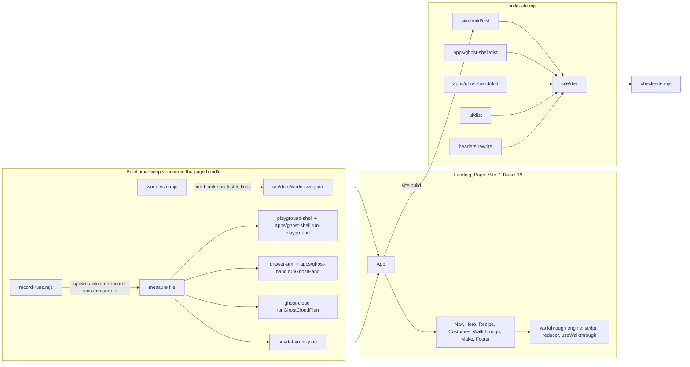

# Design Document: site

## Overview

The `site` spec builds one static landing page for Ghost Run+ and one command, `pnpm build:site`, that puts the page and the three existing builds (`apps/ghost-shell`, `apps/ghost-hand`, `ui`) into one directory, `site/dist/`. The page is a port of `docs/design/landing-mockup.html`. The port keeps the mockup's CSS, SVG, copy, and timing, and changes only the items listed in Requirement 2, criterion 4.

Three decisions shape the design.

1. **The page is a view of recorded data.** Every number in the walkthrough and every "about N lines" comes from two JSON files, `site/src/data/runs.json` and `site/src/data/world-size.json`. Two build-time scripts write them from the real world packages. Both files are committed. A test re-runs each script and compares the bytes with the committed file, so the page cannot drift from the repository. The Landing_Page bundle imports no world, no app, and no `@ghost-run/*` package.
2. **The walkthrough is a pure engine plus a thin hook.** The mockup mutates DOM nodes from timers. The port replaces that with a pure function that turns (world record, step) into a list of timed events, and a reducer that folds events into one `WalkState` value. Playing a step, jumping to a step, and showing the final state for Reduced_Motion all fold the same events. They differ only in whether the events are spread over time. This gives one definition of "what the page shows at step N" that tests can check without a browser.
3. **The Reality pane is written once.** `RealityPane` takes only the recorded "before" scene as props. The walkthrough state has no field that the Reality pane reads. "Reality never changes" is then true by construction and checked by a property test on the serialized pane.

The package is `site/` (`@ghost-run/site`), outside `apps/`. Its runtime depends on `react`, `react-dom`, and `@fontsource/fredoka`. Its build-time scripts read `core/`, `wards-config/`, `worlds/*`, and two app pipelines (see Decision D6).

## Architecture



### Package layout

```
site/
  package.json            @ghost-run/site (Component 1)
  tsconfig.json  vite.config.ts  vitest.config.ts  eslint.config.mjs
  index.html              meta CSP, favicon link, root div, module script
  public/favicon.svg      original ghost art (the Landing_Page build copies it to the root)
  src/
    main.tsx              imports the Fredoka font files and the stylesheets, mounts App
    App.tsx               the seven blocks in order
    config.ts             REPO_URL, DUR, X-ray timings, step and world ids
    components/           typed React components (Component 3)
      art/                Sprite, Icon, Ghost figures, Moon, Bat, Candle, Hill, Cauldron
      Nav.tsx  Hero.tsx  Recipe.tsx  Costumes.tsx  Walkthrough.tsx  Make.tsx  Footer.tsx
      walkthrough/        WorldChips, StepRail, Theater, PlanBar, RealityPane, CopyPane,
                          WardCard, VerdictCard, Actor, SpeechBar, panes/ShellPane,
                          HandPane, CloudPane
    engine/               pure walkthrough engine (Component 5)
      script.ts           buildScript(record, step) -> timed events; settle(record, step)
      reducer.ts          reduceWalk(state, event) -> state
      types.ts            WalkState, WalkEvent, WorldRecord views
      format.ts           formatCount, formatForce, formatRate, roundLines
      useWalkthrough.ts   the hook: timers, controls, reduced motion
      useReducedMotion.ts  useInView.ts  useXrayDemo.ts
    data/
      parts-matrix.ts     PARTS_MATRIX (the one data object of Requirement 7)
      skeleton.ts         the eight parts, six functions, three costume cards
      narration.ts        narration templates per world and step (segments, no HTML)
      runs.json  world-size.json   generated, committed
      types.ts            RunsFile and WorldSizeFile types
    styles/               the split mockup CSS (Component 4)
  scripts/
    build-site.mjs  check-site.mjs  world-size.mjs  record-runs.mjs
    record-runs.measure.ts  record-runs.config.ts   (the env-gated vitest pair)
    lib/headers.mjs  lib/refs.mjs  lib/scan-usage.mjs  lib/fs-walk.mjs
    url-allowlist.json    the external-string allowlist of the Site_Check
  tests/                  (Testing Strategy)
```

The Vite output of the Landing_Page is `site/build/dist/`. The folder name `dist` matches the existing `dist/` rule of `.gitignore`, so no ignore rule changes. `site/dist/` is the assembled site.

### Dependency direction

| From | May import | Must not import |
|---|---|---|
| `site/src` (page runtime) | `react`, `react-dom`, `@fontsource/fredoka`, files of `site/` | any `@ghost-run/*` package, `apps/*`, `worlds/*`, `core/` |
| `site/scripts` (world-size, build-site, check-site) | Node built-ins, `typescript` (usage scan), `jsdom` (HTML parse in the Site_Check) | `apps/*` source |
| `site/scripts/record-runs.measure.ts` | `@ghost-run/core`, `@ghost-run/wards-config`, the three world packages, and by relative path the two app pipeline modules named in Component 6 | `ui/`, `ghost-runner/`, `integrations/` |
| Any other package | nothing in `site/` | `site/` |

`.kiro/steering/structure.md` has no `site/` entry today. Task 1 adds this text (Requirement 1, criterion 6):

> `site/` (`@ghost-run/site`): the public landing page and the build that assembles `site/dist/`. It may depend on `core/`, `wards-config/`, and `worlds/*` at build time, on the build output of `apps/*` and `ui/`, and, in one build-time record script, on the pipeline modules of `apps/ghost-shell` and `apps/ghost-hand`. No package may depend on `site/`.

The ESLint `no-restricted-imports` rule for `site/src` bans every `@ghost-run/*` package and every relative path that reaches `apps/`, `worlds/`, `core/`, or `ui/`. A second ESLint block for `scripts/record-runs.measure.ts` allows exactly the imports in the table.

## Components and Interfaces

### Component 1: Package setup

| File | Content |
|---|---|
| `package.json` | `name` `@ghost-run/site`, `private`, `type` `module`, license MIT, `engines.node` `>=20`. Scripts: `build` (`node scripts/build-site.mjs --landing-only`: world-size, then `vite build`), `assemble` (`node scripts/build-site.mjs`: world-size, landing build, source checks, assembly), `check` (`node scripts/check-site.mjs`), `record` (`node scripts/record-runs.mjs`), `test` (`vitest run`), `test:record` (`GHOST_SITE_RECORD=1 vitest run --project record`), `typecheck` (`tsc --noEmit`), `lint` (`eslint .`). |
| dependencies | `react` `^19.3.1`, `react-dom` `^19.3.1`, `@fontsource/fredoka` (version pinned on the day it is added; license OFL-1.1). |
| devDependencies | The versions the apps use: `@vitejs/plugin-react` `^5.2.0`, `vite` `^7.3.8`, `vitest` `^3.2.7`, `typescript` `^5.9.0`, `typescript-eslint` `^8.73.0`, `eslint` `^10.15.0`, `@eslint-react/eslint-plugin` `5.30.3`, `eslint-plugin-react-hooks` `^7.1.1`, `@testing-library/react` `^16.3.3`, `@testing-library/dom` `^10.4.2`, `@testing-library/user-event` `^14.6.12`, `jsdom` `^26.1.0`, `fast-check` `^4.10.2`, `@types/node` `^20.19.0`, `@types/react` `^19.3.0`, `@types/react-dom` `^19.3.0`. Workspace links for the record script only: `@ghost-run/core`, `@ghost-run/wards-config`, `@ghost-run/playground-shell`, `@ghost-run/drawer-arm`, `@ghost-run/ghost-cloud` (all `workspace:*`). They are in-repo packages, so they add no license row. |
| `tsconfig.json` | Same as `apps/ghost-shell`: ES2022, Bundler resolution, `jsx` `react-jsx`, `strict`, `noEmit`, `isolatedModules`, `verbatimModuleSyntax`, `noUncheckedIndexedAccess`, `resolveJsonModule`, types `vite/client` and `node`; include `src`, `tests`, `scripts/**/*.ts`, `vite.config.ts`, `vitest.config.ts`. |
| `vite.config.ts` | `base: './'`, `plugins: [react()]`, `build.outDir: 'build/dist'`, `emptyOutDir: true`, `target: 'es2022'`, `sourcemap: false`, `assetsInlineLimit: 0` (font files stay files), `modulePreload: { polyfill: false }` (the polyfill is an inline script and the CSP forbids it), `cssCodeSplit: false`. A small plugin injects the meta CSP of Component 8 into `index.html` at build time, as `ui/vite.config.ts` does. |
| `vitest.config.ts` | Projects: `unit` (node: engine, data, scripts), `dom` (jsdom: components), `record` (node, only when `GHOST_SITE_RECORD=1`, `testTimeout` 600 s). |
| `eslint.config.mjs` | The `apps/ghost-shell` config with its message text renamed: `dangerouslySetInnerHTML` ban, `innerHTML` and `insertAdjacentHTML` ban, `eval` and `new Function` ban, storage-global ban, `react-hooks` rules. Page-runtime imports are limited to the allowlist of the Dependency table. A rule bans `Date.now`, `new Date`, and `Math.random` in `src/engine` (the engine reads no clock). |

`pnpm-workspace.yaml` gets one line, `  - site`. The root `package.json` gets the script `build:site` (Component 8). `pnpm-lock.yaml` changes by one importer entry (open item O9).

### Component 2: Config and shared constants (`src/config.ts`)

| Constant | Value | Source |
|---|---|---|
| `REPO_URL` | the one public repository URL (open item O1) | Requirement 20, criterion 5 |
| `DUR` | `[2700, 3900, 3300, 2700, 5200]` | mockup script, Requirement 2, criterion 5 |
| `XRAY_ON_MS`, `XRAY_OFF_MS` | `1600`, `4400` | mockup script |
| `WORLDS` | `['shell', 'hand', 'cloud']` | |
| `STEPS` | the five rail entries (number, label, code text) | Requirement 11, criterion 2 |
| `DOC_TITLE` | `Ghost Run+: let your agent's ghost try it first` | Requirement 4, criterion 7 |

`DUR` is read by the engine and by the test of Requirement 2, criterion 7. It has no second copy.

### Component 3: Typed components (port of the mockup markup)

All components are function components with named props types. Decorative SVG gets `aria-hidden="true"`. No component uses `dangerouslySetInnerHTML`. Text with inline `<b>` and `<code>` (the narration and the sticker) is built from typed segments.

| Component | Props | Replaces (mockup) |
|---|---|---|
| `Sprite` | none | the `<svg width="0" height="0" style=...>` with all `<symbol>` definitions |
| `Icon` | `id: SymbolId`, `viewBox: string`, `className?: string` | every `<svg viewBox><use href="#id"/></svg>` |
| `Nav` | `current: 'home'` | `.nav` (links become `<a>`) |
| `Hero` | none | `header.hero` with `HeroArt`, `Hill`, `PumpkinRow` |
| `HeroArt` | none | `.hero-art`: `Moon`, three `Bat`, `.aura`, `.hero-boo`, `.hero-candle` |
| `Recipe` | `lineCount: number` | `section#recipe` |
| `WorldIngredient` | `lineCount: number` | `.ing-world` with the six `.fnl` rows and `.lean` |
| `SkeletonIngredient` | none | `.ing-skel`: eight `.part` cards and `.built` |
| `Cauldron` | none | `.result` svg |
| `Costumes` | `lineCount: number` | `section#costumes` with `.xsw`, three `.cc`, `.cards-note` |
| `XraySwitch` | `checked: boolean`, `onChange(checked: boolean)` | `label.xsw` with `input#xray` |
| `CostumeCard` | `card: CostumeCardData`, `lineCount: number` | one `article.cc` |
| `ShellFigure`, `HandFigure`, `CloudFigure` | none | the three `svg.fig` costume layers over `<use href="#bones"/>` |
| `PartChips` | `uses: Record<AppPart, boolean>` | `.used`; an unused chip gets class `off` and a visually hidden text "not used" |
| `Walkthrough` | `runs: RunsFile` | `section#run` |
| `WorldChips` | `world: WorldId`, `onPick(world)` | `#wchips` (buttons with `aria-pressed`) |
| `StepRail` | `step: number`, `onJump(step)` | `ol#rail` (current button `aria-current="step"`) |
| `Theater` | `view: WalkView` | `#theater` |
| `PlanBar` | `text: string`, `rev: boolean` | `#plan` |
| `RealityPane` | `scene: RealityScene`, `fingerprintBadge: boolean`, `goBadge: string \| null` | `#real` (content `#realb` depends on `scene` only; wrapped in `React.memo`) |
| `CopyPane` | `view: CopyView` | `#copy` (content `#copyb`) |
| `ShellPane`, `HandPane`, `CloudPane` | scene and side (`'real' \| 'copy'`), per-item state | `shellPane`, `handPane`, `cloudPane` builders |
| `WardCard` | `ward: WardView` | `#ward` |
| `VerdictCard` | `candleOut: boolean`, `stamp`, `note: string` | `#verdict` with `BigCandle` |
| `Actor` | `act: 0..5`, `x: number`, `y: number`, `instant: boolean`, `term: TermView` | `#actor`; the whole element is `aria-hidden` |
| `SpeechBar` | `segments: Segment[]` | `.say` with `p#sayt` (`aria-live="polite"`, present before step 1) |
| `Make` | none | `section#make`: `Spellbook`, `WorldSmithCard` |
| `Footer` | none | `footer.foot` |

`Segment` is `{ kind: 'text' | 'b' | 'code'; text: string }`. `SymbolId` is the union of the symbol ids of Component 4's table, so a typo in an `Icon` id is a type error.

### Component 4: Sprite, symbols, and the X-ray colors

`Sprite` renders one `<svg width={0} height={0} className="sprite" aria-hidden="true" focusable="false">` with a `<defs>` block that holds the 16 `<symbol>` elements of Requirement 2, criterion 3, with ids and path data unchanged: `boo`, `bones`, `pumpkin`, `bat`, `i-mirror`, `i-ward`, `i-candle`, `i-blacklight`, `i-tomb`, `i-hook`, `i-hat`, `i-folder`, `i-file`, `i-db`, `i-bucket`, `i-lock`. It is mounted once, as the first child of the page root in `App.tsx`, before any `<use>`. The mockup's `style="position:absolute"` becomes the class `.sprite{position:absolute}` in `99-page.css`.

Every use of a symbol is `<svg viewBox="..." aria-hidden="true"><use href="#id"/></svg>`, rendered by `Icon`. The viewBox of each use is the viewBox of its symbol (as in the mockup).

**Why the X-ray colors work through `<use>`.** The `bones` symbol marks its strokes `class="bs"` and its fills `class="bf"`. The stylesheet has `.bf{fill:var(--bone-c)}` and `.bs{stroke:var(--bone-c)}`, and `.fig{--bone-c:#f7f0e1}` with `.xray .fig{--bone-c:#d8fff1}`. Two facts make this work:

- A `<use>` element clones the referenced symbol into a shadow tree. Style rules of the document are matched against the original element in the sprite, so the flat selectors `.bf` and `.bs` apply to the clone. Selectors that need an ancestor outside the symbol (for example `.xray .bf`) would not match, because the original sits in the sprite and not under `.xray`.
- A CSS custom property is an inherited property. The clone inherits from the `<use>` element, which sits inside `svg.fig`, which gets `--bone-c` from `.fig` or `.xray .fig`. So `var(--bone-c)` resolves to the color of the card that holds the figure.

The port therefore must keep `.bf` and `.bs` as flat selectors, must set `--bone-c` only on `.fig` and `.xray .fig`, and must not add any rule of the form `X .bf` or `X .bs`. Test T-sprite checks the CSS text for exactly this (no descendant selector ends in `.bf` or `.bs`; `--bone-c` is declared only on `.fig` and `.xray .fig`). jsdom does not resolve styles inside a `<use>` shadow tree, so the visual result (identical glowing skeletons at X-ray on) is an owner check (Requirement 2, criterion 8).

Test T-sprite also asserts: every `<use href="#x">` in the rendered page has a `<symbol id="x">` in the `Sprite`; every `svg` that contains a `<use>` or is decorative has `aria-hidden="true"`; the `Sprite` svg is `aria-hidden` and `focusable="false"`; no symbol id appears twice.

### Component 5: Stylesheets

The CSS of the mockup (from the comment "site mock, fixed palette" to the end of the `<style>` element) is copied verbatim into these files, with class names unchanged. The files are imported in `main.tsx` in this order. Order matters: later rules override earlier ones, and the narrow-screen rules must come last.

| Order | File | Mockup blocks | Changes |
|---|---|---|---|
| 1 | `00-fonts.css` | none (new) | `@font-face` rules come from `@fontsource/fredoka/latin-400.css`, `latin-500.css`, `latin-600.css`, `latin-700.css`, imported in `main.tsx`. |
| 2 | `01-base.css` | `.site` custom properties, `.site *`, `code`, `pre`, headings, `.nbadge`, `.btn`, `.btn-main`, `.btn.small`, focus rules | `.site` loses `border-radius:24px` and keeps `position:relative`, the palette variables, the font, and the gradient (Requirement 3, criterion 1). |
| 3 | `02-nav-hero.css` | `.nav` to `.pk-row` | `.nav-links span` becomes `.nav-links a`; `.nav-links a.on` keeps the old `span.on` look; add `text-decoration:none` and the focus ring. |
| 4 | `03-recipe.css` | `.sec` to `.result` | none |
| 5 | `04-costumes.css` | `.xsw` to `.cards-note` | none. `.bf` and `.bs` stay flat (Component 4). |
| 6 | `05-walkthrough.css` | `.wbar` to `.beam-on .beam path`, `@keyframes flow` | none |
| 7 | `06-pane-content.css` | `.tree` to `.bucket.poof::after` | add `.jl` for the joint-limit label (Component 3 note below). |
| 8 | `07-judge.css` | `.judge` to `.bigcandle.out .smoke` | none |
| 9 | `08-actor-say.css` | `.actor` to `.say p b` | none |
| 10 | `09-make-footer.css` | `.make` to `.foot span` | none |
| 11 | `10-motion.css` | idle keyframes and `@media (prefers-reduced-motion:reduce)` | the reduced-motion block is kept and extended with `.rail button,.wchip` transitions set to none |
| 12 | `11-responsive.css` | `@media (max-width:820px)` and `@media (max-width:560px)` | none; must be last |
| 13 | `99-page.css` | none (new) | `html,body{margin:0}`, `body{background:#110824}`, `.site{min-height:100vh}`, `.page{max-width:1040px;margin:0 auto}`, `.sprite{position:absolute}`, `.sr-only` (visually hidden text), `.jl`, and `.site{overflow-x:clip}` so no horizontal scroll appears (Requirement 3, criterion 4). |

Removed from the mockup: the `.doc`, `.guide`, `.guide-t`, `.guide ul`, `.guide li`, `.guide .hint` rules, the `<link>` elements for Google Fonts, and the rounded frame (`border-radius` of `.site`).

**Full-window background and column.** `App.tsx` renders `<div class="site">` (full width, the night gradient, `min-height:100vh`) and inside it `<div class="page">` (centered, `max-width:1040px`) that holds nav, hero, sections, and footer. The hero's star field (`.hero::before`), hill, and pumpkins stay inside the column, as in the mockup. The strip beside the column shows only the night gradient. This is a visible difference from a 1000 px mockup render and is listed in `docs/measurements.md` (Requirement 2, criterion 9).

**Joint-limit label.** `.jl{display:block;font-size:9.5px;color:var(--flame)}` sits under the tile caption `.hl`. It is the only addition to the mockup's walkthrough (Requirement 11, criterion 9).

### Component 6: Mapping from mockup blocks to files

| Mockup block | Component | File |
|---|---|---|
| `<svg ... style=position:absolute>` sprite | `Sprite` | `components/art/Sprite.tsx` |
| `nav.nav` | `Nav` | `components/Nav.tsx` |
| `header.hero` and hero art | `Hero`, `HeroArt`, `Hill`, `PumpkinRow` | `components/Hero.tsx`, `components/art/*` |
| `section#recipe` | `Recipe`, `WorldIngredient`, `SkeletonIngredient`, `Cauldron` | `components/Recipe.tsx` |
| `section#costumes` | `Costumes`, `XraySwitch`, `CostumeCard`, `PartChips`, three figures | `components/Costumes.tsx`, `components/art/Figures.tsx` |
| `section#run` markup | `Walkthrough` and the `walkthrough/` components | `components/Walkthrough.tsx`, `components/walkthrough/*` |
| script: `W` table, `bars`, `miniScene`, `bigScene`, `bucket`, `*Pane` | pane components and `data/narration.ts` | `components/walkthrough/panes/*`, `data/narration.ts` |
| script: `later`, `clearAll`, `countDown`, `typeText`, `reset`, `enter`, `play`, `jump` | engine | `engine/script.ts`, `engine/reducer.ts`, `engine/useWalkthrough.ts` |
| script: `moveActor`, `rel` | `Actor` and a layout effect in `Theater` | `components/walkthrough/Actor.tsx` |
| script: X-ray block | `useXrayDemo` | `engine/useXrayDemo.ts` |
| `section#make` | `Make` | `components/Make.tsx` |
| `footer.foot` | `Footer` | `components/Footer.tsx` |

### Component 7: The walkthrough engine

**State.** `WalkState` is plain data. It has no field for the Reality pane.

```ts
interface WalkState {
  world: WorldId;
  step: -1 | 0 | 1 | 2 | 3 | 4;       // -1 before the first step
  act: 0 | 1 | 2 | 3 | 4 | 5;          // actor class act-N; 5 = cheer
  actorAt: 'gutter' | 'copy' | 'ward' | 'verdict';
  copyVisible: boolean;                // false until step 1 (mockup: visibility hidden)
  copyEpoch: number;                   // bumps when the copy is re-rendered (step 5 re-copy)
  beam: boolean;
  materialize: boolean;                // the .mat class on the copy content
  plan: { text: string; rev: boolean };
  term: { visible: boolean; typed: string; caret: boolean };
  copy: CopyItemState;                 // per world, see below
  checks: { rows: CheckRowView[]; scan: boolean; tone: 'none' | 'bad' | 'good'; eoShown: boolean };
  candleOut: boolean;
  stamp: 'none' | 'BLOCKED' | 'PASS';
  note: string;
  badges: { fingerprint: boolean; go: boolean };
  narration: Segment[];
}
```

`CopyItemState` is a discriminated union by world: `shell` holds `{ usersBarsGone: number; usersCount: number; usersTag: string; usersClass: 'none' | 'poof' | 'dropped' | 'soft'; bakShown: boolean }`; `hand` holds `{ tiles: ('idle' | 'ok' | 'fail')[] }`; `cloud` holds `{ buckets: Record<string, 'idle' | 'poof' | 'vanish'> }` (a sorted list in code, not an object keyed by user text).

**Events and script.** `buildScript(record: WorldRecord, step: number): TimedEvent[]` returns events with `at` in milliseconds after the start of that step. `reduceWalk(state, event)` is pure. The events are the mockup's mutations, one for one. The timing table below is extracted from the mockup script (`later(...)` calls and the typing loop), with L the length of the typed text and R the number of check rows.

| Step | `at` (ms after step start) | Event |
|---|---|---|
| 1 Copy (nominal 2,700) | 0 | enter: actor to gutter, `act` 0, narration, beam on, copy visible, materialize |
| | 1900 | beam off |
| 2 Run on the copy (3,900) | 0 | enter: actor to copy, `act` 1, narration, beam off, terminal visible with prompt |
| | 26 x i, i = 1..L | typed text grows to i characters |
| | 26 x L + 250 | world action `run` starts (offsets below are added to this time, called T) |
| Shell `run` | T + 70 x k, k = 0..11 | users bar k gone; users row class `poof` at T |
| | T + 70 x k, k = 1..12 | users count shows round(1206 x (1 - k/12)) with a thousands separator, ends at 0 |
| | T + 850 | users class `dropped`, tag "dropped" |
| Hand `run` | T + 160 x k | tile k becomes `fail` when the record marks variant k failed, else `ok` |
| Cloud `run` | T | vanishing buckets get `poof` |
| | T + 300 | vanishing buckets get `vanish` |
| 3 Judge (3,300) | 0 | enter: actor to ward, `act` 2, narration, terminal hidden, checks cleared, `scan` on |
| | 500 + 380 x k, k = 0..R-1 | check row k appears |
| | 600 + 380 x R | ward tone `bad` or `good` (good only when every row is ok), effectsOutside line shown |
| 4 Verdict (2,700) | 0 | enter: actor to verdict, `act` 3, narration |
| | 500 | candle out, stamp BLOCKED, block note, fingerprint badge (only when the record says `p1.equal`) |
| 5 Fix and go (5,200) | 0 | enter: actor to copy, `act` 4, narration; plan text becomes the fixed plan with `rev`; fingerprint badge off; candle out; stamp cleared; note "Trying the fixed plan on a fresh copy..."; checks cleared; copy re-rendered to its initial items; beam on; materialize |
| | 1000 | beam off; terminal starts typing the fixed text (lines joined with " && ") |
| | 1000 + 26 x i, i = 1..L2 | typed text grows |
| | T2 = 1000 + 26 x L2 + 250 | world action `fix` starts |
| Shell `fix` | T2 | `.bak` row shown |
| | T2 + 500 | users class `soft`, tag from the record (`deleted_at = 1`) |
| Hand `fix` | T2 + 120 x k | tile k becomes `ok` |
| Cloud `fix` | T2 | vanishing buckets get `poof`; T2 + 300 they get `vanish` |
| | T3 = T2 + 900 | terminal hidden; checks cleared and replayed with the fixed rows (offsets as in step 3, from T3) |
| | T3 + 1500 | candle relit, stamp PASS, pass note, go badge (only when the fixed record says verdict `pass` and `p1.equal`), `act` 5 |

Two facts follow from the table. First, the last step can run past its nominal 5,200 ms: for the Shell fixed plan (73 typed characters) the PASS event fires at about 5,500 ms. The mockup behaves the same, because no later step cancels it. The nominal `DUR` array decides when the next step starts, and the walkthrough is "done" when the last event fires. Second, the per-step offsets after `T` are inside the step, so the engine never needs an event that crosses into the next step except in step 5.

**Instant application.** `settle(record, upTo)` folds the events of steps 0 to `upTo` in `at` order and ignores their times. Typing is folded as one event that sets `typed` to the whole text. Count-down folds to 0. Narration is the narration of step `upTo` only (one live-region update). The result for `upTo = 4` is the final state shown for Reduced_Motion.

**The hook.** `useWalkthrough(runs)` returns `{ view, world, step, controls: { pickWorld, replay, jump } }`.

| Situation | Behavior |
|---|---|
| Mount | Nothing is scheduled. The state is `reset(world = shell)` with `step = -1`. |
| Reduced_Motion on, mount | State is `settle(shell, 4)`. No timer, no IntersectionObserver. |
| Section first in view (IntersectionObserver, threshold 0.25, observer disconnected after the first hit) and not Reduced_Motion | `play(shell)`. |
| IntersectionObserver missing | State is `settle(shell, 4)` and no timer (no autoplay without a signal). |
| `pickWorld(w)` | cancel all timers, `reset(w)`, then `play(w)`; or `settle(w, 4)` under Reduced_Motion. `aria-pressed` follows `world`. |
| `replay()` | cancel all timers, `reset(world)`, then `play(world)`. |
| `jump(n)` | cancel all timers, `reset(world)`, state = `settle(world, n - 1)` (steps before n applied without timers), then schedule the events of step n at normal speed. Under Reduced_Motion the state is `settle(world, n)` and nothing is scheduled. The rail shows step n as `now` and the steps before it as `done`. The earlier steps are not replayed. |
| Unmount | cancel all timers, disconnect observers, remove the `matchMedia` and `resize` listeners. |
| Reduced_Motion turns on while a walk plays | cancel all timers and show `settle(world, 4)`. |
| Window resize | the `Theater` layout effect recomputes the actor position with `instant = true` for the current step. |

`play(world)` schedules step k at `sum(DUR[0..k-1])` and each event of step k at that time plus its `at`. All timers go through one registry (an array of ids owned by the hook). The hook takes a `scheduler` argument with `setTimeout` and `clearTimeout` that defaults to the globals, so tests inject Vitest fake timers or a recording scheduler. The engine never reads the clock.

**Narration.** `SpeechBar` renders the segments of `state.narration` inside `p#sayt` with `aria-live="polite"`. The element exists from the first render and is empty until step 1 starts. The narration changes only on an `enter` event, so the region updates once per step. The terminal text (`.term`) is inside the `Actor`, which is `aria-hidden`, so typed characters are not announced. Narration text comes from `data/narration.ts`: five templates per world with number slots that the hook fills from the record with the formats of Component 9.

**Actor position.** `Theater` holds refs to the gutter, copy pane, ward card, and verdict card. A layout effect, keyed on `(step, actorAt, resizeTick)`, computes `{x, y}` from `getBoundingClientRect` relative to the theater, with the offsets of the mockup (`gutter: x + w/2 - 35, y - 30`; `copy: x + w - 74, y - 40`; `ward: x + w - 80, y - 60`; `verdict: x - 50, y - 26`). It passes the numbers to `Actor`, which sets `style.transform` through React's `style` prop (applied through the CSSOM, which the CSP allows) and sets `transition: none` for one frame when `instant` is true.

**Reality pane.** `RealityPane` receives the `reality` scene of the world record and nothing else that changes during a walk except the two badge props. Its content subtree is a `React.memo` component whose only prop is the scene. The reducer, the engine, and `CopyPane` have no handle on it.

### Component 8: Data files and the scripts that write them

**`world-size.json`**

```json
{ "format": "ghost-site-world-size", "version": 1,
  "worlds": { "drawer-arm": 2647, "ghost-cloud": 789, "playground-shell": 2569 } }
```

Keys are sorted. The file is UTF-8, two-space indent, one trailing newline.

`scripts/world-size.mjs` exports `countWorldSizes(root: string): Record<string, number>` and runs as a CLI with `--write` (write the file) or `--check` (compare, exit 1 on a difference). The count for one world is the number of lines with at least one non-whitespace character in every `.ts` file under `worlds/<name>/src/`, recursively, excluding `*.test.ts` and `*.d.ts`. Files are visited in sorted order. The script reads files only and writes only the World_Size_File. It needs no TypeScript loader.

The page shows `roundLines(n)`: `Math.round(n / 100) * 100`, formatted with a thousands separator, so 789 shows as "800" and 2,569 would show as "2,600". Only `ghost-cloud` is shown. The value is read in `App.tsx` from the JSON and passed as `lineCount`; no component holds a literal.

**`runs.json`**

```ts
interface RunsFile {
  format: 'ghost-site-runs'; version: 1;
  seed: 42; variantCount: 8;
  worlds: { shell: WorldRecord; hand: WorldRecord; cloud: WorldRecord };
}
interface WorldRecord {
  id: WorldId;
  ward: { id: string; kind: 'sql' | 'physics' | 'path'; line: string };   // line = the text of the ward card kind line
  reality: RealityScene;            // drawn once in the Reality pane
  plan: PlanRecord;                 // the demo plan
  fixed: PlanRecord;                // the fixed plan
}
interface PlanRecord {
  commands: string[];               // plan lines as in the plan file
  display: string;                  // commands joined with " && "
  verdict: 'pass' | 'warn' | 'block';
  violatedWardIds: string[];        // sorted
  checks: CheckRow[];               // { label, measured, ok }
  effectsOutside: string[];         // destinations; empty means "nothing leaves the box"
  p1: { equal: boolean; before: string; after: string };   // hashes only
  copyAfter: CopyScene;             // the copy after the run, reduced to the drawn items
  facts: Record<string, number | string>;   // numbers the narration uses
  message: string;                  // renderMessage text (not shown; kept for the test)
}
type RealityScene =
  | { kind: 'shell'; root: 'project/'; tables: { name: string; rows: number }[]; files: string[] }
  | { kind: 'hand'; label: 'the real arm' }
  | { kind: 'cloud'; buckets: { name: string; objects: string[]; protected: boolean }[] };
type CopyScene =
  | { kind: 'shell'; tables: { name: string; rows: number; state: 'intact' | 'dropped' | 'soft'; note?: string }[]; files: string[] }
  | { kind: 'hand'; tiles: { id: string; label: string; outcome: 'passed' | 'failed'; jointLimit: boolean }[] }
  | { kind: 'cloud'; buckets: { name: string; objects: string[]; protected: boolean }[] };
```

The shell reality shows `project/`, `app.db` with tables `users` (1,206) and `orders` (3), `package.json`, and `data/`. It is a labeled subset of the real fixture (Open question O6); `.env` and its contents are never read into the file. A table's bar count is `clamp(2, 12, round(rows / 100))`, which gives 12 bars for `users` and 2 for `orders`, as in the mockup.

`facts` holds, per plan, the values behind the narration and ward rows: Shell `rowsLost` (1,206 and 0); Hand `succeeded`, `total`, `maxForceN` (27.53 and 29.24), `drawerOpeningM` of the base world (0.1216 and 0.1276), `vaseTouched`, `jointLimitVariants`; Cloud `bucketsRemoved`, `objectsRemoved`. The numbers in Requirement 10, criterion 3 are the values the test of Property 3 expects from a fresh run, not values typed into the script.

**`scripts/record-runs.mjs`.** It follows the pattern of `apps/ghost-hand/scripts/measure-demo.mjs`: the worlds and pipelines are TypeScript source, so the script spawns `corepack pnpm exec vitest run --config scripts/record-runs.config.ts` with `cwd` set to `site/` and the environment variable `GHOST_SITE_RUNS_OUT` set to the output path, then reads that file. The measure file `scripts/record-runs.measure.ts` is not a `*.test.ts` file and is skipped unless `GHOST_SITE_RUNS_OUT` is set, so the normal `vitest run` never picks it up. The repository has no `tsx` or `vite-node` dependency (checked at the root and in the apps), so the vitest route adds nothing.

Inputs, all read by the measure file:

| World | Plan files | Wards file | Pipeline |
|---|---|---|---|
| Shell | `apps/ghost-shell/plans/scenario-1.json`, `scenario-1-fixed.json` | `apps/ghost-shell/wards.yaml` | `runPlayground` from `apps/ghost-shell/src/pipeline/run-playground`, with the project from `buildProject` of `apps/ghost-shell/src/scenarios/project` and the inline SQL executor of `@ghost-run/playground-shell` |
| Hand | `apps/ghost-hand/plans/first.plan.json`, `revised.plan.json` | `worlds/drawer-arm/wards.yaml` and `variant-config.json` | `runGhostHand` from `apps/ghost-hand/src/pipeline/run` with `createInlineExecutor` from `apps/ghost-hand/src/exec/inline`, seed 42, 8 variants (the call of `measure-demo.measure.ts`) |
| Cloud | `worlds/ghost-cloud/demo/01-delete-protected-bucket.txt`, `03-delete-temporary-bucket.txt` | `worlds/ghost-cloud/wards.yaml` | `runGhostCloudPlan` of `@ghost-run/ghost-cloud` |

Plans are parsed with the same parsers the apps use (`parsePlanFile` for Shell and Hand; the one-line text file for Cloud). The script never copies a number from a README, `docs/measurements.md`, or the brief.

Output rules (Requirement 10, criterion 8): `JSON.stringify` with sorted keys at every level, two-space indent, one trailing newline; arrays keep their semantic order (variants by index); no timestamps, no absolute paths, no host names. The script reads no clock and no random source. Variant parameters come from `sampleVariant(seed, index, config)`. The script exits non-zero and writes nothing when a plan run gives an unexpected verdict (block for a plan, pass for a fixed plan), when `p1.equal` is false, or when the wards file does not parse. CLI flags: `--out <path>` (default `site/src/data/runs.json`) and `--check` (compare with the committed file and exit 1 on a difference).

The measure file reads the Hand joint-limit report from the structured ward violations when the engine exposes them; if the violation only holds the text, it extracts the variant id with the pattern `joint limit exceeded in variant (variant-[0-9]+)` and fails the run when the pattern finds nothing while the verdict message contains the phrase "joint limit". Open item O4 names the field to confirm during the task.

**Tile label rule.** The page shows one short label per haunted variant. The repository stores no label (Open question O4), so the record script derives it from the sampled parameters. For a variant with parameters `p` and the base parameters `b = BASE_VARIANT_PARAMS` (friction 2 N, mass 0.6 kg), compute four scores:

| Candidate | Score | Label text |
|---|---|---|
| friction | `abs(ln(p.drawerFrictionN / b.drawerFrictionN))` | `friction x` + ratio with 2 decimals |
| mass | `abs(ln(p.drawerMassKg / b.drawerMassKg))` | `mass x` + ratio with 2 decimals |
| handle | `norm(p.handleOffsetM in mm) / 10` | `handle ` + norm with 1 decimal + ` mm` |
| delay | `p.commandDelaySteps / 6` | `delay N steps` |

The label is the one with the highest score. A tie goes to the candidate that comes first in the table order. Sensor noise is not a candidate, because no mockup label names it. The multiplication sign in the page text is the glyph U+00D7. The constants (10 mm, 6 steps) are `max` values of the ranges in `variant-config.json` rounded for scoring and are fixed in the script, not read at run time.

The rule was checked on 2026-11-20 against an independent re-implementation of `sampleVariant` (a scratch script, not in the repository) for seed 42:

| Variant | friction ratio | mass ratio | handle (mm) | delay | Scores (friction, mass, handle, delay) | Label |
|---|---|---|---|---|---|---|
| 0 | 0.41 | 1.98 | 4.4 | 2 | 0.89, 0.68, 0.44, 0.33 | friction x0.41 |
| 1 | 0.93 | 1.01 | 5.5 | 3 | 0.07, 0.01, 0.55, 0.50 | handle 5.5 mm |
| 2 | 0.46 | 1.79 | 5.1 | 5 | 0.78, 0.58, 0.51, 0.83 | delay 5 steps |
| 3 | 1.68 | 1.00 | 4.0 | 2 | 0.52, 0.00, 0.40, 0.33 | friction x1.68 |
| 4 | 1.63 | 1.76 | 2.6 | 3 | 0.49, 0.57, 0.26, 0.50 | mass x1.76 |
| 5 | 0.95 | 1.44 | 3.4 | 3 | 0.05, 0.36, 0.34, 0.50 | delay 3 steps |
| 6 | 0.30 | 0.86 | 1.5 | 4 | 1.20, 0.15, 0.15, 0.67 | friction x0.30 |
| 7 | 0.97 | 0.66 | 2.4 | 0 | 0.03, 0.41, 0.24, 0.00 | mass x0.66 |

These are the eight labels of the mockup. Variants 1, 4, and 5 all have a command delay of 3 steps, which is why a fixed order of parameters would not work; the score rule gives each its own label. Two margins are small (variant 1: handle 0.55 against delay 0.50; variant 4: mass 0.57 against delay 0.50), so the real test (Property 10) is the authority and runs against the real `sampleVariant`.

**Number formats** (`engine/format.ts`, used by the narration and the ward rows): `formatCount(n)` is `n.toLocaleString('en-US')` (1,206); `formatForce(n)` is one decimal plus " N" (27.53 gives "27.5 N", 29.24 gives "29.2 N"); `formatRate(ok, total)` is `"${ok} of ${total} = ${round(100 * ok / total)}%"` (7 of 8 = 88%; 8 of 8 = 100%); `roundLines(n)` as above.

### Component 9: Parts matrix and its test

`data/parts-matrix.ts` exports `PARTS_MATRIX: Record<'shell' | 'hand' | 'cloud', Record<AppPart, boolean>>` with the values of Requirement 7, criterion 1, and `PART_NAMES: Record<AppPart, string[]>` (the code names per part). `CostumeCard` reads it. The test imports the same module (Requirement 7, criterion 5).

`scripts/lib/scan-usage.mjs` exports `deriveUsage(sourceRoot: string): Record<AppPart, boolean>`. Algorithm, using the TypeScript compiler API (`typescript` is already a devDependency of every package):

1. Collect all `.ts` and `.tsx` files under the root, skipping `*.test.*`, `*.test-d.ts`, `*.d.ts`, `tests/`, and `node_modules`.
2. For each file, build a binding table: every import specifier gives `localName -> (moduleSpecifier, importedName)`; a namespace import gives `localName -> (moduleSpecifier, '*')`.
3. Build a re-export table for each file: `export { A as B } from './m'` and `export * from './m'` give `(file, exportedName) -> (target, name)`; a local `export { X }` of an imported binding gives the same link.
4. Resolve every binding to an origin by following relative module specifiers through the re-export table until it reaches a bare package specifier. Origin `(@ghost-run/ui, Candle)` is the result for `<Candle>` in `apps/ghost-shell` through `ui-imports.ts`, and for `<Candle>` in `apps/ghost-hand/src/App.tsx` (a direct import).
5. Count a Usage_Reference when an identifier with a resolved binding appears in a position that is not an import specifier, not an export specifier, and not a type-only position: a JSX tag name, a call or `new` callee, an argument, a variable initializer, or a property or string-literal element access on a namespace (`ui.Candle`, `ui['Candle']`).
6. Map origins to parts: `MirrorWorld` of `@ghost-run/ui` is Mirror; `ghostRun` of `@ghost-run/core` is Ghost; `WardEngine` of `@ghost-run/core` is Wards; `Candle` of `@ghost-run/ui` is Candle; `BlacklightView` of `@ghost-run/ui` or `scanText` of `@ghost-run/core` is Blacklight; `Graveyard` of `@ghost-run/ui` is Graveyard.

Roots: `apps/ghost-shell/src`, `apps/ghost-hand/src`, `worlds/ghost-cloud/src`. For Ghost Cloud, `ghostRun` and `WardEngine` are used in `pipeline/run-plan.ts`; the world has no `@ghost-run/ui` import, so the four UI parts are false. The test fails with the message "costume X, part Y: page data A, derived B" (Requirement 7, criterion 4). Unit tests for `deriveUsage` use fixture trees: a re-export chain (used and unused), a namespace import, a bare import that is never used, and a type-only import.

### Component 10: Assembly (`scripts/build-site.mjs`)

Steps, in order (a failure in any step stops the script before `site/dist/` is touched, except the last two):

| # | Step | Failure message |
|---|---|---|
| 1 | Run `world-size.mjs --write` | `world-size failed: REASON` |
| 2 | Build the Landing_Page with the Vite JS API (`build({ root: 'site' })`) into `site/build/dist/` | the Vite error text |
| 3 | Stop here when the flag `--landing-only` is set | |
| 4 | If the flag `--record` is set, run `record-runs.mjs` first and then rebuild step 2 | `record-runs failed: REASON` |
| 5 | Check the sources: each of `apps/ghost-shell/dist`, `apps/ghost-hand/dist`, `ui/dist`, `site/build/dist` exists, is not empty, and holds its `index.html`; `apps/ghost-shell/dist` holds `ko.html` and `_headers`; `apps/ghost-hand/dist/assets` holds one `.wasm` file | `missing build output: PATH (build it with: corepack pnpm --filter PACKAGE build)` |
| 6 | Read `apps/ghost-shell/dist/_headers` and build the root Headers_File in memory (Component 11) | `cannot read headers: PATH` |
| 7 | Remove `site/dist/` and create it | |
| 8 | Copy the five trees (table below), remove `shell/_headers`, write `_headers` | `copy failed: PATH`; on any error in steps 7 and 8 the script removes `site/dist/` and exits 1, so no partial site stays |
| 9 | Print one line per target with its file count | |

| Source | Target in `site/dist/` | Rule |
|---|---|---|
| `site/build/dist/*` (includes `index.html`, `assets/`, `favicon.svg`) | `/` | copy as is |
| `apps/ghost-shell/dist/*` (includes `ko.html`) | `/shell/` | copy as is, then delete `/shell/_headers` |
| `apps/ghost-hand/dist/*` | `/hand/` | copy as is (wasm and worker included) |
| `ui/dist/*` | `/kit/` | copy as is |
| generated | `/_headers` | Component 11 |

Copies use `fs.cpSync(recursive)`, skip `.DS_Store`, and follow no symlinks. No file of an app build is edited, and no `base` setting changes (all three Vite configs have `base: './'`; on 2026-11-20 the three builds loaded from subfolders of one directory without change). The script writes nothing outside `site/dist/`, `site/build/dist/`, and `site/src/data/` (world-size and the optional record). It makes no network call.

The favicon is `site/public/favicon.svg`, a small original ghost drawn from the `boo` path with the Kiro purple glow as a filter-free outline, no Kiro logo and no third-party mark. Vite copies `public/` into the Landing_Page build, so it lands at `/favicon.svg`. The apps' pages that link `/favicon.svg` by an absolute path then also find it.

**Root script.** `package.json` at the root gets:

```
"build:site": "\"$npm_execpath\" --filter @ghost-run/ghost-shell --filter @ghost-run/ghost-hand --filter @ghost-run/ui run build && \"$npm_execpath\" --filter @ghost-run/site run assemble && \"$npm_execpath\" --filter @ghost-run/site run check"
```

It uses `"$npm_execpath"` like the existing root scripts, so it works under `corepack pnpm`. The root `pnpm build` runs the `build` script of every package, and `site`'s `build` builds the Landing_Page only (it does not build the apps again).

### Component 11: Headers and the Content Security Policy

`scripts/lib/headers.mjs` exports `parseHeaders(text)`, `printHeaders(blocks)`, and `scopeBlocks(blocks, prefix)`.

- A block is a path line (no indentation, not blank, not a comment) followed by indented header lines.
- `scopeBlocks(blocks, '/shell')` rewrites the path line of each block: `/*` becomes `/shell/*`; any other path `P` becomes `/shell` + `P`. It leaves the header lines unchanged, so a later change in the app's file is carried into the site. It throws when the input has no block.

The root `_headers` has these blocks, in this order:

```
/
  Content-Security-Policy: default-src 'none'; script-src 'self'; style-src 'self'; font-src 'self'; img-src 'self'; connect-src 'none'; base-uri 'none'; form-action 'none'; frame-ancestors 'none'
  X-Content-Type-Options: nosniff
  Referrer-Policy: no-referrer
/index.html
  (the same three headers)
/shell/*
  (the headers of apps/ghost-shell/dist/_headers, unchanged)
```

The `/index.html` block exists because some hosts serve the page at both paths. There is no block for `/*`, none for `/hand/*`, and none for `/kit/*`. The Landing_Page meta tag carries the same policy without `frame-ancestors` (a meta tag cannot set it).

**Ghost Hand and the kit (decision D5).** `ui/` sets its policy with a meta tag at build time (no host-level header is needed). Ghost Hand sets no policy. A candidate block for `/hand/*` would need `script-src 'self' 'wasm-unsafe-eval'` for the MuJoCo wasm, `worker-src 'self'` for the simulation worker, `connect-src 'self'` for the wasm fetch, and probably `img-src 'self' data: blob:` and `style-src 'self' 'unsafe-inline'`. Nobody has loaded Ghost Hand under such a policy. The design therefore ships no `/hand/*` block (Requirement 19, criterion 3 allows this) and records a manual check in `docs/measurements.md`: load `/hand/` in a browser under the candidate policy, run the demo, and watch the console for violations. If the owner wants the block (open question O3), the task adds it after that check passes.

**Browser check of the Landing_Page policy (Requirement 19, criterion 7).** jsdom does not enforce a CSP. No browser engine is a dependency of the site, so the check is manual and recorded in `docs/measurements.md`: serve `site/dist/` with the root `_headers` applied (for example with a static server that reads the file), open `/`, play all three worlds, toggle X-ray, and confirm that the console shows no CSP violation. An automated part is in the Site_Check (Component 12): `index.html` has no inline `<script>` and no `style` attribute, and the policy text has no `unsafe-inline`.

### Component 12: Site check (`scripts/check-site.mjs`)

`checkSite(distRoot: string): Finding[]` is a pure function over a directory; the CLI prints the findings (`FILE  REFERENCE  RULE` per line) and exits 1 when there is any, and prints one summary line when there is none. It makes no network call.

**Reference extraction** (`scripts/lib/refs.mjs`):

| File type | How references are found |
|---|---|
| `.html` | Parse with jsdom. For every element take the attributes `href`, `src`, `srcset` (each candidate URL), `poster`, `action`. `<base>` is not honored (the policy has `base-uri 'none'`). |
| `.css` | Regular expressions for `url(...)` (quoted or not) and `@import "..."` / `@import url(...)`. |
| `.js` | Static string targets only: `import("...")`, `import ... from "..."` and `export ... from "..."` (minified forms too), `new URL("...", import.meta.url)`, `new Worker("...")`, `new Worker(new URL("...", import.meta.url))`. Dynamic expressions are skipped. |

A reference is *local* when it has no scheme and does not start with `//`; `data:` and `#`-only values are handled separately. A reference is *external* when it starts with `http:`, `https:`, `//`, `ws:`, `wss:`, `ftp:`, or `data:`.

**Resolution (Property 4).** A reference resolves relative to the file that holds it (for `.js` and `.css`, relative to that file as well, as the browser does for `import.meta.url` and `url()`); a leading `/` resolves from the root of `site/dist/`. The query string and the fragment are cut off for the file lookup. A path that ends in `/` resolves to `index.html` in that folder. A same-file fragment (`#id`) must match an `id` in that file. A cross-file fragment resolves when the file exists.

**External references (Property 5).**

| Scope | Rule |
|---|---|
| `.html` and `.css` anywhere in `site/dist/` | no external reference outside the allowlist |
| `.js`, `.json`, `.svg` of the Landing_Page (`/index.html`'s `assets/`, `favicon.svg`) | no string that matches a URL scheme pattern outside the allowlist (a scan of string content, because the Landing_Page bundle is ours) |
| `.js` of the three apps (`shell/`, `hand/`, `kit/`) | only the reference forms of the `.js` row above are checked; string literals are not scanned (those bundles hold namespace identifiers, error-code links, and comments; their own build checks cover them) |
| `_headers` | the policy rule of Requirement 19, criterion 5: no `http:`, `https:`, `*`, `unsafe-inline`, `unsafe-eval`; `data:` only in the `/shell/*` block |

`scripts/url-allowlist.json` follows the shape of `apps/ghost-shell/scripts/dist-url-allowlist.json`: `strings` entries with `value`, `files` (a glob), and `reason`. It holds the five XML namespace identifiers of Requirement 20, criterion 5, the repository URL (`REPO_URL`, valid only as an anchor `href` with `rel="noopener noreferrer"` in `index.html`'s rendered markup and as a string in the JS bundle), and one more entry that Requirement 20 does not list: `https://react.dev/errors/`. React DOM's production build holds this string in its error-decoder message; it is never a request target (the shell build's bundle holds it too). Bare scheme prefixes without a host (`http://`, `https://`) are not references. The extra entry is a requirement gap and is open item O2.

**Structure rules.** The check fails when: a path of Requirement 18, criterion 1 is missing (`/index.html`, `/favicon.svg`, `/shell/index.html`, `/shell/ko.html`, `/hand/index.html`, `/kit/index.html`, `/_headers`); `site/dist/` holds more than one `_headers` file; any block has the scope `/*`; any scope names a path that does not exist in `site/dist/` (the glob `/shell/*` needs the folder `/shell/`); the font files (`*.woff2`) of Requirement 14 are missing under `assets/`; a Landing_Page `.css` file contains `data:`; the repository URL appears in a resource attribute, in a `link` `href`, in a CSS `url()`, or in the CSP; `index.html` holds an inline `<script>` or an element with a `style` attribute.

The Ghost Hand references that the check must reach are the wasm file and the worker script. In the Vite output they appear as `new URL("mujoco-HASH.wasm", import.meta.url)` and `new Worker(new URL("sim-worker-HASH.js", import.meta.url))`, both in the `new URL` form the extractor handles. The test on the real `site/dist/` asserts that at least one wasm reference and one worker reference were found, so a change of the bundle format cannot silently turn the check into a no-op.

### Component 13: Hygiene

- No literal hidden Unicode character (U+E0000 to U+E007F, U+200B to U+200D, U+2060, U+FEFF, U+202A to U+202E, U+2066 to U+2069) and no literal HTML comment opener in any file of `site/` or `.kiro/specs/site/`. Tests build such strings with `\u` escapes or `String.fromCodePoint`.
- The glyphs the page shows (U+00D7, U+2192, U+2713, U+2717, U+21BB, U+00B7, and the pumpkin emoji) are plain visible characters, not hidden ones. The emoji is a single code point and uses no zero-width joiner.
- Hosts in data and tests are reserved names (`.example`, `.test`, `.localhost`, `.invalid`) or `192.0.2.0/24`. The one exception is `REPO_URL`. Secrets, if any, are canary values (`sk-CANARY-abc123`). The Shell record never reads `.env`.
- `src/` holds no network API (`fetch`, `XMLHttpRequest`, `WebSocket`, `navigator.sendBeacon`), no storage API, no `eval`, and no `Function`. ESLint bans them and a scan test checks.
- All text is English.

## Data Models

| Model | Where | Limits and notes |
|---|---|---|
| `RunsFile`, `WorldRecord`, `PlanRecord`, `RealityScene`, `CopyScene` | `data/types.ts`, written by `record-runs.measure.ts` | 6 plan records; 8 hand tiles; sorted keys |
| `WorldSizeFile` | `data/types.ts` | 3 integer counts |
| `PARTS_MATRIX` | `data/parts-matrix.ts` | 3 costumes by 6 parts |
| `WalkState`, `WalkEvent`, `TimedEvent` | `engine/types.ts` | plain data; no Reality field |
| `Segment` | `engine/types.ts` | `{ kind, text }`; no HTML strings |
| `Header block` | `scripts/lib/headers.mjs` | `{ path: string; lines: string[] }` |
| `Finding` | `scripts/lib/refs.mjs` | `{ file, reference, rule }` |
| `AllowEntry` | `scripts/url-allowlist.json` | `{ value, files, reason }` |

`runs.json` is JSON only; the page imports it with `resolveJsonModule`. Its `format` and `version` fields are checked by a test, so a change of shape fails loudly.

## Correctness Properties

*A property is a characteristic or behavior that should hold true across all valid executions of a system-essentially, a formal statement about what the system should do. Properties serve as the bridge between human-readable specifications and machine-verifiable correctness guarantees.*

Tests that use generated inputs (`fast-check`, 100 examples per property in a Short_Run, tagged `// Feature: site, Property N: title`) fit the engine, the formatters, the scanners, and the header and reference code, which are pure functions over structured input. It does not fit the visual port (CSS, SVG, layout), the CSP in a real browser, or the build copy; those use example tests and owner checks.

### Property 1: Reality never changes (reality-never-changes)

*For any* world and *for any* sequence of user actions (pick world, replay, jump to a step, play to the end, with the fake clock advanced by any amount between actions), the serialized content of `#realb` after each action equals its content right after the reset of the current world and equals the drawn form of that world's `reality` scene; the badges `#fpb` and `#gob` are the only parts of the Reality pane that may differ. The fingerprint badge shows only when the plan record has `p1.equal`, and the go badge shows only when the fixed record has verdict `pass` and `p1.equal`.

**Validates: Requirements 12.1, 12.2, 12.3, 12.4, 12.5**

### Property 2: Parts matrix equals the imports (parts-matrix-equals-imports)

*For any* costume in {Ghost Shell, Ghost Hand, Ghost Cloud} and *for any* App_Part, `PARTS_MATRIX[costume][part]` equals the value `deriveUsage` computes from the non-test source of that costume's folder by following re-exports and counting Usage_References. A second form, over generated source trees (random import and re-export chains, namespace imports, unused imports, type-only imports), shows that `deriveUsage` reports a part as used exactly when some resolved name has a Usage_Reference.

**Validates: Requirements 7.2, 7.3, 7.4, 7.5**

### Property 3: Recorded runs equal a fresh run (recorded-runs-equal-fresh-run)

*For any* execution of `record-runs.mjs` on the repository (the test uses the fixed inputs, so the input space is one point and the property is stated over the output), the output is byte-equal to the committed `runs.json`; each plan record has the expected verdict (block for the plan, pass for the fixed plan) and `p1.equal` true; and the values of Requirement 10, criterion 3 hold in the fresh output. A structural form is a real property: *for any* `RunsFile` value generated from the type, serializing with the script's printer and parsing gives an equal value, and printing twice gives equal bytes (sorted keys, stable format).

**Validates: Requirements 10.1, 10.2, 10.3, 10.6, 10.7, 10.8, 12.3**

### Property 4: Every local link resolves (every-local-link-resolves)

*For any* generated `site/dist` tree (random folders and files, `.html`, `.css`, and `.js` files holding references of every extracted form, relative and root-absolute, with queries, fragments, and trailing slashes), `checkSite` reports a finding for a reference exactly when the target file does not exist in the tree (or, for a same-file fragment, the id does not exist), and reports none for a reference whose target exists. On the real `site/dist/`, `checkSite` returns no finding and has extracted at least the references of Requirement 20, criterion 3, including one wasm and one worker reference.

**Validates: Requirements 20.1, 20.2, 20.3, 20.6, 20.7, 20.8**

### Property 5: No external URL (no-external-url)

*For any* generated tree and *for any* external reference placed in an `.html` attribute, a CSS `url()` or `@import`, or a Landing_Page JS, JSON, or SVG string, `checkSite` reports a finding unless the value is in the allowlist; for the allowlisted repository URL it reports no finding when the value is the `href` of an anchor with `rel="noopener noreferrer"` and a finding when it is in any resource attribute or in the CSP. A URL-looking string inside an app's JS bundle that is not in a reference form produces no finding. On the real `site/dist/` there is no finding.

**Validates: Requirements 14.3, 19.5, 20.4, 20.5**

### Property 6: Settling equals playing through (walkthrough determinism)

*For any* world and *for any* step `n` in 0..4, folding every event of steps 0..n in `at` order with `reduceWalk` gives the same `WalkState` as running the hook with fake timers from `reset` and advancing time until step `n`'s last event has fired, apart from the narration (settling sets the narration of step `n` only) and the typed text (settling sets the full text). *For any* world, the state after `jump(n)` and all timers drained equals the state after `play` drained, for `n = 4` and `settle(world, 4)` equals the state after `play` drained.

**Validates: Requirements 11.4, 11.7, 11.8, 16.3, 16.4**

### Property 7: Timer hygiene

*For any* sequence of controls (pick world, replay, jump, unmount) with any time advance between them, after the last control the number of pending timers equals the number of events still to fire of the latest run (none after unmount), no event of a canceled run ever fires, and under Reduced_Motion no timer is ever scheduled. After the final state is shown and the clock is drained, zero timers remain.

**Validates: Requirements 11.5, 11.6, 11.7, 16.1, 16.2, 16.5, 16.6**

### Property 8: World size counting

*For any* generated `worlds/` fixture (random folders; `.ts`, `*.test.ts`, `*.d.ts`, and other files; lines that are empty, whitespace only, or non-blank), `countWorldSizes` returns for each world exactly the number of non-blank lines of its non-test, non-declaration `.ts` files below `src/`, at any depth. The committed `world-size.json` equals the output of a fresh run on the repository. *For any* integer `n >= 0`, `roundLines(n)` is the multiple of 100 nearest to `n` (ties upward) and `roundLines(789)` is 800.

**Validates: Requirements 9.1, 9.3, 9.5, 9.6**

### Property 9: Number formats

*For any* integer `n >= 0`, `formatCount(n)` with its separators removed parses back to `n`, and has a comma between every three digits from the right; *for any* non-negative force `f`, `formatForce(f)` ends in " N", has exactly one decimal digit, and parses to `f` rounded to one decimal; *for any* `0 <= ok <= total`, `total >= 1`, `formatRate(ok, total)` has the form `"ok of total = P%"` with `P` the rounded percentage.

**Validates: Requirements 10.5**

### Property 10: Tile label rule

*For any* variant parameters (drawn from the ranges of `variant-config.json`), the label names the candidate with the highest score of the table in Component 8, ties going to the earlier candidate, and the label text has the format of that candidate. For seed 42 and the real `sampleVariant`, the eight labels are exactly `friction x0.41`, `handle 5.5 mm`, `delay 5 steps`, `friction x1.68`, `mass x1.76`, `delay 3 steps`, `friction x0.30`, `mass x0.66` (with U+00D7 as the multiplication sign).

**Validates: Requirements 10.4**

### Property 11: Headers rewrite

*For any* `_headers` text with one or more blocks (random path lines, including `/*`, and random header lines), `scopeBlocks(parse(text), '/shell')` gives blocks whose path lines all start with `/shell/` or equal `/shell`, none equals `/*`, whose header lines are unchanged, and `parse(print(blocks))` equals `blocks`. The generated root `_headers` has no block with the scope `/*`, exactly one block per scope, and a `/` block whose policy contains none of `http:`, `https:`, `*`, `data:`, `unsafe-inline`, `unsafe-eval`.

**Validates: Requirements 19.1, 19.2, 19.3, 19.4, 19.5**

### Property 12: Narration updates once per step

*For any* world and *for any* run of the walkthrough with the fake clock, the text of the live region `#sayt` changes exactly once at the start of each step that plays, and never between two steps; the live region exists before the first step starts; and no typed terminal character is written into the live region.

**Validates: Requirements 11.11, 15.4**

## Error Handling

| Situation | Behavior |
|---|---|
| A source build (`apps/*/dist`, `ui/dist`) is missing or empty | `build-site.mjs` exits 1 with `missing build output: PATH (build it with: COMMAND)` and does not touch `site/dist/` |
| Copy or write fails after `site/dist/` was emptied | the script removes `site/dist/` and exits 1; no partial site remains |
| `apps/ghost-shell/dist/_headers` is missing or has no block | exit 1 with `cannot read headers: PATH` |
| A recorded run gives an unexpected verdict, or `p1.equal` is false, or a wards file does not parse | `record-runs.mjs` exits 1 and does not write `runs.json` |
| The vitest child of `record-runs.mjs` fails | the script prints the child's output and exits 1 |
| `runs.json` has a wrong `format` or `version` | the shape test fails; the page does not render partial data |
| `IntersectionObserver` missing | the walkthrough shows the final state with no timer |
| `matchMedia` missing | treated as Reduced_Motion off; the demo plays only on scroll |
| The user operates the X-ray switch before 4,400 ms | both X-ray timers are canceled |
| A Site_Check finding | printed as `FILE  REFERENCE  RULE`; exit 1 |
| An external reference in a copied app bundle string | not a finding (only reference forms are checked there) |
| An unexpected exception in a React subtree | not caught; the page has no error boundary because it holds static data and no I/O |

## Testing Strategy

The suite uses Vitest with Testing Library and jsdom, plus `fast-check` for the properties. It runs in a Short_Run (under 60 s) without Docker, a browser, or a network. The tests that need the MuJoCo simulation (Property 3's fresh run) are in the env-gated `record` project, started by `GHOST_SITE_RECORD=1` (script `test:record`); an always-on test checks the shape and the expected values of the committed `runs.json`. The gating reason and the measured duration go into `docs/measurements.md` (Requirement 21, criterion 3).

| Test file | Covers |
|---|---|
| `tests/dom/render.test.tsx` | every section renders in order; ids; one `h1`; `lang` and title; nav links and `aria-current`; footer items; hero buttons |
| `tests/dom/classes.test.tsx` | `DUR` equals `[2700, 3900, 3300, 2700, 5200]`; every structural class of Requirement 2, criterion 7 is in the rendered page |
| `tests/dom/xray.test.tsx` | switch state, `aria-checked`, section class; demo timers at 1,600 and 4,400 ms; user input cancels both; Reduced_Motion leaves the switch alone |
| `tests/dom/chips.test.tsx` | world chips set `aria-pressed` and reset the theater; replay; step-rail jump marks `now` and `done`; `aria-current="step"` |
| `tests/dom/reality.property.test.tsx` | Property 1 |
| `tests/dom/narration.test.tsx` | Property 12; the live region exists before step 1 |
| `tests/dom/reduced-motion.test.tsx` | `matchMedia` set to reduce: final state at load, no autoplay, instant step jump, no pending timer (Requirement 16.6) |
| `tests/dom/sprite.test.tsx` | T-sprite: every `<use>` has a symbol, ids unique, `aria-hidden`, flat `.bf` and `.bs` selectors, `--bone-c` only on `.fig` and `.xray .fig` |
| `tests/dom/no-network.test.tsx` | `fetch`, `XMLHttpRequest`, `WebSocket`, `navigator.sendBeacon` replaced by throwing functions; all five steps of all three worlds played; no call, no storage access |
| `tests/dom/a11y.test.tsx` | decorative SVG hidden; rail buttons inside an ordered list; chips show "not used" text; verdict and check rows show text; focus order |
| `tests/unit/engine.property.test.ts` | Properties 6 and 7 on the engine and the hook with a recording scheduler |
| `tests/unit/format.property.test.ts` | Property 9 |
| `tests/unit/tile-label.test.ts` | Property 10 |
| `tests/unit/world-size.test.ts` | Property 8 (fixture tree and the committed file) |
| `tests/unit/parts-matrix.test.ts` | Property 2 (real trees and generated trees) |
| `tests/unit/facts.test.ts` | folders of Requirement 5, criterion 4 and 5, 8, criterion 1 exist; spec names are folders of `.kiro/specs/`; `.kiro/agents/world-smith.json` exists; plan texts equal the plan and demo files; wards exist with the stated rules; the command of Requirement 13, criterion 4 appears in the README; the parts and six-function text match the tables |
| `tests/unit/runs-shape.test.ts` | `runs.json` shape, `format`, `version`, expected verdicts, `p1.equal`, expected values of Requirement 10, criterion 3, label rule on the recorded parameters |
| `tests/record/recorded-runs.test.ts` | Property 3 (gated) |
| `tests/unit/headers.property.test.ts` | Property 11 |
| `tests/unit/check-site.property.test.ts` | Properties 4 and 5 on generated trees, plus positive and negative fixture dists (a broken link, an external URL, a correct file, a scope `/*`, a second `_headers`, a missing font) |
| `tests/unit/build-site.test.ts` | `build-site.mjs` on a temporary repository fixture: missing source gives a non-zero exit and no `site/dist/`; the copy table; `shell/_headers` removed; the root `_headers` written |
| `tests/unit/site-dist.test.ts` | runs `checkSite` on the real `site/dist/` when it exists (skipped with a clear message when it does not) |
| `tests/unit/contrast.test.ts` | a curated table of (selector, text color, background) pairs; each color is found in that selector's rule in the CSS; the ratio is at least 4.5 (3 for large text and component borders); translucent backgrounds are composited over `#1c0e3b` first |
| `tests/unit/hygiene.test.ts` | no hidden Unicode, no comment opener, no forbidden API in `src/`, reserved hosts only, English text; the possession scan (`scanFiles`) runs by command at the checkpoint, not in this package, because the ESLint import rule bans `@ghost-run/core` in the page and the scan lives in `core/possession-node` |

**Property test configuration.** Each property is one `fc.assert` with at least 100 runs in a Short_Run (`GHOST_PBT_MODE=nightly` raises it to 10,000 as in the other packages). Each test carries the tag comment `Feature: site, Property N: TITLE` and the line `Validates: Requirements ...`.

**Lint and typecheck.** `tsc --noEmit` and `eslint .` pass with the rules of Component 1. Hygiene scans are part of the suite.

**Owner checks, not tests.** These are done by Claude Code (the owner's agent), not by Kiro, and recorded in `docs/measurements.md` (Requirement 2, criteria 8 and 9; Requirement 15, criterion 7; Requirement 19, criterion 7):

- the screenshot comparison of the built page and the mockup at 920 px and 1280 px: the hero, the recipe, the costumes with X-ray off and on, and each world at each of the five steps;
- the list of intentional differences (Requirement 2, criterion 4, the full-window background, the joint-limit label, any raised contrast value);
- the browser load of `/` under the root `_headers`, with no console CSP violation, and the optional load of `/hand/` for open question O3;
- the visual check of the X-ray skeletons through `<use>`.

No screenshot or image-diff tool is a dependency of the site.

## Requirement Traceability

| Requirement | Design section |
|---|---|
| 1 Package, stack, direction | Overview; Package layout; Dependency direction; Components 1 and 2 |
| 2 Fidelity | Components 3 to 6; Owner checks |
| 3 Window fill and column | Component 5 (`99-page.css`, `.page`) |
| 4 Page structure | Components 2, 3, 6 |
| 5 Recipe | Component 3 (`Recipe`); `data/skeleton.ts`; `facts.test.ts` |
| 6 Costumes and X-ray | Components 3, 4, 9; `useXrayDemo` |
| 7 Parts matrix | Component 9; Property 2 |
| 8 Facts | Components 3 and 8; `facts.test.ts` |
| 9 World size | Component 8; Property 8 |
| 10 Recorded runs | Component 8; Properties 3, 9, 10 |
| 11 Walkthrough | Component 7; Properties 6, 7, 12 |
| 12 Reality unchanged | Component 7 (Reality pane); Property 1 |
| 13 Section 4 and footer | Component 3 (`Make`, `Footer`); `facts.test.ts` |
| 14 Font and no request | Components 1, 5; `no-network.test.tsx`; Property 5 |
| 15 Accessibility | Components 3, 7; `a11y.test.tsx`; `contrast.test.ts` |
| 16 Reduced motion | Component 7; Property 7; `reduced-motion.test.tsx` |
| 17 Hygiene | Component 13; `hygiene.test.ts` |
| 18 Assembly | Component 10 |
| 19 Headers and CSP | Component 11; Property 11 |
| 20 Site check | Component 12; Properties 4 and 5 |
| 21 Root script and gates | Components 1 and 10; Testing Strategy |
| 22 Documentation | tasks (README rows and lines); open items O7, O8 |
| 23 Out of scope | Dependency direction; the Out-of-scope rows of the task list |
| 24 Differences | Open Questions and Differences |

## Design Decisions

| # | Decision | Why |
|---|---|---|
| D1 | The walkthrough is a pure event script plus a reducer, and instant display is the same events folded without time. | One definition of each step's state; Reduced_Motion, jump, and play cannot diverge; tests need no browser. |
| D2 | The Reality pane takes only its scene as props and is memoized. | "Never changes" is true by construction and cheap to test. |
| D3 | `runs.json` and `world-size.json` are committed, and tests compare them with a fresh run. | `build:site` does not run the MuJoCo simulation on every build (Requirement 10, criterion 10); a reviewer sees data changes in a diff; the test keeps them true. |
| D4 | `record-runs.mjs` spawns vitest on an env-gated measure file instead of using `tsx` or `vite-node`. | The worlds and pipelines are TypeScript source, the repository has no other TypeScript loader for scripts, and `apps/ghost-hand/scripts/measure-demo.mjs` already uses this route. |
| D5 | No `/hand/*` and no `/kit/*` headers block in the first version. | Nothing proves that Ghost Hand runs under a candidate policy, and `ui/` sets its policy with a meta tag. A wrong block would break the demo. |
| D6 | The record script imports the pipeline modules of `apps/ghost-shell` and `apps/ghost-hand` by relative path. | Re-implementing the pipelines would duplicate logic and could drift from what the apps show. The import is in one build-time file and the ESLint rule limits it. See O5. |
| D7 | Tile labels are computed by a score rule in the record script and stored in `runs.json`. | The page needs no world knowledge; the rule is a pure function with a property test. |
| D8 | Narration is typed segments, not HTML strings. | The lint rule bans `innerHTML`; segments render as `<b>` and `<code>` elements. |
| D9 | The Landing_Page build goes to `site/build/dist/`. | The name `dist` is already ignored by Git, so no ignore rule changes. |
| D10 | The Landing_Page JS is scanned for URL strings; copied app JS is scanned for reference forms only. | The Landing_Page bundle is ours; app bundles hold namespace identifiers and documentation links (Requirement 20, criterion 4). |
| D11 | `useWalkthrough` takes an injectable scheduler. | Tests drive time without real waits; the engine reads no clock. |
| D12 | With no `IntersectionObserver`, the page shows the final state and starts no timer. | Autoplay needs a visibility signal; the final state is a safe answer. |

## Open Questions and Differences

Requirement 24 asks the design to follow the repository where it differs from the brief. The items O-D1 to O-D12 are the differences found between the brief (and the mockup) and the repository. The items O1 to O9 are decisions that need the owner or a change outside this spec.

### Differences between the brief and the repository

| # | Difference | What the design does |
|---|---|---|
| O-D1 | `_headers`: only `apps/ghost-shell/dist/_headers` exists (one `/*` block). Ghost Hand has none. `ui/` sets its policy with a meta tag at build time. | The root file rewrites the Shell block to `/shell/*`, adds strict blocks for `/` and `/index.html`, and adds none for `/hand/*` and `/kit/*` (D5, O3). |
| O-D2 | Import method: a scan of import lines fails. `apps/ghost-shell/src/ui-imports.ts` re-exports every kit component, and `apps/ghost-hand/src/capabilities.ts` uses `import * as ui`. | `deriveUsage` follows re-exports and counts uses of names, including namespace member access (Component 9). |
| O-D3 | The Ghost Hand `--json` output holds only `verdict`, `wardIds`, and `failedVariants`. The success count is in the message; force and variant parameters need the world package. | The measure file runs `runGhostHand` and reads rows and variant results (Component 8). |
| O-D4 | No tile-label rule exists in the repository. Variants 1, 4, and 5 share the command delay 3. | The score rule of Component 8, checked against the eight mockup labels. |
| O-D5 | The joint-limit label on the variant-6 tile is not in the mockup. | One `.jl` text label under the tile caption; listed as a difference for `docs/measurements.md`. |
| O-D6 | The Shell fixture root is `playground-demo` and holds `build/`, `.env`, and `README.md` besides the files the page shows. | The page shows a subset labeled `project/` and never reads or shows `.env` contents. |
| O-D7 | The brief wants a GitHub nav link and forbids external URLs. | One allowlisted anchor, `REPO_URL`, with `rel="noopener noreferrer"` (O1). |
| O-D8 | The mockup has one `style="position:absolute"` attribute and a Google Fonts link, both against the strict policy. | The class `.sprite` and self-hosted font files (Components 4 and 5). |
| O-D9 | The mockup nav entries are `span` elements and the costume card links go to `#run`. | Real anchors to `./`, `shell/`, `hand/`, `kit/`, and `#make` (Component 3). |
| O-D10 | The README has no Ghost Cloud row and no `@fontsource/fredoka` entry. | A task adds both (O8). |
| O-D11 | `worlds/ghost-cloud/wards.yaml` has two wards, `no-bucket-delete` and `no-public-bucket`. | The page shows the first only and does not claim the second does not exist. |
| O-D12 | `.kiro/steering/structure.md` has no `site/` entry. | Task 1 adds the text in Dependency direction. |

### Decisions for the owner

| # | Question | Default in this design |
|---|---|---|
| O1 | The public repository URL for the nav link. `.git/config` shows `https://github.com/SungHyunC/ghost-run.git`; no README line names it. | `REPO_URL` is one constant; its value is left as a task input and must be confirmed before the Site_Check allowlist is fixed. |
| O2 | Requirement 20, criterion 5 lists two allowlist groups. React DOM's production build holds the string `https://react.dev/errors/`, so scanning the Landing_Page bundle for URL strings needs a third entry. | Add the entry (Component 12). Amend the requirement, or restrict the scan of Landing_Page JS to reference forms only. |
| O3 | Should the root `_headers` get a `/hand/*` block? | No block until a browser run under the candidate policy passes (D5). |
| O4 | Which field carries the "joint limit exceeded" report in the Ghost Hand run result? | The task reads the structured field if there is one; otherwise it uses the pattern in Component 8 and fails when the message mentions a joint limit but the pattern finds none. |
| O5 | The record script imports `apps/ghost-shell/src/pipeline/run-playground`, `apps/ghost-shell/src/scenarios/project`, `apps/ghost-hand/src/pipeline/run`, and `apps/ghost-hand/src/exec/inline` by relative path. Requirement 1, criterion 5 allows reading files of `apps/`; the structure rules say `site/` depends on app build output. | Allow this in one build-time file and write it into the `structure.md` entry. The alternative is to move the record logic into a package that both can import, which is outside this spec. |
| O6 | The Shell reality shows a subset of the fixture (`project/`, `app.db` with two tables, `package.json`, `data/`). | Keep the subset, as the mockup draws it. |
| O7 | The README link to the site needs the deployed URL, which the owner chooses later (Requirement 18, criterion 9). | The README edit names `site/dist/` and the command now and adds the URL after deployment. |
| O8 | README edits (Ghost Cloud row, "Not written by Kiro" line, `@fontsource/fredoka` row, favicon and asset rows). | A task makes them; the devlog is not edited by Kiro (Requirement 22, criteria 5 and 6). |
| O9 | `pnpm-workspace.yaml`, the root `package.json`, `pnpm-lock.yaml`, `.kiro/steering/structure.md`, and `apps/*` headers (the "Ghost Run+ home" link) are outside `site/`. | The tasks name each edit; the lockfile changes by one importer entry and the new dependency rows. |
