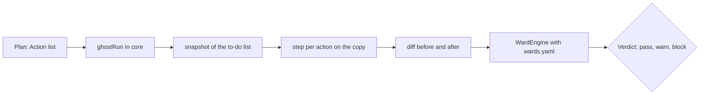

# Design Document: starter

## Overview

`starter` mirrors a to-do list. The state is an array of `{ id, text }`. The one design decision that matters most is that every to-do is a virtual path `todos/<id>`, so the existing `path` ward and the file-style `Change` shapes judge the world with no new ward kind.

The world lives in `worlds/starter/`. It depends on `core/` only. The demo and the tests also use `wards-config` and `vite-node` as dev dependencies.

## Architecture



Reality is the fixture list held by `createStarterWorld()`. The world is in memory, so no Docker box is used.

## Components and Interfaces

### File layout

```
worlds/starter/
  package.json, tsconfig.json, eslint.config.mjs, vitest.config.ts
  world.config.ts          registration
  wards.yaml               the ward keep-todos
  README.md
  src/world.ts             state, actions, the six functions
  src/index.ts             public entry
  scripts/run-demo.ts      the three demo plans, returns the printed text
  scripts/demo.ts          prints it (the `demo` script)
  tests/contract.test.ts   verifyWorld, registration, invalid action
  tests/demo.test.ts       the blocked line and the passed line
```

### Component 1: State and actions

```ts
export interface Todo { readonly id: number; readonly text: string }
export interface TodoState { readonly todos: readonly Todo[] }
export type Action =
  | { kind: 'add'; text: string }
  | { kind: 'remove'; id: number }
  | { kind: 'clear' };
```

### Component 2: The six functions

| Function | Behavior here |
|---|---|
| `snapshot()` | `structuredClone` of the list. |
| `step(s, a)` | New snapshot. Invalid action: copy of the list with `success: false` and an error. Never throws. |
| `diff(before, after)` | `file-created`, `file-overwritten`, `file-deleted` on `todos/<id>`, sorted by code point. |
| `render(s)` | `{ world: 'starter', todos: [...] }`. |
| `fingerprint()` | SHA-256 over sorted `[path, sha256(text)]` rows; the manifest holds the per-to-do hashes. |
| `effectsOutside(a)` | Always `[]`. |

Change kinds: `file-created` (add), `file-overwritten` (same id, new text, only possible across unrelated snapshots), `file-deleted` (remove, clear). The `path` ward reads `file-deleted`.

### Component 3: Registration (`world.config.ts`)

Default export `{ id: 'starter', deterministic: false, wardsFile: './wards.yaml', create: createStarterWorld }`.

### Component 4: Registration gate

`tests/contract.test.ts` calls `verifyWorld` with `deterministic: false`, the parsed ward set, an `actionArb` for the three action kinds, and 100 runs. P1 and P3 and the ward checks run.

### Component 5: Wards

```yaml
wards:
  - id: keep-todos
    kind: path
    deny: [delete]
    paths: ["todos/*"]
```

| Ward | Rule | Message |
|---|---|---|
| `keep-todos` | no delete of `todos/*` | the ward id and the deleted path |

### Component 6: Demo

`scripts/run-demo.ts` runs each plan on a fresh world with `ghostRun` and `WardEngine.evaluate`, counts `file-deleted` changes, and compares the fingerprint before and after. `scripts/demo.ts` prints the text. `runDemo(wardsText)` takes the wards text (default: the file `wards.yaml`), and `demo.ts` reads it from the optional argument `--wards <file>`. The plans are `clear`, `remove 2`, and `add "buy candles"`. The lost count prints "1 to-do" and "N to-dos". The `demo` script runs it with `vite-node` and the package's `vitest.config.ts` (which maps the workspace packages to their source).

## Data Models

| Model | Fields | Limits |
|---|---|---|
| `TodoState` | `todos: Todo[]` | Fixture of 3; no fixed maximum |
| `Scene` | `world`, `todos[]` | plain data |
| `Effect` | none | `effectsOutside` is always empty |

## Correctness Properties

- P1: the fingerprint before a ghost run equals the fingerprint after it (checked by `verifyWorld`).
- P3: a restored snapshot equals the pre-snapshot state, and `step` leaves its input unchanged (checked by `verifyWorld`).
- Ward: a plan that deletes a to-do produces `block` (checked by `verifyWorld` and `tests/demo.test.ts`).

## Error Handling

| Situation | Behavior |
|---|---|
| Invalid action | `step` returns `{ success: false, error }` and does not throw. |
| `wards.yaml` does not parse | The test or the demo throws with `wards.yaml does not parse`. |

## Testing Strategy

- `tests/contract.test.ts`: registration, `verifyWorld`, one invalid action.
- `tests/demo.test.ts`: the whole output with the shipped wards (`clear` and `remove 2` blocked, `add` passed), the whole output with `paths: ["todos/1"]` (`remove 2` passes, `clear` blocked), a wards text that does not parse, and that the output blocks of both READMEs equal these two outputs.

Verification commands: `corepack pnpm --filter @ghost-run/world-starter test`, `typecheck`, `lint`, and `demo`.

## Requirement Traceability

| Requirement | Design section |
|---|---|
| 1 State and actions | Component 1 |
| 2 Six functions | Component 2 |
| 3 Registration gate | Component 4 |
| 4 Registration file | Component 3 |
| 5 Wards | Component 5 |
| 6 Demo | Component 6 |
| 7 Claim scope | README of the world |
| 8 Hygiene and dependencies | Overview, root README table |
