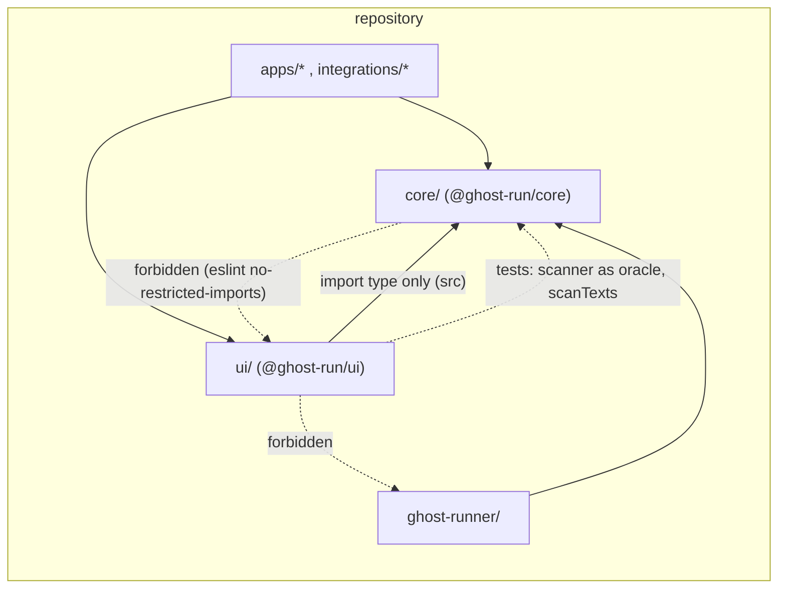
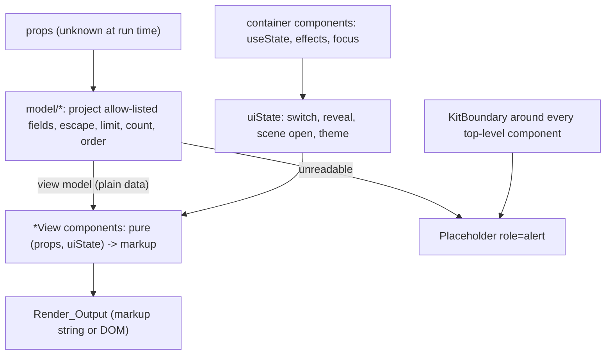

# Design Document: ui-kit

## Overview

The `ui-kit` spec is the shared screen kit of Ghost Run+: the workspace package `ui/` (`@ghost-run/ui`), written in TypeScript with React 19 and built with Vite 7. It draws data that `core`, the possession detector, and the ward engine already produced. It computes no verdict, no diff, no finding, and no red-thread link.

The design has two layers.

1. **View-model layer** (`ui/src/model/`, pure TypeScript, no React import, no DOM, no clock, no random source). Each function takes `unknown` (the raw prop), projects only the fields named in the input contract, escapes every string, applies display limits, and returns a plain-data view model or `{ kind: 'unreadable' }`. All display decisions that can be wrong (counts, texts, ordering, claim honesty, candle mapping, hidden-code-point notation) live here and are tested in a plain Node environment at full property size.
2. **Component layer** (`ui/src/components/`, React). Each component maps a view model to markup. Components contain no decision logic beyond "which pre-built string goes where". Interaction state (blacklight switch, reveal controls, theme, open scene) is held in thin container components; the markup is produced by pure `*View` functions of `(props, uiState)` so that every state can be rendered statically in tests.

**Decisions in one table.**

| ID | Decision | Section |
|---|---|---|
| D1 | `ui/` exports TypeScript source (like `ghost-runner`), not a pre-built bundle. A Vite "gallery" page in `ui/` builds to static files and is the build and static-hosting check target. | Architecture |
| D2 | View-model functions accept `unknown` and return plain data. Components never read a prop field directly. | Architecture |
| D3 | `@ghost-run/core` is a type-only import in `src/`. At run time `ui/src` imports nothing from `core`. Tests may import core values (scanner as oracle). | Architecture |
| D4 | DOM test environment: **jsdom 26.1.0**. happy-dom is not installed. View-model and static-markup tests run in `node`. | Testing Strategy |
| D5 | Render_Output is the string from `react-dom/server` `renderToStaticMarkup` of a pure `*View`. DOM mounting (Testing Library) is used only for behavior that needs effects, focus, or events. | Testing Strategy |
| D6 | Display escaping happens in the view model, once, so no component can forget it. Hex_Notation is `<U+XXXX>`. | Components |
| D7 | Color tokens live in `ui/src/theme/tokens.ts`. `theme.css` mirrors them and a sync test fails on drift. All other CSS uses `var(--gk-*)` only. | Visual design |
| D8 | All icons, flame, smoke, and tombstone shapes are inline SVG drawn in this package (original work, no files, no fonts). | Visual design |
| D9 | `null` for an optional prop is a wrong type (Placeholder). Only `undefined` means "not supplied". | Error Handling |
| D10 | `recordedAt` is parsed by a small pure parser (no `Date`). Only `YYYY-MM-DDTHH:MM:SS[.fff]Z` is valid. | Components |
| D11 | Focus return from the seance to its tombstone uses a per-document store, not routing. | Components |
| D12 | The Theme owner is `KitRoot`. `LightsToggle` is rendered by `KitRoot` and is not exported alone. | Components |
| D13 | Secret-like key redaction (`[hidden: secret-like field]`) happens in the view model by the pure functions `isSecretLikeKey` and `redactGenericValue`, once, for unknown-kind `Change` fields and `Scene` values. It is a key-name heuristic. | Components (Secret-like keys) |
| D14 | Claim honesty has two independent outputs: the Assurance_Text and the "Not claimed" banner. Each has its own condition and both can appear together. | Components (Candle and claim banner) |
| D16 | Not-applicable claims. `IsolationClaims.notApplicable?: readonly ('P5' | 'P6')[]` marks a property that does not apply to the world (for example P5 and P6 in Ghost Hand). It is neither claimed nor NOT claimed, is shown as `P<n>: not applicable to this world` with the `not-applicable` icon, and does not count toward condition B. Rule when a property is both claimed `true` and listed: the claim wins and the line shows `claimed` (the kit only echoes what it receives and a supplied `true` is shown as claimed by criterion 9; the other choice would silently drop a claim, and neither choice can produce a `NOT claimed` text). Not applicable applies only to well-formed claims in `docker-box` or `playground`; it is ignored for `static-analysis` and for malformed claims, and a malformed flag is not rescued by the list. P1 cannot be listed (type and model). **Decision awaiting user confirmation.** | Components (claims model) |
| D15 | ESLint 10 only: no `eslint-plugin-react` and no `eslint-plugin-jsx-a11y` (their peer ranges stop at ESLint 9). Accessibility is checked by axe-core and role-based queries. | Source hygiene; Testing Strategy |

### Research summary

The design environment had no shell and no network access (every `execute_bash`, `web_fetch`, and web search call was refused before running). Therefore:

- **Verified by reading the repository:** `pnpm-workspace.yaml` already lists `ui`; the directory `ui/` does not exist yet; `core/src/index.ts` already re-exports `./possession/index.js`, so `Finding`, `ScanResult`, `Needle`, and `ThreadLink` reach the kit through `@ghost-run/core` (Assumption A1 holds today). The core name is `ThreadLink`, and the requirements now use the same spelling; this design writes `ThreadLink` everywhere. `core` and `ghost-runner` use `vitest ^3.2.7`, `fast-check ^4.10.2`, `typescript ^5.9.0`, `eslint ^10.15.0`, `typescript-eslint ^8.73.0`, `@types/node ^20.19.0`. `ghost-runner` resolves `@ghost-run/core` to `../core/src/index.ts` through a Vitest alias and a `tsconfig` `paths` entry. The root `package.json` declares `packageManager` `pnpm@12.21.0`.
- **Taken from the task statement (npm, 2026-11-18), not re-checked here:** versions and licenses of react, react-dom 19.3.1; @types/react and @types/react-dom 19.3.0; vite 7.3.8 (Node ^20.19); @vitejs/plugin-react 5.2.0 (Vite 4 to 8); vitest 3.2.7 (Vite 5 to 7); @testing-library/react 16.3.3; @testing-library/dom 10.4.2; @testing-library/user-event 14.6.12; jsdom 26.1.0 (Node 18+); happy-dom 21.0.4; eslint-plugin-react-hooks 7.1.1 (peer range accepts ESLint ^10); @eslint-react/eslint-plugin 5.30.3 (MIT, Node 20.19 or newer, peer `eslint` `*`); all MIT except axe-core 4.14.1 (MPL-2.0).
- **Excluded because of ESLint 10 (from the task statement):** `core` uses ESLint 10.15.0. `eslint-plugin-react` 7.37.5 (peer ESLint up to ^9.7) and `eslint-plugin-jsx-a11y` 6.10.2 (peer ESLint up to ^9) do not accept ESLint 10, so `ui/` does not depend on them (see "Forbidden versions and why"). The `dangerouslySetInnerHTML` ban uses `@eslint-react/eslint-plugin`, and accessibility is checked by axe-core DOM tests and role-based queries.
- **Verified since:** the `dangerouslySetInnerHTML` rule IDs of `@eslint-react/eslint-plugin` 5.30.3 are fixed (see Q1).
- **Unverified (listed in "Open Questions / Unverified"):** the Vitest `projects` inline syntax in 3.2.7, `react-dom/server` resolution inside the jsdom environment, strings in the React production bundle, and the contrast values (computed by hand, see "Visual design").

### Dependencies

Runtime (`dependencies`, Requirement 1 criterion 3): `@ghost-run/core` (`workspace:*`), `react`, `react-dom`. Nothing else.

Development (`devDependencies`), each with its reason. All MIT except axe-core.

| Package | Version range | Reason |
|---|---|---|
| `typescript`, `typescript-eslint`, `eslint`, `@types/node` | `^5.9.0`, `^8.73.0`, `^10.15.0`, `^20.19.0` | Same as `core` and `ghost-runner`. `@types/node` only for `tests/scan` and `tests/dist`. |
| `vite` | `^7.3.8` | Build and test runner base. `^7` excludes Vite 8 (needs Node 22). |
| `@vitejs/plugin-react` | `^5.2.0` | JSX transform for Vite 7. |
| `vitest` | `^3.2.7` | Same line as `core`. `^3` excludes Vitest 4 and later. |
| `fast-check` | `^4.10.2` | Property tests, same as `core`. |
| `jsdom` | `^26.1.0` | DOM environment (D4). `^26` excludes jsdom 27 (needs Node 22). |
| `@testing-library/react`, `@testing-library/dom`, `@testing-library/user-event` | `^16.3.3`, `^10.4.2`, `^14.6.12` | DOM mount, queries, keyboard and pointer input. `@testing-library/dom` is a peer of the React package. |
| `@types/react`, `@types/react-dom` | `^19.3.0` | Types. |
| `@eslint-react/eslint-plugin` | `5.30.3` (exact) | `dangerouslySetInnerHTML` prohibition rule (peer `eslint` `*`, accepts ESLint 10; Node 20.19 or newer). The rule IDs are fixed and verified: `@eslint-react/dom-no-dangerously-set-innerhtml` and `@eslint-react/dom-no-dangerously-set-innerhtml-with-children` (Q1, resolved); a `no-restricted-syntax` selector blocks the same construct independently. |
| `eslint-plugin-react-hooks` | `^7.1.1` | `rules-of-hooks` and `exhaustive-deps` (peer range includes ESLint ^10). |
| `axe-core` | `^4.14.1` | Accessibility audit in DOM tests; it replaces the static JSX accessibility lint. **MPL-2.0.** |

**axe-core license handling.** MPL-2.0 is file-level copyleft. The package is used as a development dependency only: it is imported by `tests/dom/*.test.tsx` and nowhere in `src/`, `gallery/`, or `vite.config.ts`, so it is not in the Vite bundle and not in `ui/dist`. `ui` is `private` and publishes no tarball, and the package is not modified or copied. The README dependency table lists it with the license `MPL-2.0` and the note "dev only, not shipped". A source-scan test fails when `axe-core` is imported under `src/` or `gallery/`.

**Forbidden versions and why.**

| Forbidden | Why | Enforcement |
|---|---|---|
| `vite` 8 and later | Needs Node 22 or newer; the repository runs Node 20.20.2 (`engines.node >=20`). | Range `^7.3.8`; a test reads the installed `vite/package.json` and fails when the major is not 7. |
| `vitest` 4 and later (including 5) | Needs a newer Vite and Node 22 or newer. | Range `^3.2.7`; same version test (major 3). |
| `jsdom` 27 and later | Needs Node 22 or newer. | Range `^26.1.0`; same version test (major 26). |
| `happy-dom` | Not needed once jsdom is chosen (YAGNI). | Not listed; a test asserts it is not in `package.json`. |
| `three`, `@mujoco/mujoco`, any 3D library | Out of scope (Requirement 1 criterion 7). | `no-restricted-imports` and a `package.json` test. |
| `eslint-plugin-react` (7.37.5 and any version whose peer range stops below ESLint 10) | Its peer range covers ESLint up to ^9.7 only, and `core` uses ESLint 10.15.0. Not used. | Not listed; the hygiene test asserts it is not in `ui/package.json`. The `react/no-danger` rule it would give is replaced by the `@eslint-react/eslint-plugin` rule plus a `no-restricted-syntax` selector. |
| `eslint-plugin-jsx-a11y` (6.10.2 and any version whose peer range stops below ESLint 10) | Its peer range covers ESLint up to ^9 only. Not used. | Not listed; the hygiene test asserts it is not in `ui/package.json`. Accessibility is checked by axe-core DOM tests and role-based queries (see "Accessibility checking"). |

**No other package is added.** No CSS library, no icon package, no font package, no state library, no router, no `jest-dom`, no Playwright. Licenses for the README table: every package above is MIT except axe-core (MPL-2.0, dev only). Assets and fonts for the README table: **icons, flame, smoke, tombstone shapes: original SVG paths written in this package, license MIT (repository license). Fonts: none (system font stacks only).** If an implementation task needs another package it must record name, version, license, and reason in the README table first.

---

## Architecture

### Package layout

```
ui/
├─ package.json  tsconfig.json  tsconfig.node.json  vite.config.ts  vitest.config.ts
├─ eslint.config.mjs  index.html  README.md
├─ gallery/
│  └─ main.tsx                    # static demo page: every component with fixture data
├─ src/
│  ├─ index.ts                    # public exports (components, types, tokens, escapeForDisplay, isHiddenDisplay; core types as `export type` only)
│  ├─ types.ts                    # UI-owned input types (IsolationClaims, GraveEntry, ...)
│  ├─ model/                      # pure view models, no React
│  │  ├─ limits.ts  texts.ts  guards.ts  escape.ts  numbers.ts  time.ts  redact.ts
│  │  ├─ mirror.ts  scene.ts  candle.ts  claims.ts  icons.ts
│  │  ├─ blacklight.ts  thread.ts  graveyard.ts  seance.ts
│  ├─ theme/
│  │  └─ tokens.ts                # Theme_Tokens + Contrast_Pairs (single source)
│  ├─ components/
│  │  ├─ KitRoot.tsx  KitBoundary.tsx  Placeholder.tsx  Reveal.tsx
│  │  ├─ MirrorWorld.tsx  Candle.tsx  ClaimBanner.tsx
│  │  ├─ BlacklightView.tsx  RedThreadView.tsx  Graveyard.tsx  SeanceView.tsx
│  │  └─ art/  Icon.tsx  FlameArt.tsx  SmokeLayer.tsx  TombstoneShape.tsx
│  ├─ hooks/  useReducedMotion.ts  useFocusReturn.ts
│  └─ styles/ index.css  theme.css  kit.css  motion.css
└─ tests/
   ├─ model/    (node)      view-model and escaper properties, contrast
   ├─ static/   (node)      renderToStaticMarkup properties
   ├─ dom/      (jsdom)     parse, mount, keyboard, axe, network stubs
   ├─ scan/     (node)      source, stylesheet, hygiene scans (no build needed)
   ├─ dist/     (node)      scans of ui/dist (needs `pnpm build`)
   ├─ support/  pbt-config.ts  pbt-stats.ts  contrast.ts  markup.ts  setup-dom.ts
   └─ fixtures/ arbitraries.ts  canary.ts  hosts.ts
```

`ui/src` is exported as source: `exports["."]` points at `./src/index.ts`, `exports["./styles.css"]` at `./src/styles/index.css`. Apps are Vite projects and transpile it. This follows `ghost-runner` (`main: src/index.ts`) and avoids a second build target (D1). `ui/dist` is the Vite build of the gallery.

### Dependency direction



Rules and where each is enforced:

| Rule | Enforcement |
|---|---|
| `ui` imports other repository packages only through `@ghost-run/core`, and only with `import type` in `src/`, `gallery/` | ESLint `no-restricted-syntax` selector `ImportDeclaration[source.value='@ghost-run/core'][importKind!='type']` in `src/**` and `gallery/**` |
| `ui` must not import `@ghost-run/ghost-runner`, `apps/*`, `integrations/*`, `worlds/*`, `three`, `@mujoco/mujoco`, or core internals | `no-restricted-imports` patterns (see "Source hygiene") |
| `core` must not import `ui` | `core/eslint.config.mjs` already has `**/ui/**`. It does not yet list the package name `@ghost-run/ui`. **This design does not change `core/`.** Adding `@ghost-run/ui` and `@ghost-run/ui/**` to `WORKSPACE_PATTERNS` plus a lint fixture test (Requirement 1 criterion 6) is a **separate task in the tasks stage**, kept apart from the `ui/` implementation tasks so that `core/` is not edited at the same time by several specs. Until that task is done, Requirement 1 criterion 6 is not claimed as verified. |
| `pnpm-workspace.yaml` lists `ui` | Already true (verified). No change. |

### Data flow and layering



Static tests call `renderToStaticMarkup(<XView props uiState />)`. DOM tests mount the container.

### Input contract (quoted from the requirements)

The kit consumes these types from `@ghost-run/core` and defines no second shape: `Change`, `FileChange`, `SqlRowCountChange`, `Scene`, `Verdict`, `WardVerdict`, `WardViolation`, `WardNotice`, `GhostReport` (from `core/src/types.ts`); `Finding`, `ScanResult`, `Needle`, and `ThreadLink` (`ThreadLink`, spelled the same in the requirements) from the possession types. Shapes as they exist in the repository:

```ts
// from @ghost-run/core (read from core/src/types.ts and core/src/possession/types.ts)
interface Change { readonly kind: string; readonly [key: string]: unknown }
interface WardViolation { wardId: string; wardKind: 'path'|'sql'|'egress'|'physics'; reason: string }
interface WardNotice { kind: string /* core today: 'effect-outside'|'observed-event'; kinds such as 'unsupported-step', 'path-escape', 'content-inspection' may be added */; reason: string; stepIndex: number; destination?: string; path?: string }
interface WardVerdict { verdict: 'pass'|'warn'|'block'; violations: readonly WardViolation[]; notices: readonly WardNotice[] }
// WardNotice is taken from core as is. ui-kit does not narrow, redeclare, or switch on `WardNotice.kind`: the Candle shows every notice as 'step <stepIndex>: <reason>' whatever the kind.
interface Finding { category: 'tag'|'zero-width'|'bidi'|'html-comment'; line: number; column: number; offset: number;
                    length: number; codePoints: readonly number[]; firstCodePoint: string; rendering: string }
interface ScanResult { findings: readonly Finding[] }
interface Needle { value: string; origin: 'effect'|'observed-destination'|'observed-path'; stepIndex: number }
type ThreadLink =
  | { status: 'found'; needle: Needle; matchedKey: 'value'|'host'; source: string; kind: string;
      recordIndex: number; line: number; column: number; lineText: string; hidden: boolean }
  | { status: 'not-found'; needle: Needle }
```

The component input table of Requirement 2 criterion 3 is implemented one to one:

| Component | Props type (design) |
|---|---|
| `MirrorWorld` | `{ changes: readonly (readonly Change[])[]; realScene?: Scene; mirrorScene?: Scene; stepLabels?: readonly string[] }` |
| `Candle` | `{ verdict?: WardVerdict; claims?: IsolationClaims }` |
| `BlacklightView` | `{ sources: readonly BlacklightSource[] }` |
| `RedThreadView` | `{ needles: readonly Needle[]; links: readonly ThreadLink[]; actionLabels?: readonly string[] }` |
| `Graveyard` | `{ entries: readonly GraveEntry[]; onOpenSeance: (id: string) => void }` |
| `SeanceView` | `{ entry: GraveEntry; onBack: () => void }` |
| `KitRoot` | `{ initialTheme?: 'dark' \| 'light'; children?: ReactNode }` |

Types owned by the kit (no other spec defines them): `IsolationClaims` (Requirement 7 criterion 1), `GraveEntry` (Requirement 10 criterion 1), `BlacklightSource`. See "Data Models". `IsolationClaims` is a structural subset of the ghost-runner `Isolation` object, so an `Isolation` value is assignable (Assumption A4).

**Allow_List_Projection.** Each model function reads named fields with a helper `pick(obj, 'a', 'b')` that returns only those own properties. A field not named in the contract is never read, so it cannot be rendered. The one place where field names come from the data is the unrecognized-change row (Requirement 5 criterion 5), which shows at most 5 primitive fields by design.

### Display limits (Assumption A8)

All limits are constants in `model/limits.ts`.

| Constant | Value | Reason |
|---|---|---|
| `COMPACT_MAX` | 120 code points | Same as ward messages (`sanitizeText` default) |
| `DETAIL_MAX` | 4,096 code points | Requirement 14 criterion 6; one screen-reader paragraph of a long command |
| `MIRROR_ROWS` | 200 rows | A row has about 14 elements; 200 rows is about 2,800 nodes, a jsdom mount under 100 ms |
| `SCENE_ENTRIES`, `SCENE_DEPTH` | 200 entries in total, depth 8 | Same node budget; deeper values show `[nested too deep]` |
| `BL_LINES` | 200 lines per source | Requirement 14 criterion 5 and Assumption A8; same node budget |
| `BL_FINDINGS` | 100 Findings per source | Requirement 14 criterion 5 and Assumption A8. One limit for both the Findings list and the in-text highlighted markers of a source, applied to the first Findings in `ScanResult.findings` order. A Finding has about 12 elements in its list entry and marker |
| `TOMBSTONES`, `THREADS` | 200 each | Requirement 14 criterion 5 and Assumption A8; a tombstone and a thread each have about 20 elements, so 4,000 nodes at most |
| `MARKER_CODEPOINTS`, `MARKER_RENDERING` | 20, 200 | Requirement 8 criterion 6 |
| `UNKNOWN_VERDICT_MAX` | 40 | Requirement 6 criterion 8 |
| `UNRECOGNIZED_FIELDS` | 5 | Requirement 5 criterion 5 |
| `GENERIC_DEPTH` | 8 (same value as `SCENE_DEPTH`) | Depth bound of `redactGenericValue`; the number of entries is bounded only by the render limit above, not while building |

The render limits are initial limits (Requirement 14 criterion 5). Every limited list shows `Showing <shown> of <total>` and a native `<button>` reveal control that renders all elements. A reveal control only grows the rendered set; it never changes a count of a summary line.

---

## Components and Interfaces

### Shared view-model helpers

```ts
// model/escape.ts
export function formatHex(codePoint: number): string;            // '<U+XXXX>', uppercase, >= 4 digits
export function escapeForDisplay(s: string, opts?: { keepNewline?: boolean }): string;
export function compact(s: string, max?: number): string;         // escape, then cut: 117 code points + '...' when > 120
export function detail(s: string): string;                        // escape, then cut at 4,096 code points + '[truncated]'
export function isHiddenDisplay(cp: number): boolean;             // the Hidden_Display_Code_Point ranges
```

`escapeForDisplay` and `isHiddenDisplay` are public API: `ui/src/index.ts` exports both (value exports), so Ghost Shell applies the same display rule. Types from `@ghost-run/core` are re-exported with `export type` only. `ui/tests/scan/index-exports.test.ts` checks that the two exports exist.

`escapeForDisplay` walks the string with `for...of` (a lone surrogate arrives as one element in U+D800 to U+DFFF). It replaces: every Hidden_Display_Code_Point (U+E0000 to U+E007F, U+200B to U+200D, U+2060, U+FEFF, U+202A to U+202E, U+2066 to U+2069, with no emoji exception, so U+200D is always escaped, Assumption A6); every control in U+0000 to U+001F and U+007F to U+009F (U+000A kept only when `keepNewline` is true); every unpaired surrogate. The output of an escaped token is ASCII (`<U+200B>`), so the function is idempotent: a second pass finds nothing to replace (Requirement 3 criterion 5; the characters `<`, `U`, `+`, `>` and hex digits are never replaced).

`compact` and `detail` are token-aware: they append whole tokens (one code point or one `<U+XXXX>` token) while the running length stays within `max - 3` (compact, the ellipsis `...`) or `max` (detail, then `[truncated]` is appended). A cut never falls inside a token, and the compact result never exceeds 120 code points. For ordinary text longer than 120 code points the result is the first 117 code points followed by `...`.

```ts
// model/guards.ts
export type Unreadable = { readonly kind: 'unreadable' };
export function isRecord(v: unknown): v is Record<string, unknown>;       // non-null, non-array object
export function pick<K extends string>(v: unknown, ...keys: K[]): Partial<Record<K, unknown>> | null;
export function arrayOf(v: unknown): readonly unknown[] | null;
export function displayPrimitive(v: unknown, max?: number): string;       // string -> escaped, number/boolean/null -> String(v), other -> '[non-primitive]'
```

```ts
// model/numbers.ts
export function formatCount(v: unknown): string;     // 1206 -> '1,206'; not a finite non-negative integer -> 'invalid number: ' + displayPrimitive(v)
// model/time.ts
export function parseUtcInstant(s: unknown): number | null;   // epoch ms; null when invalid (D10)
```

`parseUtcInstant` accepts only `^\d{4}-\d{2}-\d{2}T\d{2}:\d{2}:\d{2}(\.\d{1,3})?Z$`, validates month 1 to 12, day against the month length (leap years by the Gregorian rule), hour 0 to 23, minute 0 to 59, second 0 to 59, and converts with the days-from-civil integer algorithm. It never calls `Date`, so the ESLint ban on `Date` (see "Source hygiene") holds. Forms such as `+00:00` are `time unreadable` (Open Question Q8).

### Secret-like keys (Requirement 4 criteria 8 and 9, Requirement 5 criteria 5 and 11, Requirement 16 criterion 6, Assumption A7)

The Mirror_World shows generic data in two places: the fields of an unrecognized `Change` and the values of `realScene` and `mirrorScene`. Both go through one pure module, `model/redact.ts` (decision D13). No React code reads a generic value directly.

```ts
// model/redact.ts
export const SECRET_LIKE_WORDS: readonly string[];      // 'secret','token','password','passwd','apikey','api_key',
                                                        // 'authorization','cookie','credential','private_key','session'
export const HIDDEN_SECRET_TEXT: '[hidden: secret-like field]';

/** true iff key.toLowerCase() contains at least one word of SECRET_LIKE_WORDS as a substring. */
export function isSecretLikeKey(key: string): boolean;

export type GenericNode =
  | { readonly kind: 'primitive'; readonly text: string }                       // escaped, at most DETAIL_MAX code points
  | { readonly kind: 'hidden'; readonly text: typeof HIDDEN_SECRET_TEXT }       // value of a Secret_Like_Key
  | { readonly kind: 'object'; readonly entries: readonly { readonly key: string; readonly node: GenericNode }[] }
  | { readonly kind: 'array'; readonly items: readonly GenericNode[] }
  | { readonly kind: 'marker'; readonly text: '[nested too deep]' | '[circular reference]' | '[non-primitive]' | '[unreadable value]' };

export interface GenericLimits { readonly maxDepth: number }                      // default GENERIC_DEPTH = 8

/** value: any value. key: the key under which the value sits, or null for a root value or an array element. */
export function redactGenericValue(value: unknown, key: string | null, limits?: GenericLimits): GenericNode;

export interface GenericRow { readonly depth: number; readonly key: string; readonly valueText: string; readonly hidden: boolean }
export function flattenGeneric(root: GenericNode): readonly GenericRow[];         // pre-order list for the Scene view
```

**Algorithm of `isSecretLikeKey`.** `const k = key.toLowerCase()` (the locale-independent `String.prototype.toLowerCase`); return `SECRET_LIKE_WORDS.some((w) => k.includes(w))`. The test runs on the raw key, before any escaping. Examples: `Authorization`, `X-Auth-Token`, `userSessionId`, `API_KEY`, `my_PASSWORD_hint`, and `cookies` match; `name`, `path`, `rows` do not.

**Algorithm of `redactGenericValue`** (recursion with `depth` starting at 0 and an `ancestors` set of the containers on the current path, both internal):

1. IF `key !== null` and `isSecretLikeKey(key)`, RETURN `{ kind: 'hidden' }` at once. The value is not read, not inspected, and not descended into, so a secret-like key hides the whole subtree at any depth. This check comes first, so it also hides a value that would be circular or too deep.
2. IF `value` is a string, number, boolean, bigint, or `null`, RETURN `{ kind: 'primitive', text }`, where `text` is `displayPrimitive(value, DETAIL_MAX)` (a string goes through the Display_Escaper and the 4,096 code point cut).
3. IF `value` is an array or a plain object (prototype `Object.prototype` or `null`):
   1. IF `depth >= limits.maxDepth`, RETURN the marker `[nested too deep]`.
   2. IF `ancestors` already holds this exact object (identity), RETURN the marker `[circular reference]`.
   3. Add the object to `ancestors`; in a `try` block build the children; in a `finally` block remove it again. A sibling that holds the same object as another sibling (a shared reference, not a cycle) is therefore rendered in full both times.
   4. An array yields one child per index `i` in `0..length-1`, each with `redactGenericValue(value[i], null, ...)` at `depth + 1`. Array indices are not keys, so an element is never hidden because of its position; the keys inside an element object are checked.
   5. An object yields one entry per own enumerable string key from `Object.keys(value)` (symbol keys are ignored), in that order, each with `redactGenericValue(value[k], k, ...)` at `depth + 1`. The key is kept for display and is escaped later by `flattenGeneric` (the Display_Escaper form, compacted).
   6. IF reading an element or a property throws (a getter or a proxy), that child becomes the marker `[unreadable value]`; the other children are still rendered.
4. Any other value (`undefined`, function, symbol, `Map`, `Set`, `Date`, class instance) RETURNS the marker `[non-primitive]`.

The function is total, never mutates its input, reads each property at most once, and runs in time linear in the size of the visited input (the depth bound keeps the recursion finite for deeply nested and for circular input). `flattenGeneric` lists the nodes in pre-order as rows `{ depth, key, valueText, hidden }`: a `hidden` node has `valueText` equal to `HIDDEN_SECRET_TEXT` and `hidden: true`; a container row shows `{<n> fields}` or `[<n> items]`; an array element row has the key text `[<i>]`. The Scene view shows the first `SCENE_ENTRIES` rows and offers the reveal control for the rest.

**Where it is applied.**

| Place | Use |
|---|---|
| Unrecognized `Change` row (Requirement 5 criterion 5) | For each of the first 5 own fields with a string, number, or boolean value, `redactGenericValue(value, fieldName)`. A Secret_Like_Key field shows its key and `[hidden: secret-like field]`. A nested object value is not shown in this row (the row shows primitive fields only), so the nested rule is exercised through the Scene view and by the function tests. |
| `realScene` and `mirrorScene` (Requirement 5 criterion 11) | `flattenGeneric(redactGenericValue(scene, null))`, shown in the `Full scene` region. |
| Known-kind `Change` rows | Not applicable: the row reads only the allow-listed fields (`path`, `table`, counts, targets), and extra fields on such a Change are never rendered (Requirement 2 criterion 7). A known kind with missing or mistyped fields is shown as an unrecognized row and so goes through the rule. |

**Limits of the heuristic (stated in the README, Requirement 4 criterion 7, Requirement 16 criterion 6, Assumption A7).** The rule matches key names, not values, by case-insensitive containment of the eleven words:

- It can miss a secret under an innocent key name (`pwd`, `auth`, `bearer`, `passphrase`, `jwt`, `value`) and under a key that spells a word differently (`privateKey` becomes `privatekey`, which does not contain `private_key`; `x-api-key` and `private-key` contain neither `apikey` nor `api_key`). It cannot see a secret typed into a string under a harmless key, into a command, or into any other displayed field.
- A hidden code point inside the key name (`pass` and `word` separated by U+200B) defeats the containment test; the escaped key shows `<U+200B>`, and the value is shown. This follows the requirement (plain `toLowerCase`, no stripping) and is not widened here.
- It can hide a harmless value (`session_count`, `tokens_used`, `cookie_policy`).
- It protects the Mirror_World only. The producer of the `Change` values and of the `Scene` stays responsible for redaction.

**README text** (to be placed in `ui/README.md` and in the repository README under a heading "Secret-like key rule", Requirement 16 criterion 6; English):

> The Mirror world hides the value of any field whose key name contains `secret`, `token`, `password`, `passwd`, `apikey`, `api_key`, `authorization`, `cookie`, `credential`, `private_key`, or `session`, ignoring letter case, and shows `[hidden: secret-like field]` instead. This is a heuristic. It matches key names by case-insensitive containment and never inspects values. It can miss a secret under an innocent key name (for example `pwd`, or `privateKey`, which does not contain `private_key`), and it can hide a harmless value (for example `session_count`). It does not detect a secret typed into a command string or any other displayed text. The producer of the changes and scenes remains responsible for redaction.

A scan test checks that both README files contain the phrases `case-insensitive containment`, `heuristic`, `innocent key name`, `harmless value`, and `responsible for redaction` (see "Scan tests").

### Mirror world

```ts
// model/mirror.ts
export type RowKind = 'file-created' | 'file-overwritten' | 'file-deleted' | 'symlink-changed'
                    | 'sql-row-count' | 'unrecognized' | 'unreadable';
export interface CellItem { readonly label?: string; readonly text: string }       // text is already escaped
export interface PaneCell { readonly state: StateTag; readonly items: readonly CellItem[] }
export interface StateTag { readonly text: string; readonly icon: IconId }          // text + icon, never color alone
export interface ChangeRowModel {
  readonly key: string;                 // `${stepIndex}.${index}`
  readonly stepIndex: number; readonly index: number;
  readonly kind: RowKind;
  readonly reality: PaneCell; readonly mirror: PaneCell;
  readonly vanish: boolean;             // true: show Vanish_Effect and the 'would be removed' label
  readonly extraLabel?: string;         // 'unrecognized change', 'rows lost: 1,206', 'table dropped'
}
export interface StepModel { readonly stepIndex: number; readonly label?: string; readonly rows: readonly ChangeRowModel[]; readonly unreadable: boolean }
export interface MirrorModel {
  readonly kind: 'ok';
  readonly steps: readonly StepModel[];
  readonly totalRows: number; readonly stepCount: number;
  readonly summary: string;             // '<N> changes in <M> steps'
  readonly emptyText: string | null;    // 'No changes: the ghost run left the mirror unchanged.' when N = 0
  readonly scene: { real: SceneTree | null; mirror: SceneTree | null };
}
export function buildMirrorModel(input: unknown): MirrorModel | Unreadable;   // input = { changes, realScene?, mirrorScene?, stepLabels? }
```

Row rules (Requirement 5 criterion 5), in code order:

| Condition | Row |
|---|---|
| element is not a record | kind `unreadable`, text `Unreadable item <index>` (one row, so UI-P1 still counts it once) |
| `kind` is `file-created` and `path` is a string | reality `path`, state `absent`; mirror `path`, state `created` |
| `file-overwritten`, string `path` | reality state `present`; mirror state `overwritten` |
| `file-deleted`, string `path` | reality state `present`; mirror state `deleted`, `vanish: true` |
| `symlink-changed`, string `path` | reality `path` + `targetBefore` when a string; mirror `path` + `targetAfter` when a string; state `link changed` |
| `sql-row-count`, string `table` | reality `table` + `formatCount(rowsBefore)`; mirror `table` + `formatCount(rowsAfter)`; when both are finite non-negative integers and `rowsBefore > rowsAfter`: `rows lost: <before - after>` and `vanish: true`; `dropped === true` adds `table dropped` |
| any other `kind` string, or a known kind with missing or mistyped required fields | kind `unrecognized`; reality shows `kind` and up to 5 own fields whose values are string, number, or boolean (in `Object.keys` order). Field names go through `compact`; each value goes through `redactGenericValue` with its key, so the value of a Secret_Like_Key is replaced by `[hidden: secret-like field]` and the key stays visible; mirror label `unrecognized change` |

The derived `rows lost` number is computed only from supplied values and is labelled as arithmetic on the supplied counts (Requirement 2 criterion 8). The Mirror never writes a sentence that reality is unchanged (Requirement 5 criterion 13). Steps that are not arrays become one step with `unreadable: true` and zero rows. `stepLabels[i]` is used when it is a string.

`SceneTree` (`model/scene.ts`) is a flattened read-only list of `{ depth, key, valueText, hidden }` built from `redactGenericValue` (see "Secret-like keys"): keys and string values escaped, a value under a Secret_Like_Key replaced by `[hidden: secret-like field]` at any depth, at most `SCENE_ENTRIES` entries in the initial render (`Showing <shown> of <total>` and a reveal control, Requirement 14 criterion 5) and depth `SCENE_DEPTH`; deeper values show `[nested too deep]`, a repeated ancestor shows `[circular reference]`, and a value that is not JSON-like shows `[non-primitive]`.

**Component structure.**

```tsx
export function MirrorWorld(props: MirrorWorldProps): JSX.Element            // container: boundary + useState(revealAll, sceneOpen, sceneRevealAll)
export function MirrorWorldView(p: { model: MirrorModel; revealAll: boolean; sceneOpen: boolean; sceneRevealAll: boolean;
                                     onReveal?: () => void; onToggleScene?: () => void; onRevealScene?: () => void }): JSX.Element
```

Markup: a `<section aria-labelledby>` with heading `Mirror world`; a `<p>` summary line; a `<table aria-label="Changes in reality and in the mirror copy">` with `<thead>` columns `Reality` and `Mirror (copy)` (`scope="col"`), one `<tbody>` per step whose first row is a `<th scope="colgroup" colSpan=2>` showing `step <stepIndex>` and the step label, then one `<tr data-change-row="<key>">` per Change_Row. The Mirror column cells get the fog class on a background pseudo-layer; every text element has `opacity: 1` and no `filter` (Requirement 5 criterion 2). Vanish rows carry a `SmokeLayer` as the first child of the mirror cell (decorative, `aria-hidden`, `z-index: -1`), and a visible state tag with the cloud icon and the text `would be removed`.

Keyboard: the only interactive elements are the `Show all` reveal button for rows (`aria-label="Show all <total> rows"`, shown with `Showing <shown> of <total>`), the `Full scene` disclosure button (`aria-expanded`, `aria-controls`), and the `Show all` reveal button for scene entries inside the open region (`aria-label="Show all <total> scene entries"`). All are native `<button>` elements.

### Candle and claim banner

```ts
// model/candle.ts
export type CandleState = 'lit' | 'flickering' | 'out' | 'unknown' | 'idle';
export interface CandleModel {
  readonly kind: 'ok';
  readonly state: CandleState;
  readonly textLabel: string;            // PASS | WARN | BLOCK | UNKNOWN | NO VERDICT
  readonly accessibleLabel: string;      // fixed strings of Requirement 6 criterion 1
  readonly icon: IconId;                 // candle-lit | candle-flicker | candle-out | candle-unknown | candle-idle
  readonly unknownValueText?: string;    // escaped, <= 40 code points
  readonly wardLines: readonly string[];       // 'Violated ward: <wardId> (<wardKind>)', distinct, first appearance order
  readonly violationItems: readonly ListItem[];  // '<wardId>: <reason>'
  readonly noticeItems: readonly ListItem[];     // 'step <stepIndex>: <reason>' for every notice; kind-agnostic, no switch on WardNotice.kind
  readonly noticeSummary?: string;       // '<k> notices need review' when warn
  readonly inconsistency?: string;       // 'Data inconsistent: pass verdict with violations.'
}
export type ListItem = { readonly text: string } | { readonly unreadableIndex: number };
export function buildCandleModel(verdict: unknown): CandleModel | Unreadable;   // verdict undefined -> idle
```

The state is chosen by `verdict.verdict` alone (a lookup table, no other field is read for the state). A `block` verdict with no violations shows `Violated ward: none reported`. A violation element that is not a record becomes `Unreadable item <index>` and is skipped in `wardLines`. The five icons have pairwise different shapes (see "Visual design"). A `warn` verdict shows `<k> notices need review` with `k = notices.length` as supplied. The Candle never prints `approved` or `safe` (fixed-text scan test, Requirement 6 criterion 12).

```ts
// model/claims.ts
export type ClaimStatus = 'claimed' | 'not-claimed' | 'not-applicable'
export interface ClaimLine {
  readonly id: 'P1' | 'P5' | 'P6'
  readonly claimed: boolean       // true iff status is 'claimed'
  readonly status: ClaimStatus
  readonly text: string           // 'P1 claimed' | 'P5 NOT claimed' | 'P6: not applicable to this world'
  readonly icon: IconId           // check | ban | not-applicable (IconId from model/icons.ts)
}
export interface ClaimModel {
  readonly lines: readonly [ClaimLine, ClaimLine, ClaimLine];        // effective values, in order P1, P5, P6
  /** Condition A (Requirement 7 criterion 6): set iff mode is docker-box or playground AND p1Claimed === true. */
  readonly assuranceText: string | null;
  /** Condition for criterion 3: set iff mode is the valid value static-analysis. */
  readonly staticBanner: string | null;
  /** Condition B (Requirement 7 criterion 5): set iff claims is absent or malformed, OR mode is docker-box or playground
   *  and at least one of P1, P5, P6 is neither claimed nor validly not applicable. Independent of condition A. */
  readonly notClaimedBanner: string | null;                           // 'Not claimed for this run: <list>.' (+ 'Isolation status unknown.' when absent or malformed)
  readonly unknownStatus: boolean;
}
export function buildClaimModel(claims: unknown): ClaimModel;          // total: never returns Unreadable
```

The model computes condition A and condition B separately, from the effective claim lines, and never derives one from the other (decision D14). Both can be set at once (for example `docker-box`, `p1Claimed` true, `p6Claimed` false).

Decision table (`mode` is checked first):

| `claims` | `lines` (effective) | `assuranceText` (condition A) | `staticBanner` | `notClaimedBanner` (condition B) |
|---|---|---|---|---|
| absent, not a record, `mode` unknown, or a boolean field not a boolean (`notApplicable` ignored) | all `false` | `null` | `null` | `Isolation status unknown. Not claimed for this run: P1, P5, P6.` |
| `static-analysis` (any booleans, any `reason`) | all `false` (a supplied `true` is treated as not claimed) | `null` | `Static analysis only: no ghost rehearsal took place. P1, P5 and P6 are NOT claimed for this run.` + ` Reason: Docker unavailable.` or ` Reason: box image missing.` when `reason` is exactly that value | `null` (the static banner already names P1, P5, P6) |
| `docker-box` or `playground`, all three booleans `true` | all `true` | Docker text or in-memory text by `mode` | `null` | `null` |
| `docker-box` or `playground`, `p1Claimed` `true`, `p5Claimed` or `p6Claimed` not `true` | as supplied | by `mode` | `null` | `Not claimed for this run: <list>.` naming each unclaimed id in the order P1, P5, P6 (here P5, P6, or both) |
| `docker-box` or `playground`, `p1Claimed` not `true` | as supplied | `null` | `null` | `Not claimed for this run: <list>.` including P1 |
| `docker-box` or `playground`, well-formed, `P5` and/or `P6` in `notApplicable` with that flag not `true` | that line is `not-applicable` (text `P<n>: not applicable to this world`, icon `not-applicable`); a flag that is `true` stays `claimed` (D16); `P1` and other entries are ignored | by `mode` iff `p1Claimed` `true` | `null` | the list names only ids that are `not-claimed`; `null` when none is left |
| `docker-box` or `playground`, well-formed, lowered claim listed in the banner | as above | as above | `null` | list followed by ` No rehearsal took place.` for `reason` `static-analysis`, by ` Some steps were not rehearsed.` for `reason` `unsupported-step`, and by nothing for any other or absent `reason` |

**Text table** (all fixed texts of the claim display; constants in `model/texts.ts`):

| Text | Shown when | Source constant |
|---|---|---|
| `Ghost ran inside a sealed Docker box (P1 claimed).` | condition A and `mode` is `docker-box` | `ASSURANCE_DOCKER` |
| `Ghost ran on an in-memory copy in this browser (P1 claimed).` | condition A and `mode` is `playground` | `ASSURANCE_PLAYGROUND` |
| `Static analysis only: no ghost rehearsal took place. P1, P5 and P6 are NOT claimed for this run.` | `mode` is `static-analysis` | `STATIC_BANNER` |
| ` Reason: Docker unavailable.` / ` Reason: box image missing.` | appended to the static banner when `reason` is exactly `docker-unavailable` / `box-image-missing` | `REASON_*` |
| `Not claimed for this run: <list>.` | condition B | `NOT_CLAIMED_PREFIX` |
| `Isolation status unknown.` | condition B and `claims` is absent or malformed (including an unknown `mode`) | `STATUS_UNKNOWN` |
| ` No rehearsal took place.` / ` Some steps were not rehearsed.` | appended to the not-claimed banner when `reason` is exactly `static-analysis` / `unsupported-step` (the wards message builder uses the same split; no wording for a not-applicable property or an absent reason) | `REASON_NO_REHEARSAL` / `REASON_STEPS_NOT_REHEARSED` |
| `P<n>: not applicable to this world` | a validly not-applicable P5 or P6 line | `notApplicableText` |
| `claimed` / `NOT claimed` | line suffix after `P<n> ` | `CLAIMED_TEXT` / `NOT_CLAIMED_TEXT` |

Fixed Assurance_Text strings are the only places where the words `sealed` and `isolated` may appear; a source-scan test enforces this (Requirement 7 criterion 8). The model sets a claim to `true` only when the supplied value is the boolean `true` (Requirement 7 criterion 9).

`Candle` component: one container `<section data-candle-state="lit" aria-label="<accessibleLabel>">` holding the `FlameArt` (decorative), the icon with the text label (`PASS`), the polite live region `<div role="status" aria-live="polite" class="gk-sr-only">` with the accessible label, the ward lines, violation and notice lists in monospace, and the `ClaimBanner` (always in the same container, Requirement 7 criterion 8). `ClaimBanner` is `<div role="group" aria-label="Isolation claims">` with three `<li>` lines taken from `ClaimLine.text` and `ClaimLine.icon` (`P1 claimed` with the check icon, `P5 NOT claimed` with the ban icon, `P6: not applicable to this world` with the `not-applicable` icon, which is neither of the two other icons), then the assurance paragraph (condition A) and the banner paragraph (static or not-claimed, condition B), each shown whenever its own condition holds, so both may appear together. The banner paragraphs carry `data-claim="assurance"`, `data-claim="static"`, or `data-claim="not-claimed"` so tests do not rely on text alone.

Props: `{ verdict?: WardVerdict; claims?: IsolationClaims }`. Keyboard: none (not interactive).

### Blacklight

```ts
// model/blacklight.ts
export interface MarkerModel {
  readonly findingIndex: number;
  readonly category: HiddenCategory;
  readonly position: string;            // 'line:column'
  readonly hex: readonly string[];      // at most 20 items of '<U+XXXX>'
  readonly moreCount: number;           // 0, or k for '+<k> more'
  readonly rendering: string;           // escaped, <= 200 code points, '[truncated]' appended when cut
}
export type Segment =
  | { readonly kind: 'text'; readonly text: string }         // escaped; uncovered hidden code points appear as hex here in both states
  | { readonly kind: 'marker'; readonly marker: MarkerModel };
export interface LineModel { readonly number: number; readonly segments: readonly Segment[] }
/** Which limited lists the user revealed, by source index (Requirement 14 criterion 5). */
export interface BlacklightReveal { readonly lines: ReadonlySet<number>; readonly findings: ReadonlySet<number> }
export interface SourceModel {
  readonly label: string;               // compact(source)
  readonly summary: string;             // '<source>: <n> findings'; n is ALWAYS the total number of Findings, never the shown number
  readonly categoryCounts: readonly { category: HiddenCategory; count: number }[];  // all four categories, in order; totals
  readonly lines: readonly LineModel[]; // first BL_LINES (200) lines, or all lines when revealed
  readonly totalLines: number;
  readonly linesNotice: string | null;  // 'Showing <shown> of <total>' for the lines, when shown < total
  readonly totalFindings: number;       // number of elements of scan.findings
  readonly entries: readonly MarkerModel[];   // one per placed Finding among the shown Findings, in ScanResult.findings order
  readonly unplaced: readonly FindingFields[]; // 'Findings that could not be placed' among the shown Findings
  readonly findingsNotice: string | null;     // 'Showing <shown> of <total>' for the Findings, when shown < total
  readonly noFindingsText: string | null;     // 'No hidden text found by the blacklight.'
}
export interface BlacklightModel { readonly kind: 'ok'; readonly sources: readonly SourceModel[]; readonly emptyText: string | null }  // 'No texts to scan.'
export function buildBlacklightModel(sources: unknown, mode: 'on' | 'off', reveal: BlacklightReveal): BlacklightModel | Unreadable;
```

Algorithm per source (pure, one pass): split `text` into code points with `Array.from`; split lines on U+000A, U+000D U+000A, and lone U+000D (the possession Line_Break rule; the line and column printed in a marker are the supplied `Finding` values, never recomputed). A Finding is placed when `offset >= 0`, `length >= 0`, integer values, and `offset + length <= cps.length`; otherwise it is unplaced and goes to the `unplaced` group with its fields shown. A Finding element that is not a record becomes an `Unreadable item <index>` entry and covers nothing.

**Limits (Requirement 14 criterion 5, Requirement 8 criterion 8, Assumption A8).** The first `BL_FINDINGS` (100) elements of `scan.findings`, in order, are the *shown Findings*; all of them when the user activated the Findings reveal control of that source. The Findings list and the in-text markers of a source use this same set, so the list and the markers never disagree. The first `BL_LINES` (200) lines are rendered, or all lines after the lines reveal control. The reveal controls are independent per source and per list. Counts: the summary line and the per-category counts use `totalFindings` and the full `findings` array; they do not change when a list is limited or revealed.

**Covered code points.** Mark each code point `i` as *shown-covered* when some shown placed Finding has `offset <= i < offset + length`, and as *overflow-covered* when it is covered only by placed Findings that are not shown.

| Code point is | `mode` `off` | `mode` `on` |
|---|---|---|
| shown-covered | omitted | not printed raw; its Finding prints a marker segment at the Finding start offset (overlapping Findings, for example a hidden run inside an `html-comment`, each print their own marker at their own start) |
| overflow-covered (Finding beyond the 100 limit, not revealed) | printed as `<U+XXXX>` | printed as `<U+XXXX>` |
| uncovered hidden code point | printed as `<U+XXXX>` (Requirement 8 criterion 10) | printed as `<U+XXXX>` |
| any other code point | `escapeForDisplay` | `escapeForDisplay` |

The overflow-covered row applies Requirement 8 criterion 5 (exception line) and Requirement 14 criterion 5 (a Finding beyond the limit keeps its code points visible in Hex_Notation until revealed) in both states. It is the stated exception to Requirement 8 criterion 5 (omit covered code points while `off`): findings beyond the 100th remain visible as `<U+XXXX>` text even when the switch is off, because showing a hidden character is safer than hiding it. The omission rule holds for every shown Finding; the combination hides nothing: a hidden code point is either shown as a marker, omitted because its Finding is listed, or visible as hex. After the Findings reveal control is activated, the overflow set is empty and the table reduces to the rows of Requirement 8.

The list `entries` has one item per placed shown Finding in both modes, so toggling changes only the in-text markers.

Because `off -> on -> off` is a pure function of `mode` for fixed `reveal`, the model satisfies the involution trivially, and the reveal state is not touched by the switch. The DOM test checks the real toggle.

Components:

```tsx
export function BlacklightView(props: { sources: readonly BlacklightSource[] }): JSX.Element   // container: useState('off'), useState(reveal sets)
export function BlacklightPanelView(p: { model: BlacklightModel; mode: 'on'|'off'; onToggle?: () => void;
                                         onRevealLines?: (sourceIndex: number) => void;
                                         onRevealFindings?: (sourceIndex: number) => void }): JSX.Element
export function BlacklightSwitch(p: { on: boolean; onToggle: () => void }): JSX.Element
```

`BlacklightSwitch` is `<button type="button" role="switch" aria-checked={on} aria-label="Blacklight">` containing the lamp icon (aria-hidden) and visible text `Blacklight: off` or `Blacklight: on`. Because the visible text differs from the accessible name, the visible text starts with the name ("Blacklight") so the label-in-name rule holds. Enter and Space activate a native button; a pointer click works as well. The panel shows, per source: heading with the summary (always the total count), per-category counts, line list (`<ol>`, each `<li data-line>` with a monospace line number and the segments) followed, when limited, by `Showing <shown> of <total>` and a `Show all <total> lines` button; the Findings list (`<ol aria-label="Findings of <source>">`, one `<li data-finding-index>` each, at most 100 until revealed) followed, when limited, by `Showing <shown> of <total>` and a `Show all <total> findings` button; the unplaced group when non-empty; and the fixed sentence `Text analysis does not catch every injection.` once per view. A marker is `<mark class="gk-marker" data-category>`: fluorescent fill token, 2 px dashed outline, lamp icon, category text, `line:column`, hex list, and `rendering`. Fill, outline, icon, and text together make the marker independent of color (Requirement 8 criterion 7).

### Red thread

```ts
// model/thread.ts
export interface ThreadModel {
  readonly index: number;
  readonly accessibleName: string;       // 'Red thread: <value> at step <n> to <source> line <l> column <c>' | '... no cause found'
  readonly action: { stepText: string; origin: string; value: string; actionLabel?: string };
  readonly cause: null | { source: string; kind: string; position: string; lineText: string;
                            matchedHost: boolean; hidden: boolean };
  readonly notFoundText: string | null;  // 'No cause found in the texts the agent read. Not found does not mean safe.'
}
export interface RedThreadModel {
  readonly kind: 'ok'; readonly threads: readonly ThreadModel[];
  readonly mismatch: string | null;      // 'Red thread data mismatch: <a> needles, <b> links.'
  readonly emptyText: string | null;     // 'No addresses or paths to trace.'
}
export function buildRedThreadModel(input: unknown): RedThreadModel | Unreadable;
```

Pairing is by index only (`needles[i]` with `links[i]`) up to the shorter length; the model never reorders or guesses. The cause end is built only from a `found` link whose fields have the right types; `links[i].needle` is not used for pairing. A `found` link shows `source`, `kind`, `line:column` (monospace), `lineText` (already ASCII-escaped upstream, escaped again here), `matched host key` when `matchedKey === 'host'`, and, when `hidden` is true, the warning icon, `hidden text`, and `Turn on the blacklight to reveal it.` A `not-found` link draws no line. The fixed sentence `The red thread finds literal occurrences only.` is shown once per view. The `Thread` element is `<li><div role="group" aria-label="<accessibleName>">`. The red line is an SVG connector between the two ends: `aria-hidden`, class `gk-thread-line`, stroke token `--gk-block` (path in "Visual design"). It is drawn only for `found`. Red thread names, ends, and texts all exist as text, so the connection is not only a drawing (Requirement 9 criterion 7). No keyboard interaction.

### Graveyard and seance

```ts
// model/graveyard.ts
export interface TombstoneModel {
  readonly inputIndex: number;           // stable identity for focus return (ids may repeat)
  readonly id: string;                   // escaped; used only in data-attribute and callback
  readonly rawIdValid: boolean;          // /^[A-Za-z0-9_-]{1,64}$/
  readonly command: string;              // compact
  readonly recordedAt: string;           // escaped as supplied
  readonly timeUnreadable: boolean;
  readonly wardIds: readonly string[];   // compact each
  readonly accessibleName: string;       // 'Open seance for blocked command <command>, recorded <recordedAt>, ward <ids>'
}
export interface GraveyardModel { readonly kind: 'ok'; readonly summary: string;       // '<N> blocked commands'
                                  readonly tombstones: readonly TombstoneModel[]; readonly emptyText: string | null }
export function buildGraveyardModel(entries: unknown): GraveyardModel | Unreadable;
```

Ordering: valid-time entries first, sorted by `parseUtcInstant` descending with the input order kept for equal instants (a stable sort on a precomputed `(instant, inputIndex)` key); then invalid-time entries in input order, each with `time unreadable`. Entries with the same id are all kept. An element that is not a record becomes an `Unreadable item <index>` tombstone-slot (not a button). `onOpenSeance` is called with the original `id` string, exactly once per activation, only when `rawIdValid`.

```tsx
export function Graveyard(props: { entries: readonly GraveEntry[]; onOpenSeance: (id: string) => void }): JSX.Element
export function GraveyardView(p: { model: GraveyardModel; revealAll: boolean; onOpen?: (t: TombstoneModel) => void; onReveal?: () => void }): JSX.Element
```

A Tombstone is a native `<button type="button" data-tombstone-index aria-label="<accessibleName>">` whose content is the `TombstoneShape` SVG (decorative), the command in monospace, `recordedAt` in monospace, and the ward ids in monospace. An invalid id renders `<button disabled>` and the visible text `No seance link: invalid id`. The shape is an arch with horizontal inscription lines and a base line, never a cross (Requirement 10 criterion 13).

```ts
// model/seance.ts
export interface SeanceModel { readonly kind: 'ok'; readonly command: string; readonly recordedAt: string;
                               readonly wardIds: readonly string[]; readonly notRecorded: readonly string[];  // e.g. 'sources not recorded'
                               readonly parts: { verdict: boolean; changes: boolean; sources: boolean; thread: boolean } }
export function buildSeanceModel(entry: unknown): SeanceModel | Unreadable;
```

`SeanceView` shows `<section aria-labelledby="seance-title">` with `<h2 tabIndex={-1}>Seance</h2>` (focused on mount), the full command (detail limit), `recordedAt`, ward ids, then for each part: the `Candle` with its `ClaimBanner` when `wardVerdict` or `claims` is present, `MirrorWorld` for `changes`, `BlacklightView` for `sources`, `RedThreadView` for `needles` with `links` (and `actionLabels` as the optional adornment); for each absent part it prints `<part> not recorded` with `<part>` in `wardVerdict`, `claims`, `changes`, `sources`, `needles`, `links` (so `claims not recorded` is shown next to the banner `Isolation status unknown.`; `actionLabels` is an optional label list and has no "not recorded" line). A `Back to graveyard` `<button>` calls `onBack`.

**Focus return (D11).** `useFocusReturn()` returns a store kept in a `WeakMap<Document, Store>` (or the `KitRoot` store when present). `Graveyard` calls `store.remember(inputIndex)` before `onOpenSeance`. `SeanceView` calls `store.restore()` after `onBack()` returns and on unmount. `restore()` focuses `[data-tombstone-index="<n>"]` when it is in the document, and otherwise marks the request pending; `Graveyard` runs a mount effect that consumes a pending request. This works whether the app keeps the graveyard mounted behind the seance or swaps views. The kit does not route, fetch, or build a seance URL (Requirement 10 criterion 10).

### KitRoot, lights on, and boundaries

```tsx
export function KitRoot(props: { initialTheme?: 'dark' | 'light'; children?: ReactNode }): JSX.Element
```

`KitRoot` renders `<div class="gk-root" data-theme="dark|light">`, a header with `LightsToggle`, and `children`. Theme state is `useState(initialTheme === 'light' ? 'light' : 'dark')`. The toggle is `<button role="switch" aria-checked={theme==='light'} aria-label="Lights on">` with a bulb icon and the visible text `Lights: off` or `Lights: on`. The click handler flips the state, so React commits the new `data-theme` in the same render commit. The children are rendered at the same tree position in both themes, so they are not remounted and keep their state and scroll offsets (Requirement 11 criterion 4). Nothing is stored (Assumption A9). The root attribute is on the kit root element, not on `document.documentElement`; an app that styles `<body>` copies the value itself.

`KitBoundary` is a class component with `getDerivedStateFromError`; its fallback is `Placeholder` with the component name and no text from the error or the data. Each top-level component is exported as `withBoundary(Inner, 'Candle')` and so on.

`Placeholder`: `<div role="alert" class="gk-placeholder">` with the text `Data unavailable: <component name> received unreadable input.` where `<component name>` is one of the fixed names `MirrorWorld`, `Candle`, `BlacklightView`, `RedThreadView`, `Graveyard`, `SeanceView`, `KitRoot`.

### ARIA and keyboard summary

| Component | Interactive elements (all native `<button>`) | Accessible name | Notes |
|---|---|---|---|
| KitRoot | Lights toggle (`role="switch"`) | `Lights on` | `aria-checked`; visible text starts with `Lights` |
| MirrorWorld | `Show all`, `Full scene` disclosure, `Show all` (scene entries) | `Show all <n> rows`, `Full scene`, `Show all <n> scene entries` | disclosure uses `aria-expanded`, `aria-controls` |
| Candle | none | section `aria-label` is the accessible label | polite `role="status"` region; icons `aria-hidden` |
| BlacklightView | Blacklight switch; per source `Show all` (lines) and `Show all` (findings) when limited | `Blacklight`, `Show all <n> lines`, `Show all <n> findings` | markers are `<mark>`; counts and lines are plain text |
| RedThreadView | `Show all` when more than 200 threads | `Show all <n> threads` | each thread is a `role="group"` with the name of Requirement 9 criterion 7 |
| Graveyard | one button per Tombstone, `Show all` when more than 200 entries | Requirement 10 criterion 5; `Show all <n> tombstones` | invalid id is `disabled` |
| SeanceView | `Back to graveyard` | same text | heading is focused on mount |

Tab order is DOM order; there are no `tabIndex` values above 0 and no key handlers (native buttons give Enter and Space), so no keyboard trap exists. Every status indicator has a text label; every purely decorative SVG has `aria-hidden="true"` and `focusable="false"`.

### Reduced motion

CSS is authoritative: `motion.css` contains the only `animation` and `transition` declarations and ends with

```css
@media (prefers-reduced-motion: reduce) {
  *, *::before, *::after { animation: none !important; transition: none !important; }
}
```

so the end state of every effect is the base style. `useReducedMotion()` (`useSyncExternalStore` over `window.matchMedia('(prefers-reduced-motion: reduce)')`, server snapshot `false`) lets `FlameArt` and `SmokeLayer` set `data-motion="reduce"`; jsdom does not evaluate CSS media queries, so tests drive the hook with a stubbed `matchMedia` and assert the attribute. Animations (Requirement 12 criteria 5 to 7): `gk-flicker 0.6s ease-in-out 3` (1.8 s total, transform only), `gk-dissolve 0.9s ease-out 1 forwards` (0.9 s), `gk-fade 0.2s linear 1`. None is `infinite`; the flame changes shape by transform on a small area, at most 1.7 times per second, and nothing flashes the screen.

---

## Visual design

### Color tokens

`ui/src/theme/tokens.ts` is the only module that declares colors:

```ts
export type Theme = 'dark' | 'light';
export interface Rgba { r: number; g: number; b: number; a: number }
export interface ThemeTokens { [name: string]: string }   // '#rrggbb' or 'rgba(r,g,b,a)'
export const THEMES: Record<Theme, ThemeTokens>;
export type PairRole = 'text' | 'large-text' | 'graphic';
export interface ContrastPair { id: string; role: PairRole; fg: string; bg: string; backdrop: readonly string[] }  // token names; backdrop is the compositing chain
export const CONTRAST_PAIRS: Record<Theme, readonly ContrastPair[]>;
```

Token values (roles follow `halloween-ui.md`: dark default; light for lights on; ghost layers desaturated and semi-transparent; block red; warn amber; pass a neutral warm white candle):

| Token | Role | Dark | Light |
|---|---|---|---|
| `--gk-bg` | page background | `#14111c` | `#faf7f2` |
| `--gk-surface` | cards, rows, tombstones | `#1d1928` | `#ffffff` |
| `--gk-fog` | mirror pane layer (over `--gk-surface`) | `rgba(176,170,204,0.10)` ≈ `#2c2838` | `rgba(90,80,130,0.08)` ≈ `#f2f1f5` |
| `--gk-text` | body text | `#ece8f4` | `#1f1b2e` |
| `--gk-muted` | secondary text | `#b4adc6` | `#565068` |
| `--gk-pass` | pass text and icon, candle | `#fff1d6` | `#3b3552` |
| `--gk-warn` | warn text and icon (amber) | `#ffc247` | `#7a4a00` |
| `--gk-block` | block text and icon, red thread | `#ff8585` | `#b3261e` |
| `--gk-line` | borders, dividers, tombstone outline | `#8d86a6` | `#7a7390` |
| `--gk-focus` | focus ring | `#8ab4ff` | `#1f4fd1` |
| `--gk-bl-fill` | blacklight highlight fill | `#b8ff5c` | `#d6ff3d` |
| `--gk-bl-ink` | text on the highlight | `#14111c` | `#1f1b2e` |
| `--gk-bl-edge` | marker dashed outline | `#b8ff5c` | `#1f1b2e` |
| `--gk-flame`, `--gk-smoke` | decorative fills only (never carry text or shape alone) | `#fff1d6`, `#8d86a6` | `#fff1d6`, `#7a7390` |

The flame fill is the same warm white in both themes. In the light theme the flame is separated from the page by its stroke (`--gk-pass`, a graphic pair), not by the fill. Decorative tokens are listed in `DECORATIVE_TOKENS` and appear in no Contrast_Pair; the stylesheet scan allows them only in `fill`, `fill-opacity`, and background-layer rules.

### Contrast values

Method: WCAG 2.x relative luminance `L = 0.2126 R + 0.7152 G + 0.0722 B` with `c = ((v + 0.055) / 1.055)^2.4` for `v = channel/255 > 0.03928`, ratio `(L1 + 0.05) / (L2 + 0.05)`. `--gk-fog` is alpha-composited over `--gk-surface` first. **These numbers were computed by hand, not by a script**, because the design session could not run `node -e`. Each value is rounded to one decimal and may be off by 0.1. Every pair has a margin of at least 1.0 over its threshold, and UI-P6 (`tests/model/p6-contrast.test.ts`) recomputes every pair exactly with an independent implementation. If UI-P6 reports a value below its threshold, the token changes, not the test.

Backdrop luminances used: dark `--gk-bg` 0.0063, `--gk-surface` 0.0111, `--gk-fog` 0.0234; light `--gk-bg` 0.9326, `--gk-surface` 1.0000, `--gk-fog` 0.8838. Foreground luminances: dark text 0.8208, muted 0.4367, pass 0.8902, warn 0.6030, block 0.3973, line 0.2547, focus 0.4526, bl-fill 0.8248; light text 0.0127, muted 0.0871, pass 0.0408, warn 0.0904, block 0.1106, line 0.1841, focus 0.1049, bl-ink 0.0127, bl-fill 0.8615.

| Pair (foreground) | Role | Needs | Dark on bg / surface / fog | Light on bg / surface / fog |
|---|---|---|---|---|
| `--gk-text` | text | 4.5 | 15.5 / 14.2 / 11.9 | 15.7 / 16.7 / 14.9 |
| `--gk-muted` | text | 4.5 | 8.6 / 8.0 / 6.6 | 7.2 / 7.7 / 6.8 |
| `--gk-pass` | text | 4.5 | 16.7 / 15.4 / 12.8 | 10.8 / 11.6 / 10.3 |
| `--gk-warn` | text | 4.5 | 11.6 / 10.7 / 8.9 | 7.0 / 7.5 / 6.7 |
| `--gk-block` | text | 4.5 | 7.9 / 7.3 / 6.1 | 6.1 / 6.5 / 5.8 |
| `--gk-line` | graphic | 3.0 | 5.4 / 5.0 / 4.2 | 4.2 / 4.5 / 4.0 |
| `--gk-focus` | graphic | 3.0 | 8.9 / 8.2 / 6.8 | 6.3 / 6.8 / 6.0 |
| `--gk-bl-edge` | graphic | 3.0 | 15.5 / 14.3 / 11.9 | 15.7 / 16.7 / 14.9 |
| `--gk-bl-ink` on `--gk-bl-fill` | text | 4.5 | 15.5 | 14.5 |

That is 25 declared pairs per theme (15 text, 1 highlight text, 9 graphic). The role `large-text` is available and unused. Smallest margins: text 5.8 against 4.5 (light `--gk-block` on fog); graphic 4.0 against 3.0 (light `--gk-line` on fog). The red thread line, the red icons, and the `would be removed` label use `--gk-block`; amber icons use `--gk-warn`; none of them relies on color alone because each is paired with an icon shape and a text label (Requirement 12 criterion 4). The focus ring is `outline: 3px solid var(--gk-focus); outline-offset: 2px` (at least 2 px, Requirement 12 criterion 2) and is checked against all three backdrops.

**Stylesheet rules checked by `tests/scan/stylesheet.test.ts`** (Requirements 11.5, 12.5, 12.9): a color literal (hex, `rgb(`, `hsl(`, named color) appears only in `theme.css`, and every literal there equals a `THEMES` value (drift test); all other CSS uses `var(--gk-*)`, `currentColor`, `transparent`, or `inherit`; a rule that sets a foreground token and a background token together uses a declared pair; every foreground token is declared against all three backdrops, so a rule that sets only a foreground color is covered whichever backdrop it sits on; `@keyframes`, `animation`, and `transition` appear only in `motion.css`; every animation has a finite iteration count, a duration of at most 1 s, and a total of at most 3 s; the file ends with the reduced-motion block above.

### Typography

| Use | `font-family` stack (system fonts only, nothing loaded) |
|---|---|
| Monospace: paths, table names, row counts, line numbers, `line:column`, commands, ward ids, step numbers, `recordedAt`, scene values | `ui-monospace, "SF Mono", Menlo, Consolas, "DejaVu Sans Mono", monospace` |
| Interface text | `system-ui, -apple-system, "Segoe UI", sans-serif` |

Monospace elements also set `font-variant-numeric: tabular-nums`, `white-space: pre-wrap`, and `overflow-wrap: anywhere`, so a long path wraps and is never clipped or hidden. No `@font-face`, no `@import`, no font file. No text element has `opacity < 1` or a CSS `filter`; fog and smoke are separate background layers behind text (Requirement 12 criterion 12).

### SVG assets

All assets are original geometry written for this package (license: repository MIT; listed in the README asset table). All SVG elements set `aria-hidden="true"` and `focusable="false"` when decorative. Strokes and fills use `currentColor` or token classes, never literals. No cross, crucifix, trademark, logo, or character is drawn. A single diagonal slash appears only inside the "not claimed" ban circle; no two strokes cross to make a plus or an x.

**Icon set** (`viewBox="0 0 24 24"`, `fill="none"`, `stroke="currentColor"`, `stroke-width="2"`, `stroke-linecap="round"`, `stroke-linejoin="round"`). The single `IconId` union (with the `ICON_IDS` list) is defined once in `model/icons.ts` (pure, no React); `model/mirror.ts`, `model/candle.ts`, and `model/claims.ts` import it as a type, and `components/art/Icon.tsx` imports the same type and holds geometry only (a `Record<IconId, ...>` of the table below). `Icon` therefore takes an `IconId` from a fixed union, so a prop string can never select an icon or inject markup.

| `IconId` | Elements | Used for |
|---|---|---|
| `candle-lit` | body `M9 13h6v8H9zM7 21h10`; wick `M12 13v-1.5`; flame `M12 3.2c2.2 2.4 3 4 3 5.4a3 3 0 0 1-6 0c0-1.4.8-3 3-5.4z` | pass |
| `candle-flicker` | body and wick as above; flame as above; ticks `M5.5 6l2 1.2M18.5 6l-2 1.2M4.5 10h2M17.5 10h2` | warn |
| `candle-out` | body and wick as above; wisp `M12 11.5c-2-1.2-2-2.6 0-3.8s2-2.6 0-3.8` | block |
| `candle-unknown` | body and wick; `<circle cx="12" cy="7.5" r="3.2" stroke-dasharray="2 1.6"/>` | unknown |
| `candle-idle` | body and wick; bar `M10 8h4` | no verdict |
| `check` | `M5 12.5l4.5 4.5L19 7.5` | claimed |
| `ban` | `<circle cx="12" cy="12" r="8"/>` and `M6.4 6.4l11.2 11.2` | NOT claimed |
| `not-applicable` | `<circle cx="12" cy="12" r="8"/>` and `M8 12h8` | `P<n>: not applicable to this world` |
| `cloud` | `M7 18a4 4 0 0 1-.6-7.96 5 5 0 0 1 9.6-1.54A4.8 4.8 0 0 1 17 18H7z` | would be removed, deleted |
| `lamp` | tube `M5 6h14v5H5z`; rays `M8 11v3M12 11v5M16 11v3` | blacklight |
| `bulb` | `M12 3a6 6 0 0 0-3.5 10.9c.6.5 1 1.1 1 1.9v.2h5v-.2c0-.8.4-1.4 1-1.9A6 6 0 0 0 12 3zM10 18h4M10 21h4` | lights |
| `thread` | `M4 18c4 0 4-12 8-12s4 12 8 12`; end dots `<circle cx="4" cy="18" r="1.5"/>`, `<circle cx="20" cy="18" r="1.5"/>` | red thread |
| `hidden-text` | `M4 8h10M4 12h16` and dashed `M4 16h12` (`stroke-dasharray="2 2"`) | hidden text |
| `warning` | `M12 4l9 16H3zM12 10v4M12 17h.01` | notices, data inconsistent |
| `link-changed` | `M9 8h-2a4 4 0 0 0 0 8h2M15 8h2a4 4 0 0 1 0 8h-2M9 12h6` | symlink |
| `state-created` | `<circle cx="12" cy="12" r="7"/>` | state `created` |
| `state-overwritten` | `M5 9h14M5 15h14` | state `overwritten` |
| `state-present` | `<circle cx="12" cy="12" r="7"/>` and `<circle cx="12" cy="12" r="2"/>` | state `present` |
| `state-absent` | `<circle cx="12" cy="12" r="7" stroke-dasharray="2 2"/>` | state `absent` |
| `chevron`, `back` | `M6 9l6 6 6-6`; `M15 5l-7 7 7 7` | reveal, disclosure, back |

The five candle icons differ in shape (full flame; flame with ticks; wisp; dashed circle; bar), so they stay distinguishable in grayscale and without color.

**Flame art** (`FlameArt`, `viewBox="0 0 48 72"`): candle body `<rect x="14" y="36" width="20" height="30" rx="3"/>`, base `M8 68h32`, wick `M24 36v-5`. Flame (lit and flickering) `M24 6c6 7 9 12 9 17a9 9 0 0 1-18 0c0-5 3-10 9-17z` with fill `--gk-flame`, stroke `--gk-pass`; inner flame `M24 16c3 3.5 4.5 6 4.5 8.5a4.5 4.5 0 0 1-9 0c0-2.5 1.5-5 4.5-8.5z`. The flickering state adds the static ticks `M10 14l5 3M38 14l-5 3`, so the shape differs without motion; CSS `gk-flicker` rotates the flame by plus and minus 4 degrees around `24px 32px` and scales Y between 0.94 and 1. The out state omits the flame and draws the wisp `M24 30c-5-3-5-7 0-10s5-7 0-10` in `--gk-smoke`. Reduced motion: no animation; the base style is the lit or flickering shape as drawn.

**Smoke layer** (`SmokeLayer`, `viewBox="0 0 96 24"`, `preserveAspectRatio="none"`, positioned absolutely behind the cell text): circles `cx=14 cy=14 r=8`, `cx=34 cy=10 r=9`, `cx=56 cy=14 r=8`, `cx=76 cy=9 r=7`, `cx=88 cy=15 r=5`, fill `--gk-smoke`, `fill-opacity` 0.9 at the start of `gk-dissolve` and 0.35 in the end state; the animation also moves the layer up 3 px. The end state is the base style, so reduced motion and the finished animation look the same. The path or count is never inside the animated element.

**Tombstone** (`TombstoneShape`, `viewBox="0 0 40 52"`): outline `M6 50V20a14 14 0 0 1 28 0v30z`, base `M3 50h34`, inscription lines `M13 26h14M13 32h14M13 38h8`; stroke `--gk-line`, fill `--gk-surface`. An arch with horizontal lines: no cross.

**Red thread connector** (`viewBox="0 0 120 24"`, `preserveAspectRatio="none"`): path `M2 12C40 2 80 22 118 12`, `stroke-width` 2, stroke `--gk-block`, end dots `r=3` at `(2,12)` and `(118,12)`. The connector is decorative; the two ends and the accessible name carry the information.

---

## Data Models

```ts
// ui/src/types.ts  (types owned by the kit)
import type { Change, Scene, WardVerdict, ScanResult, Needle, ThreadLink } from '@ghost-run/core';

export type Theme = 'dark' | 'light';
export type IsolationMode = 'docker-box' | 'static-analysis' | 'playground';

/** Structural subset of the ghost-runner Isolation object (Assumption A4). */
export interface IsolationClaims {
  readonly mode: IsolationMode;
  readonly p1Claimed: boolean;
  readonly p5Claimed: boolean;
  readonly p6Claimed: boolean;
  /** `docker-unavailable` and `box-image-missing` explain a static-analysis run; `static-analysis`: no rehearsal took place; `unsupported-step`: some steps could not be rehearsed. */
  readonly reason?: 'docker-unavailable' | 'box-image-missing' | 'static-analysis' | 'unsupported-step';
  /** Properties that do not apply to this world; only P5 and P6 (D16). */
  readonly notApplicable?: readonly ('P5' | 'P6')[];
}

export interface BlacklightSource { readonly source: string; readonly text: string; readonly scan: ScanResult }

export interface GraveDetail {
  readonly wardVerdict?: WardVerdict;
  readonly changes?: readonly (readonly Change[])[];
  readonly claims?: IsolationClaims;
  readonly sources?: readonly BlacklightSource[];
  readonly needles?: readonly Needle[];
  readonly links?: readonly ThreadLink[];
  readonly actionLabels?: readonly string[];
}

export interface GraveEntry {
  readonly id: string;                    // /^[A-Za-z0-9_-]{1,64}$/ for a working seance link
  readonly command: string;
  readonly recordedAt: string;            // 'YYYY-MM-DDTHH:MM:SSZ'
  readonly wardIds: readonly string[];
  readonly detail?: GraveDetail;
}
```

`ui/src/types.ts` also holds the prop interfaces of the table in "Input contract". Every input type is plain JSON plus two callbacks (`onOpenSeance`, `onBack`). A type-level test (`tests/types.test-d.ts`, run by Vitest typecheck as in `core`) asserts that no input type contains `SecretValues`, `EvaluateInputs`, `Uint8Array`, or a `Map` (Requirement 4 criterion 4), by checking that `Props extends { [K in keyof Props]: JsonOrFn }`. The `IsolationClaims`-to-`Isolation` assignability is checked by a type test over a local structural copy of the ghost-runner field list (the kit cannot import `ghost-runner`).

**Fixed texts.** All fixed strings are constants in `model/texts.ts` (English only, no hidden characters). Tests import the constants instead of repeating the strings, plus a few literal checks of the strings that the requirements pin (`PASS`, `Candle out: block.`, `Static analysis only: ...`).

**Hidden characters in this design and in the kit sources.** No hidden code point and no HTML comment opener is written literally in `ui/` or in this spec. Tests build them with `String.fromCodePoint` and `\u` escapes.

---

## Correctness Properties

*A property is a characteristic or behavior that should hold true across all valid executions of a system-essentially, a formal statement about what the system should do. Properties serve as the bridge between human-readable specifications and machine-verifiable correctness guarantees.*

PBT applies to this feature because the view models and the static render of the views are pure functions with a large input space (arbitrary strings, hidden code points, lists, mixed valid and malformed data). It does not apply to the CSS, to the SVG geometry, to the build output, or to focus and keyboard behavior; those use scan tests, snapshot-style example tests, and DOM example tests (see "Testing Strategy").

**Numbering.** `Property N` below is UI-P`N` of Requirement 15 criterion 2, with the same number and meaning. These numbers are not the safety properties P1 to P8 of the world contract. A test file and a test title say `UI-P7`, never `P7`, for these properties (Requirement 15 criterion 3). The kit asserts none of the safety properties; it displays the claims it receives.

**Property reflection.** The prework produced about 30 testable criteria. They were merged as follows.

- Escaper behavior (3.1, 3.2, 3.5, 3.6, 3.7, 14.6) and the markup scan (3.3, 3.4, 3.8) are one property (UI-P3) with a model leg (the function) and a static leg (the markup).
- Determinism (2.5), no mutation (2.6), and totality (14.2, 14.3, 14.7) share the arbitrary-JSON generator and the freeze-render-twice harness, so they are one property (UI-P8).
- Extra-field forwarding (2.7, 4.5) and the secret-like key rule (4.8, 4.9) are UI-P4, with a view-model leg for `isSecretLikeKey` and `redactGenericValue`. Markup inertness (4.2, 4.3) is UI-P5. They keep separate generators and assertions.
- Mirror row coverage, counts, step lines, and the summary (5.3, 5.4, 5.6, 5.7, 5.8) are one property (UI-P1).
- Candle state, label, ward id list, lines, and independence from unrelated fields (6.1, 6.2, 6.3, 6.5, 6.6, 6.8, 6.9, 6.10) are one property (UI-P2). Edge cases 6.4 and 6.7 are generator branches of it.
- The red-thread format rules (9.2, 9.4, 9.5, 9.7, 9.8) are assertions inside UI-P11 together with pairing (9.1, 9.3, 9.6, 9.12).
- The contrast function checks (12.10) and the pair enumeration (12.8, 12.9) are one property (UI-P6).
- Claim honesty (7.2 to 7.9) is UI-P7 with two independent conditions (Assurance_Text, banner) checked separately.
- The row-by-kind table (5.5), the empty texts (14.1), the render limits of the other lists (14.5), the seance parts (10.8), and every keyboard, focus, theme, live-region, and scan criterion are example or scan tests, not properties, because their behavior does not vary with input or they test the DOM and the toolchain. The render limits of the Mirror rows, the Blacklight lines and Findings, and the Tombstones are also inside UI-P1, UI-P10, and UI-P9.

### Property 1: Change coverage

*For any* `changes` value built from arbitrary steps (empty steps, empty `changes`, up to 30 changes per step) whose elements are known kinds with valid fields, known kinds with missing or mistyped fields, unknown kinds, and non-record elements, and *for any* `stepLabels` and any row counts including negative, fractional, `NaN`-like, and very large values given as JSON numbers or strings, the model and the static render of `MirrorWorldView` (all rows revealed) contain exactly one `data-change-row` element per element of `changes`, keyed `<stepIndex>.<index>` without gaps or duplicates and ordered by step and then by index; the summary line equals `<N> changes in <M> steps` with `N` the number of elements and `M` the number of steps; each step shows `step <stepIndex>` and its label when one is given; each `sql-row-count` row with finite non-negative integer counts shows `1,206`-style grouped numbers equal to `Number` formatting of the supplied value and, when `rowsBefore > rowsAfter`, the text `rows lost: <before - after>`; each non-integer count shows `invalid number`. For any `changes` with more than 200 elements the initial render shows exactly 200 rows and `Showing 200 of <N>`, and the revealed render shows all `N`.

**Validates: Requirements 5.3, 5.4, 5.6, 5.7, 5.8, 14.5**

### Property 2: Candle mapping

*For any* `WardVerdict`-shaped value whose `verdict` is `pass`, `warn`, or `block` and whose `violations` (0 to 12 items, repeated ward ids, hidden code points in ids and reasons) and `notices` (0 to 12 items, with `kind` values that include kinds beyond the known `effect-outside` and `observed-event`, such as `unsupported-step`, `path-escape`, and `content-inspection`) are arbitrary, *and for any* value whose `verdict` is not one of those three (strings, numbers, booleans, `null`-free primitives), the model and the static render of `Candle` contain exactly one Candle_State with its fixed icon, text label (`PASS`, `WARN`, `BLOCK`, `UNKNOWN`), and accessible label, chosen by `verdict` alone; the list of `Violated ward: <wardId> (<wardKind>)` lines equals the distinct ward ids of `violations` in order of first appearance; each violation shows `<wardId>: <reason>` and each notice `step <stepIndex>: <reason>` in input order whatever its `kind`; `warn` shows `<k> notices need review`; `block` with no violations shows `Violated ward: none reported`; `pass` with violations stays in the `lit` state and shows `Data inconsistent: pass verdict with violations.`; an unknown value shows the `unknown` state and its escaped value of at most 40 code points and never `lit`; and adding any unrelated fields (`needles`, `links`, `findings`, `entries`) next to the verdict leaves the Render_Output unchanged. For `verdict` absent the output is the `idle` state with `NO VERDICT`.

**Validates: Requirements 6.1, 6.2, 6.3, 6.4, 6.5, 6.6, 6.7, 6.8, 6.9, 6.10**

### Property 3: No hidden characters

*For any* strings placed in every displayed field of every component (paths, tables, targets, unknown-change field names and values, step labels, scene keys and values, ward ids, kinds, reasons, notice reasons, unknown verdict values, sources, text lines, finding `rendering`, needle values, link `source` and `lineText`, action labels, commands, `recordedAt`, ward ids of entries, and entry ids), each built from arbitrary text with Hidden_Display_Code_Points (tag characters, zero-width characters including U+200D between emoji, bidi controls, U+0000 to U+001F and U+007F to U+009F controls, unpaired surrogates) inserted at arbitrary positions, the static Render_Output (text nodes and every attribute value, including `aria-label`, `title`, `data-*`, and `id`) contains no Hidden_Display_Code_Point literally; `escapeForDisplay(s)` replaces each such code point by its `<U+XXXX>` notation with at least four uppercase hex digits and leaves every other code point unchanged; `escapeForDisplay(escapeForDisplay(s)) === escapeForDisplay(s)`; `compact(s)` never exceeds 120 code points, equals the first 117 code points of the escaped text plus `...` when the escaped text is longer, and never ends inside a `<U+XXXX>` token; and `detail(s)` appends `[truncated]` exactly when the escaped text exceeds 4,096 code points.

**Validates: Requirements 3.1, 3.2, 3.3, 3.4, 3.5, 3.6, 3.7, 3.8, 14.6**

### Property 4: No secret forwarding

*For any* valid props of any component, and *for any* extra fields named `secretValues`, `payloads`, `env`, and `token` added at the top level of the props and to every contract object of the input (verdict, violations, notices, claims, findings, scan results, sources, needles, links, known-kind changes, grave entries, `detail`) holding a canary value `sk-CANARY-` followed by 1 to 40 characters of `[A-Za-z0-9_-]`, the static Render_Output (all text and all attribute values) does not contain any generated canary value.

*And for any* unknown-kind `Change` (a kind string outside the five known kinds, or a known kind with a missing or mistyped required field) and *any* `realScene` or `mirrorScene` value, built from the secret-like key generator below, with a generated canary as the value of each secret-like key and a visible marker value (`visible-` followed by digits) under each non-secret key: (a) the Render_Output (the `Full scene` region revealed) contains no canary value; (b) it contains the text `[hidden: secret-like field]` once for each shown secret-like key, and the key itself is still shown through the Display_Escaper; (c) it still contains every visible marker value of a non-secret key that is not under a secret-like key; (d) a Secret_Like_Key at any depth hides its whole value, including nested objects and arrays and the non-secret keys inside them, without descending. The model leg checks `isSecretLikeKey` and `redactGenericValue` directly: `isSecretLikeKey(k)` equals `SECRET_LIKE_WORDS.some((w) => k.toLowerCase().includes(w))` for every generated key, so the rule is stated by an independent one-line oracle; `redactGenericValue` returns a `hidden` node exactly for the generated secret-like keys; it does not throw, does not mutate its input, and terminates for circular input and for input deeper than `GENERIC_DEPTH` (these two cases are generated by dedicated arbitraries, because they are not JSON).

**Validates: Requirements 2.7, 4.5, 4.8, 4.9, 5.5, 5.11**

### Property 5: Markup inertness

*For any* props of any component in which every displayed string is replaced by markup-like text (strings containing `<script>`, ``, quotes, ampersands, backticks, `javascript:` and `JaVaScRiPt:` prefixes, attribute-breaking sequences, entity text, and the tag name of every allowed element), the static Render_Output parsed into a DOM `template` contains only elements from the declared allow-list (`div`, `section`, `h2`, `h3`, `p`, `span`, `code`, `mark`, `ol`, `ul`, `li`, `table`, `thead`, `tbody`, `tr`, `th`, `td`, `button`, `svg`, `path`, `circle`, `rect`, `title` only if declared by the component), contains no attribute whose name starts with `on`, contains no attribute from outside the declared list (`class`, `role`, `aria-*`, `data-*`, `id`, `type`, `disabled`, `scope`, `colspan`, `tabindex`, `viewBox`, `d`, `fill`, `stroke`-family presentation attributes, `focusable`, `cx`, `cy`, `r`, `x`, `y`, `width`, `height`, `rx`, `preserveAspectRatio`, `stroke-dasharray`), contains no `style` attribute, no `href`, no `src`, and no attribute value that starts with `javascript:` after removing whitespace and control characters, and the number of elements equals the number produced for the same props with plain letters in place of the markup-like text.

**Validates: Requirements 4.2, 4.3**

### Property 6: Contrast

*For any* Theme in `dark` and `light` and *for any* Contrast_Pair declared in `CONTRAST_PAIRS[theme]` (exhaustive enumeration, 25 pairs per theme), the WCAG contrast ratio computed after alpha compositing the pair over its declared backdrop chain is at least 4.5 for role `text`, at least 3 for role `large-text`, and at least 3 for role `graphic`; every foreground token used by the kit is declared against `--gk-bg`, `--gk-surface`, and `--gk-fog`; *and for any* two generated colors `a` and `b`, `contrast(a, a) === 1`, `contrast(a, b) === contrast(b, a)`, `contrast(a, b) >= 1`, `contrast(#000000, #ffffff) === 21`, and compositing a color over itself with any alpha returns the same color.

**Validates: Requirements 11.6, 12.8, 12.9, 12.10**

### Property 7: Claim honesty

*For any* `claims` value (absent, a non-record, a record with `mode` one of `docker-box`, `static-analysis`, `playground`, or any other string or number, with `p1Claimed`, `p5Claimed`, `p6Claimed` each `true`, `false`, or a non-boolean, `reason` one of the four enum values, another string, or absent, and `notApplicable` a list of `P1`, `P5`, `P6`, or other entries, a non-list, or absent) combined with *any* verdict (absent or any of the three), the Render_Output of the Candle container satisfies two independent conditions. **Condition A:** it contains an Assurance_Text if and only if `mode` is `docker-box` or `playground` and `p1Claimed` is the boolean `true`; that text is the Docker text for `docker-box` and the in-memory text for `playground`, and never the other. **Condition B:** it contains a banner (`data-claim="static"` for the valid `static-analysis` value, `data-claim="not-claimed"` otherwise) if and only if `claims` is absent or malformed (including an unknown `mode` or a non-boolean claim field) or at least one of `p1Claimed`, `p5Claimed`, `p6Claimed` is neither the boolean `true` nor (for P5 and P6, with well-formed claims) validly not applicable, where P5 or P6 is validly not applicable when listed in `notApplicable` and its flag is not `true` (P1 only claimed; D16); a `not-claimed` banner names exactly the ids that are not claimed and not applicable, in the order P1, P5, P6, and a `static-analysis` value always produces the static banner (with the reason suffix only for the two `docker-unavailable` and `box-image-missing` values, and `notApplicable` ignored) and never a claimed line. Each validly not-applicable line shows exactly `P<n>: not applicable to this world` with its icon and never the text `NOT claimed`; the not-claimed banner carries ` No rehearsal took place.` for `reason` `static-analysis` and ` Some steps were not rehearsed.` for `reason` `unsupported-step` and no other wording. A and B are not exclusive and are checked separately: both appear together for `docker-box` or `playground` with `p1Claimed` true and `p5Claimed` or `p6Claimed` not true, only A appears when all three are true, only B appears when `p1Claimed` is not true or the value is `static-analysis`, absent, or malformed, and for every generated value at least one of the two is present unless P1 is claimed and each of P5, P6 is claimed or validly not applicable under `docker-box` or `playground`. The text `Isolation status unknown.` is present if and only if `claims` is absent or malformed, and absent for every valid `docker-box`, `playground`, and `static-analysis` value. The words `sealed` and `isolated` occur in the Render_Output only inside an Assurance_Text.

**Validates: Requirements 7.2, 7.3, 7.4, 7.5, 7.6, 7.7, 7.8, 7.9, 7.10, 7.11, 7.12**

### Property 8: Totality

*For any* JSON value given as the props of any component (the generator mixes `fc.jsonValue()` with valid props in which one randomly chosen field is replaced by a JSON value, including `null`, numbers, deeply nested arrays, empty objects, and objects with unknown fields), the component renders without throwing, both as static markup and as a mounted DOM tree, and produces either its normal output or exactly the Placeholder `Data unavailable: <component name> received unreadable input.` in an element with `role="alert"`; a list element that is unreadable is shown as `Unreadable item <index>` at its position while its sibling elements are still rendered; rendering the same deep-frozen props twice yields equal output and never throws a mutation error (determinism and no mutation); and a child that throws inside a `KitBoundary` yields the Placeholder without any text from the error or the data.

**Validates: Requirements 2.5, 2.6, 14.2, 14.3, 14.4, 14.7**

### Property 9: Graveyard coverage and order

*For any* list of `GraveEntry` records (0 to 40 entries, ids that match and ids that do not match `^[A-Za-z0-9_-]{1,64}$`, duplicate ids, `recordedAt` values that are valid UTC instants with and without milliseconds, equal instants, and invalid strings such as `2026-13-40T25:61:61Z` and `2026-11-20 02:14:09`, 0 to 5 ward ids, hidden code points in commands and ward ids), the model and the static render contain exactly one Tombstone per entry; each Tombstone shows the compacted command, the `recordedAt` text as supplied, and every ward id; the summary equals `<N> blocked commands`; the Tombstones with valid instants come first ordered by instant descending with input order kept for equal instants, followed by the entries with invalid times in input order, each marked `time unreadable`; every Tombstone with an id outside the pattern is a disabled button showing `No seance link: invalid id`; the accessible name of each valid Tombstone equals `Open seance for blocked command <command>, recorded <recordedAt>, ward <ids>`; and activating the Tombstone at position `i` through the model's `onOpen` calls the callback exactly once with the `id` of the corresponding input entry, never for an invalid id. For `0` entries the output is `No blocked commands yet.`; for more than 200 entries the initial render shows 200 Tombstones and `Showing 200 of <N>`, the summary still shows `<N> blocked commands`, and the revealed render shows all `N`.

**Validates: Requirements 10.2, 10.3, 10.4, 10.5, 10.6, 10.7, 10.11, 10.12, 14.5**

### Property 10: Blacklight coverage and involution

*For any* text built from arbitrary ordinary text, line breaks (`\n`, `\r\n`, lone `\r`), and Hidden_Display_Code_Points inserted at arbitrary positions (line start, line end, inside words, directly after a line break, inside an HTML comment built from `String.fromCodePoint(0x3C, 0x21, 0x2D, 0x2D)`), and *for* the `ScanResult` of that text produced by the possession scanner `scanText` of `@ghost-run/core` used as a test-only oracle (a second generator builds Findings by hand that satisfy the position rules, including overlapping findings, findings that lie outside the text, and lists of 101 to 250 Findings; a third generator builds texts of 201 to 400 lines), the following hold for the panel view in the `on` state with `n` the number of Findings, `k = min(n, 100)`, and the first `k` Findings in `ScanResult.findings` order called the shown Findings:

- the Findings list contains exactly one entry `<li data-finding-index>` per placed shown Finding, in order, each with its category, `line:column`, the `<U+XXXX>` notation of each of its first 20 code points followed by `+<k> more` when it has more, and its escaped `rendering` (cut at 200 code points with `[truncated]`); each unplaced shown Finding is listed under `Findings that could not be placed`; the in-text markers are exactly those of the placed shown Findings;
- when `n > 100`, the text `Showing 100 of <n>` and a keyboard-operable reveal control are present for the Findings; after the control is activated all `n` Findings are listed with their markers and the text `Showing` is absent for the Findings;
- every code point covered only by a placed Finding beyond the first 100 (not revealed) appears as `<U+XXXX>` in the text lines in both states, so no hidden code point is invisible;
- the first 200 lines are rendered and, when the text has more than 200 lines, `Showing 200 of <total>` with a reveal control is present; after the reveal all lines are rendered;
- the per-source summary equals `<source>: <n> findings` and the per-category counts sum to `n`, for every limit and reveal state (the count never shows the shown number);
- in the `off` state no code point covered by a placed shown Finding appears in the text lines, and a Hidden_Display_Code_Point not covered by any placed Finding appears as `<U+XXXX>` in both states;
- *and*, for a mounted `BlacklightView`, toggling the switch from `off` to `on` and back to `off` restores the Render_Output of the first `off` state exactly, with and without a previously activated reveal control.

**Validates: Requirements 8.3, 8.4, 8.5, 8.6, 8.8, 8.9, 8.10, 8.13, 14.5**

### Property 11: Red thread pairing

*For any* list of `Needle` values (0 to 12, origins `effect`, `observed-destination`, `observed-path`, any step index, hidden code points in values) and *any* list of `ThreadLink` values of equal length (`found` links with arbitrary `source`, `kind`, `line`, `column`, `lineText`, `matchedKey` of `value` or `host`, `hidden` of either value; and `not-found` links), with optional `actionLabels`, the model and the static render contain one Thread per pair in the order of `needles`; each Thread shows `step <stepIndex>`, the origin, and the escaped value and, when `actionLabels` has an entry for the step, that label; each `found` Thread shows the exact `source`, `line`, and `column` of its link (as `line:column`) and its `lineText`, shows `matched host key` exactly when `matchedKey` is `host`, and shows `hidden text` and `Turn on the blacklight to reveal it.` exactly when `hidden` is `true`, and draws a connector line; each `not-found` Thread shows `No cause found in the texts the agent read. Not found does not mean safe.`, no cause end, and no connector line; the accessible name of each Thread equals `Red thread: <value> at step <stepIndex> to <source> line <line> column <column>` for `found` and `Red thread: <value> at step <stepIndex>, no cause found` for `not-found`; and for lists of different lengths `a` and `b` the render shows `min(a, b)` Threads and the text `Red thread data mismatch: <a> needles, <b> links.`.

**Validates: Requirements 9.1, 9.2, 9.3, 9.4, 9.5, 9.6, 9.7, 9.8, 9.12**

---

## Error Handling

| Situation | Behavior | Requirement |
|---|---|---|
| Prop is not an array where an array is expected, a required field is missing, or a field has the wrong type (including `null` for an optional prop, decision D9) | The component renders the Placeholder `Data unavailable: <component name> received unreadable input.` in `role="alert"`. It does not throw. | 14.2 |
| One element of a list prop is unreadable | An item `Unreadable item <index>` is rendered at that position (a Mirror row, a violation line, a thread slot, a tombstone slot). Other elements render normally. | 14.3 |
| `changes` is `[]` or every step is empty | `No changes: the ghost run left the mirror unchanged.` and `0 changes in <M> steps`. | 5.12, 14.1 |
| `verdict` absent | Candle `idle`: `NO VERDICT`, accessible label `No verdict yet.` | 6.1, 14.1 |
| `verdict.verdict` outside `pass`, `warn`, `block` | Candle `unknown` with `UNKNOWN`, the escaped value (at most 40 code points). Never styled as lit. | 6.8 |
| `verdict.verdict` missing, or `violations` or `notices` not an array | Placeholder (wrong type). | 14.2 |
| `claims` absent, malformed, or with an unknown `mode` | Banner `Isolation status unknown. Not claimed for this run: P1, P5, P6.` and no Assurance_Text. `buildClaimModel` is total and never returns `unreadable`. | 7.5 |
| `docker-box` or `playground` with `p1Claimed` true and `p5Claimed` or `p6Claimed` not true | Assurance_Text and `Not claimed for this run: <list>.` are both shown (independent conditions). | 7.5, 7.6 |
| `static-analysis` with `p1Claimed: true` | Treated as not claimed; static banner shown. | 7.6 |
| `notApplicable` lists `P1`, an unknown id, or is not a list; or a flag listed there is `true` | The entry or value is ignored; a `true` flag stays claimed (D16). | 7.10, 7.11 |
| `needles` and `links` differ in length | Pairs up to the shorter length plus `Red thread data mismatch: <a> needles, <b> links.` No guessed pairing. | 9.8 |
| `Finding` lies outside the text | Listed under `Findings that could not be placed` with its fields; never dropped. | 8.9 |
| `Finding` list is empty for a source | `No hidden text found by the blacklight.` for that source. `sources` empty: `No texts to scan.` | 8.12, 14.1 |
| String longer than 120 code points in a compact view | First 117 code points of the escaped text plus `...`. | 3.6 |
| String longer than 4,096 code points in a detail view | First 4,096 code points of the escaped text plus `[truncated]`. | 14.6 |
| List larger than its render limit | First `limit` elements, `Showing <shown> of <total>`, and a `Show all` button (keyboard operable). Limits: 200 for Mirror rows, Scene entries, Blacklight lines, Tombstones, Threads; 100 for the Blacklight Findings list and in-text markers of a source. A Finding beyond the marker limit keeps its covered code points visible as `<U+XXXX>` until revealed. Summary counts always show the total. | 14.5, 8.8 |
| Field of an unknown-kind `Change` or a `Scene` value under a Secret_Like_Key | The key is shown; the value is replaced by `[hidden: secret-like field]`, including nested objects and arrays, without descending. | 4.8, 5.5, 5.11 |
| Generic value is circular, deeper than 8 levels, not JSON-like, or throws when read | Marker `[circular reference]`, `[nested too deep]`, `[non-primitive]`, or `[unreadable value]` at that position; siblings still render; no throw. | 14.2, 5.11 |
| Row count not a finite non-negative integer | `invalid number: <escaped raw value>`. | 5.6 |
| `recordedAt` not a valid UTC instant | Sorted after valid entries in input order, marked `time unreadable`; the supplied text is still shown (escaped). | 10.3 |
| `id` does not match the pattern | Disabled tombstone with `No seance link: invalid id`; `onOpenSeance` never called for it. | 10.6 |
| A component throws (bug or hostile data that escapes a model) | `KitBoundary` shows the Placeholder; no text from the error or the data. The sibling components keep rendering. | 14.4 |
| `initialTheme` not `dark` or `light` | `KitRoot` starts in `dark`, renders its children, and shows the Placeholder for `KitRoot` above them. | 14.2, 11.2 |
| `onOpenSeance` or `onBack` is not a function | The control renders; activation is a no-op and does not throw. | 14.7 |
| `matchMedia` missing (old environment, server render) | `useReducedMotion` returns `false`; CSS media query still disables motion in browsers. | 12.5 |
| Hostile text (markup, hidden characters, `javascript:`) | Rendered as an escaped text child only; never as markup, URL, style, or handler. | 3.3, 4.2 |

The kit logs nothing to the console and writes nothing to storage in any of these paths (Requirement 4 criterion 6).

---

## Testing Strategy

### Approach

PBT applies to the pure view models and to the static render of the views. Unit and example tests cover fixed texts, SVG paths, keyboard and focus behavior, and the named examples of Requirement 15 criterion 6. Scan tests cover CSS, sources, hygiene, and the build output. A property test uses `fast-check` (no hand-written PBT engine), runs with the counts below, carries the tag comment `Feature: ui-kit, Property <n>: <title>`, and is the single test of its property per leg.

### DOM test environment decision (D4, Requirement 15 criterion 5, Assumption A14)

| Criterion | jsdom 26.1.0 | happy-dom 21.0.4 |
|---|---|---|
| Node 20.20.2 | supported (Node 18 and later, from the task statement) | supported (Node 20 and later) |
| Vitest 3.2.x | built-in environment `jsdom` | built-in environment `happy-dom` |
| Testing Library and `user-event` | the reference environment of both libraries | works, with more reported edge differences |
| `axe-core` | the environment most used with it | less used; more risk of false results |
| Speed | slower to start (about 0.5 to 1 s per file) | faster |
| Layout, CSS media queries, `matchMedia` | none; `matchMedia` must be stubbed | partial; `matchMedia` exists |

**Choice: jsdom 26.1.0.** The DOM leg runs only 25 and 500 examples and a few dozen example tests, so jsdom's start-up cost is small, while axe-core and Testing Library fidelity matters more. happy-dom is not installed. **Risks:** (1) jsdom 27 and later need Node 22 and are excluded by the range; (2) `matchMedia`, `ResizeObserver`, and layout are absent, so `setup-dom.ts` stubs `matchMedia` and no component may depend on layout; (3) `react-dom/server` may resolve differently in the jsdom environment (Q3); the static legs therefore run in the `node` environment and only the parse leg of UI-P5 runs `renderToStaticMarkup` inside jsdom; (4) jsdom does not implement the default toggle of `<details>`, so the kit uses buttons with `aria-expanded` instead of `<details>`.

**Split by file.** `tests/model/**` and `tests/static/**` and `tests/scan/**` and `tests/dist/**` run with `environment: 'node'`. Only `tests/dom/**` runs with `environment: 'jsdom'` (set in the Vitest `projects` entry; a `// @vitest-environment jsdom` docblock per file is the fallback if the inline `projects` syntax is not accepted, Q2).

### Render_Output serialization (D5)

The Render_Output of the requirements ("serialized HTML markup, including text nodes and every attribute value") is realized in two ways that give the same string for the same state.

| Method | Used by | What it covers |
|---|---|---|
| **Static markup**: `renderToStaticMarkup(<XView model uiState />)` from `react-dom/server`, in the `node` environment | UI-P1, P2, P3, P4, P7, P8 (static leg), P9, P10 (panel leg), P11, determinism, fixed-text scans | Every text node and every attribute value of a pure view in a chosen UI state (all revealed, scene open, blacklight on or off). No effects run. |
| **Static markup parsed into a DOM `template`** (jsdom environment) | UI-P5 | Same string, parsed so the test can walk elements and attribute names. React escapes `<`, `&`, quotes, so parsed markup shows whether data ever became an element or attribute. |
| **DOM mount**: Testing Library `render` and `container.innerHTML`, plus `user-event` | UI-P8 (mount leg), UI-P10 (toggle leg), keyboard, focus return, live region, theme toggle, network stubs, axe | Effects (focus, `useSyncExternalStore`), event handlers, error boundary, state kept across theme change. |

**All output surfaces.** Because the markup string includes attribute values, the checks for hidden code points (UI-P3) and canaries (UI-P4) run on the full string. This covers `aria-label` (candle, tombstone, thread, switch, table), `title` (if any), `data-*` (`data-change-row`, `data-finding-index`, `data-tombstone-index`, `data-category`, `data-claim`, `data-candle-state`), and `id`. SVG `<title>` is not used (icons are `aria-hidden`), so there is no hidden tooltip surface. A test lists the attributes found in the markup of every component and fails when an attribute name appears that is not in the declared list (that test is UI-P5). The markup escapes the characters `<`, `>`, `&`, and `"` as entities; canary values use `[A-Za-z0-9_-]` so entity escaping cannot hide them, and the hex notation in assertions is compared as `escapeHtml('<U+200B>')`. Document title and focus targets outside the container are not kit output.

`react-dom/server` is imported only in `tests/`; it is not a dependency of the library code, and `src/` imports no server module.

### Accessibility checking

| Layer | Tool | What it proves | Limit |
|---|---|---|---|
| Static lint (replaced) | `eslint-plugin-jsx-a11y` is **not used** (its peer range stops at ESLint 9, decision D15). Partial substitute in `ui/eslint.config.mjs`: `no-restricted-syntax` selectors ban `tabIndex` above 0 and `onClick`/`onKey*` handlers on non-interactive elements (`div`, `span`, `li`, `td`, `tr`, `p`, `section`), so interaction can only sit on native `<button>` elements | The two most common structural mistakes at the source level | Everything else (names, roles, ARIA validity) is proven on the rendered DOM by the next two rows |
| Role-based queries | In `tests/dom/**` every control is found by role and accessible name (`getByRole('switch', { name: 'Blacklight' })`, `getByRole('button', { name: /^Open seance for blocked command / })`, `getByRole('alert')`, `getByRole('status')`, `getByRole('table')`, `getByRole('group', { name: ... })`), never by class, test id, or text alone | A control without the right role or name cannot be found, so the test fails | Names of purely decorative elements are not queried |
| Automated DOM audit | `axe-core` (dev only) run in `tests/dom/a11y.test.tsx` on each component mounted with fixture data in each theme and state (blacklight on and off, seance open, reveal controls, `Full scene` open) and on the whole gallery inside `<main>`. Rules enabled include `button-name`, `aria-valid-attr`, `aria-valid-attr-value`, `aria-allowed-attr`, `aria-allowed-role`, `aria-required-children`, `aria-required-parent`, `aria-roles`, `label`, `label-title-only`, `list`, `listitem`, `td-headers-attr`, `th-has-data-cells`, `scope-attr-valid`, `duplicate-id`, `duplicate-id-aria`, `image-alt`, `svg-img-alt`, `tabindex`, `nested-interactive` | Roles, names, ARIA validity, button names, table headers, list structure, image and SVG alternatives. This replaces the jsx-a11y checks | `color-contrast` is **disabled** because jsdom has no layout and no loaded CSS. Contrast is proven by UI-P6 over the token pairs. `region` is disabled for component fragments and enabled for the gallery page |
| Keyboard | `@testing-library/user-event`: Tab order equals DOM order; Enter and Space operate each switch, tombstone, reveal button, disclosure, and back button; no keyboard trap (Tab from the last element leaves the container) | Requirement 12 criterion 1 | Real browser focus rings are not rendered; ring thickness and contrast are checked as CSS text plus UI-P6 |
| Motion | Stylesheet scan (rules above) plus a DOM test with `matchMedia` stubbed to `reduce` that asserts `data-motion="reduce"` | Requirement 12 criteria 5 and 6 | Real animation playback is a manual check |
| Color is never the only signal | Structure test: each of the five candle states, the vanish label, the highlighted findings, the claim lines, and the thread has an icon element and a text node | Requirement 12 criterion 4 | Perception is a manual check in grayscale |
| Manual (tasks) | Open the built gallery with `vite preview`, tab through every control in both themes, run the browser's axe extension including color contrast, view in grayscale and with reduced motion on | Real contrast, focus ring visibility | Not automated (no browser test tool is added) |

### Property run sizes and the 60-second budget (Assumption A14)

Every property has at least one **full-size leg** that runs at the Short_Run and Nightly_Run counts of Requirement 15 criterion 1. DOM mount legs are an **additional smaller leg**, because mounting a tree in jsdom costs 10 to 100 times more than a static render.

| Leg | Environment | Short_Run | Nightly_Run | Reason |
|---|---|---|---|---|
| V (view model, escaper, contrast) | node | 100 | 10,000 | Pure functions, well under 1 ms per example |
| S (static markup of a view) | node | 100 | 10,000 | Server render, about 1 to 3 ms per example |
| SP (static markup parsed into `template`) | jsdom | 100 | 10,000 | Server render plus parse, about 3 to 6 ms |
| DOM (mount, toggle, interact, unmount) | jsdom | 25 | 500 | About 20 to 80 ms per mount of a tree of 50 to 200 elements |

| Property | Legs and counts (Short / Nightly) | Test file |
|---|---|---|
| UI-P1 | V 100 / 10,000; S 100 / 10,000 | `tests/model/p1-mirror.test.ts`, `tests/static/p1-mirror.test.tsx` |
| UI-P2 | V 100 / 10,000; S 100 / 10,000 | `tests/model/p2-candle.test.ts`, `tests/static/p2-candle.test.tsx` |
| UI-P3 | V 100 / 10,000; S 100 / 10,000 | `tests/model/p3-escape.test.ts`, `tests/static/p3-hidden.test.tsx` |
| UI-P4 | V 100 / 10,000; S 100 / 10,000 | `tests/model/p4-redact.test.ts`, `tests/static/p4-secrets.test.tsx` |
| UI-P5 | SP 100 / 10,000 | `tests/dom/p5-inert.test.tsx` |
| UI-P6 | V exhaustive (50 pairs) plus 100 / 10,000 for the contrast function | `tests/model/p6-contrast.test.ts` |
| UI-P7 | V 100 / 10,000; S 100 / 10,000 | `tests/model/p7-claims.test.ts`, `tests/static/p7-claims.test.tsx` |
| UI-P8 | V 100 / 10,000; S 100 / 10,000; DOM 25 / 500 | `tests/static/p8-total.test.tsx`, `tests/dom/p8-total.test.tsx` |
| UI-P9 | V 100 / 10,000; S 100 / 10,000 | `tests/model/p9-graveyard.test.ts`, `tests/static/p9-graveyard.test.tsx` |
| UI-P10 | V 100 / 10,000; S 100 / 10,000; DOM 25 / 500 | `tests/model/p10-blacklight.test.ts`, `tests/static/p10-blacklight.test.tsx`, `tests/dom/p10-toggle.test.tsx` |
| UI-P11 | V 100 / 10,000; S 100 / 10,000 | `tests/model/p11-thread.test.ts`, `tests/static/p11-thread.test.tsx` |

**Estimated Short_Run time** (estimates from the per-example costs above; **not measured**, see Q9): V legs 11 x 100 x 0.5 ms = 0.6 s; S legs 8 x 100 x 3 ms = 2.4 s; SP leg 100 x 6 ms = 0.6 s; DOM legs 3 x 25 x 80 ms = 6 s; axe audits 8 mounts x 0.7 s = 5.6 s; example and scan tests about 4 s; environment start (6 jsdom files at about 1 s, Vite transform of cold TSX about 4 s) about 10 s. Total about 30 s on the Reference_Machine, which leaves a factor of 2 under the 60 s limit. **Nightly_Run** (no time limit): V 11 x 10,000 x 0.5 ms = 55 s; S 8 x 10,000 x 3 ms = 240 s; SP 60 s; DOM 3 x 500 x 80 ms = 120 s; the rest as above: about 8 to 9 minutes.

**Measurement method (tasks step).** `pnpm --filter @ghost-run/ui test` runs `vitest run --reporter=default --reporter=json --outputFile=.vitest-short.json` (the file is ignored by git); a task step records the wall time and the per-file durations in `docs/devlog.md`. Rule: if the measured Short_Run exceeds 45 s on the Reference_Machine, the DOM leg count drops first (to 15), then the S leg count is kept and generator sizes are reduced; the V legs never drop below 100. Each property test also has a per-test timeout of 60,000 ms in Short_Run (copy of the `core` convention) and none in Nightly_Run. No `ui/**` file is covered by the existing `contract-pbt` hook (scope `core/**`, `worlds/**`), so no hook change is part of this spec.

### PBT configuration and statistics (core convention)

`ui/tests/support/pbt-config.ts` follows `core/tests/pbt-config.ts`: `GHOST_PBT_MODE=nightly` selects the Nightly counts, anything else the Short counts; `process` is read through `globalThis`.

```ts
export const PBT_MODE: 'short' | 'nightly';
export const NUM_RUNS_FULL: number;     // 100 | 10_000
export const NUM_RUNS_DOM: number;      // 25 | 500
export const PBT_TIMEOUT: number | undefined;     // 60_000 | undefined
export const PBT_SEED: number | undefined;        // from GHOST_PBT_SEED, for replay
export function params(kind: 'full' | 'dom'): { numRuns: number; seed?: number; path?: string };   // GHOST_PBT_PATH optional
```

`fast-check` prints the seed and the path of a failing run in its error message; the helper also prints `PBT seed=<n>` before each `fc.assert`, so the seed is in the log even when output is truncated (Requirement 15 criterion 1). Replay: `GHOST_PBT_SEED=<n> pnpm --filter @ghost-run/ui test <file>`. A shrunk counterexample becomes a fixed example in `tests/regressions.test.tsx` (Requirement 15 criterion 7).

`ui/tests/support/pbt-stats.ts` copies the `createCounter` helper of `core/tests/pbt-stats.ts` (the `ui` package cannot import `core` test files, because `core` is consumed through its public entry only). Each property prints a coverage line and asserts non-vacuity for buckets that its generator hits with probability of at least 1 in 10, so that 100 examples miss a bucket with probability below 3e-5:

| Property | Buckets counted |
|---|---|
| UI-P1 | kind (`known-valid`, `known-invalid`, `unknown`, `non-record`), empty step, count validity |
| UI-P2 | verdict (`pass`, `warn`, `block`, `unknown`, `absent`), `violations` empty or not, repeated ward ids |
| UI-P3 | field name, hidden category (tag, zero-width, bidi, control, surrogate) |
| UI-P4 | extra-field name, secret-like word (all eleven), letter case (lower, upper, mixed, capitalized), key position (whole key, prefix, suffix, inside a longer key), nesting (top level, nested object, object in array, depth 1 to 6), view (unknown-kind `Change`, `realScene`, `mirrorScene`), non-secret control key present |
| UI-P7 | `mode` (`docker-box`, `playground`, `static-analysis`, unknown, absent, malformed) x `p1Claimed` value x (`p5Claimed`, `p6Claimed` both true or not) x `notApplicable` (valid, with `P1` or junk entries, non-list, absent) x `reason` (four enum values, other, absent); both A and B present together |
| UI-P8 | output was Placeholder or normal, per component |
| UI-P9 | time valid or invalid, id valid or invalid, equal instants present |
| UI-P10 | findings placed or unplaced, overlapping or not, covered or uncovered hidden code point, Finding count (at most 100, 101 to 250), line count (at most 200, 201 to 400), revealed or not |
| UI-P11 | `found` or `not-found`, `hidden` true or false, `matchedKey` |

### Generators (`tests/fixtures/arbitraries.ts`)

- `hiddenCodePoint`: `fc.oneof` over `fc.integer({min: 0xE0000, max: 0xE007F})`, `fc.constantFrom(0x200B, 0x200C, 0x200D, 0x2060, 0xFEFF)`, `fc.integer({min: 0x202A, max: 0x202E})`, `fc.integer({min: 0x2066, max: 0x2069})`, `fc.integer({min: 0, max: 0x1F})`, `fc.integer({min: 0x7F, max: 0x9F})`, mapped with `String.fromCodePoint`. A lone surrogate is `String.fromCharCode(fc.integer({min: 0xD800, max: 0xDFFF}))`. The source file contains no literal hidden character.
- `dirtyString(base)`: inserts 0 to 5 `hiddenCodePoint` values at arbitrary positions of `base` (with or without emoji neighbors).
- `markupString`: `fc.constantFrom` over a fixed list of hostile samples plus `fc.string()` joined with them. The list contains the element names from the allow-list, the `javascript:` variants, and attribute-breaking quotes. Hosts in samples use `.example` and `.invalid` only.
- `canary`: `'sk-CANARY-' + fc.stringMatching(/^[A-Za-z0-9_-]{1,40}$/)`.
- `secretLikeKey`: picks one of `SECRET_LIKE_WORDS` (the test file holds its own copy of the eleven words, so the oracle is independent of `src/`), applies a letter-case variant (`toLowerCase`, `toUpperCase`, capitalized, or random per-character case), and optionally adds a prefix and a suffix from `fc.stringMatching(/^[A-Za-z0-9_-]{0,6}$/)`. `plainKey`: a generated key that contains none of the eleven words in lowercase (filtered by the independent oracle). `genericValue(depth)`: a record of `plainKey` and `secretLikeKey` entries whose values are strings, numbers, booleans, nested records, and arrays of records, up to depth 6; each secret-like key holds a `canary` or a nested record that holds canaries under any key; each plain key outside a secret-like subtree holds `visible-` plus digits. `unknownChange`: `{ kind: <string outside the five known kinds> }` plus `genericValue(1)` fields, and known kinds with a mistyped field. `sceneValue`: `genericValue(6)`. `circularValue` and `deepValue(n)`: records built in code with a back reference, and records nested 9 to 40 levels deep (not JSON, used by the model leg only).
- `claimsAny`: `fc.oneof` of absent, non-record values, and records with `mode` from `docker-box`, `static-analysis`, `playground`, other strings, and numbers, with `p1Claimed`, `p5Claimed`, `p6Claimed` each independently `true`, `false`, or a non-boolean, `reason` from the four enum values, other strings, or absent, and `notApplicable` as a list of `P5`, `P6`, `P1`, or junk entries, a non-list, or absent. It is weighted so that each of the cases "A and B both present", "only A", and "only B" has probability of at least 1 in 10.
- `bigScan`: a text with 0 to 400 lines and 0 to 250 inserted hidden runs plus its `scanText` result, used with the `reveal` sets of the Blacklight model.
- `change`, `changes`, `wardVerdict`, `claims`, `needle`, `threadLink`, `finding`, `scanResult`, `graveEntry`, `graveDetail`: structured arbitraries for valid data, plus `breakOne(valid)` that replaces one field or element by `fc.jsonValue()`.
- `scanOracle(text)`: `scanText(text)` from `@ghost-run/core` (tests may import values from core; `src/` may not).
- `isoUtc`: valid instants through `fc.date` mapped to the exact string format; `badTime`: `fc.constantFrom` over invalid forms plus mutated valid strings.

### Example and unit tests

| Test file | What it checks |
|---|---|
| `tests/dom/examples.test.tsx` | The six examples of Requirement 15 criterion 6: block verdict with `no-data-loss` and reason `would delete 1,206 rows from users` (candle out, ward name and `1,206` visible); Plan B run (banner shown, no Assurance_Text); `playground` run with `p1Claimed` true (in-memory text shown, `Isolation status unknown.` absent); a README text whose destination `setup-check.example` is hidden in tag characters (built with `String.fromCodePoint`; thread `found`, `hidden` true, the blacklight shows the decoded word); a tombstone opened by keyboard; the lights switch |
| `tests/dom/keyboard.test.tsx` | Tab order, Enter and Space on every control, `onOpenSeance` once, focus returns to the opening tombstone after Back (both when the graveyard stays mounted and when it is re-mounted), no trap |
| `tests/dom/theme.test.tsx` | `data-theme` flips in the same commit; Blacklight state and the open seance survive the toggle; the DOM node identity of a child stays the same (no remount); no storage write (spies) |
| `tests/dom/network.test.tsx` | `fetch`, `XMLHttpRequest`, `WebSocket`, `navigator.sendBeacon` replaced by throwing functions; every component mounted and operated; none called (Requirement 13 criterion 2); `console` and storage spies stay silent (Requirement 4 criterion 6) |
| `tests/dom/boundary.test.tsx` | A throwing child yields the Placeholder only; the siblings stay |
| `tests/dom/a11y.test.tsx` | axe audits (see above) |
| `tests/model/redact.test.ts` | Fixed examples for `isSecretLikeKey` (the eleven words in lower, upper, and mixed case; `userSessionId`, `X-Auth-Token`, `API_KEY`; non-matches `name`, `path`; the documented misses `privateKey`, `x-api-key`, `pwd`; the documented false positive `session_count`) and for `redactGenericValue` (secret-like key at depth 3 hides a nested object without descending; array indices are not keys; a circular object yields `[circular reference]`; a 9-level value yields `[nested too deep]`; a throwing getter yields `[unreadable value]` and its siblings render; a shared non-circular reference renders twice) |
| `tests/static/texts.test.tsx` | Fixed texts of Requirements 5, 6, 7, 8, 9, 10, 14 (all literals pinned by the requirements); empty states; seance parts and `<part> not recorded`; no `approved` or `safe` in the Candle's fixed texts; no `sealed` or `isolated` outside the two Assurance_Text constants |
| `tests/static/svg.test.tsx` | Every icon path equals the table of this design; the tombstone path has no crossing strokes; every SVG has `aria-hidden` |
| `tests/types.test-d.ts` | No input type holds `SecretValues`, `EvaluateInputs`, `Uint8Array`, or `Map`; `IsolationClaims` accepts a structural `Isolation` value and `notApplicable` accepts only `'P5'` and `'P6'` |
| `tests/regressions.test.tsx` | Shrunk counterexamples (starts empty) |

### Scan tests (`tests/scan/`, node, no build)

| Test | Rule |
|---|---|
| `source-scan.test.ts` | In `src/`, `gallery/`, `vite.config.ts`: no `dangerouslySetInnerHTML`, `innerHTML`, `outerHTML`, `insertAdjacentHTML`, `document.write`, `eval`, `new Function`, string arguments to timers (Requirement 4 criterion 1); no import of `axe-core`, `react-dom/server`, `three`, or `@mujoco/mujoco`; `sealed` and `isolated` only in the Assurance_Text constants; no `<audio>`, no audio file under `ui/` (Requirement 12 criterion 11) |
| `stylesheet.test.ts` | The rules listed under "Contrast values" |
| `theme-sync.test.ts` | Every custom property of `theme.css` equals the `THEMES` value; no token is missing in either |
| `hygiene.test.ts` | Runs `scanTexts` of `@ghost-run/core` over every file of `ui/` (without `node_modules`, `dist`) and `.kiro/specs/ui-kit/` read with `node:fs`, expects outcome `clean` (Requirement 16 criterion 2); asserts that fixtures name only hosts ending in `.example`, `.test`, `.localhost`, `.invalid`, and secrets of the form `sk-CANARY-`; asserts `.gitignore` lists `dist` and `node_modules` (Requirement 16 criterion 5); asserts `ui/package.json` has no `happy-dom`, no 3D package, no `eslint-plugin-react`, no `eslint-plugin-jsx-a11y`, and lists `@eslint-react/eslint-plugin`, and that the major versions of the installed `vite`, `vitest`, `jsdom` are 7, 3, 26 |
| `readme.test.ts` | Reads `ui/README.md` and the repository `README.md`; each contains the heading "Secret-like key rule" and the phrases `case-insensitive containment`, `heuristic`, `innocent key name`, `harmless value`, and `responsible for redaction` (Requirement 4 criterion 7, Requirement 16 criterion 6) |
| `eslint-fixtures.test.ts` | Runs ESLint programmatically on one-line fixtures (built from strings). For `dangerouslySetInnerHTML` it runs twice: once with only the `@eslint-react/eslint-plugin` rule enabled and once with only the `no-restricted-syntax` selector enabled, and expects an error each time, so either layer alone blocks the construct. It also checks the `no-restricted-imports`, `no-restricted-syntax`, and `no-restricted-globals` errors, and fails when the two fixed plugin rules are missing from the config. The `core` side of Requirement 1 criterion 6 is a fixture test in `core` (a separate tasks-stage task, see "Dependency direction") |

---

## Build and static hosting verification

### Vite configuration (D1, Requirement 13)

`vite.config.ts` builds the gallery (`index.html` at the package root loads `gallery/main.tsx`). It has no `server.proxy`, no `define` of environment values, no plugin that fetches, and:

```ts
build: {
  outDir: 'dist', emptyOutDir: true, target: 'es2022', sourcemap: false,
  assetsInlineLimit: 0,                      // no data: URIs, no asset inlining surprises
  modulePreload: { polyfill: false },        // the polyfill calls fetch()
  cssCodeSplit: false,
},
base: './',                                  // relative URLs: works under any path
```

A tiny inline Vite plugin with `apply: 'build'` and `transformIndexHtml` adds this CSP meta tag to the built `index.html` only (the dev server needs inline scripts for refresh and would break):

`default-src 'none'; script-src 'self'; style-src 'self'; img-src 'none'; font-src 'none'; connect-src 'none'; base-uri 'none'; form-action 'none'`

**CSP recommendation.** The gallery ships this policy. It works because the kit sets no inline `style` attribute (a lint rule bans the `style` prop), no inline script, no image, and no font. An app that embeds the kit decides its own policy; the kit is compatible with this one. `frame-ancestors` cannot be set by a meta tag and is not used.

**COOP and COEP.** The kit does not need either header: it uses no `SharedArrayBuffer`, no worker, and no cross-origin subresource. The built page also works under `Cross-Origin-Embedder-Policy: require-corp` because it loads nothing from another origin. The headers required by multi-threaded MuJoCo belong to the host of the second app, not to this package; no `_headers` file is added here.

### Dist scan (`tests/dist/dist-scan.test.ts` and `tests/support/dist-scan.ts`)

`pnpm --filter @ghost-run/ui build && pnpm --filter @ghost-run/ui test:dist`. The test reads every file under `ui/dist` (it fails with the message "run pnpm build first" when `dist/index.html` is missing). The scanner is a pure function `scanDist(files: {path: string; text: string}[]): Violation[]` with its own self-tests on in-memory fixtures (a clean sample and one sample per rule, built from string pieces so no real URL is committed).

| Rule | Detection | Allowed non-reference strings |
|---|---|---|
| External origin in a URL | `https?:\/\/` or `\/\/[a-z0-9.-]+\/` in any file; the host is parsed | Hosts ending in `.example`, `.test`, `.localhost`, `.invalid` (fixtures); the W3C namespace identifiers `http://www.w3.org/2000/svg`, `http://www.w3.org/1999/xhtml`, `http://www.w3.org/1998/Math/MathML`, `http://www.w3.org/1999/xlink`, `http://www.w3.org/XML/1998/namespace` (strings compared as text, never requested); the error-decoder URL prefix inside the React production bundle, which is message text. The exact list is recorded after the first scan (Q5) with the reason for each entry |
| Reference to another origin | HTML: `<script src>`, `<link href>`, ``, `<iframe src>`, `<form action>` whose value is not relative; CSS: `@import`, `url(...)` whose argument is not a relative path, `#fragment`, or empty | none |
| Network API use | `\bfetch\s*\(`, `XMLHttpRequest`, `new WebSocket`, `sendBeacon`, `new EventSource`, `importScripts`, `serviceWorker.register` | none; if the React bundle contains one, the entry must name the bytes context and reason (Q5). The runtime proof is the throwing-stub test of Requirement 13 criterion 2 |
| Analytics or tracking | A deny list of substrings: `gtag(`, `googletagmanager`, `google-analytics`, `plausible`, `mixpanel`, `segment`, `hotjar`, `sentry`, `datadog`, `newrelic`, `clarity.ms`, `fullstory` (case-insensitive) | none |
| Remote fonts | `@font-face` with a `src` that is not relative; any `fonts.` host | none; no `@font-face` is expected at all |
| Inline script | `<script>` without `src`; `javascript:` | none |
| CSP present | `index.html` contains the CSP meta tag with the policy string above | none |
| Only static file types | Every file under `dist` has an extension in `html`, `js`, `css`, `svg`, or `txt`; a `map` file fails the scan | none |

**Serving check.** `tests/dist/serve.test.ts` starts `preview({ root, preview: { host: '127.0.0.1', port: 0 } })` from the Vite JS API (fixed port 4173 with `strictPort` is the fallback if `port: 0` is not supported, Q10), requests `/index.html`, every `script` and `link` URL found in it, and `/missing`, and asserts: status 200 for existing files, only same-origin URLs, content types `text/html`, `text/javascript`, `text/css`, and that the served `index.html` equals the built file. The server is closed in `afterAll`. A final manual step opens the page in a browser (tasks).

---

## Source hygiene, lint, and package configuration

### Source rules

1. **Hidden characters.** No literal Hidden_Display_Code_Point or HTML comment opener in `ui/` or in this spec. Tests use `String.fromCodePoint(0x...)` and `\u` escapes. The `hygiene.test.ts` scan enforces it (Requirement 16).
2. **Fixtures.** Only fake canaries (`sk-CANARY-abc123` style) and reserved hosts (`setup-check.example`, `cdn.example`, `box.test`, `192.0.2.7`).
3. **No `dangerouslySetInnerHTML`.** Enforced twice: the `@eslint-react/eslint-plugin` rule and a `no-restricted-syntax` selector, so the rule holds even if the plugin changes (the two fixed rule IDs are verified, Q1). `eslint-fixtures.test.ts` proves that each layer blocks the construct on its own.
4. **No `style` prop, no `href`, no `src`** on elements built from props (selectors below), so a data string cannot become a style, URL, or handler.
5. **No clock, random source, storage, network, console in `src/`.**

### ESLint configuration (`ui/eslint.config.mjs`, flat config, consistent with `core` and `ghost-runner`)

```js
import tseslint from 'typescript-eslint';
import eslintReact from '@eslint-react/eslint-plugin';
import hooks from 'eslint-plugin-react-hooks';

// Rule IDs of the dangerouslySetInnerHTML prohibition in @eslint-react/eslint-plugin 5.30.3 (verified, fixed, no fallback):
// '@eslint-react/dom-no-dangerously-set-innerhtml' and '@eslint-react/dom-no-dangerously-set-innerhtml-with-children'.
// The plugin is registered under the key '@eslint-react' in the plugins object below.

const FORBIDDEN_IMPORTS = [
  { group: ['@ghost-run/ghost-runner', '@ghost-run/ghost-runner/**', '**/ghost-runner/**'], message: 'ui may depend on @ghost-run/core only.' },
  { group: ['**/apps/**', '**/integrations/**', '**/worlds/**'], message: 'ui must not import apps, integrations, or worlds.' },
  { group: ['three', 'three/*', '@mujoco/mujoco', '@mujoco/mujoco/*'], message: '3D libraries are out of scope for ui.' },
  { group: ['**/core/**', '@ghost-run/core/*'], message: 'Import @ghost-run/core through its public entry only.' },
];
const SRC_SYNTAX_BAN = [
  { selector: "ImportDeclaration[source.value='@ghost-run/core'][importKind!='type']", message: 'Use import type for @ghost-run/core in ui/src.' },
  { selector: "JSXAttribute[name.name='dangerouslySetInnerHTML']", message: 'dangerouslySetInnerHTML is banned.' },
  { selector: "Property[key.name='dangerouslySetInnerHTML']", message: 'dangerouslySetInnerHTML is banned (props objects and createElement).' },
  { selector: "JSXAttribute[name.name='tabIndex'][value.expression.value>0]", message: 'Positive tabIndex is banned.' },
  { selector: "JSXOpeningElement[name.name=/^(div|span|li|td|tr|p|section)$/] > JSXAttribute[name.name=/^on(Click|Key.*|Mouse.*)$/]", message: 'Put handlers on native buttons only.' },
  { selector: "JSXAttribute[name.name='style']", message: 'Inline style is banned; use classes.' },
  { selector: "MemberExpression[property.name=/^(innerHTML|outerHTML)$/]", message: 'Raw HTML assignment is banned.' },
  { selector: "CallExpression[callee.property.name='insertAdjacentHTML']", message: 'insertAdjacentHTML is banned.' },
  { selector: "CallExpression[callee.object.name='document'][callee.property.name=/^write(ln)?$/]", message: 'document.write is banned.' },
  { selector: "CallExpression[callee.name='eval']", message: 'eval is banned.' },
  { selector: "NewExpression[callee.name='Function']", message: 'new Function is banned.' },
  { selector: "CallExpression[callee.name=/^(setTimeout|setInterval)$/][arguments.0.type=/^(Literal|TemplateLiteral)$/]", message: 'String timer arguments are banned.' },
  { selector: "NewExpression[callee.name='Date']", message: 'No clock in ui/src.' },
];
const SRC_GLOBALS = ['Date', 'process', 'localStorage', 'sessionStorage', 'indexedDB', 'fetch', 'XMLHttpRequest',
  'WebSocket', 'EventSource', 'crypto', 'performance', 'console'].map((name) => ({ name, message: `${name} is not allowed in ui/src.` }));

export default tseslint.config(
  { ignores: ['dist/**', 'node_modules/**'] },
  {
    files: ['src/**/*.{ts,tsx}', 'gallery/**/*.tsx'],
    extends: [tseslint.configs.base],
    plugins: { '@eslint-react': eslintReact, 'react-hooks': hooks },
    languageOptions: { parserOptions: { ecmaFeatures: { jsx: true } } },
    rules: {
      '@eslint-react/dom-no-dangerously-set-innerhtml': 'error',
      '@eslint-react/dom-no-dangerously-set-innerhtml-with-children': 'error',
      'react-hooks/rules-of-hooks': 'error',
      'react-hooks/exhaustive-deps': 'error',
      'no-restricted-imports': ['error', { patterns: FORBIDDEN_IMPORTS }],
      'no-restricted-syntax': ['error', ...SRC_SYNTAX_BAN],
      'no-restricted-globals': ['error', ...SRC_GLOBALS],
      'no-restricted-properties': ['error',
        { object: 'Math', property: 'random', message: 'No random source in ui/src.' },
        { object: 'navigator', property: 'sendBeacon', message: 'No network calls in ui/src.' },
        { object: 'document', property: 'cookie', message: 'No cookies in ui/src.' }],
    },
  },
  {
    files: ['tests/**/*.{ts,tsx}'],
    extends: [tseslint.configs.base],
    rules: { 'no-restricted-imports': ['error', { patterns: FORBIDDEN_IMPORTS }] },   // tests may import values from @ghost-run/core
  },
);
```

`react-hooks/*` are the long-standing rule names of `eslint-plugin-react-hooks` 7.1.1, whose peer range includes ESLint ^10; the plugin object is registered under the key `react-hooks` and only these two rules are enabled (no preset, so the config does not depend on the preset accessor name). `@eslint-react/eslint-plugin` 5.30.3 declares peer `eslint` `*` and Node 20.19 or newer. Its rule IDs for the prohibition are fixed (verified against 5.30.3, Q1 resolved): `@eslint-react/dom-no-dangerously-set-innerhtml` and `@eslint-react/dom-no-dangerously-set-innerhtml-with-children`, with a hyphen and no fallback; `eslint-fixtures.test.ts` fails when these rules do not reject `dangerouslySetInnerHTML`. The `no-restricted-syntax` selectors (the JSX attribute selector and the property selector) are the independent second layer for Requirement 4 criterion 1, so a plugin mismatch cannot remove the ban. `eslint-plugin-react` and `eslint-plugin-jsx-a11y` are not used at all (decision D15, "Forbidden versions and why"); the selectors for positive `tabIndex` and handlers on non-interactive elements are a small source-level substitute, and axe-core plus role-based queries cover the rest (see "Accessibility checking"). As in `core/eslint.config.mjs`, each block that sets `no-restricted-syntax` repeats the full list, because a later block replaces rule options instead of merging them.

### `ui/package.json`

```json
{
  "name": "@ghost-run/ui",
  "version": "0.0.0",
  "private": true,
  "description": "Ghost Run+ screen kit: mirror world, candle, blacklight, red thread, graveyard, lights on",
  "type": "module",
  "main": "src/index.ts",
  "types": "src/index.ts",
  "exports": { ".": { "types": "./src/index.ts", "import": "./src/index.ts" }, "./styles.css": "./src/styles/index.css" },
  "sideEffects": ["**/*.css"],
  "engines": { "node": ">=20.19" },
  "scripts": {
    "test": "vitest run --project model --project static --project dom --project scan",
    "test:nightly": "GHOST_PBT_MODE=nightly vitest run --project model --project static --project dom --project scan",
    "test:dist": "vitest run --project dist",
    "typecheck": "tsc --noEmit && tsc --noEmit -p tsconfig.node.json",
    "lint": "eslint .",
    "build": "tsc --noEmit && vite build",
    "preview": "vite preview",
    "clean": "node -e \"require('node:fs').rmSync('dist',{recursive:true,force:true})\""
  },
  "license": "MIT",
  "dependencies": { "@ghost-run/core": "workspace:*", "react": "^19.3.1", "react-dom": "^19.3.1" },
  "devDependencies": {
    "@eslint-react/eslint-plugin": "5.30.3",
    "@testing-library/dom": "^10.4.2", "@testing-library/react": "^16.3.3", "@testing-library/user-event": "^14.6.12",
    "@types/node": "^20.19.0", "@types/react": "^19.3.0", "@types/react-dom": "^19.3.0",
    "@vitejs/plugin-react": "^5.2.0", "axe-core": "^4.14.1", "eslint": "^10.15.0",
    "eslint-plugin-react-hooks": "^7.1.1",
    "fast-check": "^4.10.2", "jsdom": "^26.1.0", "typescript": "^5.9.0", "typescript-eslint": "^8.73.0",
    "vite": "^7.3.8", "vitest": "^3.2.7"
  }
}
```

Notes: the root `build` script (`pnpm -r build`) runs this `build`, which type-checks and builds the gallery; it does not need `core` built because `tsconfig` `paths` and the Vitest alias point at `core/src/index.ts`, as in `ghost-runner`. `engines.node >=20.19` follows Vite 7. The range style (`^`) follows the repository; `pnpm-lock.yaml` fixes exact versions. `pnpm-workspace.yaml` already lists `ui`, so no change is needed there. The `allowBuilds` entry for `esbuild` already exists.

### `ui/tsconfig.json` and `tsconfig.node.json`

```json
{
  "compilerOptions": {
    "target": "ES2022", "module": "ESNext", "moduleResolution": "Bundler",
    "lib": ["ES2022", "DOM", "DOM.Iterable"],
    "jsx": "react-jsx", "strict": true, "noEmit": true, "skipLibCheck": true,
    "isolatedModules": true, "verbatimModuleSyntax": true, "noUncheckedIndexedAccess": true, "types": [],
    "paths": { "@ghost-run/core": ["../core/src/index.ts"] }
  },
  "include": ["src", "gallery", "tests/model", "tests/static", "tests/dom", "tests/support", "tests/fixtures", "tests/*.test-d.ts", "tests/regressions.test.tsx"]
}
```

`tsconfig.node.json` extends it with `"types": ["node"]`, `"lib": ["ES2022"]`, and `include`: `vite.config.ts`, `vitest.config.ts`, `tests/scan`, `tests/dist`. `types: []` in the main file keeps Node globals out of `src/` and `gallery/` (as in `core`).

### `ui/vitest.config.ts`

```ts
import { fileURLToPath } from 'node:url';
import react from '@vitejs/plugin-react';
import { defineConfig } from 'vitest/config';

const root = fileURLToPath(new URL('..', import.meta.url));

export default defineConfig({
  plugins: [react()],
  resolve: { alias: [{ find: /^@ghost-run\/core$/, replacement: `${root}core/src/index.ts` }] },
  test: {
    typecheck: { enabled: true, include: ['tests/**/*.test-d.ts'] },
    projects: [
      { extends: true, test: { name: 'model',  environment: 'node',  include: ['tests/model/**/*.test.ts'] } },
      { extends: true, test: { name: 'static', environment: 'node',  include: ['tests/static/**/*.test.tsx'] } },
      { extends: true, test: { name: 'dom',    environment: 'jsdom', include: ['tests/dom/**/*.test.tsx', 'tests/regressions.test.tsx'],
                               setupFiles: ['tests/support/setup-dom.ts'] } },
      { extends: true, test: { name: 'scan',   environment: 'node',  include: ['tests/scan/**/*.test.ts'] } },
      { extends: true, test: { name: 'dist',   environment: 'node',  include: ['tests/dist/**/*.test.ts'] } },
    ],
  },
});
```

`setup-dom.ts` registers `afterEach(cleanup)` (Vitest globals are off, so Testing Library cannot register it), stubs `window.matchMedia` with a controllable `matches` value, and sets `IS_REACT_ACT_ENVIRONMENT`. It installs no `jest-dom`.

### `ui/vite.config.ts`

```ts
import react from '@vitejs/plugin-react';
import { defineConfig, type Plugin } from 'vite';

const CSP = "default-src 'none'; script-src 'self'; style-src 'self'; img-src 'none'; font-src 'none'; connect-src 'none'; base-uri 'none'; form-action 'none'";
const csp = (): Plugin => ({
  name: 'ghost-run-csp', apply: 'build',
  transformIndexHtml: () => [{ tag: 'meta', attrs: { 'http-equiv': 'Content-Security-Policy', content: CSP }, injectTo: 'head-prepend' }],
});

export default defineConfig({
  base: './',
  plugins: [react(), csp()],
  build: { outDir: 'dist', emptyOutDir: true, target: 'es2022', sourcemap: false,
           assetsInlineLimit: 0, modulePreload: { polyfill: false }, cssCodeSplit: false },
});
```

### Work for the tasks stage (not done by this design)

1. Create `ui/` with the files above; run `pnpm install` and record any peer-dependency warnings and the resolved `@eslint-react/eslint-plugin` version (the two rule IDs are fixed, Q1).
2. **Separate task, not part of the `ui/` implementation tasks:** add `@ghost-run/ui` and `@ghost-run/ui/**` to `WORKSPACE_PATTERNS` in `core/eslint.config.mjs`, with a lint fixture test in `core` (Requirement 1 criterion 6). It is split out so that `core/` is not edited at the same time by several specs; it touches only that ESLint file and its fixture test, and runs when no other spec's task is editing `core/`. `pnpm-workspace.yaml` needs no change.
3. Add the README dependency, font, and asset tables (Requirement 1 criterion 9, Requirement 13 criterion 5), including axe-core `MPL-2.0` (dev only, not shipped) and `@eslint-react/eslint-plugin` `MIT`, the note that `eslint-plugin-react` and `eslint-plugin-jsx-a11y` are not used because of their ESLint 10 peer ranges, the sentence about upstream redaction (Requirement 4 criterion 7), and the "Secret-like key rule" text (Requirement 16 criterion 6) in `ui/README.md` and in the repository README.
4. Run the contrast test, correct any token that fails, and update the table of this design.
5. Measure the Short_Run and Nightly_Run times and record them in `docs/devlog.md`.
6. Record the dist-scan allow-list after the first build (Q5).

---

## Requirements Traceability

| Requirement | Satisfied in |
|---|---|
| 1 Package, stack, dependency direction | Overview (Dependencies, forbidden versions incl. `eslint-plugin-react` and `eslint-plugin-jsx-a11y`); Architecture (layout, dependency direction table; the `core` lint change is a separate tasks-stage task); Source hygiene (ESLint, `package.json`) |
| 2 Presentation-only boundary, input contracts | Architecture (layering, input contract, Allow_List_Projection); Components (view-model signatures); Properties 4 and 8 |
| 3 Display escaping | Components (shared helpers `escape.ts`); Property 3 |
| 4 Markup inertness, secret non-display | Components (D6, props only as text; D13 and "Secret-like keys": `isSecretLikeKey`, `redactGenericValue`, README text); Source hygiene (ESLint selectors and the `@eslint-react` rule); Data Models (type test); Properties 4 and 5 |
| 5 Mirror world | Components (Mirror world, Secret-like keys); Visual design (SVG); Property 1; Property 4 (criteria 5 and 11); Error Handling |
| 6 Candle | Components (Candle and claim banner); Visual design (icons, flame); Property 2 |
| 7 Isolation claims, Plan B | Components (`claims.ts` model, decision table, text table; D14, D16); Property 7 (conditions A and B); resolved Open Question Q4 |
| 8 Blacklight | Components (Blacklight: limits, covered code points); Visual design (marker styling); Property 10; resolved Open Question Q12 |
| 9 Red thread | Components (Red thread); Visual design (connector); Property 11 |
| 10 Graveyard and seance | Components (Graveyard and seance, focus return D11, `time.ts` D10); Visual design (tombstone); Property 9 |
| 11 Lights on | Components (KitRoot); Visual design (tokens); Testing (`theme.test.tsx`, stylesheet and sync scans) |
| 12 Accessibility | Components (ARIA table, reduced motion); Visual design (contrast table); Testing (accessibility checking: axe-core and role-based queries replace `jsx-a11y`); Property 6 |
| 13 Static hosting, assets, content | Build and static hosting verification; Overview (assets); Visual design (SVG, no cross); Testing (`network.test.tsx`) |
| 14 Empty states, bounded rendering | Components (display limits table, Blacklight limits, Secret-like keys bounds); Error Handling; Properties 1, 3, 8, 9, 10 |
| 15 Property and example tests | Correctness Properties; Testing Strategy (sizes, config, generators, examples) |
| 16 Repository hygiene | Source hygiene (rules 1 and 2); Testing (`hygiene.test.ts`, `readme.test.ts`); Build (`.gitignore` check); Components (README text of the secret-like key rule) |

---

## Open Questions / Unverified

These items could not be confirmed in the design session (no shell, no network) or need a decision from another spec. None is silently decided.

| # | Item | Status and plan |
|---|---|---|
| Q1 | **`@eslint-react/eslint-plugin` 5.30.3 rule IDs.** The `dangerouslySetInnerHTML` prohibition uses the fixed IDs `@eslint-react/dom-no-dangerously-set-innerhtml` and `@eslint-react/dom-no-dangerously-set-innerhtml-with-children` (hyphen form, verified against 5.30.3). | **Resolved.** No load-time resolution and no try-both fallback. `eslint-fixtures.test.ts` proves the rules reject `dangerouslySetInnerHTML` and that the `no-restricted-syntax` selector rejects it independently (double layer). |
| Q2 | **Vitest 3.2.7 inline `projects` with `extends: true`.** | **Unverified.** Fallback: per-file `// @vitest-environment jsdom` docblocks and `vitest run <glob>` per script. |
| Q3 | **`react-dom/server` inside the jsdom environment** (export conditions could select the browser build). | **Unverified.** The static legs avoid it (node environment). If UI-P5 cannot call `renderToStaticMarkup` in jsdom, UI-P5 renders with Testing Library and parses `container.innerHTML`. |
| Q4 | **Conflict between Requirement 7 criteria 5 and 7 (previous design).** | **Resolved.** The requirements now state two independent conditions. Condition A: Assurance_Text iff `mode` is `docker-box` or `playground` and `p1Claimed` is true. Condition B: the "Not claimed" banner iff `claims` is absent or malformed or at least one of P1, P5, P6 is not claimed. Both may appear together. The design implements this in `buildClaimModel` (decision D14, decision table and text table), the component, and Property 7. |
| Q5 | **Strings in the React production bundle** (error-decoder URL, any `fetch` token) that the dist scan would flag. | **Unverified.** The allow-list is recorded after the first build with a reason per entry. The runtime proof is the throwing-stub test. |
| Q6 | **Contrast numbers are hand-computed**, not script-checked. | Margins are at least 1.0 over each threshold. UI-P6 verifies exactly; a failing pair changes a token, not the threshold. |
| Q7 | **Peer and runtime facts of the dev tools** (jsdom 26 with Vitest 3.2.7, axe-core inside jsdom, `@vitejs/plugin-react` 5.2.0 with Vitest, `user-event` 14 with React 19) come from the task statement and general knowledge. | **Unverified here.** Confirmed by the first green run of the tasks stage. |
| Q8 | **`recordedAt` forms.** Only `...Z` with up to 3 fraction digits is valid; `+00:00` or lowercase `t` are `time unreadable`. | Decision D10. Widening needs a requirements change. |
| Q9 | **Timing estimates** (about 30 s Short_Run) are not measured. | Measured in tasks step 5 with the rule of "Property run sizes". |
| Q10 | **Vite `preview()` with `port: 0`** in 7.3.8. | **Unverified.** Fallback: fixed port 4173 with `strictPort: true`. |
| Q11 | **Secret-like field names (previous design: "secret-like field names shown").** | **Resolved as a stated limitation.** Requirement 4 criteria 8 and 9 and Assumption A7 hide the value of any unknown-kind `Change` field or `Scene` entry whose key contains one of eleven words (case-insensitive), implemented by `isSecretLikeKey` and `redactGenericValue` (decision D13) and tested by UI-P4. The rule is a heuristic on key names: it misses a secret under an innocent key (`pwd`, `privateKey`, `x-api-key`), misses a key with a hidden code point inside a word, cannot see secrets typed into commands or other text, and can hide harmless values (`session_count`). The README states this (README text in "Secret-like keys", Requirement 16 criterion 6). Widening the word list needs a requirements change. |
| Q12 | **Unbounded Findings list (previous design).** | **Resolved.** Requirement 14 criterion 5, Requirement 8 criterion 8, and Assumption A8 now limit the Blacklight Findings list and the in-text markers to 100 per source and the lines to 200, with `Showing <shown> of <total>` and a keyboard-operable reveal control. The summary count is always the total; a Finding beyond the limit keeps its covered code points visible as `<U+XXXX>` until revealed. Implemented in `BlacklightReveal`, `BL_FINDINGS`, `BL_LINES`, and Property 10. |
| Q13 | **Two copies of React.** `react` and `react-dom` are `dependencies` (Requirement 1 criterion 3), so an app that declares a different range could install two copies. | Apps must use the same range; pnpm dedupes equal ranges. A `peerDependencies` entry would need a requirements change. |
| Q14 | **`null` for an optional prop** is a Placeholder (D9); `undefined` is "not supplied". | Decision. Matches "wrong field type" of Requirement 14 criterion 2. |
| Q15 | **Line-break rule in the Blacklight lines** repeats the possession rule (`\n`, `\r\n`, lone `\r`) read from the possession design; the printed `line:column` is always the supplied Finding value. | If possession changes the rule, `blacklight.ts` and P10 change with it. |
| Q16 | **Possession type name.** | **Resolved.** The requirements now write `ThreadLink`, the same as `core`; the design uses `ThreadLink` everywhere. |
| Q17 | **Playwright or another browser test tool is not added** (no approved version in the task statement). Real focus-ring rendering, color contrast in a browser, and animation playback are manual checks. | Open. A browser-based check could be a later spec. |
