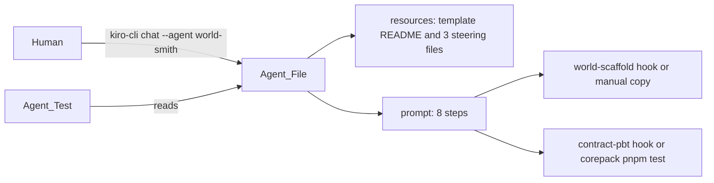

# Design Document: world-smith

## Overview

One JSON file, `.kiro/agents/world-smith.json`, plus one test file in the existing `integrations/kiro-hook` package. The format is the Kiro custom-agent format confirmed on kiro.dev/docs/custom-agents on 2026-11-18: `name`, `description`, `tools`, `excludedTools`, `includeMcpJson`, `includePowers`, `resources`, `permissions`, `prompt`, `welcomeMessage`. No code runs at agent time besides what Kiro runs.

The one design decision: permissions are an allow list of three command endings (`test`, `typecheck`, `lint`) with the prefix `corepack pnpm `. Everything else (deletes, git, installs) falls through to the normal approval and to `ghost-gate`.

## Architecture

## Components and Interfaces

### Agent_File fields

| Field | Value |
|---|---|
| `name` | `world-smith` |
| `description` | one sentence |
| `tools` | `["read", "write", "shell"]` |
| `excludedTools` | `["@kirocrew-work"]` |
| `includeMcpJson` | `false` |
| `includePowers` | `false` |
| `resources` | four `file://./...` entries (Requirement 2.1) |
| `permissions.rules` | shell allow rules ending in `test`, `typecheck`, `lint` |
| `prompt` | the eight steps, the hook-or-command fallback, and the limits |
| `welcomeMessage` | one line |
| `model` | absent (Auto) |

### Agent_Test

`integrations/kiro-hook/tests/agent-file.test.mjs` exports `validateAgentFile(text, exists)` that returns a list of error strings, and tests it on the real file, on negative examples, and runs `scanFiles` on the five files of this feature. It reads files only.

## Data Models

The Agent_File JSON only. Rule shape: `{ "capability": "shell", "match": ["..."], "effect": "allow" }`.

## Correctness Properties

No property-based test is claimed: the file is static data and the checks are example tests (Requirement 5.4 gives the negative examples). The agent adds no safety property; P1 to P8 stay claimed only where the world-contract steering claims them.

## Error Handling

- If the workspace is not trusted, Kiro does not load the agent. The README paragraph says so.
- If `kiro-cli` rejects a field, the CLI validation step (Requirement 1.3) shows it, and the file is changed to the accepted form.
- If a hook is disabled, the prompt tells the agent to run the same work by command.

## Testing Strategy

Vitest example tests in `integrations/kiro-hook` (no new dependency). One manual check at the end: `kiro-cli chat --agent world-smith` with a read-only question, recorded in `docs/measurements.md`.

## Requirement Traceability

| Requirement | Where |
|---|---|
| 1 | Agent_File, `kiro-cli agent validate`, Agent_Test |
| 2 | `resources`, Agent_Test |
| 3 | `tools`, `permissions`, `excludedTools`, Agent_Test |
| 4 | `prompt`, Agent_Test |
| 5 | Agent_Test |
| 6 | root README |

## Open Items

- The `match` syntax of permission rules (glob or prefix) is taken from the official example. The task 4 live call checks that an allowed command runs without a prompt and that a non-listed command asks.
- The name `@kirocrew-work` in `excludedTools` follows the MCP selector form from the docs; `includeMcpJson: false` is the main guard.
