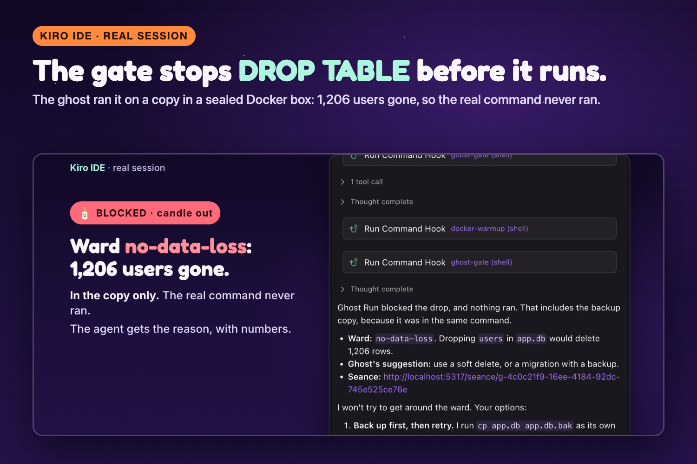
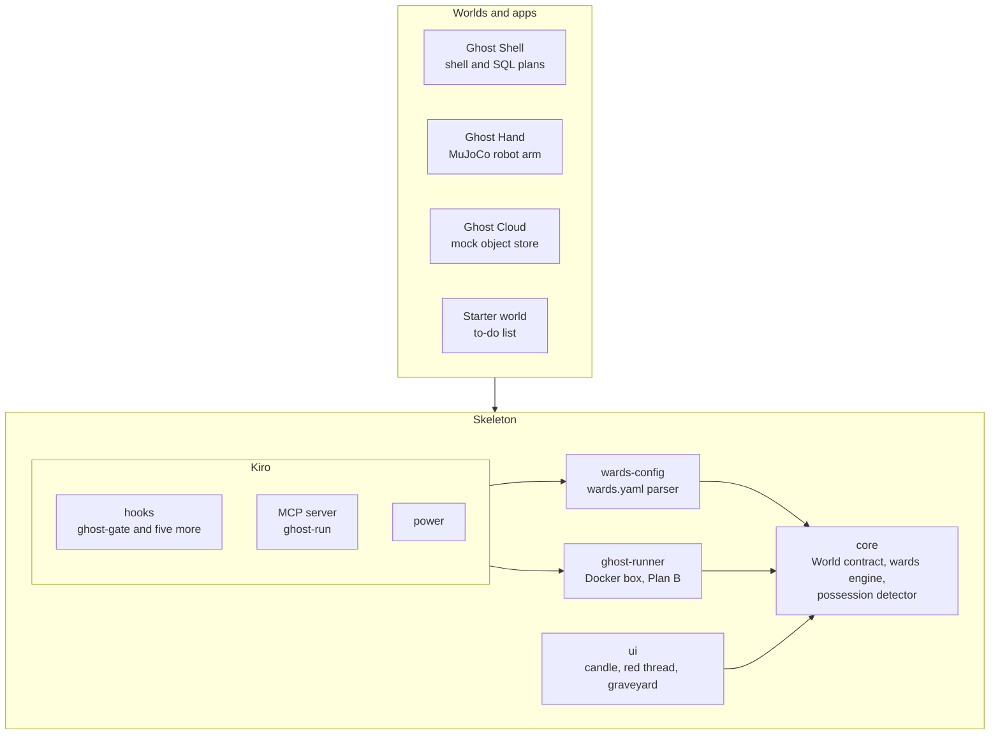
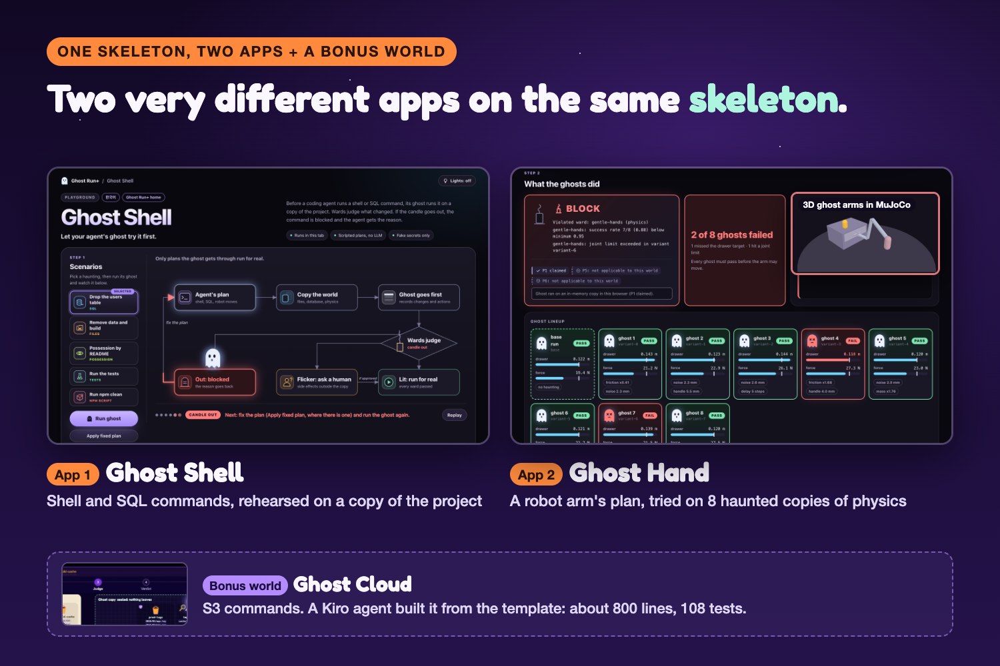

# Ghost Run+

Let your agent's ghost try it first.

**Links:** [live site](https://ghost-run-plus.pages.dev) | [demo video](https://youtu.be/kTymapHaAY4) | [Ghost Shell](https://ghost-run-plus.pages.dev/shell/) | [Ghost Hand](https://ghost-run-plus.pages.dev/hand/) | [UI kit](https://ghost-run-plus.pages.dev/kit/)



## What it is

Ghost Run+ lets an AI agent rehearse an irreversible action in a copy of the world before it runs for real. A "ghost" plays the agent's plan against a mirror world (a copy of the files, the database, or the physics scene). Declared guard rules, called wards and written in `wards.yaml`, judge the result, and the real action proceeds only if every ward passes. It addresses two failures: a plain mistake, such as an agent deleting a production database during a code freeze (reported publicly for a Replit agent in July 2025), and possession, where hidden instructions in a document the agent reads steer it. A blocked agent gets the ward id, the numbers, and a seance link, so it can fix the plan and try again.



How one run works: [docs/how-it-works.md](docs/how-it-works.md).

## Try it in one minute

Needs Node.js 20 or later and `corepack`. No browser, no Docker, no network at run time.

```
corepack pnpm install --frozen-lockfile
corepack pnpm --filter @ghost-run/world-starter demo
```

Expected output (exit code 0):

```
plan: clear
  blocked by ward keep-todos: the copy lost 3 to-dos
  real list unchanged: true (fingerprint ed34d2240ad1 before and after)
plan: remove 2
  blocked by ward keep-todos: the copy lost 1 to-do
  real list unchanged: true (fingerprint ed34d2240ad1 before and after)
plan: add "buy candles"
  passed: 1 action, the copy lost 0 to-dos
```

The demo runs three plans on a to-do list through the same calls the apps use. `worlds/starter/src/world.ts` (about 70 lines) is the smallest world: read it to see the six functions of `World<S, A>`.

### Change a rule

Open `worlds/starter/wards.yaml`. The ward protects every to-do:

```
    paths: ["todos/*"]
```

Protect only the first to-do instead:

```
    paths: ["todos/1"]
```

Run the demo again:

```
corepack pnpm --filter @ghost-run/world-starter demo
```

```
plan: clear
  blocked by ward keep-todos: the copy lost 3 to-dos
  real list unchanged: true (fingerprint ed34d2240ad1 before and after)
plan: remove 2
  passed: 1 action, the copy lost 1 to-do
plan: add "buy candles"
  passed: 1 action, the copy lost 0 to-dos
```

`remove 2` now passes, because to-do 2 is no longer protected. `clear` is still blocked, because it deletes to-do 1. Nothing else changed: the plans, the world, and the code are the same. Undo the edit to get the first output back. To try a rule without editing the file, save a copy and run `corepack pnpm --filter @ghost-run/world-starter demo --wards <file>`.

## Use it in your Kiro

- **This template, with enforcement.** Clone it, run `corepack pnpm install` and `corepack pnpm -r build`, build the box image (`corepack pnpm --filter @ghost-run/ghost-runner box:build`), open the folder in Kiro and trust it, run `corepack pnpm gate:on`, and start a new session. `gate:off` switches it off and `gate:status` prints the state.
- **An existing project, with enforcement.** Run the installer from this repository: `node <repository>/integrations/power/install-gate.mjs --project <your project>`. It copies a self-contained gate bundle to `<project>/.kiro/ghost-run/` and writes the hook files enabled. Re-run it with `--force` to repair a damaged install, and with `--uninstall` to remove it. See [integrations/power/README.md](integrations/power/README.md).
- **An existing project, advisory only.** Install the power (`kiro-cli powers install <repository>/integrations/power`) for the MCP tools and the skill. Nothing enforces a verdict there.

Three limits to know:

- **Trusted commands.** A `trusted_commands` list in `wards.yaml` lets listed commands pass without a rehearsal. Such a command runs whatever the project's scripts and config files contain. See [docs/wards.md](docs/wards.md#trusted-commands).
- **No Docker.** The gate falls back to static analysis (Plan B), asks for human approval, and does not claim P1 isolation.
- **Headless runs.** With `--trust-all-tools`, Kiro answers an `ask` itself, so a warned command runs. A blocked command is still blocked. Use `--trust-tools=@builtin` or narrower for unattended runs.

Details, including package-manager commands that cannot be rehearsed faithfully: [docs/kiro-integration.md](docs/kiro-integration.md).

## One skeleton, two apps

This repository is a Kiroween 2026 entry in the Skeleton Crew category: one reusable skeleton and two apps built on it.



| Part | Where | What it is |
|---|---|---|
| Skeleton | `core/` | World contract, ghost runner logic, wards engine, possession detector, blacklight |
| Skeleton | `wards-config/` | `wards.yaml` parser, validator, and printer |
| Skeleton | `ui/` | Shared screens: mirror world, candle, blacklight, red thread, graveyard, lights-on mode |
| Skeleton | `ghost-runner/` | Docker box runner, Repo_World, Plan B static analysis |
| Skeleton | `integrations/` | Kiro hooks (`kiro-hook/`), the `ghost-run` MCP server (`mcp/`), and the Kiro power (`power/`) |
| Skeleton | `.kiro/specs/_new-world/` | Fill-in spec template for a new world |
| Skeleton | `.kiro/agents/world-smith.json` | The `world-smith` agent, which builds a new world from that template |
| App 1 | `apps/ghost-shell/` with `worlds/playground-shell/` | Shell and SQL plans run against an in-memory project and an in-browser SQLite database |
| App 2 | `apps/ghost-hand/` with `worlds/drawer-arm/` | A browser MuJoCo robot arm tries a plan on 8 haunted variants before the "real" arm runs it |
| Starter world | `worlds/starter/` | The smallest world (a to-do list, about 70 lines in `src/world.ts`) with one `path` ward and a one-command demo. Start reading here |
| Third world (Ghost Cloud) | `worlds/ghost-cloud/` | The third world, built by the `world-smith` agent. It has no real mode and no screen of its own yet |

The two apps side by side:

| App | Folder | Live page | Run it locally |
|---|---|---|---|
| Ghost Shell | `apps/ghost-shell/` | https://ghost-run-plus.pages.dev/shell/ | `corepack pnpm --filter "@ghost-run/ghost-shell..." build` then `corepack pnpm --filter @ghost-run/ghost-shell preview` (`http://localhost:4173/`) |
| Ghost Hand | `apps/ghost-hand/` | https://ghost-run-plus.pages.dev/hand/ | `corepack pnpm --filter "@ghost-run/ghost-hand^..." build` then `corepack pnpm --filter @ghost-run/ghost-hand dev` (`http://localhost:5173/`) |

A new world implements the six functions of `World<S, A>` (`core/src/types.ts`) and inherits the ghost runner, the wards engine, the possession detector, and the UI kit. See [docs/build-a-world.md](docs/build-a-world.md).

## How it was built with Kiro

Counts come from the files (method in [docs/built-with-kiro.md](docs/built-with-kiro.md)):

- **Specs:** 14 specs with requirements, design, and tasks. 934 of 939 checklist items are checked, and the designs state 204 properties.
- **Steering:** 6 files in `.kiro/steering/` (product, structure, tech, security, world contract, UI style).
- **Hooks:** `ghost-gate` (Pre Tool Use), `ghost-log`, `contract-pbt`, `world-scaffold`, `blacklight-steering`, and `docker-warmup`. They are committed disabled; a human switches the gate on.
- **MCP server:** `ghost-run`, with the tools `ghost_run`, `ghost_diff`, `ghost_trace`, `wards_check`, and `blacklight`.
- **Power:** `integrations/power/`, with a skill and the bundled server.
- **Custom agent:** `world-smith` builds a new world from the spec template. It built Ghost Cloud.
- **Property-based tests:** the properties run with vitest and fast-check.

Some page designs were drafted with Claude Code; the list is in the same document.

## Measured

- **Full test run:** 4,831 tests passed, 11 skipped, 0 failed in 13 packages, in 877 s on an Apple M1 Mac with Docker (commit `c46d919`, 2026-11-26). Typecheck took 28 s and lint 12 s. [Check A](docs/measurements.md#check-a-at-c46d919-2026-11-26).
- **The gate on our own work:** the first gated Kiro CLI session asked for approval 21 times, and every first notice named the project's own folder. After two fixes, the next session had 13 asks that named the root until the runner was rebuilt and none after, and 9 asks from `corepack pnpm` network attempts in the box. [Devlog, 2026-11-25](docs/devlog.md#the-gate-on-our-own-work-task-191) and [measurements](docs/measurements.md#gate-switched-on-for-daily-use-task-191-2026-11-25).
- **Host checks:** exit codes and the `ask` prompt of the gate, checked in Kiro CLI 3.5.0 and Kiro IDE 1.4.236 and 1.5.11 (2026-11-21). `rm -rf data` was blocked by `protect-data` in both. [Host checks](docs/measurements.md#host-checks-before-enabling-the-gate-2026-11-21-kiro-cli-350-docker-2993).
- **Ghost Hand:** the plan `fast pull` is blocked (1 of 8 variants fails, 27.53 N peak force); the revised plan passes (0 of 8). A ghost run of 8 variants has a median of 308 ms in Chrome 157. [Ghost Hand numbers](docs/ghost-hand.md).

## Documentation

- [How a ghost run works](docs/how-it-works.md)
- [Quick start](docs/quick-start.md): install, run the apps, run every test, Ghost Hand from the terminal
- [Kiro integration](docs/kiro-integration.md): hooks, MCP server, power, install paths, limits
- [Build a world](docs/build-a-world.md): by hand, from the template, or with the `world-smith` agent
- [Ghost Shell](docs/ghost-shell.md) and [Ghost Hand](docs/ghost-hand.md): scenarios, claims, tested environments
- [Wards](docs/wards.md), [Possession detector](docs/possession.md), [Ghost runner](docs/ghost-runner.md), [UI kit](docs/ui-kit.md)
- [Landing site](docs/landing-site.md): build and deploy
- [Built with Kiro](docs/built-with-kiro.md): specs table, steering, hooks, who wrote what
- [Dependencies and data](docs/dependencies.md): every library, data file, asset, and license
- [Measurements](docs/measurements.md), [devlog](docs/devlog.md), and [research notes](docs/research.md)
- Package READMEs: [ghost-runner](ghost-runner/README.md), [ui](ui/README.md), [Ghost Shell app](apps/ghost-shell/README.md), [Ghost Hand app](apps/ghost-hand/README.md), [hooks](integrations/kiro-hook/README.md), [MCP server](integrations/mcp/README.md), [power](integrations/power/README.md)

## License

MIT, see [LICENSE](LICENSE). Licenses of the dependencies, data, and assets are listed in [docs/dependencies.md](docs/dependencies.md).
