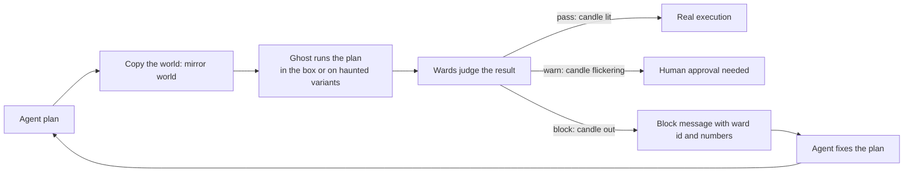

# Ghost Run+

Let your agent's ghost try it first.

**Live site:** https://ghost-run-plus.pages.dev: the landing page, [Ghost Shell](https://ghost-run-plus.pages.dev/shell/), [Ghost Hand](https://ghost-run-plus.pages.dev/hand/), and the [UI kit](https://ghost-run-plus.pages.dev/kit/).

## What it is

Ghost Run+ lets an AI agent rehearse an irreversible action in a copy of the world before it runs for real. A "ghost" plays the agent's plan against a mirror world (a copy of the files, the database, or the physics scene). Declared guard rules, called wards and written in `wards.yaml`, judge the result, and the real action proceeds only if every ward passes. It addresses two failures: a plain mistake, such as an agent deleting a production database during a code freeze (reported publicly for a Replit agent in July 2025), and possession, where hidden instructions in a document the agent reads steer it. A blocked agent gets the ward id, the numbers, and a seance link, so it can fix the plan and try again.

## Use it in your Kiro

- **Start from this template** (enforcement): clone the repository, run `corepack pnpm install` and `corepack pnpm -r build`, build the box image (`corepack pnpm --filter @ghost-run/ghost-runner box:build`), open the folder in Kiro and trust it, set `enabled` to `true` in `.kiro/hooks/ghost-gate.json` and `.kiro/hooks/docker-warmup.json`, and start a new session. The hooks are committed disabled. The gate depends on the workspace packages (`core`, `ghost-runner`, `wards-config`), so copying `integrations/kiro-hook/` into another project does not build.
- **In an existing project**: install the power for the advisory tools and the skill. In the Kiro Powers panel choose Add Custom Power and Import from folder, or run `kiro-cli powers install <repository>/integrations/power`. Nothing enforces a verdict there. See [integrations/power/README.md](integrations/power/README.md) for the workspace root rule, the default wards, and the box image.
- Full rehearsal needs Docker and the box image (`corepack pnpm --filter @ghost-run/ghost-runner box:build`).
- Without Docker the gate falls back to static analysis (Plan B) and asks for human approval. It does not claim P1 isolation in that mode.
- Docker Desktop's Resource Saver can stop its VM when idle. The gate retries once with a longer deadline, so a sleeping Docker is not mistaken for a missing one. See [integrations/kiro-hook/README.md](integrations/kiro-hook/README.md).

## One skeleton, two apps

This repository is a Kiroween 2026 entry in the Skeleton Crew category: one reusable skeleton and two apps built on it.

| Part | Where | What it is |
|---|---|---|
| Skeleton | `core/` | World contract, ghost runner logic, wards engine, possession detector, blacklight |
| Skeleton | `wards-config/` | `wards.yaml` parser, validator, and printer |
| Skeleton | `ui/` | Shared screens: mirror world, candle, blacklight, red thread, graveyard, lights-on mode |
| Skeleton | `ghost-runner/` | Docker box runner, Repo_World, Plan B static analysis |
| Skeleton | `integrations/` | Kiro hooks (`kiro-hook/`), the `ghost-run` MCP server (`mcp/`), and the Kiro power (`power/`) |
| Skeleton | `.kiro/specs/_new-world/` | Fill-in spec template for a new world |
| Skeleton | `.kiro/agents/world-smith.json` | The `world-smith` agent, which builds a new world from that template |
| App 1 | `apps/ghost-shell/` with `worlds/playground-shell/` | Shell and SQL plans run against an in-memory project and an in-browser SQLite database |
| App 2 | `apps/ghost-hand/` with `worlds/drawer-arm/` | A browser MuJoCo robot arm tries a plan on 8 haunted variants before the "real" arm runs it |
| Third world (Ghost Cloud) | `worlds/ghost-cloud/` | The third world, built by the `world-smith` agent. It has no real mode and no screen of its own yet |

A new world implements the six functions of `World<S, A>` (`core/src/types.ts`). Four are primary: `snapshot`, `step`, `diff`, and `render`. Two are auxiliary: `fingerprint` and `effectsOutside`. The world then inherits the ghost runner, the wards engine, the possession detector, and the UI kit. See "Build a world with the `world-smith` agent" and "Start a new world from the template" below.

## How a ghost run works



1. The agent proposes a plan.
2. The runner copies the real state (files, database, or physics scene). Reality is not touched.
3. The ghost runs the plan on the copy: inside a Docker box in real mode, or on the base world and the haunted variants in Ghost Hand.
4. The wards judge the changes and observed events.
5. The candle shows the verdict: `pass` (lit), `warn` (flickering, the host asks the human to allow or deny), or `block` (out).
6. On `pass` the real action runs. On `block` the agent receives the ward id, the numbers, and a seance link, fixes the plan, and rehearses again.

## Quick start

Tested on Node.js 20.20.2, macOS, Apple M1. Linux is supported and Windows is unverified.

Needed:

- Node.js 20 or later and `corepack` (every command below uses `corepack pnpm`; the pnpm version is pinned in `package.json`).
- Docker, only for the real-mode box. Without Docker the runner falls back to Plan B (static analysis only), which does not claim P1.
- Chrome, for Ghost Hand. Chrome 157 is the only tested browser.

Install:

```
corepack pnpm install --frozen-lockfile
```

Open Ghost Shell (static page, no server logic; serves `http://localhost:4173/`, and the Korean page at `http://localhost:4173/ko.html`):

```
corepack pnpm --filter @ghost-run/ghost-shell build
corepack pnpm --filter @ghost-run/ghost-shell preview
```

Open Ghost Hand (Vite dev server, `http://localhost:5173/`):

```
corepack pnpm --filter @ghost-run/ghost-hand dev
```

Both addresses are the Vite defaults; Vite picks another port when one is busy. Both commands were started and answered with HTTP 200 on 2026-11-18.

Run every test, one package at a time:

```
corepack pnpm test
```

The root `test`, `typecheck`, and `lint` scripts run the 10 packages one after another and keep going after a failure. Running them in parallel (`pnpm -r test`) made some time-limited tests fail under load. The full `corepack pnpm test` took 816.97 s (about 13 min 37 s) on 2026-11-18 on an Apple M1 Mac with Docker running, and all 10 packages passed; the Docker tests of `ghost-runner` take 657 s of that. Per-package numbers are at the end of `docs/measurements.md`. `corepack pnpm typecheck` took 21.9 s and `corepack pnpm lint` 8.3 s, both with exit code 0. One package alone: `corepack pnpm --filter @ghost-run/ui test`.

Build the Docker box image for real-mode runs:

```
corepack pnpm --filter @ghost-run/ghost-runner box:build
```

The image tag carries a hash of the box files. With the image already built, the command finished in 2.4 s. The first build downloads Debian packages and needs network access. Details are in [ghost-runner/README.md](ghost-runner/README.md).

Run Ghost Hand from the terminal with `ghost-hand-run`:

```
corepack pnpm --filter @ghost-run/ghost-hand build:node
cd apps/ghost-hand
node dist-node/cli.js plans/first.plan.json --wards ../../worlds/drawer-arm/wards.yaml
node dist-node/cli.js plans/revised.plan.json --wards ../../worlds/drawer-arm/wards.yaml
node dist-node/cli.js validate plans/revised.plan.json
```

The first plan prints `GHOST RUN BLOCKED by ward gentle-hands` and exits with code 2. The revised plan prints `GHOST RUN PASSED: all 1 ward cleared.` and exits with code 0. `validate` exits with 0 for a valid plan file and 65 for an invalid one.

## Landing site

The landing page lives in `site/` (`@ghost-run/site`). Source: [site/](https://github.com/SungHyunC/ghost-run/tree/main/site) in the repository https://github.com/SungHyunC/ghost-run. It is deployed at https://ghost-run-plus.pages.dev (Cloudflare Pages, free plan). The deploy is a direct upload of `site/dist/` with `npx wrangler pages deploy site/dist --project-name ghost-run-plus --branch main`. Cloudflare Pages applies the root `_headers` file. One behavior to know: it redirects `/shell/ko.html` to `/shell/ko`.

Build it from the repository root:

```
corepack pnpm build:site
```

The command builds the three apps and the kit, assembles the result into `site/dist/`, and runs the site check. `site/dist/` holds the landing page at `/`, Ghost Shell at `/shell/`, Ghost Hand at `/hand/`, the kit showcase at `/kit/` and the kit gallery at `/kit/gallery/`.

The walkthrough in section 3 runs live in the browser with the same engines as the apps: Ghost Shell and Ghost Cloud run in the page (SQLite through `sql.js` in a Web Worker), and Ghost Hand runs the MuJoCo simulation in a worker. The Ghost Hand engine (about 11 MB of WebAssembly) loads only when Ghost Hand is picked, and a browser that cannot run the engines shows the recorded runs. Reality is a drawn copy that no run changes, and nothing leaves the page. Details and sizes: `docs/measurements.md`, section "Live walkthrough measurements".

The landing page at `/` has five pages with the hashes `#cover`, `#recipe`, `#costumes`, `#run`, and `#make`. `/kit/` is a showcase of the real UI kit, rendered with the gallery's sample data. The developer gallery is at `/kit/gallery/`.

## Ghost Shell

Ghost Shell (`apps/ghost-shell/`, with the world in `worlds/playground-shell/`) is a static web page: no server, no API key, and no runtime LLM call. A ghost runs a plan against an in-memory virtual project (an in-memory file system and an SQLite database in `sql.js`). The page shows the mirror world, the candle, the claims for the run, the message the agent would receive, and the graveyard. It runs no real command and touches no real file. You can also load your own plan file and edit `wards.yaml` in the page.

The page has a Korean version, `ko.html`, linked from the English page. It translates the page's own words; the ui kit parts (the candle, the claims, the mirror table, the blacklight, the red thread, and the graveyard), the ward reasons, and the message the agent receives stay in English.

Five scenarios are bundled:

| # | Scenario | Result |
|---|---|---|
| 1 | Drop the users table | `block` by `no-data-loss` ("would delete 1,206 rows from users"); the fixed plan passes |
| 2 | Remove data and build | `block` by `protect-data`, one violation per deleted path under `data/`; the fixed plan passes |
| 3 | Possession by README | `block` by `no-secret-egress`: the plan reads `.env` and then makes a network attempt to `setup-check.example:443`, which is caught by behavior and by content. The page shows the red thread to the hidden text and the blacklight |
| 4 | Run the tests | `pass`, with no change, no event, and no notice |
| 5 | Run npm clean | `block` by `protect-data` (the script runs `rm -rf data`) |

Claims, in short (the full table and limits are in [apps/ghost-shell/README.md](apps/ghost-shell/README.md)):

- P1, P2, and P3 are claimed for the in-memory playground world only. P2 means that the diff equals an independent derivation from the action journal. It is not a test of fidelity to a real shell.
- P5 and P6 are claimed where P1 holds for the run and no step was unsupported.
- Nothing is claimed for the Docker box or for Plan B on this page. The page lowers a claim in the UI when its scope does not hold.
- Text analysis does not catch every injection. The possession scenario uses a fake canary value and a reserved example domain only.

## Ghost Hand

Ghost Hand (`apps/ghost-hand/`, with the world in `worlds/drawer-arm/`) is a browser page. A MuJoCo robot arm (WebAssembly) tries a plan on a base copy of a drawer scene and on 8 haunted variants (perturbed friction, mass, handle offset, sensor noise, and command delay) before the "real" arm runs the plan. The page draws a 3D ghost-arm overlay with Three.js. The `ghost-hand-run` command (`dist-node/cli.js`) runs the same pipeline from the terminal.

### What the "real" arm is

The "real" arm is a reference simulation run by the same MuJoCo engine. No physical robot is involved, and nothing here claims anything for physical hardware.

### Claims

| Property | Claimed where | Not claimed |
|---|---|---|
| P1 (a ghost run leaves reality unchanged) | Per run, for the in-memory page world: the page shows the claim only when the fingerprints before and after the run are equal. | Physical hardware, and any run whose fingerprints differ. |
| P2 (the ghost result equals the reference execution) | The base ghost run against the reference execution, within the Tested_Environments. Scope wording: "On the same build and in the tested environments, the ghost run's result equals the reference simulation run's result. Not claimed for physical hardware." The page shows this text only when the Determinism_Self_Check passed. | Physical hardware, other browsers, other machines. |
| P3 (restoring a snapshot returns the exact pre-snapshot state; the trajectory after it also matches) | All worlds, including this one. | Nowhere. |
| P4 (a stricter ward never lets more plans pass) | Evidence from `core` (wards engine logic). Ghost Hand adds no ward engine of its own. | Nowhere. |
| P5, P6 | Not claimed. The page shows "not applicable" for both. | Always: the world has no protected path and no secret file. |
| P8 (same seed and same plan give identical variant outcomes) | Within the Tested_Environments only. | Any other environment. |

The joint-limit and self-collision ward, the message without the lowered-claim line, and the "not applicable" banner for P5 and P6 are available because the prerequisites PR-1, PR-2, and PR-3 landed (state checked on 2026-11-18, see `docs/measurements.md`, section "Prerequisite landing state (18.3)").

### Plan revision: recorded or scripted

Plan revision in the page is a replay. The page does not call an LLM. It replays a Plan_File of `origin: "recorded"` (written by a Kiro session) or of `origin: "scripted"` (written by hand), and it states which one it shows.

The shipped revised plan `apps/ghost-hand/plans/revised.plan.json` has `origin: "recorded"`. A Kiro CLI session decided its values: it ran the first plan, read the block message, and chose the numbers from that message, the Wards_File, and the declared ranges (`recordedWith`: "Kiro CLI 3.4.0, model Auto, 2026-11-18"). The page replays the file and says so with the text "Recorded plan: replayed here, not decided by an LLM in this page." The first plan, `plans/first.plan.json`, stays `origin: "scripted"`. The attempts and the messages of the recording are in `docs/measurements.md`, section "Plan revision recording".

How to record a revision (design decision D18):

1. Run `ghost-hand-run plans/first.plan.json --wards ../../worlds/drawer-arm/wards.yaml` (from `apps/ghost-hand`, after `corepack pnpm --filter @ghost-run/ghost-hand build:node`) and read the block message. The exit code is 2 for a blocked plan.
2. Write the revised Plan_File with `origin: "recorded"`, `revisionOf` (the name of the first plan), and `recordedWith` (the tool and version that decided the revision, at most 120 characters).
3. Run `ghost-hand-run validate <revised plan>`. It exits 0 for a valid file and 65 for an invalid one.
4. Run `ghost-hand-run <revised plan> --wards ...` again. Exit code 0 means pass.

### Tested environments and platforms

- Tested_Environments: Node.js 20.20.2 and Chrome 157 (157.0.8103.79) on an Apple M1 Mac (macOS). Firefox, Safari, Linux, and x86 machines were not tested.
- The Determinism_Self_Check runs in the page and reproduces the reference trajectory hash. It is a measurement in one browser on one machine, not a proof. If it fails, the page shows no P2 or P8 claim.
- The `deterministic: true` flag of `worlds/drawer-arm/world.config.ts` is limited to the Tested_Environments.
- macOS and Linux are the supported platforms for the commands. Windows is unverified. Chrome 157 is the only tested browser.
- Hosting: the page uses the single-thread MuJoCo build and Web Workers. It needs no `SharedArrayBuffer` and no special response headers (no COOP or COEP). It runs on any static host.

### MuJoCo pitfalls

Measured details are in `docs/measurements.md`, section "Probe results".

- Set the model memory size explicitly (`<size memory="1M"/>` in the scene). Without it each `MjData` takes about 13.6 MB, and the WebAssembly heap grows by about 14 MB per object.
- Typed-array views over the WebAssembly memory become empty (length 0) when the memory grows. Read a view fresh at every use and copy it at once. Never keep one across a call.
- The README of `@mujoco/mujoco` deviates from the actual API: `DoubleBuffer` takes an element count, not an array (use `DoubleBuffer.FromArray`); the view accessor is `GetView()`, not `getView()`; and a plain `Float64Array` passed as an output parameter is accepted but never written.
- Call `.delete()` on every wrapped object you construct, and never on the non-owning accessors `data.warning`, `data.solver`, and `data.timer` (that aborts the module).

### Variants of the shipped seed

The shipped seed is 42 and the default count is 8 (`worlds/drawer-arm/variant-config.json`). The configuration allows up to 20 variants, but the page limits the count to the default of 8 while `largeCountEnabled` is `false`. These values were read from a run of the pipeline on 2026-11-18 (Node.js 20.20.2, Apple M1 Mac, `@mujoco/mujoco` 4.0.1).

| Variant | drawerFrictionN | drawerMassKg | handleOffsetM (x, y, z) | sensorNoiseM | commandDelaySteps |
|---|---|---|---|---|---|
| variant-0 | 0.821 | 1.187 | 0.0036, 0.0012, 0.0022 | 0.0023 | 2 |
| variant-1 | 1.870 | 0.607 | 0.0022, -0.0012, -0.0049 | 0.0023 | 3 |
| variant-2 | 0.926 | 1.075 | 0.0015, 0.0012, -0.0048 | 0.0026 | 5 |
| variant-3 | 3.355 | 0.599 | 0.0032, -0.0010, -0.0023 | 0.0002 | 2 |
| variant-4 | 3.267 | 1.059 | 0.0017, 0.0000, 0.0020 | 0.0020 | 3 |
| variant-5 | 1.893 | 0.862 | -0.0018, -0.0014, 0.0025 | 0.0016 | 3 |
| variant-6 | 0.602 | 0.516 | 0.0001, 0.0007, -0.0013 | 0.0004 | 4 |
| variant-7 | 1.932 | 0.397 | 0.0013, -0.0004, -0.0020 | 0.0018 | 0 |

### Measured numbers of the demo runs

All numbers below were measured on 2026-11-18 on an Apple M1 Mac (macOS). Plan results and timing: Node.js 20.20.2, seed 42, 8 variants, the shipped `wards.yaml` (ward `gentle-hands`: success rate at least 0.95, contact force at most 30 N, no contact with the vase). Browser numbers: Chrome 157.0.8103.79, headless, real time. The machine was not idle, so timings are indicative. The full records are in `docs/measurements.md`.

| Plan | Verdict | Variants with success:false | Max contact force | Base_World drawer opening |
|---|---|---|---|---|
| `fast pull` | block (ward `gentle-hands`) | 1 of 8 | 27.53 N (limit 30 N) | 0.1216 m (target 0.12 m) |
| `slow pull, gentle grip` (recorded) | pass | 0 of 8 | 29.24 N (limit 30 N) | 0.1276 m (target 0.12 m) |

Browser timings (the page-ready number is of the test harness page, not of the app page, which also runs the Determinism_Self_Check; the 3D overlay number is of the real overlay renderer):

| Check | Measured (2026-11-18, Chrome 157.0.8103.79, Apple M1 Mac) |
|---|---|
| Page ready (harness page, 3 loads) | 368 ms first load, 241 ms and 281 ms warm loads |
| Ghost run, 8 variants, 5 runs | median 308 ms, maximum 313 ms |
| Ghost run, 20 variants, 3 runs | median 518 ms, maximum 553 ms |
| 3D overlay frame time, 8 ghost arms | median frame interval 16.7 ms (the 60 Hz vsync period), median render call 0.7 ms |
| 3D overlay frame time, 20 ghost arms | median frame interval 16.7 ms, median render call 0.6 ms |

A second browser run under higher machine load gave a median of 414 ms for 8 variants and 557 ms for 20 variants. The frame interval shows no dropped frame in 300 samples; it gives no headroom below 16.7 ms, and headless Chrome has no visible window.

Trajectory_Hash of the reference plan (`reference-plan-v1`, Base_World), measured on 2026-11-18: the hash from Chrome 157 on the main thread and in a Web Worker equals the hash from Node.js 20.20.2 (each context run twice). The stored golden hash is `2cf8283de204eae50fbc4db3660e57d6b19b799cbc557ad31af56ba14e191d9f`. This holds for the Tested_Environments only.

Run time of `verifyWorld` on the drawer-arm world (2026-11-18, Node.js 20.20.2, Apple M1 Mac): 35 examples took 6040 ms in the budget measurement. The contract test took 12.8 s to 14.0 s for both calls over several runs. The save-time budget is 60 s.

### Licenses and assets

The Ghost Hand rows are in the table of the section "Dependencies and data". The build writes `dist/THIRD_PARTY_NOTICES.txt` (`corepack pnpm --filter @ghost-run/ghost-hand build`, or `notices` alone). It is generated from `apps/ghost-hand/notices/sources.json` and the upstream license texts in `apps/ghost-hand/notices/`. It lists MuJoCo, Qhull, TinyXML-2, tinyobjloader, libccd, miniz, and lodepng (bundled in `mujoco.wasm`), plus react, react-dom, scheduler, and three. `@mujoco/mujoco` 4.0.1 declares Apache-2.0 in its `package.json`, but its tarball has no LICENSE file, so the MuJoCo license text comes from the upstream repository at tag 4.0.1.

Assets: the page uses only primitive Three.js shapes and system fonts. It has no image, no font file, no icon file, and no audio. The shared UI kit draws its icons as original SVG paths (MIT, this repository). The scene is written as MJCF text in `worlds/drawer-arm/src/engine/` with no mesh file.

## Possession detector

The possession detector (`core/src/possession/`, plus the Node file helpers in `core/possession-node.ts`) scans text for hidden characters that can carry instructions an agent should not obey. The scanner is a pure function.

### Claim (P7)

Text that contains a hidden code point of the categories `tag`, `zero-width`, or `bidi` is always flagged, and ordinary text is never flagged. Ordinary text includes the England, Scotland, and Wales flag emoji, whose tag characters are allowed only as a standard RGI tag sequence. This claim applies everywhere, because the scanner is a pure function.

### Additional markdown category

HTML comment detection is an additional category. It applies only where the `markdown` option is `true`. It is not part of the P7 negative direction.

### What the detector does not do

- Text analysis does not catch every injection. A malicious instruction written in plain visible words is not found by this detector.
- The action-based criterion (a secret file read followed by an unapproved network attempt produces `block`) is owned by the `wards` spec as P6. The possession detector does not assert P6.
- Invisible characters outside the categories above are not detected. Examples are U+115F, U+3164, and look-alike letters (homoglyphs) from other scripts.
- The red thread is a lookup for a literal occurrence. An address that the agent built from several pieces, encoded, compressed, or encrypted does not produce a `found` link. The red thread is not a verdict input: a `not-found` link never changes a `pass`, `warn`, or `block` verdict.
- Input size is not limited by the detector. The caller should cap the size of untrusted large input before scanning it.

### Unicode data

The emoji and tag-sequence rules use numeric tables generated from Unicode 16.0.0 data (Emoji 16.0). The tables are pinned to that version. To regenerate them, run `corepack pnpm --filter @ghost-run/core gen:emoji`. The source URLs and SHA-256 hashes are pinned in `core/scripts/emoji-data.pin.json`.

## Wards

Wards are the declared guard rules that judge a ghost run. They live in `wards.yaml` and are judged by the pure modules in `core/src/judge/` and the engine in `core/src/wards.ts`. The parser, validator, and printer are in the separate package `@ghost-run/wards-config`. The verdict is `pass` (candle lit), `warn` (candle flickering), or `block` (candle out).

### Default wards file

The default file is `apps/ghost-shell/wards.yaml`. It holds three wards: `protect-data` (`path`), `no-data-loss` (`sql`), and `no-secret-egress` (`egress`). The repo world uses this file instead of the per-world `worlds/<name>/wards.yaml` described in the world contract.

The file also has a top-level `safe_commands` list: `ls`, `pwd`, `cat`, `git status`, `git diff`. `wards-config` parses, validates, and prints the list for the `ghost-gate` hook. The matching rules for these commands are owned by the kiro-integration spec, not by the wards spec. The list is not a ward and does not change any verdict computed by the engine.

### Claims

| Property | Claimed where | Not claimed |
|---|---|---|
| P4 (a stricter ward never lets more plans pass) | All worlds. It is pure logic in the wards engine. | Nowhere. |
| P5 (a plan that deletes or overwrites a protected path produces `block`) | Where P1 holds: the playground and real mode with the Docker box. | Plan B (`static-analysis`), where no ghost run takes place. |
| P6 (a secret read followed by an unapproved network attempt produces `block`) | Where network attempts are recorded: the playground and real mode with the Docker box. | Plan B (`static-analysis`), and steps the playground cannot rehearse. |

When P5 or P6 is not claimed for a run, the message builder adds this line to every verdict kind (`CLAIM_LOWERED_LINE`):

> P5 and P6 protections are NOT guaranteed for this run: no ghost rehearsal took place (static analysis only).

When some steps could not be rehearsed in the playground, it adds `CLAIM_LOWERED_UNSUPPORTED_STEP_LINE` instead. Worlds where P5 and P6 do not apply, such as Ghost Hand, pass no claims and get no line.

### Path policies

- **Case policy.** Path wards match paths without regard to letter case by default. The reason is that APFS, the default file system on macOS, is case-insensitive, so `./DATA` and `./data` are the same directory there. Matching too much fails safe: a plan is blocked rather than let through. The cost is a possible false positive on Linux, where `DATA` and `data` can be different directories. A `path` ward can set `case_sensitive: true` to opt out. Case folding is one code point to one code point and is applied after Unicode normalization (NFC).
- **Symbolic links and moves.** P5 holds for symbolic links and moves only under this precondition: the world reports the actual resolved paths in its changes, and the Differ walks the copy with `lstat` so that it sees links as links and does not follow them. The judge itself never touches the file system. If a world does not meet the precondition, P5 is not claimed for symbolic links and moves in that world.
- **Paths outside the copy.** A path that escapes the copy root with a leading `..` matches no ward. It produces a `path-escape` notice instead, so a human can review it.

### What content inspection does not catch

The egress ward inspects request payloads for the values of secret files in raw form and in base64, base64url, hex, and percent encodings. It does not catch these cases:

- compression of the payload;
- encryption of the payload;
- multi-layer encodings, such as base64 of hex;
- a secret split over several requests;
- a secret sent one character at a time, for example through DNS lookups;
- secret values shorter than 8 bytes;
- payload bytes beyond the first 64 KiB (65,536 bytes) of each payload.

Only the behavior criterion catches these cases: a network attempt to a host that is not in `allow_hosts` after a secret file was read produces `block`, whatever the payload contains. Content inspection is an addition to that criterion. It does not replace it. It catches a secret sent to an allowed host, which the behavior criterion permits.

### Limits of the tools

- **`isMoreRestrictive` is sound but not complete.** When it returns `true`, the second ward set really does let through no more plans than the first. When it returns `false`, the second set may still be stricter. It compares sets of patterns by string containment, so these pairs can return `false` even though the second set is stricter: `data/**` against `data/**` plus `data/x`, `*.example.test` against `a.example.test`, and a host entry with a port against the same entry without a port.
- **`printWards` does not preserve comments.** It writes a canonical form of the ward set, so comments in an edited `wards.yaml` are lost when the file is printed again. Keep the explanations in the file you edit by hand and treat printed output as generated.
- **Entry points.** The default entry of `@ghost-run/wards-config` imports no Node built-in, so a browser can parse `wards.yaml`. Reading a file from disk is available only from `@ghost-run/wards-config/node`.
- **Test values.** Examples and tests use fake canary values such as `sk-CANARY-abc123` and reserved domains such as `setup-check.example`. `registry.npmjs.org` appears only as the `allow_hosts` example in the default file.

## Ghost runner

`@ghost-run/ghost-runner` (`ghost-runner/`) rehearses a shell plan against a Copy of a directory inside a sealed Docker box (`--network none`, copy-only mount) and returns the changes and observed events for the wards to judge. Usage, the box build, the run id, cleanup, and the license table are in [ghost-runner/README.md](ghost-runner/README.md).

- **P1, P5, and P6** are claimed only for runs in the Docker box. P6 additionally needs the recorder to see network attempts.
- **Plan B.** When Docker or the box image is unavailable, nothing runs on the host and only static analysis is done. P1, P5, and P6 are not claimed, and the run says so: `P1 isolation is NOT guaranteed: Docker box unavailable, static analysis only.`
- The in-box recorder reports `tamperResistant: false`.
- Supported on macOS and Linux. Windows is unverified.

## UI kit

`@ghost-run/ui` (`ui/`) draws the mirror world, candle, blacklight, red thread, graveyard, and lights-on theme from data that `core` already produced. It computes no verdict, diff, or finding. It asserts none of P1 to P8 and shows only the claim flags it receives. Its render properties are named UI-P1 to UI-P11. A Plan B run never shows a P1 claim. Commands, the dependency table, and the asset table are in [ui/README.md](ui/README.md).

### Secret-like key rule

The Mirror world hides the value of any field whose key name contains `secret`, `token`, `password`, `passwd`, `apikey`, `api_key`, `authorization`, `cookie`, `credential`, `private_key`, or `session`, ignoring letter case, and shows `[hidden: secret-like field]` instead. This is a heuristic. It matches key names by case-insensitive containment and never inspects values. It can miss a secret under an innocent key name (for example `pwd`, or `privateKey`, which does not contain `private_key`), and it can hide a harmless value (for example `session_count`). It does not detect a secret typed into a command string or any other displayed text. The producer of the changes and scenes remains responsible for redaction.

## Kiro integration

Ghost Run+ plugs into Kiro (IDE and CLI) with five hooks, one MCP server, and one power. Details, claims, and limits are in the READMEs of each part:

- [`integrations/kiro-hook/`](integrations/kiro-hook/README.md): the hooks `ghost-gate` (Pre Tool Use), `ghost-log` (Post Tool Use), `contract-pbt`, `world-scaffold`, and `blacklight-steering`. The note on [cross-call exfiltration](integrations/kiro-hook/docs/cross-call-exfiltration.md) states what the records can and cannot do.
- [`integrations/mcp/`](integrations/mcp/README.md): the advisory MCP server `ghost-run` with the tools `ghost_run`, `ghost_diff`, `ghost_trace`, `wards_check`, and `blacklight`.
- [`integrations/power/`](integrations/power/README.md): the Kiro power (plugin file, skill, and a bundled server). It gives the advisory tools and the skill, not the enforcing gate.

- **P1 is claimed per run, never as a property of a hook.** The gate and `ghost_run` repeat the flags `p1Claimed`, `p5Claimed`, and `p6Claimed` of the run they report, and claim nothing when the flag is `false`.
- **Plan B.** Without Docker and the built box image the run is static analysis only. P1, P5, and P6 are not claimed, the message says `P1 isolation is NOT guaranteed`, and the verdict is at least `warn`.
- **A seatbelt, not full isolation.** A `pass` is not an approval of the real command, text analysis does not catch every injection, and the hooks are not tamper-resistant against a process with the developer's privileges. P6 holds within one tool call only.
- **State.** Every hook file in `.kiro/hooks/` is disabled except the probe hook. The gate is switched on by a human after a checklist. Facts measured only in the Kiro CLI are marked "pending (task 1.4)" for the IDE.
- Supported on macOS and Linux. Windows is unverified.

### Build a world with the `world-smith` agent

`.kiro/agents/world-smith.json` is a workspace custom agent that follows the steps above for you. Trust the workspace, then start it in the CLI with `kiro-cli chat --agent world-smith` (the IDE lists it in the agent picker). The file uses the V3 format, so a non-interactive call needs `--agent-engine v3`. It asks for the world name, copies the template, writes the world spec one file at a time for your approval, implements the six functions in `worlds/<world-name>/`, registers the world, and runs the `verifyWorld` gate and the wards. It uses the `world-scaffold` and `contract-pbt` hooks when they are enabled and runs the same work by command when they are not. It runs only `corepack pnpm --filter ... test`, `typecheck`, and `lint` without asking, uses no Kiro Crew tools, Powers, or MCP servers from your config, leaves the model on Auto, and changes nothing outside the new spec folder and `worlds/<world-name>/`. It does not replace the gate: deletes and other commands still need your approval or `ghost-gate`.

### Start a new world from the template

`.kiro/specs/_new-world/` is a fill-in template for the three spec files of a new world (the six `World<S, A>` functions, the `verifyWorld` registration gate, the registration file, the wards, the claim-scope table, and the hygiene rules). It is not a real spec and has no `.config.kiro`.

1. Copy it: `cp -r .kiro/specs/_new-world .kiro/specs/<world-name>`.
2. Remove the copied `README.md`, replace every `<placeholder>`, `Fill in:` line, and `TBD`, and delete the "Template notice" block of each file.
3. Ask Kiro to run the tasks of the copy. When the agent creates a file in `worlds/<world-name>/`, the `world-scaffold` hook adds `world.config.ts`, `tests/contract.test.ts`, `wards.yaml`, and `README.md`; each save in `worlds/` then runs the `contract-pbt` hook within its 60 s limit (both hooks must be enabled).

## Built with Kiro

Everything below is in this repository. Counts were taken from the files on 2026-11-18.

**Specs** (`.kiro/specs/<name>/` with `requirements.md`, `design.md`, and `tasks.md`). "Tasks" is the number of checked items out of all checklist items in `tasks.md`. "Properties" is the number of `### Property` headings in `design.md`.

| Spec | What it decided | Tasks | Properties |
|---|---|---|---|
| `core-contract` | The `World<S, A>` contract with six functions and the safety contract | 15 of 15 | 8 |
| `possession` | The blacklight scan for hidden Unicode, the red thread, and the P7 claim | 65 of 65 | 22 |
| `wards` | The judging rules, the `wards.yaml` format, the parser in `wards-config`, and the block message | 64 of 64 | 17 |
| `ghost-runner` | The Docker box (`--network none`, copy-only mount), Repo_World, and Plan B | 97 of 97 | 22 |
| `ui-kit` | The shared screens and their render properties | 87 of 87 | 11 |
| `kiro-integration` | The five hooks, the MCP server, and the power | 94 of 98 | 21 |
| `ghost-shell` | App 1: the playground page and the playground world | 79 of 80 | 26 |
| `ghost-hand` | App 2: the MuJoCo arm page, the drawer-arm world, and the 8 haunted variants | 103 of 105 | 23 |
| `world-smith` | The `world-smith` agent | 9 of 9 | none |

`.kiro/specs/_new-world/` is the fill-in template for a new world, not a real spec, so it has no counts. The unchecked tasks are still open.

**Steering** (`.kiro/steering/`): `product.md`, `structure.md`, `tech.md`, `security.md`, `world-contract.md`, and `halloween-ui.md`. The `halloween-ui.md` file applies only to `ui/**` and `apps/**`.

**Hooks** (`.kiro/hooks/`, state as committed):

| Hook | Trigger | State |
|---|---|---|
| `ghost-gate` | Pre Tool Use (`shell`, `write`) | disabled |
| `ghost-log` | Post Tool Use | disabled |
| `contract-pbt` | File Save in `core/**` and `worlds/**` | disabled |
| `world-scaffold` | File Create in `worlds/*/` | disabled |
| `blacklight-steering` | File Save in `.kiro/**` | disabled |
| Probe hooks (`probe-host-facts.json`) | Record host facts of tool events | enabled |

The files `exp-b-block-rm-rf.json`, `exp-b-log-write.json`, and `probe-ask.json` are experiment hooks and are disabled. The scripts are in `integrations/kiro-hook/`. The gate is switched on by a human, as described under "Kiro integration".

**MCP server**: `integrations/mcp/` is the stdio server `ghost-run` with the tools `ghost_run`, `ghost_diff`, `ghost_trace`, `wards_check`, and `blacklight`.

**Power**: `integrations/power/` has `plugin.json`, the skill `skills/ghost-run/SKILL.md`, and `mcp.json` for the bundled server.

**Custom agent**: `.kiro/agents/world-smith.json` (see "Build a world with the `world-smith` agent").

**Property-based tests**: the properties of the table above are tested with vitest and fast-check. The safety contract properties P1 to P8 are defined in `.kiro/steering/world-contract.md`.

**Plan revision recorded with the Kiro CLI**: the revised Ghost Hand plan `apps/ghost-hand/plans/revised.plan.json` was decided by a Kiro CLI 3.4.0 session (model Auto, 2026-11-18). It ran the first plan, read the block message, and chose the grasp force and pull values over several attempts. The attempts and messages are in `docs/measurements.md`, section "Plan revision recording".

**Not written by Kiro**: the Ghost Shell page design was written with Claude Code on 2026-11-20 at the owner's request: the hero, the animated ghost flow (`apps/ghost-shell/src/flow/`), the mirror stage picture of reality and the ghost copy (`apps/ghost-shell/src/stage/`), the Korean page (`apps/ghost-shell/ko.html`, `apps/ghost-shell/src/i18n/`), the scenario cards, the page texts in `apps/ghost-shell/src/page-texts.ts`, the stylesheet `apps/ghost-shell/src/page.css`, and their tests. The judging pipeline, the playground world, the ui kit components, and every spec, hook, and steering file stay as Kiro wrote them. The Ghost Hand page design was also written with Claude Code on 2026-11-20 at the owner's request: the layout, the scenario rail, the ghost lineup (`apps/ghost-hand/src/components/GhostLineup.tsx`), the angled camera preset, and the stylesheet `apps/ghost-hand/src/page.css`; the drawer-arm world, the pipeline, and the claim texts stay as Kiro wrote them. The landing page design draft (mockup) was made by Claude Code, and Kiro built the page from it. The live-walkthrough mockup (v5) was made by Claude Code; Kiro built it. The paged landing mockup (v6) and the kit showcase mockup were made by Claude Code; Kiro built them.

## Dependencies and data

| Name | Version | Use | License |
|---|---|---|---|
| Unicode `emoji-data.txt` (Extended_Pictographic) | 16.0.0 (Emoji 16.0) | Source for generated numeric tables. URL: https://www.unicode.org/Public/16.0.0/ucd/emoji/emoji-data.txt | Unicode License v3 (Unicode-3.0), https://www.unicode.org/license.txt |
| Unicode `emoji-sequences.txt` (RGI_Emoji_Tag_Sequence) | 16.0.0 (Emoji 16.0) | Source for generated numeric tables. URL: https://www.unicode.org/Public/emoji/16.0/emoji-sequences.txt | Unicode License v3 (Unicode-3.0), https://www.unicode.org/license.txt |
| fast-check | 4.10.2 | Dev dependency, property-based tests | MIT |
| vitest | 3.2.7 | Dev dependency, test runner | MIT |
| typescript | 5.9.3 | Dev dependency, compiler | Apache-2.0 |
| @types/node | 20.19.43 | Dev dependency, Node type definitions | MIT |
| @mujoco/mujoco | 4.0.1 | Runtime dependency of `apps/ghost-hand` and `worlds/drawer-arm`, MuJoCo physics (WebAssembly) | Apache-2.0 (`package.json` license field; the tarball has no LICENSE file) |
| three | 0.187.0 | Runtime dependency of `apps/ghost-hand`, 3D ghost-arm overlay | MIT |
| react | 19.3.1 | Runtime dependency of `apps/ghost-hand`, UI | MIT |
| react-dom | 19.3.1 | Runtime dependency of `apps/ghost-hand`, UI | MIT |
| @types/three | 0.187.0 | Dev dependency of `apps/ghost-hand`, three type definitions | MIT |
| @types/react | 19.3.0 | Dev dependency of `apps/ghost-hand`, React type definitions | MIT |
| @types/react-dom | 19.3.0 | Dev dependency of `apps/ghost-hand`, React DOM type definitions | MIT |
| @testing-library/react | 16.3.3 | Dev dependency of `apps/ghost-hand`, component tests | MIT |
| jsdom | 26.1.0 | Dev dependency of `apps/ghost-hand`, test DOM | MIT |
| vite | 7.3.8 | Dev dependency of `apps/ghost-hand`, dev server and build | MIT |
| eslint | 10.15.0 | Dev dependency of `apps/ghost-hand` and `worlds/drawer-arm`, linter | MIT |
| typescript-eslint | 8.73.0 | Dev dependency of `apps/ghost-hand` and `worlds/drawer-arm`, TypeScript lint rules | MIT |
| yaml (eemeli) | 2.9.1 | Runtime dependency of `wards-config`, YAML 1.2 parser with source ranges for `wards.yaml` | ISC |
| sql.js | 1.16.0 | Runtime dependency of `apps/ghost-shell` and `worlds/playground-shell`, SQLite compiled to WebAssembly for the playground database | MIT |
| @modelcontextprotocol/sdk | 1.32.2 | Runtime dependency of `integrations/mcp`, MCP server and stdio transport for the `ghost-run` server (Node.js 18 or later) | MIT |
| zod | 4.6.7 | Runtime dependency of `integrations/mcp`, input schemas of the MCP tools (SDK peer range `^3.25 || ^4.0`) | MIT |
| esbuild | 0.28.2 | Dev dependency of `integrations/mcp`, builds the single-file server bundle of the Kiro power (`pnpm --filter @ghost-run/mcp bundle`; the bundle is committed). Published 2026-08-08, license read from the installed `package.json` on 2026-11-18 | MIT |
| shell-quote | 1.12.0 | Runtime dependency of `ghost-runner`, shell command parsing | MIT |
| @types/shell-quote | 1.7.5 | Dev dependency of `ghost-runner`, shell-quote type definitions | MIT |
| Node.js (base image `node:20-bookworm-slim`) | v20.20.2 | Box package of `ghost-runner`, in-box recorder runtime (not shipped on the host) | MIT |
| strace | 6.1-0.1 | Box package of `ghost-runner`, system call recording | LGPL-2.1-or-later |
| sqlite3 | 3.40.1-2+deb12u2 | Box package of `ghost-runner`, read-only row counts | Public domain |
| curl | 7.88.1-10+deb12u15 | Box package of `ghost-runner` | curl license |
| openssl | 3.0.22-1~deb12u1 | Box package of `ghost-runner`, box-only CA at image build time | Apache-2.0 |
| ca-certificates | 20250419~deb12u1 | Box package of `ghost-runner` | GPL-2.0-or-later (scripts), MPL-2.0 (certificate data) |
| @eslint-react/eslint-plugin | 5.30.3 | Dev dependency of `ui`, React lint rules | MIT |
| eslint-plugin-react-hooks | 7.1.1 | Dev dependency of `ui`, hooks lint rules | MIT |
| @testing-library/dom | 10.4.2 | Dev dependency of `ui`, DOM queries for component tests | MIT |
| @testing-library/user-event | 14.6.12 | Dev dependency of `ui`, simulated user input in component tests | MIT |
| @vitejs/plugin-react | 5.2.0 | Dev dependency of `ui`, Vite React plugin | MIT |
| axe-core | 4.14.1 | Dev dependency of `ui`, accessibility audit in tests (not shipped) | MPL-2.0 |
| `core` (`@ghost-run/core`) | 0.0.0 | no runtime dependencies (`core/package.json` has no `dependencies` field) | MIT (this repository) |
| Fonts, icons, and assets of `ui` | none | Icons, flame, smoke, and tombstone shapes are original SVG paths written in `ui/` as code (MIT). Fonts: none, system stacks only. Audio: none | MIT (this repository) |
| Fonts, icons, and assets of `apps/ghost-hand` | none | The app uses only primitive shapes and system fonts | none |
| @fontsource/fredoka | 5.3.0 | Runtime dependency of `site`, self-hosted Fredoka font files (weights 400 to 700, latin subset) for the landing page | OFL-1.1 (`package.json` license field) |
| sql.js | 1.16.0 | Bundled into the landing page (`site/src/live/`, SQL worker and `sql-wasm` file) for the live Ghost Shell walkthrough | MIT (`package.json` license field) |
| @mujoco/mujoco | 4.0.1 | Bundled into the landing page (Ghost Hand engine chunk, simulation worker, and `mujoco` wasm file), loaded only when Ghost Hand is picked | Apache-2.0 (`package.json` license field; the tarball has no LICENSE file) |
| yaml (eemeli) | 2.9.1 | Bundled into the landing page through `@ghost-run/wards-config` (parses the wards of the live runs) | ISC (`package.json` license field) |
| `site/public/favicon.svg` | n/a | Favicon of the landing page, an original ghost drawn for this project | MIT (this repository) |
| Other fonts, icons, images, and audio of `site` | none | The landing page has no audio and no font, icon, or image asset besides Fredoka and the favicon. Its icons and art are inline SVG paths written in `site/src/` | MIT (this repository) |

Notes for the Ghost Hand rows:

- fast-check, vitest, typescript, and @types/node (rows above) are also dev dependencies of `apps/ghost-hand` and `worlds/drawer-arm`, at the same installed versions.
- The `@mujoco/mujoco` `package.json` license field says Apache-2.0, but the published tarball contains no LICENSE file.
- The MuJoCo WebAssembly file bundles components with their own licenses. They are listed in `docs/research.md`: Qhull, tinyxml2, tinyobjloader, libccd, miniz, and lodepng. The third-party notices file is `dist/THIRD_PARTY_NOTICES.txt`, generated by the build of `apps/ghost-hand` (see the Ghost Hand section).

Notes for the site rows:

- `site` (`@ghost-run/site`) is the landing page. Versions and licenses were read from the installed `package.json` files.
- Runtime dependencies of `site`: `react` 19.3.1 (MIT), `react-dom` 19.3.1 (MIT), and `@fontsource/fredoka` 5.3.0 (OFL-1.1), plus `sql.js` 1.16.0 (MIT), `@mujoco/mujoco` 4.0.1 (Apache-2.0), and `yaml` 2.9.1 (ISC), which the live walkthrough bundles. The workspace packages it imports (`@ghost-run/core`, `@ghost-run/wards-config`, and the three world packages) are MIT and part of this repository. Versions and licenses were read from the installed `package.json` files on 2026-11-21. `site/dist/THIRD_PARTY_NOTICES.txt` is generated at assembly from the packages that the landing bundle and its engine chunks hold (`site/build/bundled-packages.json`), with the license texts read from the installed packages, plus the components compiled into `mujoco.wasm`; the site check fails when a bundled package is missing from it.
- Development dependencies of `site`, all in the table above at the same installed versions: `typescript`, `eslint`, `typescript-eslint`, `@types/node`, `vite`, `@vitejs/plugin-react`, `vitest`, `fast-check`, `jsdom`, `@testing-library/react`, `@testing-library/dom`, `@testing-library/user-event`, `@types/react`, `@types/react-dom`, `@eslint-react/eslint-plugin`, and `eslint-plugin-react-hooks`. The workspace packages `@ghost-run/core`, `@ghost-run/wards-config`, `@ghost-run/playground-shell`, `@ghost-run/drawer-arm`, and `@ghost-run/ghost-cloud` are MIT and part of this repository; only the record script uses them.

Notes for the wards-config rows:

- `yaml` is pinned to exactly 2.9.1 in `wards-config/package.json`. Its license field is ISC, confirmed on 2026-11-18 (see `docs/measurements.md`). It has no dependencies of its own.
- vitest, fast-check, typescript, @types/node, eslint, and typescript-eslint (rows above) are also dev dependencies of `core`, `ghost-runner`, `ui`, and `wards-config`, at the same installed versions.

Notes for the Ghost Shell rows:

- `apps/ghost-shell` (the playground page) and `worlds/playground-shell` (the world it runs) are static and need no server, no API key, and no runtime LLM call. The page runs the bundled scenarios and your own plan files against an in-memory virtual project and an in-browser SQLite database (`sql.js`), then shows the verdict as a candle. It runs no real command and touches no real file. It claims P2 only as "the diff computed from the action record equals the diff of the ghost run", not as equality with a real shell.
- Versions and licenses were read from the installed `package.json` files on 2026-11-18.
- Runtime dependencies of `apps/ghost-shell`: `sql.js` 1.16.0 (MIT), `react` 19.3.1 (MIT), `react-dom` 19.3.1 (MIT). `yaml` 2.9.1 (ISC) reaches the page through `@ghost-run/wards-config`. The workspace packages `@ghost-run/core`, `@ghost-run/ui`, `@ghost-run/wards-config`, and `@ghost-run/playground-shell` are MIT and part of this repository.
- Development dependencies of `apps/ghost-shell`, all listed in the table above at the installed versions: `typescript` 5.9.3 (Apache-2.0), `eslint` 10.15.0, `typescript-eslint` 8.73.0, `@types/node` 20.19.43, `vite` 7.3.8, `@vitejs/plugin-react` 5.2.0, `vitest` 3.2.7, `fast-check` 4.10.2, `jsdom` 26.1.0, `@testing-library/react` 16.3.3, `@testing-library/dom` 10.4.2, `@testing-library/user-event` 14.6.12, `@types/react` 19.3.0, `@types/react-dom` 19.3.0, `@eslint-react/eslint-plugin` 5.30.3, and `eslint-plugin-react-hooks` 7.1.1 (all MIT unless noted).
- Development dependencies of `worlds/playground-shell`: `@ghost-run/wards-config` (workspace), `@types/node`, `eslint`, `fast-check`, `jsdom`, `typescript`, `typescript-eslint`, and `vitest`, at the same installed versions.
- Excluded on purpose: `shell-quote` and `@types/sql.js`. The playground uses its own tokenizer and parser instead of `shell-quote`, and `src/sql-js.d.ts` declares only the six `sql.js` APIs that the code uses instead of `@types/sql.js`.
- Fonts, icons, and other assets of `apps/ghost-shell`: none. The app adds no font and no image. Icons and art come from `@ghost-run/ui` (original SVG paths, MIT, this repository) and the page uses system font stacks. Audio: none.
- Measured `verifyWorld` run time of the playground world (task 7.6; Apple M1 class Mac, Node 20+, Short_Run with 100 runs per property, default state comparison): 13.8 s and 14.9 s in two runs. The save-time budget is 60 s. Details are in `docs/measurements.md`.
- Measured wasm size (task 3.3, build output of `apps/ghost-shell`): the `sql.js` wasm file is 688,197 bytes (about 337 kB gzip). It is served from the same origin as the page and no CDN is used. The whole `dist/` folder is about 1.2 MB.
- Claims: the playground states P1 to P3 and the ward properties for its deterministic in-memory world only. Plan B is a real-mode concept and does not apply to the playground.

License note: every dependency above is under a permissive license (MIT, BSD, ISC, or Apache-2.0) except `axe-core`, which is MPL-2.0 (a file-level copyleft license). It is a dev-only test tool, it is not bundled into any shipped artifact, and it is not modified. The Unicode data rows use the Unicode License v3.
