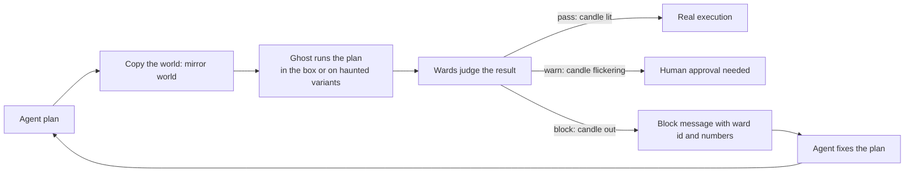

# Ghost Run+: How a ghost run works

The flow of one ghost run, from the plan to the verdict. Part of [Ghost Run+](../README.md).

## How a ghost run works

1. The agent proposes a plan.
2. The runner copies the real state (files, database, or physics scene). Reality is not touched.
3. The ghost runs the plan on the copy: inside a Docker box in real mode, or on the base world and the haunted variants in Ghost Hand.
4. The wards judge the changes and observed events.
5. The candle shows the verdict: `pass` (lit), `warn` (flickering, the host asks the human to allow or deny), or `block` (out).
6. On `pass` the real action runs. On `block` the agent receives the ward id, the numbers, and a seance link, fixes the plan, and rehearses again.
